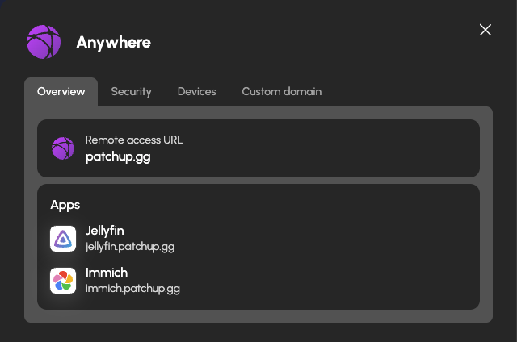

# Introducing HexOS Anywhere

*On Friday, November 13, we launch HexOS Anywhere. Open Jellyfin on your phone from a hotel. Let your parents watch the family videos from their TV. No port forwarding, no VPN app on their device, no rented server to babysit, and your home IP address is never shown to the world.*

{.large .light-only}
{.large .dark-only}

When you set up a HexOS server, the apps on it answer at an address that only works at home. That is the safe default, and it is also the first thing people ask us to change. The question comes up in Discord every week in one form or another: "How do I get to my photos when I'm not home?" or "Can I give my friends access to Jellyfin to watch on their own devices?"

There have always been ways to do it. None of them were good enough to put in front of every HexOS owner. So we built something different. Below, we look at the usual ways to reach your apps from outside the house, how HexOS Anywhere does it differently, and what it costs.

## Common approaches to connecting when self-hosting

{.large .light-only}
{.large .dark-only}

Normally, apps on your network are only available locally. Any device on the internet that tries to connect to your home network is blocked by default, unless you were the one that initiated the connection (like when you visit a website, or connect to an online game). When self-hosting, if you want to allow people (including yourself) who are *outside* your network to connect to apps that are *inside* your network, you essentially have three options:

**Port forwarding** exposes a specific port on your router's firewall. This approach is the most common of the three, but it is by far the least secure. It isn't very intuitive for home users to setup, either. You expose your public (WAN) IP to the world, which port scanners operated by malicious users can discover and probe for vulnerabilities in your exposed services. One unpatched service or a vulnerable software update means that a bad actor could then exploit your home server, potentially gaining control of it and gaining access to other devices on your network as well. On top of that, most home users have to jump through additional hoops to prevent your services from going offline, as most home internet service plans will rotate your public IP address periodically. This means you have to setup dynamic DNS (DDNS) to keep your exposed services available. If you want to expose more than one web service that communicates over a common port like HTTP or HTTPS, you have to go even further and configure a reverse-proxy server like NGINX or Caddy.

**VPN Tunnelling** is a much more secure approach. This is not the same as purchasing a plan from a VPN provider like NordVPN or Proton. With this approach, *you* are the VPN provider, and instead of using a VPN to pretend you're in a different country, you use a VPN to pretend your connected device is on your own home network. There are a few gotchas with this approach too, though. You have to configure the VPN service to run on your own hardware, or configure a service like Tailscale. You still have to use DDNS with a custom domain to ensure that you can consistently connect, and every device that wants to connect to your home network over a VPN has to be capable of installing and running a VPN client. Some devices, like smart TVs, consoles, or computers you don't have full priveleges on (like a public computer or your friend's device) simply won't be able to connect using this method without specialized hardware like a travel router. Oh? You want your non-technical friends who live halfway across the country to setup and configure a VPN client and custom configuration on their device so they can connect? You want to watch Plex on a smart TV at your parent's house? Forget it.

**Running a relay server** is arguably the best option of the three; you hide your public IP address, and a lot of relay software like Netbird or Pangolin has additional security features you can configure to secure individual services and lock them down behind password or even single sign-on (SSO) authentication. This is also one of the most complex approaches to configure, as you have to not only configure software on your own hardware, but also on a server that lives in the cloud.

## Why not run my own relay?

If you want to do this on your own, you need a virtual private server (VPS) that is always on, a domain name to point at it, and the time to set up the proxy, its certificates, its sign-in page, and its updates. Here's a breakdown of everything that's required to get something like this running.

| What you need | How you get it | Cost |
|---|---|---:|
| A cloud-hosted server to act as the relay | Rent a VPS from Vultr or Hetzner with 1GB of RAM (minimum to run Debian 13 and the relay software, and usually includes bandwidth caps) | $60+/yr |
| A domain name | Purchase a domain name from Cloudflare, Namecheap, Google Domains | ~$10-20/yr or more, depending on the name |
| An SSL certificate | Issue a Let's Encrypt cert, which is free, but you then have to prove you own the domain, keep a renewal job working every 90 days, and fix it if it ever expires. A paid certificate skips the babysitting part, but costs extra | $0 to $60 |
| Lots and lots of time | Setup and configuration of Pangolin or Netbird on the VPS, setup of Caddy or NGINX for reverse-proxying your services, configuring security layers like SSO auth and fail2ban, and keeping all of it updated and online. | $??? |

So, the baseline cost to do it yourself is somewhere around $72 a year once the domain and a free certificate are in, and that is before you've even typed a single line of configuration. It is also another server you are now responsible for. If the relay goes down while you are travelling, access to your apps goes with it.

On the topic of configuration, here's a short list of the steps you'd need to take:

<ul style="columns: 2; column-gap: 2rem;">
<li>Rent the VPS.</li>
<li>Buy a domain and point its DNS at the VPS.</li>
<li>Set up SSH keys and a non-root user.</li>
<li>Configure the firewall.</li>
<li>Install Caddy or NGINX.</li>
<li>Configure Caddy or NGINX for each service you want to make available.</li>
<li>Get a certificate issued for the domain(s) you want to use.</li>
<li>Set up the renewal job, and check that it runs.</li>
<li>Build the tunnel from the VPS back to your home server.</li>
<li>Add a sign-in layer in front of every app.</li>
<li>Install fail2ban so brute-force attempts get blocked.</li>
<li>Issue a certificate and test connectivity to each app you host.</li>
<li>Repeat the per-app steps every time you add or update an app.</li>
<li>Keep the VPS patched, forever.</li>
</ul>

How long will all that take? Depends on your expertise and experience. Every app you add goes through the per-app steps again.

## Meet HexOS Anywhere

HexOS Anywhere gives every app on your server its own URL, such as `jellyfin.k7m2p9qa.relay.hexos.com`, with all the security considerations in place and no renewal job to babysit. A visitor can then open that link from any device. The connection goes to a HexOS relay in the cloud, which then forwards the traffic directly to your server through a secure WireGuard tunnel. We leverage a feature called **TLS Passthrough** to ensure that the connection is encrypted end-to-end. We can see the URL that gets requested and a header that tells us what device is trying to connect, but the actual contents of packets sent are secured via HTTPS, and are not decrypted until they arrive at your server. This means we have no way of reading the data that passes through the relay even if we wanted to.

Your router is never touched, and your public IP address is never shown to anyone.

{.medium .framed}

### Turning it on for an app

Open any installed app in the Command Deck and you will find a new Remote Access tab. Flip the switch and the app will be granted a new, secure address that you can use to connect, or copy and send to your friends and family so they can connect to your home server. The first time you do this, HexOS asks you to set a password or a six-digit PIN for your server. That is the gate code: visitors are required to enter this pin or password before they are allowed to access the app. Whether an app sits behind that gate is up to you, although we do recommend leaving it on. The setting is enabled by default for all apps whenever you enable remote access on an app for the first time. An app with a strong login of its own, like Vaultwarden, can have it switched off so your visitors only need to sign-in once instead of twice.

{.medium .framed}

If you're connecting through a web browser, you'll see a login screen that prompts you to enter your pin or password. For phone apps, smart TV apps, consoles, and any other system that can't display a web browser, they'll be blocked initially. However, after they try to login for the first time, those devices will appear in a device list. You can approve systems that you want to allow through without a password on a per-device basis. 

Any device that fails to enter a correct pin or password five times consecutively will be timed-out for 15 minutes. This measure is put in place to help prevent brute-force attacks of your passwords or pin codes.

### You decide who gets in

The Security tab in Settings > Remote access adds two more dials. You can allow only the countries you and your friends connect from, and you can block individual addresses or whole ranges entirely if you detect suspicious activity. Both of these settings are enforced at the *relay* and not *your server*. This means that a bad actor who is blocked by these settings never touches your server at all.

{.medium .framed}

### Bring your own domain

The relay address works out of the box, but if you own a domain and want to use it for your services, you can do that, too! HexOS verifies the domain, takes care of the certificate, and uses the domain for every app on every server you own. The Custom domain tab in Settings > Remote access walks you through the one DNS record it needs.

{.medium .framed}

## Fast enough to stream

Remote access is only useful if the stream keeps up. Some remote solutions put a hard limit on what passes through. Plex, for example, caps remote streaming at 2 Mbps. We set the ceiling for HexOS Anywhere at **10 Mbps per server**. That is enough for a 1080p stream with room to spare, we've started with this cap to ensure that everyone has a smooth experience while we evaluate what real-world usage will look like once it's widely available.

## Web apps first, with more on the way

We started with web-based apps that communicate over HTTP/HTTPS because that is where the majority of the demand is. That being said, the groundwork has now been laid for other kinds of features as well. Virtual machines are next, followed by games.

To be frank, we really, *really* wanted to include games with this release, but unfortunately games tend to use other, lower-level protocols like TCP and UDP to communicate. Forwarding that traffic is not so simple. That being said, we *have* already built a proof-of-concept for forwarding game traffic, too, so you may not have to wait very long!

## What it costs

Everything else in HexOS runs on your hardware. HexOS Anywhere is the one feature that also runs on ours, every day, for as long as you use it. That is why it is the one thing in HexOS with a yearly price.

  
HexOS Anywhere

  
$29

  
per year, per server

Compare that with the $72 a year and a domain you would pay to run a reverse proxy yourself, with nothing to set up and nothing to keep patched.

  
Everything on your server. Anywhere you are.

  
Available Friday, November 13. $29 a year per server, for Lifetime owners.

  
Already own Lifetime? Add it to any of your servers from your account on hexos.com. Buying Lifetime today? It is in the cart beside your license, and you can remove it if you do not want it.

  
<a href="https://hexos.com/anywhere" style="display: inline-block; padding: 12px 26px; border-radius: 999px; background: #fff; color: #7f35b2; font-weight: 700; font-size: 16px; text-decoration: none;">Get HexOS Anywhere</a>

