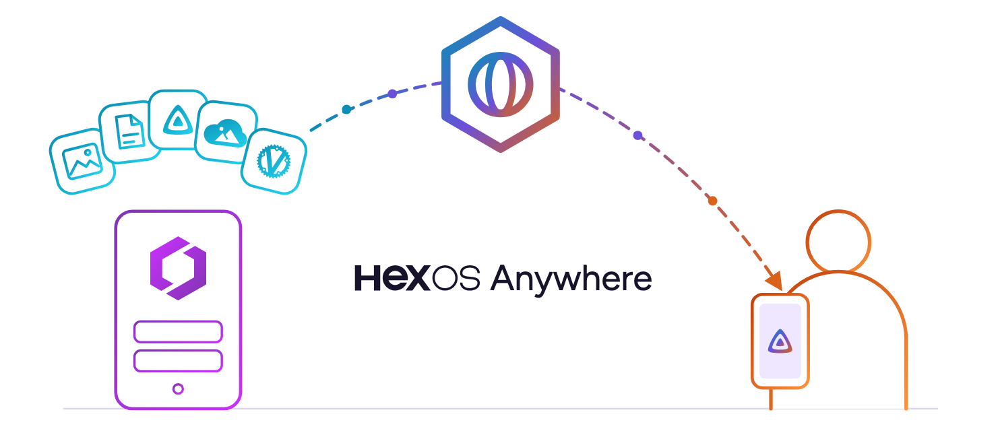
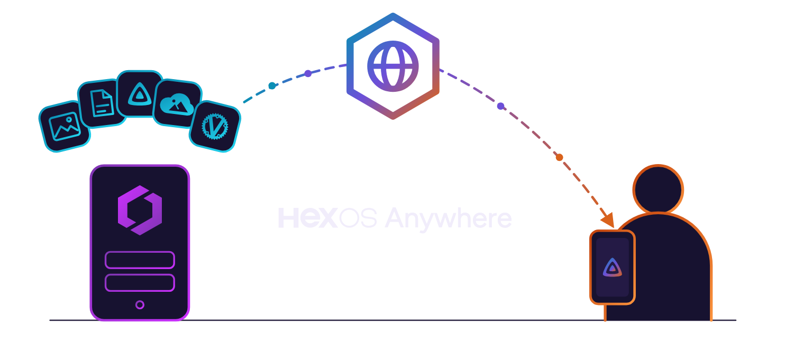
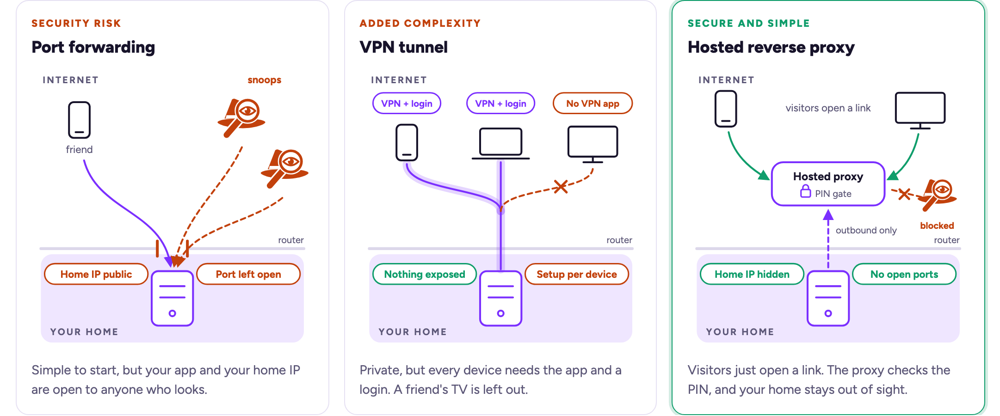
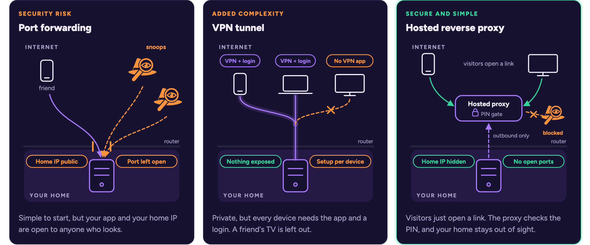
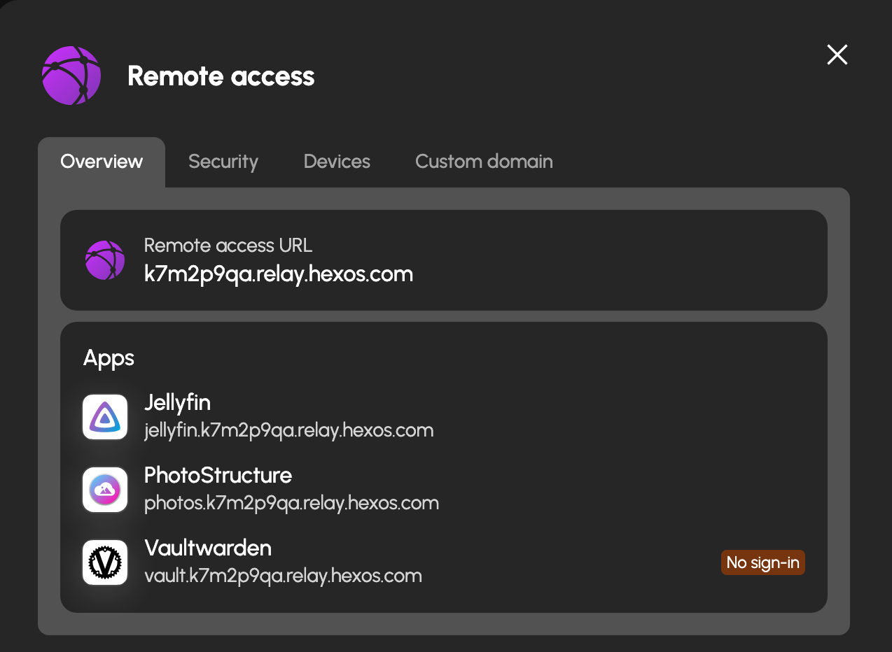
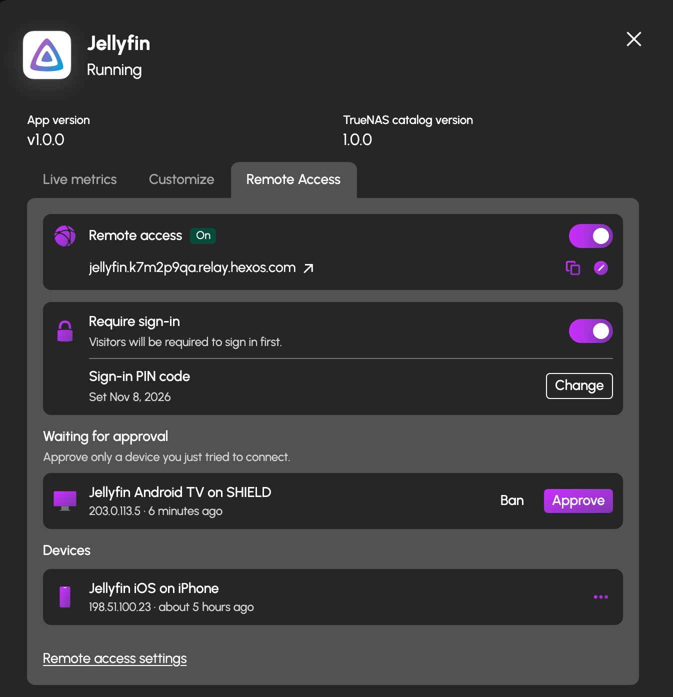
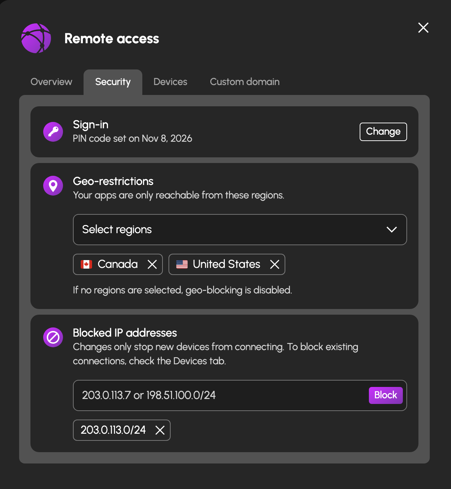
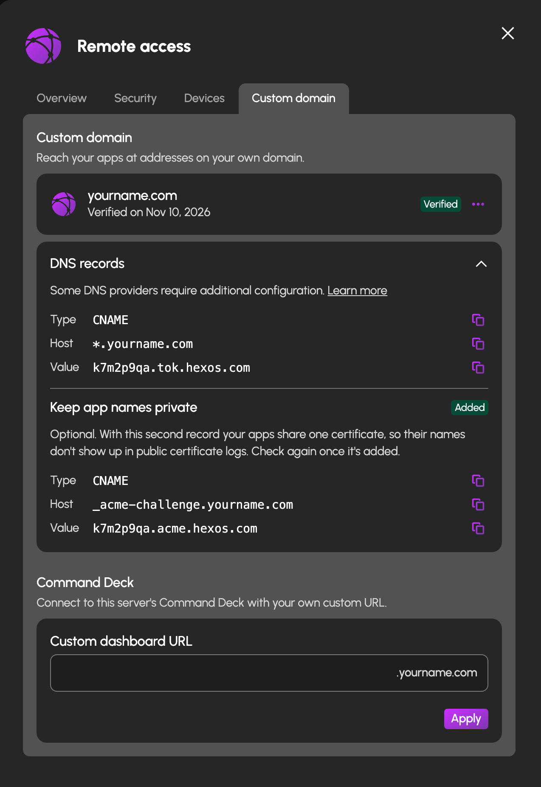

# Introducing HexOS Anywhere

*On Friday, November 13, we launch HexOS Anywhere. Open Jellyfin on your phone from a hotel. Let your parents watch the family videos from their TV. No port forwarding, no VPN app on their device, no rented server to babysit, and your home IP address is never shown to the world.*

{.large .light-only}
{.large .dark-only}

When you set up a HexOS server, the apps on it answer at an address that only works at home. That is the safe default, and it is also the first thing people ask us to change. The question comes up in Discord every week in one form or another: "How do I get to my photos when I'm not home?" or "Can I give my friends access to Jellyfin to watch on their own devices?"

There have always been ways to do it. None of them were good enough to put in front of every HexOS owner. So we built something different. Below, we look at the usual ways to reach your apps from outside the house, how HexOS Anywhere does it differently, and what it costs.

## Common approaches to connecting when self-hosting

{.large .light-only}
{.large .dark-only}

Normally, apps on your network are only available locally. Any device on the internet that tries to connect to your home network is blocked by default, unless you were the one that initiated the connection (like when you visit a website, or connect to an online game). When self-hosting, if you want to allow people (including yourself) who are *outside* your network to connect to apps that are *inside* your network, you essentially have three options:

**Port forwarding** exposes a specific port on your router's firewall. This approach is the most common of the three, but it is by far the least secure. It isn't very intuitive for home users to setup, either. You expose your public (WAN) IP to the world, which port scanners operated by malicious users can discover and probe for vulnerabilities in your exposed services. One unpatched service or a vulnerable software update means that a bad actor could then exploit your home server, potentially gaining control of it and gaining access to other devices on your network as well. On top of that, most home users have to jump through additional hoops to prevent your services from going offline, as most home internet service plans will rotate your public IP address periodically. This means you have to setup dynamic DNS (DDNS) to keep your exposed services available. If you want to expose more than one web service that communicates over a common port like HTTP or HTTPS, you have to go even further and configure a reverse-proxy server like NGINX or Caddy.

**VPN Tunnelling** is a much more secure approach. This is not the same as purchasing a plan from a VPN provider like NordVPN or Proton. With this approach, *you* are the VPN provider, and instead of using a VPN to pretend you're in a different country, you use a VPN to pretend your connected device is on your own home network. There are a few gotchas with this approach too, though. You have to configure the VPN service to run on your own hardware, or configure a service like Tailscale. You still have to use DDNS with a custom domain to ensure that you can consistently connect, and every device that wants to connect to your home network over a VPN has to be capable of installing and running a VPN client. Some devices, like smart TVs, consoles, or computers you don't have full priveleges on (like a public computer or your friend's device) simply won't be able to connect using this method without specialized hardware like a travel router. Oh? You want your non-technical friends who live halfway across the country to setup and configure a VPN client and custom configuration on their device so they can connect? You want to watch Plex on a smart TV at your parent's house? Forget it.

**Running a relay server** is arguably the best option of the three; you hide your public IP address, and a lot of relay software like Netbird or Pangolin has additional security features you can configure to secure individual services and lock them down behind password or even single sign-on (SSO) authentication. This is also one of the most complex approaches to configure, as you have to not only configure software on your own hardware, but also on a server that lives in the cloud.

## Why not run my own relay?

If you want to do this on your own, you need a virtual private server (VPS) that is always on, a domain name to point at it, and the time to set up the proxy, its certificates, its sign-in page, and its updates. Here's a breakdown of everything that's required to get something like this running.

| What you need | How you get it | Cost |
|---|---|---:|
| A cloud-hosted server to act as the relay | Rent a Vultr Cloud VPS with 1GB of RAM (minimum to run Debian 13 and the relay software, also capped at 2TB/mo. of total bandwidth) | ~$60/yr |
| A domain name | Purchase a domain name from Cloudflare, Namecheap, Google Domains | ~$10-20/yr or more, depending on the name |
| An SSL certificate | Issue a Let's Encrypt cert, which is free, but you then have to prove you own the domain, keep a renewal job working every 90 days, and fix it if it ever expires. A paid certificate skips the babysitting part, but costs extra | $0 to $60 |
| Lots and lots of time | Setup and configuration of Pangolin and Netbird on the VPS, setup of Caddy or NGINX for reverse-proxying your services, configuring security layers like SSO auth and fail2ban, and keeping all of it updated and online. | $??? |

So, the baseline cost for one person doing it themselves is somewhere around $72 a year once the domain and a free certificate are in, and that is before anyone has typed a single line of configuration. It is also another server you are now responsible for. If the relay goes down while you are travelling, access to your apps go with it.

Then there is the work. Here's a list of all the steps you'd need to take:

<ul style="columns: 2; column-gap: 2rem;">
<li>Rent the VPS.</li>
<li>Buy a domain and point its DNS at the VPS.</li>
<li>Set up SSH keys and a non-root user.</li>
<li>Configure the firewall.</li>
<li>Install Caddy or NGINX.</li>
<li>Configure Caddy or NGINX for each service you want to make available.</li>
<li>Get a certificate issued for the domain(s) you want to use.</li>
<li>Set up the renewal job, and check that it runs.</li>
<li>Build the tunnel from the VPS back to your home server.</li>
<li>Add a sign-in layer in front of every app.</li>
<li>Install fail2ban so brute-force attempts get blocked.</li>
<li>For each app: a proxy block, a subdomain, a certificate, a test.</li>
<li>Repeat the per-app steps every time you add or update an app.</li>
<li>Keep the VPS patched, forever.</li>
</ul>

How long will all that take? Depends on your expertise and experience. Every app you add goes through the per-app steps again.

## Meet HexOS Anywhere

HexOS Anywhere gives every app on your server its own https address, such as `jellyfin.k7m2p9qa.relay.hexos.com`, with a certificate already in place and no renewal job to babysit. A visitor opens that link from any browser or any app. The connection goes to a HexOS relay in the cloud, which passes it on to your server without opening it. The encryption ends on your server, not on ours, so the relay can see that someone connected and how much data moved, but never what they watched or which files they opened.

Your router is never touched. Your public IP address is never shown to anyone, not to visitors and not to the internet at large.

{.medium .framed}

### Turning it on for an app

Open any installed app in the Command Deck and you will find a new Remote Access tab. Flip the switch and the app gets its address. No proxy block, no DNS record, no certificate to request. The tenth app takes the same five seconds as the first. The first time you do this, HexOS asks you to set a password or a six-digit PIN for your server. That is the gate code: the one thing visitors are asked for before they see anything at all. Whether an app sits behind that gate is up to you. Each app has its own "require sign-in" switch, on by default, and we recommend leaving it on. An app with a strong login of its own, like Vaultwarden, can have it switched off so your visitors sign in once instead of twice.

{.medium .framed}

Browsers get a sign-in page that looks like the HexOS one. Phone, TV and desktop apps cannot show a page, so they wait in a list instead. You approve the ones you recognise with a tap, and ban the ones you do not. Five wrong guesses from one address in fifteen minutes lock that address out for fifteen minutes.

### You decide who gets in

The Security tab in Settings > Remote access adds two more dials. You can allow only the countries your people connect from, and you can block individual addresses or whole ranges. Both are enforced at the relay, so a refused visitor never reaches your server at all.

{.medium .framed}

### Bring your own domain

The relay address works out of the box. If you own a domain, you can point it at HexOS instead, and your apps answer under it: `jellyfin.yourname.com` rather than the relay name. HexOS verifies the domain, takes care of the certificate, and uses the domain for every app on every server you own. The Custom domain tab in Settings > Remote access walks you through the one DNS record it needs.

{.medium .framed}

## Fast enough to stream

Remote access is only useful if the stream keeps up. Some remote solutions put a hard limit on what passes through. Plex, for example, caps remote streaming at 2 Mbps. We set the ceiling for HexOS Anywhere at **10 Mbps per server**, each way. That is enough for a 1080p stream with room to spare, and the cap is there to keep one busy server from slowing the relay for everyone else.

## Apps first, and then more

We started with apps because that is where the demand is. The same relay, the same sign-in gate and the same device approvals are built to carry other things too. Virtual machines are next: reaching a VM's desktop from outside your network through the same address scheme, with the same controls.

One honest caveat. HexOS Anywhere carries web traffic, so an app you open in a browser or a media client works today. Some apps speak other protocols, and game servers are the big example: a Minecraft or Satisfactory server needs its own ports open to the players, and this method does not cover that yet. We are working on a solution for those too, and we will say more as it is ready.

## What it costs

Everything else in HexOS runs on your hardware. HexOS Anywhere is the one feature that also runs on ours, every day, for as long as you use it. That is why it is the one thing in HexOS with a yearly price.

  
HexOS Anywhere

  
$29

  
per year, per server

Compare that with the $72 a year and a domain you would pay to run a reverse proxy yourself, with nothing to set up and nothing to keep patched.

## How to buy

HexOS Anywhere is a subscription on top of your Lifetime licence, $29 a year for each server you want to reach from outside. There are two ways to add it, and both end in the same place.

**From the Command Deck.** Open an installed app, pick the Remote Access tab and flip the switch. If the server does not have HexOS Anywhere yet, the deck says so and offers it right there. A couple of clicks and you are back on the switch.

**From your account.** Sign in at hexos.com and open your account page. Beside each server that holds a Lifetime licence you can add HexOS Anywhere, or buy it with Lifetime at checkout and place it on a server later. Cancel whenever you like and it simply stops renewing.

  <figure style="margin: 0;">
    

Screenshot to capture

<strong>The Command Deck offering HexOS Anywhere</strong>

Remote Access tab on a server without the subscription: the prompt that offers it

    <figcaption style="margin-top: 8px; font-size: 14px; color: var(--hx-muted, #605a6e); text-align: center;">From the Command Deck: flip the switch, and the deck offers HexOS Anywhere for that server.</figcaption>
  </figure>
  <figure style="margin: 0;">
    

Screenshot to capture

<strong>Account page on hexos.com</strong>

A server with a Lifetime licence and the Add HexOS Anywhere control beside it

    <figcaption style="margin-top: 8px; font-size: 14px; color: var(--hx-muted, #605a6e); text-align: center;">From your account on hexos.com: add it beside any server with a Lifetime licence.</figcaption>
  </figure>

The [Remote Access docs](/features/remote-access) cover the details, including how native apps like Jellyfin, Emby and Plex clients are approved, and what the relay can and cannot see. As always, come find us in Discord if something does not work the way you expect.

  
Everything on your server. Anywhere you are.

  
Available Friday, November 13. $29 a year per server, for Lifetime owners.

  
Already own Lifetime? Add it to any of your servers from your account on hexos.com. Buying Lifetime today? It is in the cart beside your license, and you can remove it if you do not want it.

  
<a href="https://hexos.com/anywhere" style="display: inline-block; padding: 12px 26px; border-radius: 999px; background: #fff; color: #7f35b2; font-weight: 700; font-size: 16px; text-decoration: none;">Get HexOS Anywhere</a>

*Prices for DigitalOcean, Vultr, Hetzner and .com renewals were checked on November 10, 2026 from each provider's published pricing and public comparisons. They change often; check the provider before you buy.*
