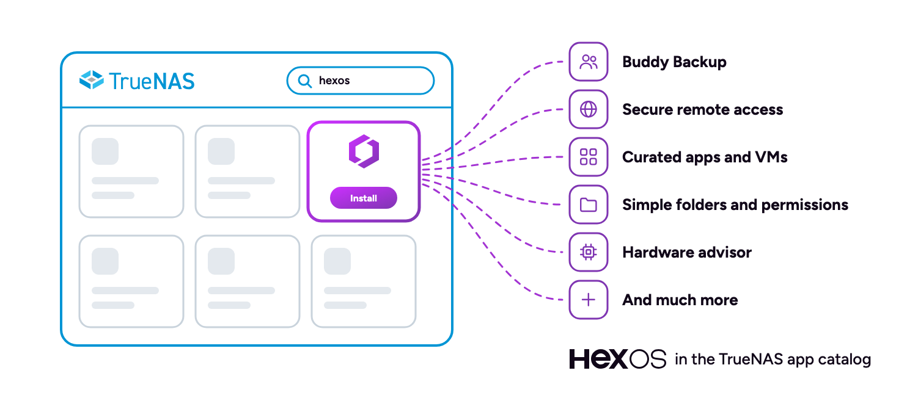
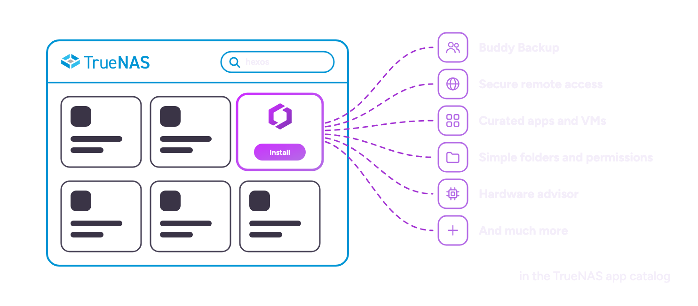
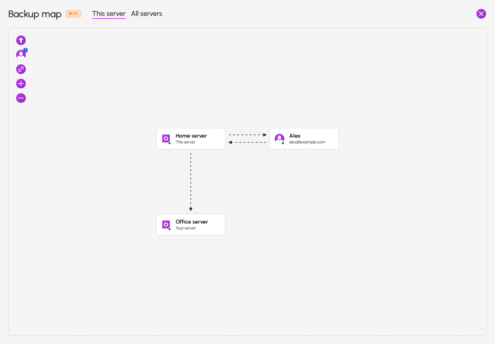
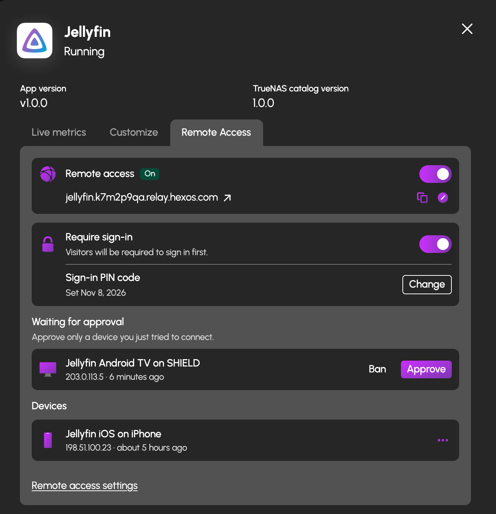
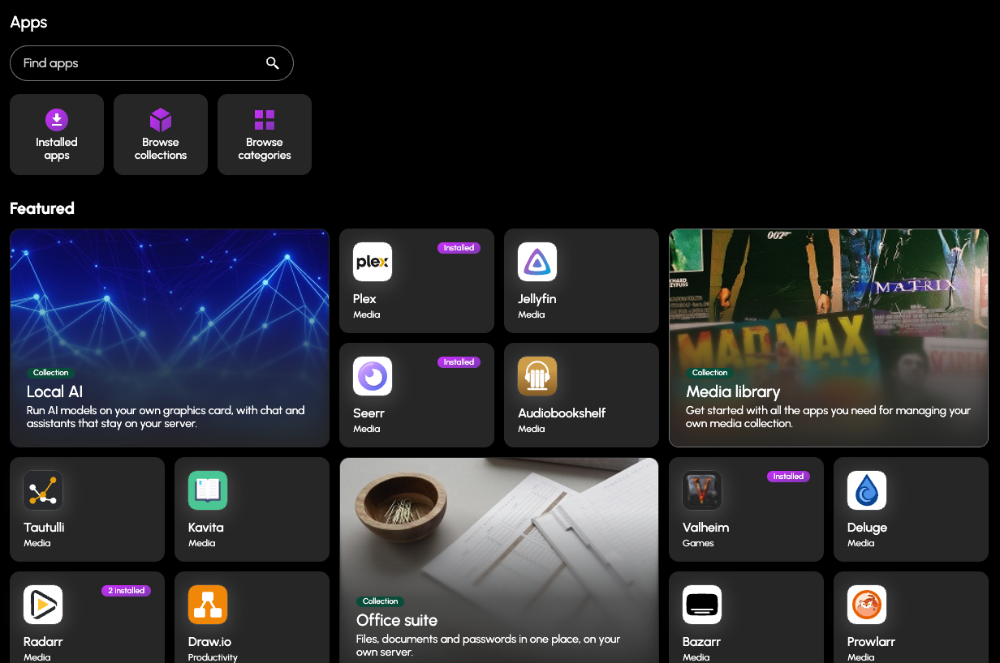
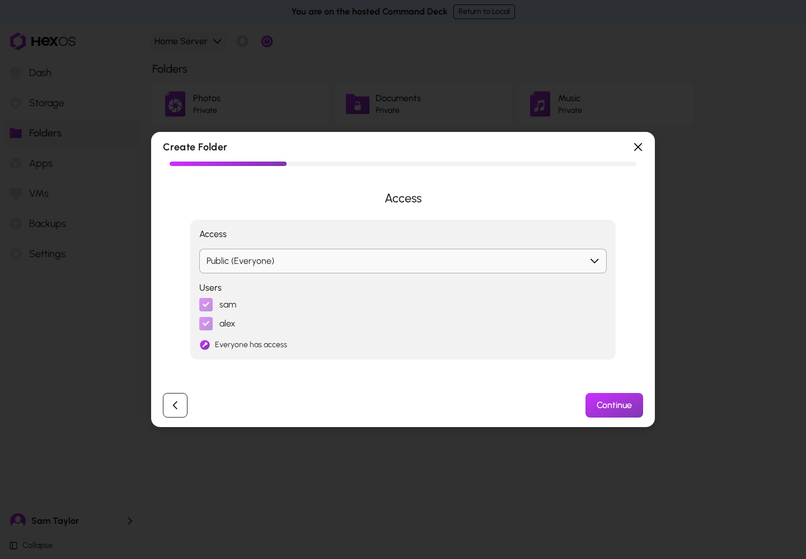
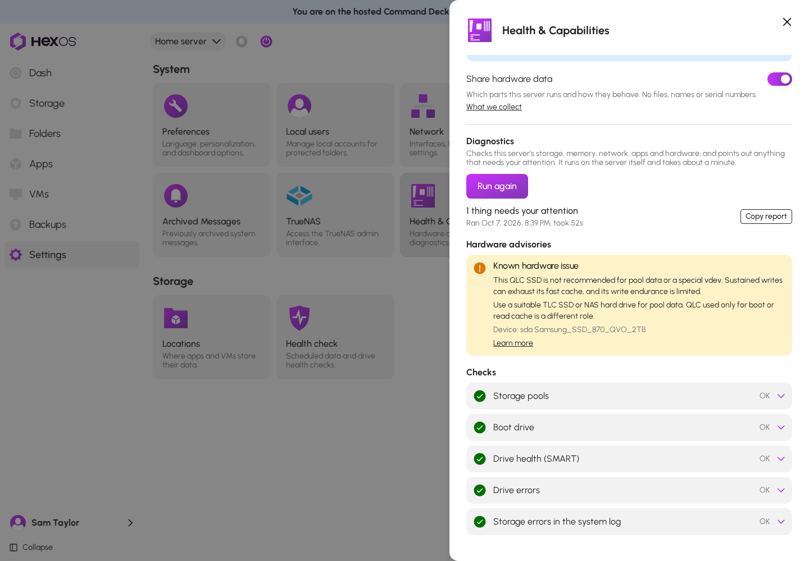
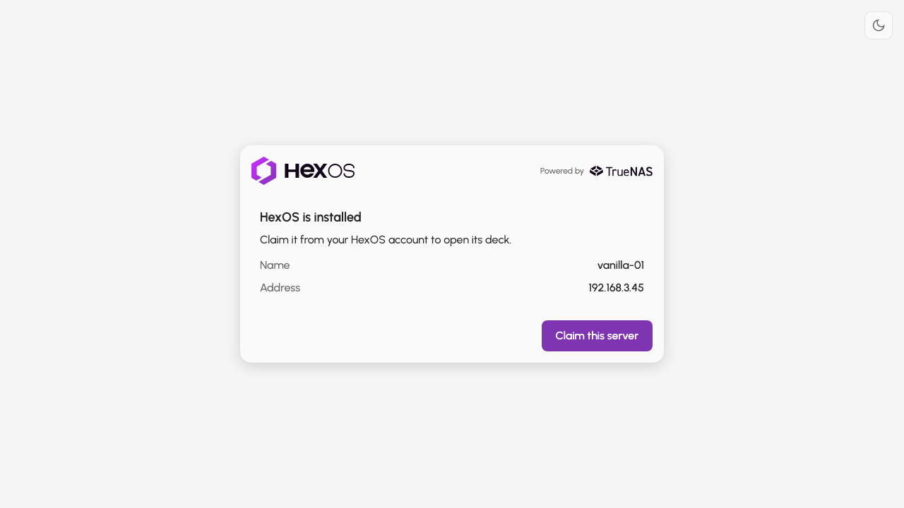
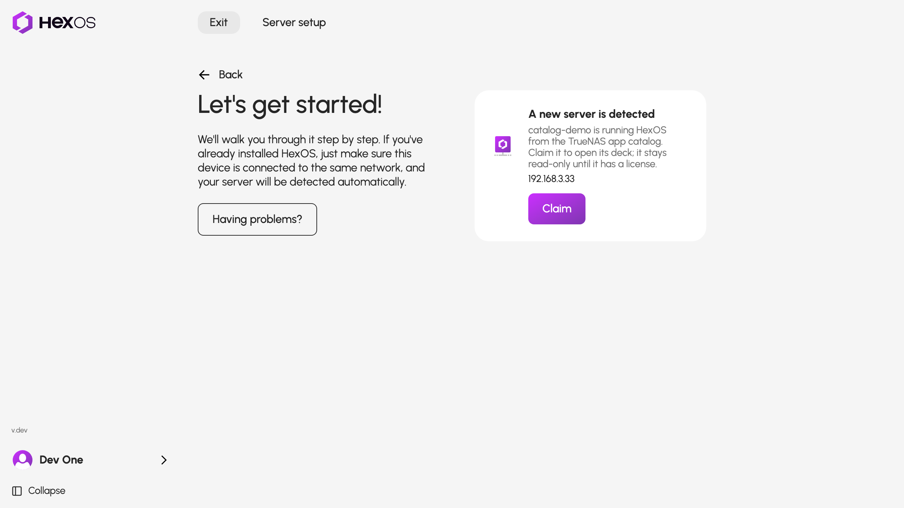
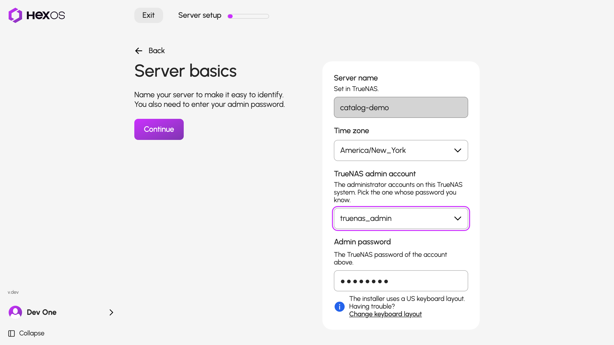

# HexOS Is Now in the TrueNAS App Catalog

*No creating boot media, reinstalling the OS, or recreating your storage pools. Just install the app and claim your server. Your data and configuration remain intact.*

{.large .light-only}
{.large .dark-only}

HexOS has grown up. Since 1.0 shipped in April, we have added Buddy Backup, virtual machines, secure remote access and a full hardware health system, and the foundation underneath all of it has stayed solid. We have reached a level of stability and maturity that we are proud of, and it has opened the door to something we have wanted for a long time: an even closer partnership with TrueNAS.

Here is what that means in practice. Starting today, HexOS is listed in the Community train of the TrueNAS app catalog. If you already run TrueNAS, you no longer need our installer or a fresh start. You add HexOS to the server you have, with a click, and it takes a few minutes. Your pools, shares, users and apps stay as they are, and the full TrueNAS interface stays available whenever you want it.

## Five highlights of what HexOS adds

HexOS adds far more to your server than one post can cover. These are five of the biggest. You can [explore everything HexOS does](https://hexos.com/features) on our features page.

### Buddy Backup

Back up your folders to a friend's or family member's HexOS server, and host theirs in return. Your files are encrypted before they leave your server, so only you can read them. Your buddy hosts the backup. You own it. When you need it, you can restore a single folder or a whole server.

{.medium .framed}

### HexOS Anywhere

Reach the apps on your server from wherever you are. HexOS Anywhere gives each app its own secure address, and you turn it on with a switch. There is no port forwarding to set up, no VPN app to install, and your home IP address is never shown. HexOS Anywhere is an optional add-on.

{.medium .framed}

### Curated apps and virtual machines

Pick from over a hundred curated apps and virtual machines, and click install. HexOS chooses the settings and the storage locations for you, so the app is ready the first time you open it. There is no YAML to write and no paths to map. The apps you already run in TrueNAS show up alongside them.

{.medium .framed}

### Simple folders and permissions

Your shares appear as folders. Each folder shows who can open it and what they can do, in words you can read at a glance. Changing access is a few clicks.

{.medium .framed}

### A health system that watches your hardware

HexOS helps you trust the hardware your files live on:

- **Drive Certification** checks a new or used drive and gives you a report in plain language before you trust it with your files.
- **The Hardware Advisor** matches your exact parts against known problems, so you hear about them before they cause trouble.
- **Memory testing** checks your server's memory for faults, started from the deck.
- **Diagnostics** checks more than twenty parts of your server in about a minute and tells you what needs your attention.

When something does need you, such as a failed drive or a missed backup, HexOS tells you in plain words what happened and what to do.

{.medium .framed}

### And much more

These five are only the start. There is much more to HexOS than we have room for here. [Explore everything else on our features page](https://hexos.com/features).

## What you need

- **A server running TrueNAS 25.04.2.6 or newer.** We recommend TrueNAS 25.10.8 for the best experience.
- **At least one storage pool.** TrueNAS needs a pool before it can install any app, and HexOS is no different.

## How to install it

1. In TrueNAS, open **Apps** > **Discover** and search for "hexos".
2. Click **Install**. There are no options to choose, so click **Install** again on the form.
3. When the app is running, click its **Web UI** button, then click **Claim this server**.

{.medium .framed}

4. Sign in to your HexOS account, or create one. Your server is already found and waiting. Click **Claim**.

{.medium .framed}

5. Under **TrueNAS admin account**, pick an administrator account on your TrueNAS system and enter its password. Click **Continue**.

{.medium .framed}

HexOS finishes the install and opens the Command Deck for your server. Your server keeps the name you gave it in TrueNAS.

## Everything you set up stays where it is

Nothing on your server is wiped, moved or rebuilt. Your pools, datasets, shares, users and apps all stay exactly as you have them.

Your shares appear in HexOS as folders. Your apps appear in HexOS too. One thing to know: a dataset that has no SMB share will not show up as a folder. It is still on your server, untouched, and you can still manage it in TrueNAS.

The same goes for anything advanced that HexOS doesn't manage directly. NFS, iSCSI, S3 and directory services keep running the way they do today. HexOS leaves those settings alone. The full TrueNAS interface is still there, and you can open it whenever you want to change them.

## Look around before you buy

After you claim your server, the whole Command Deck is open to you for free, with your own server, your own folders and your own apps on screen. Go anywhere you like. See how HexOS shows your storage, your drives and your apps, and decide whether it is for you.

Before you buy, the Command Deck does not change your pools, folders or apps. To start making changes and to use everything HexOS offers, your server needs a HexOS license.

Two tools are the exception. Drive Certification and memory testing work in full from the moment you claim your server, with no license and no cost.

## Test your drives and memory for free

Every server depends on two things being sound: the drives that hold your files and the memory that every file passes through on its way there. A weak drive can fail weeks after you fill it. Faulty memory can quietly damage data as it is written, and nothing looks wrong until much later. The right time to find either problem is before you trust the hardware with anything important.

That is why we made these two tools available to everyone who installs the HexOS app, whether or not they ever buy a license.

### Drive Certification

{.medium .framed}

Click a drive in the Command Deck, then click **Test drive**. HexOS starts with a quick check that reads the drive's health information and runs its short built-in self-test. It takes a few minutes and does not touch your files, so it is safe to run on a drive that is already in a pool.

From there, HexOS recommends the next test based on what it found:

- **Thorough test** runs the drive's extended self-test. It does not erase anything, so it also works on drives that are in use.
- **Full test** is for an unused hard drive. It runs the extended self-test, then writes across the entire drive and reads it all back.
- **Burn-in** is the deepest check for an unused hard drive. It writes and verifies four separate patterns across the whole surface.

Full test and burn-in erase the drive, so HexOS guards them carefully. It will not offer them on a drive in a pool, a boot drive or a flash drive. If it finds existing data on the drive, you have to type the drive's serial number before it will begin.

You can close the page while a test runs. The Activity Center shows its progress alongside everything else your server is doing.

When the test finishes, you get a verdict in plain words, such as *This drive passed*, *Don't use this drive*, or *This looks like a cable problem*. That last one matters. A bad cable can make a healthy drive look like a failing one, and HexOS can tell the difference. The measurements behind the verdict are one click away under **Technical details** if you want them.

### Memory testing

{.medium .framed}

A memory test cannot run while your server is busy doing other things, because the test needs the memory to itself. HexOS handles that for you. You start the test from the Command Deck, HexOS restarts your server into the test, and your server comes back with the result when it is done. You do not need to plug anything in or sit in front of the machine.

So even if you never buy a license, install the app and test your hardware. It is the best free thing you can do for your data today.

## If you change your mind

You can remove HexOS at any time. Your pools, shares and apps stay on your TrueNAS system. Features that only HexOS provides, such as Buddy Backup and HexOS Anywhere, stop working once it is removed.

## Why we build on TrueNAS

We are incredibly happy to build our product on the world's most trusted, enterprise-grade, open source storage platform. Being listed in the TrueNAS app catalog is a good moment to say why.

**API.** HexOS manages your pools, shares, users and apps through the TrueNAS API. That API is complete, consistent and well documented. It is the reason HexOS can join a server you set up yourself and work with everything that is already there.

**Reliability.** Businesses have trusted TrueNAS with their data for years. That track record is what lets us tell a family their photos are safe.

**Security.** The TrueNAS team's commitment to security patching is exceptional. When a major CVE is announced, they address it quickly, and that speed says a lot about their professionalism.

**Relationship.** We have frequent calls with TrueNAS leadership, where we share ideas and coordinate our plans. HexOS is better because of that collaboration, and we are grateful for it.

## Get started

If you already run TrueNAS, open **Apps** > **Discover**, search for "hexos", and take a look around. Exploring costs nothing, and neither does testing your drives and memory.

  
Already on TrueNAS? Add HexOS today.

  
Black Friday pricing is live now.

  
Every purchase comes with a 30-day refund policy. If HexOS isn't for you, email support@hexos.com within 30 days and we'll refund you.

  
<a href="https://hexos.com/pricing" style="display: inline-block; padding: 12px 26px; border-radius: 999px; background: #fff; color: #7f35b2; font-weight: 700; font-size: 16px; text-decoration: none;">See Black Friday pricing</a>

