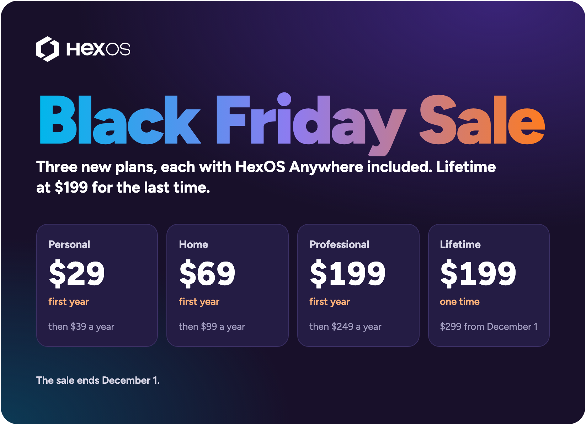
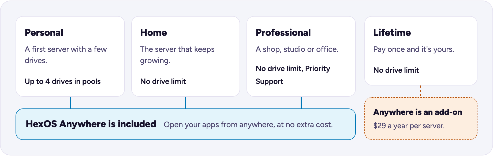
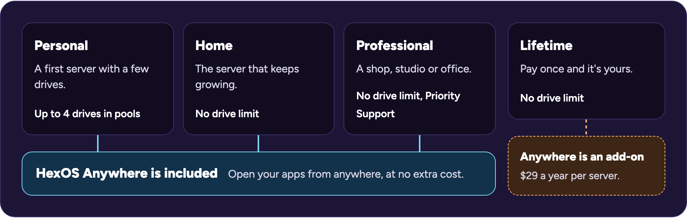
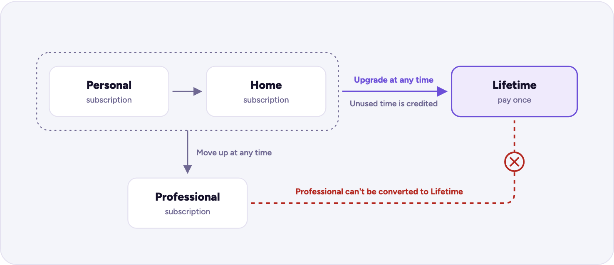
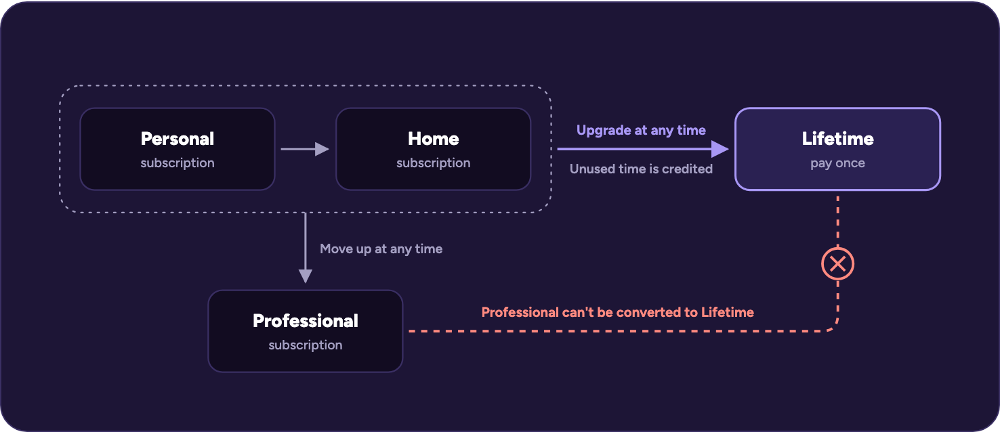

# Black Friday Is Here, With Three New Ways to Get HexOS

*Our Black Friday sale is live now and ends December 1. HexOS Personal, Home and Professional go on sale for the first time, each with a discount on its first year. All three include HexOS Anywhere. Lifetime stays at $199 until the sale ends, then goes to $299.*

{.large}

Since the day HexOS went on sale, there has been one way to buy it: a Lifetime license. That works well for a lot of you. It doesn't fit everyone. Some of you would rather start small on a first server and see how it goes. Some of you run HexOS in a shop, a studio or an office, where people depend on the server for work.

So today we're adding three yearly subscriptions next to Lifetime. To kick them off, each one is discounted for its first year during our Black Friday sale.

## The sale at a glance

| License | Black Friday price | Regular price |
|---|---|---|
| **HexOS Personal** | **$29 for the first year** | $39 a year |
| **HexOS Home** | **$69 for the first year** | $99 a year |
| **HexOS Professional** | **$199 for the first year** | $249 a year |
| **HexOS Lifetime** | **$199, one time** | $299, one time, from December 1 |

The discount on a subscription covers its first year. After that it renews at the regular price, and you can cancel from your account whenever you like. Every license covers one server. Every purchase comes with our 30-day refund policy.

This is also the last stretch for Lifetime at $199. When the sale ends, the price goes to $299.

## Meet the three new plans

The same HexOS runs on every plan: storage, folders, apps, virtual machines, Buddy Backup and notifications. You can install it with our ISO or add it as an app to a TrueNAS system you already run. The plans differ in two places: how many drives you can use, and the kind of support you get.

- **HexOS Personal** is the easy way in, built for a first server with a few drives. It covers up to four drives in pools. The drives can be any size, and they can be hard drives, SSDs or a mix. Spare drives sitting in the case don't count until you use them.
- **HexOS Home** is the same HexOS with no drive limit. It's for the server that keeps growing.
- **HexOS Professional** is for commercial use. It has no drive limit, and it comes with Priority Support, which puts you first in line with our team.

## HexOS Anywhere is included with all three

Two weeks ago we launched [HexOS Anywhere](/blog/2026-11-13), which lets you open the apps on your server from wherever you are. There's no port forwarding, no VPN app to install, and your home IP address is never shown.

For Lifetime owners, Anywhere is an optional add-on at $29 a year per server. With Personal, Home and Professional, it's part of the plan. You don't add anything to your cart and you don't pay anything extra. Remote access works for as long as your subscription is active.

{.large .light-only}
{.large .dark-only}

## Start on a subscription, move to Lifetime whenever you want

Choosing Personal or Home doesn't lock you out of Lifetime. You can upgrade to Lifetime at any time from your account. When you do, we credit the unused time on your subscription toward the Lifetime price, so you don't pay twice for the same months.

You can also move up between subscriptions at any time. Personal can move to Home or Professional. Home can move to Professional. Those changes are prorated to the day you upgrade.

{.large .light-only}
{.large .dark-only}

There are three things to know before you plan on upgrading later.

- **Professional can't be converted to Lifetime.** Professional includes Priority Support, and Lifetime doesn't, so there is no upgrade path from one to the other.
- **An upgrade uses the Lifetime price on the day you upgrade.** Lifetime is $199 until the sale ends and $299 after that.
- **On Lifetime, HexOS Anywhere becomes an add-on.** It's included with your subscription. After you upgrade to Lifetime, you can keep it for $29 a year per server.

## Public Support and Priority Support

Every HexOS license comes with support from our team. There are two kinds, and the license on a server decides which one that server gets.

{.large .light-only}
{.large .dark-only}

**Public Support** is how we've always helped people. You post in our community on Discord and the HexOS team answers in the open. Other owners often jump in too, and the answer is there for the next person who hits the same thing. Because the threads are public, don't post passwords or personal details in them. If we need something sensitive, a staff member will ask for it by direct message.

**Priority Support** is new, and it comes with Professional. You open a private ticket that only you and HexOS staff can see. Your ticket is handled ahead of the public queue. It's the plan to buy when people rely on your server for work.

A few things are the same for both. All support is online and best effort, so we don't promise a set response time on any plan. Priority describes the order we work in. Support covers HexOS itself: installing and setting it up, claiming a server, using the Command Deck, and getting apps from our catalog installed. Support also follows the server. If you want Priority Support for two servers, each one needs its own Professional subscription.

Questions about your account, an order or a refund aren't support tickets. Send those to support@hexos.com on any plan. The full details are in our [Support Terms](https://hexos.com/terms/support).

## If you already own Lifetime

Nothing changes for you. Your license is yours forever, with no renewals and no drive limit. You keep Public Support. HexOS Anywhere stays an optional add-on that you can put on any of your servers from your account.

## If a subscription ends

Your data stays exactly where it is. Installing apps and VMs, Buddy Backup, alerts and support pause until you renew. The TrueNAS interface is always there underneath if you need it.

  
Pick the HexOS that fits your server.

  
Black Friday pricing ends December 1.

  
Every purchase comes with a 30-day refund policy. If HexOS isn't for you, email support@hexos.com within 30 days and we'll refund you.

  
<a href="https://hexos.com/pricing" style="display: inline-block; padding: 12px 26px; border-radius: 999px; background: #fff; color: #7f35b2; font-weight: 700; font-size: 16px; text-decoration: none;">See Black Friday pricing</a>

