# Back up a Mac with Time Machine

Use a private HexOS folder as a network destination for Time Machine. Your Mac and server must be able to reach each other on the network.

> **Thank you:** The HexOS community contributed the original version of this guide.
{.is-contribute}

## Before you begin

Check that the destination has enough free space for the Mac and future backups. Time Machine warns when the selected destination is smaller than its recommended size. Address that warning before relying on the backup.

Keep a backup you already trust until a new backup has finished and you have successfully restored a sample file. Choosing a destination is not proof that a backup succeeded.

## Create the folder in HexOS

1. Open **Folders** in the Command Deck, then click **New folder**. Enter a descriptive name and choose a pool.

 Name and location for the backup folder 

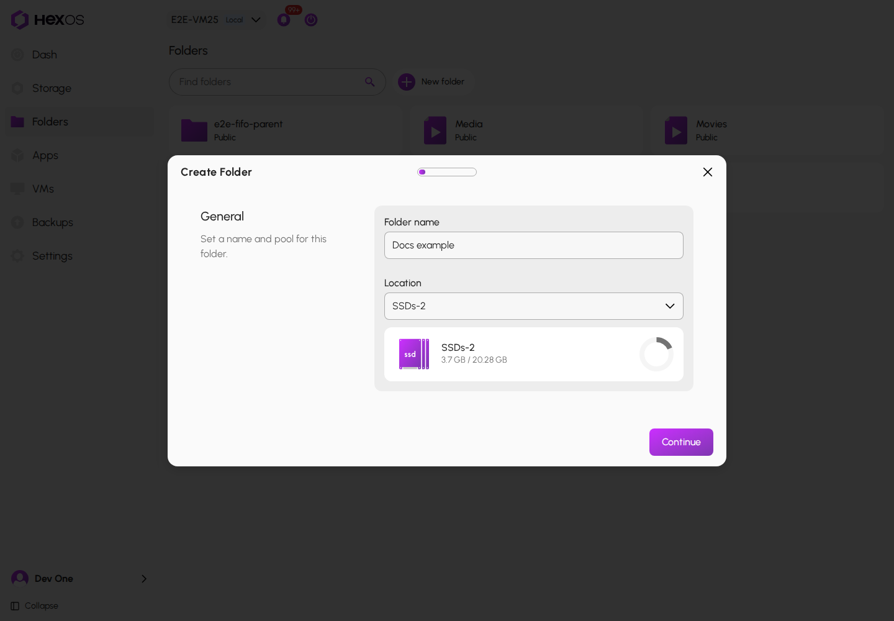{.medium .framed}

2. Click **Continue**. Set **Access** to **Private**. Add a local user with **New user** if needed. Give that user **Full Access** so the Mac can write backups. These are local file-sharing credentials, separate from your HexOS sign-in.

 A private user with Full Access 

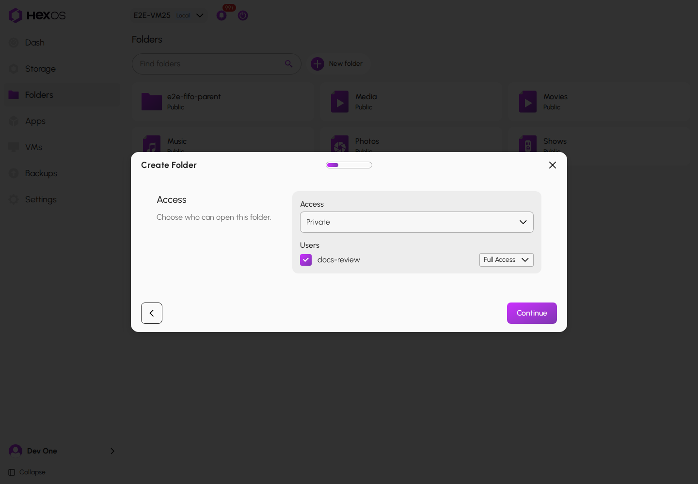{.medium .framed}

3. Click **Continue**. Leave **Everyday files** selected and turn on **Enable Time Machine**. If you set a **Folder storage limit**, allow enough room for the backup and its history.

 Enable Time Machine in the folder options 

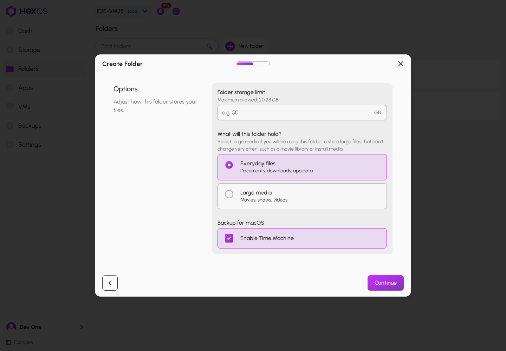{.medium .framed}

4. Continue to **Encryption** and choose the protection the folder needs. Folder encryption protects data on the server; the Mac also offers separate backup encryption below. A folder with a manual passphrase must be unlocked before the Mac can access it. See [Encrypted folders](/features/folders/encryption).

 Encryption choices for the folder 

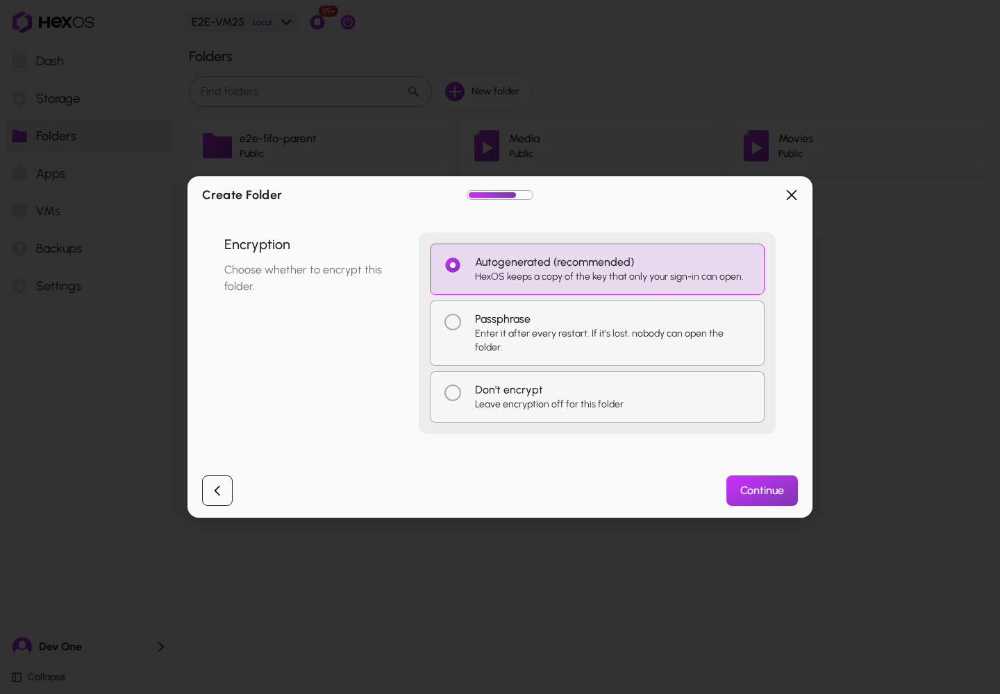{.medium .framed}

5. Review the choices and click **Create**. Open the resulting folder and check **Time Machine enabled** and the user's **Full Access**. This example leaves server-side folder encryption off; choose the protection you need.

 The created private Time Machine folder 

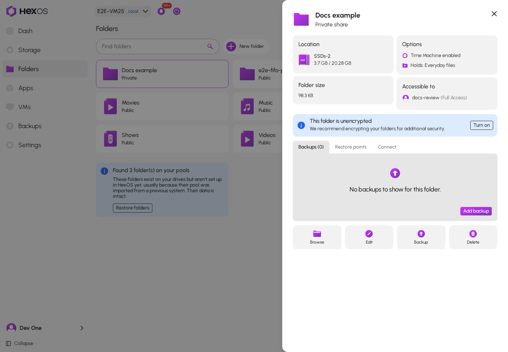{.medium .framed}

You do not need to change the share purpose in TrueNAS when you enable Time Machine through this wizard.

## Choose the destination on your Mac

These screenshots show macOS 15.8.1. Labels can differ on other macOS versions.

1. Open **System Settings** > **General** > **Time Machine**. Click the add button (**+**) below the destination list. If no destination is configured, your Mac may instead offer **Add Backup Disk**.

 Time Machine settings on the Mac 

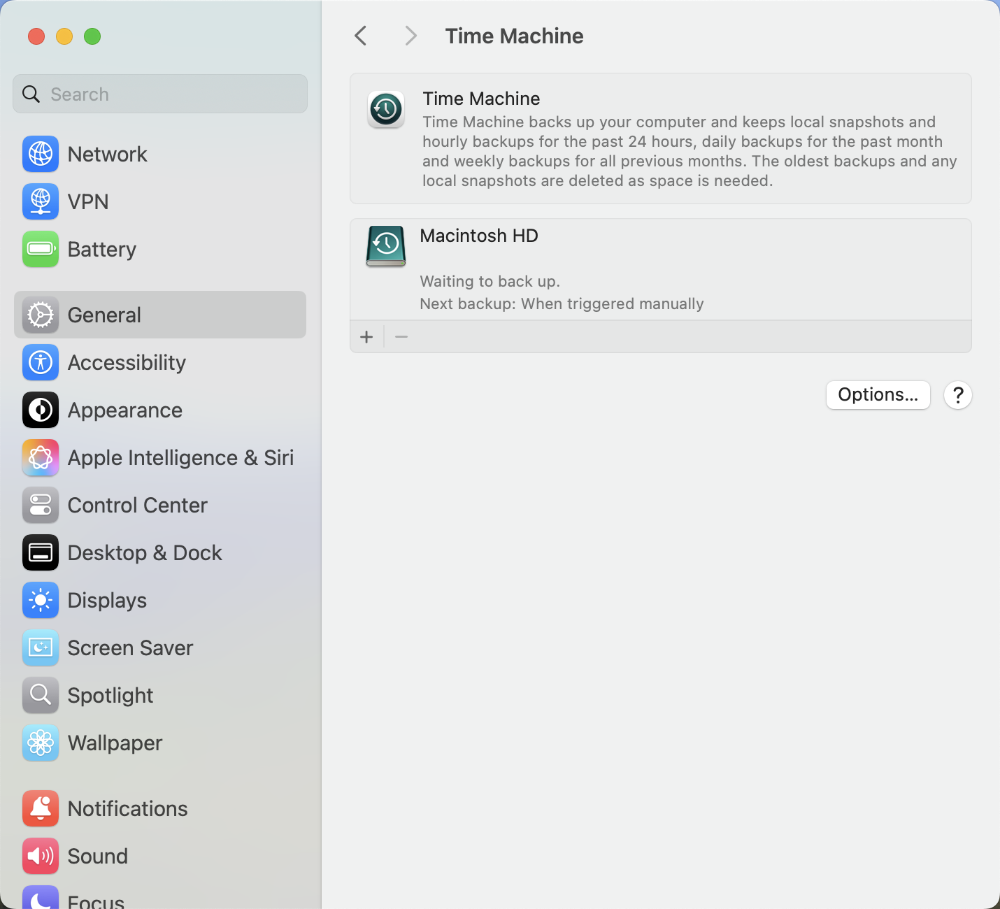{.medium .framed}

2. Click the folder on your HexOS server, then click **Set Up Disk…**. Check both the folder and server names.

 Choose the folder on the correct server 

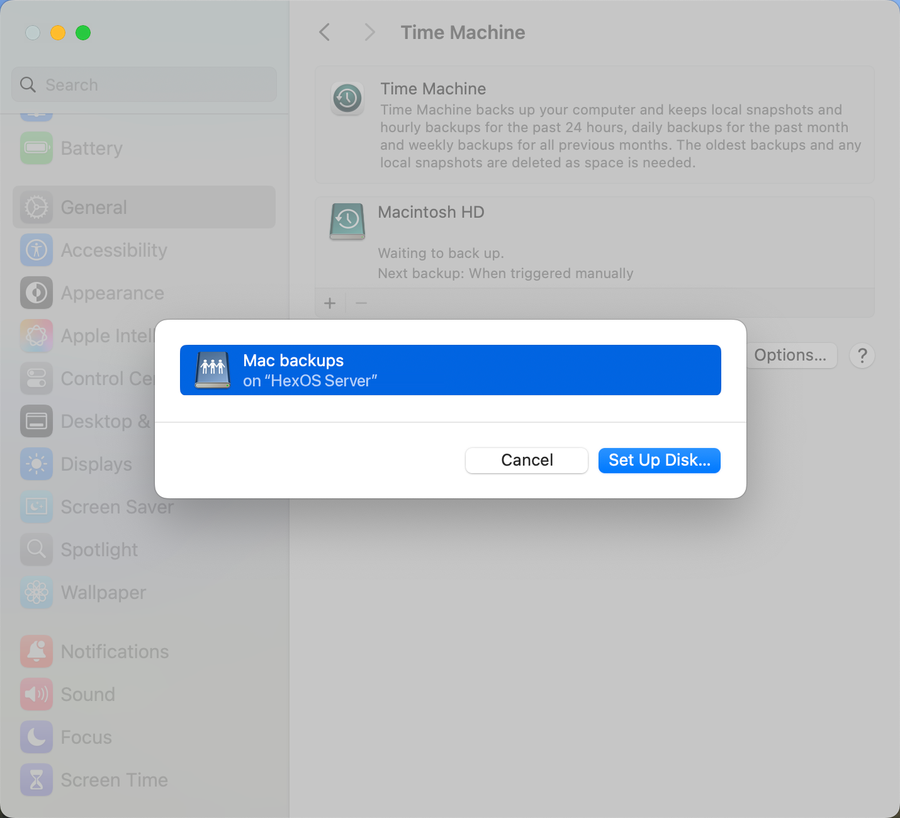{.medium .framed}

3. If macOS asks to connect to the server, click **Connect**. Choose **Registered User** and enter the local username and password that you gave **Full Access** in HexOS. Click **Connect**.

 Sign in with the folder's local user 

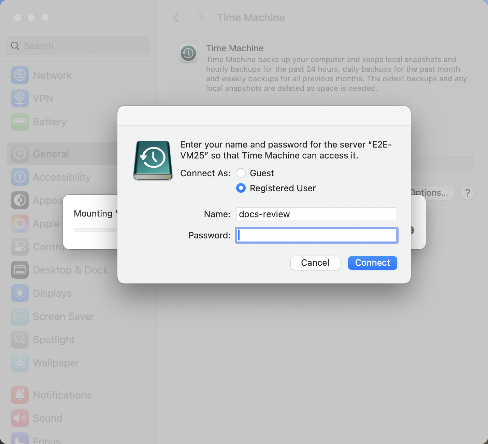{.medium .framed}

4. Review **Encrypt Backup** and **Disk Usage Limit**. If you enable backup encryption, enter and confirm a password and keep it somewhere safe. This password is separate from the folder's local-user password and any HexOS folder-encryption passphrase.

 Backup encryption and usage limit 

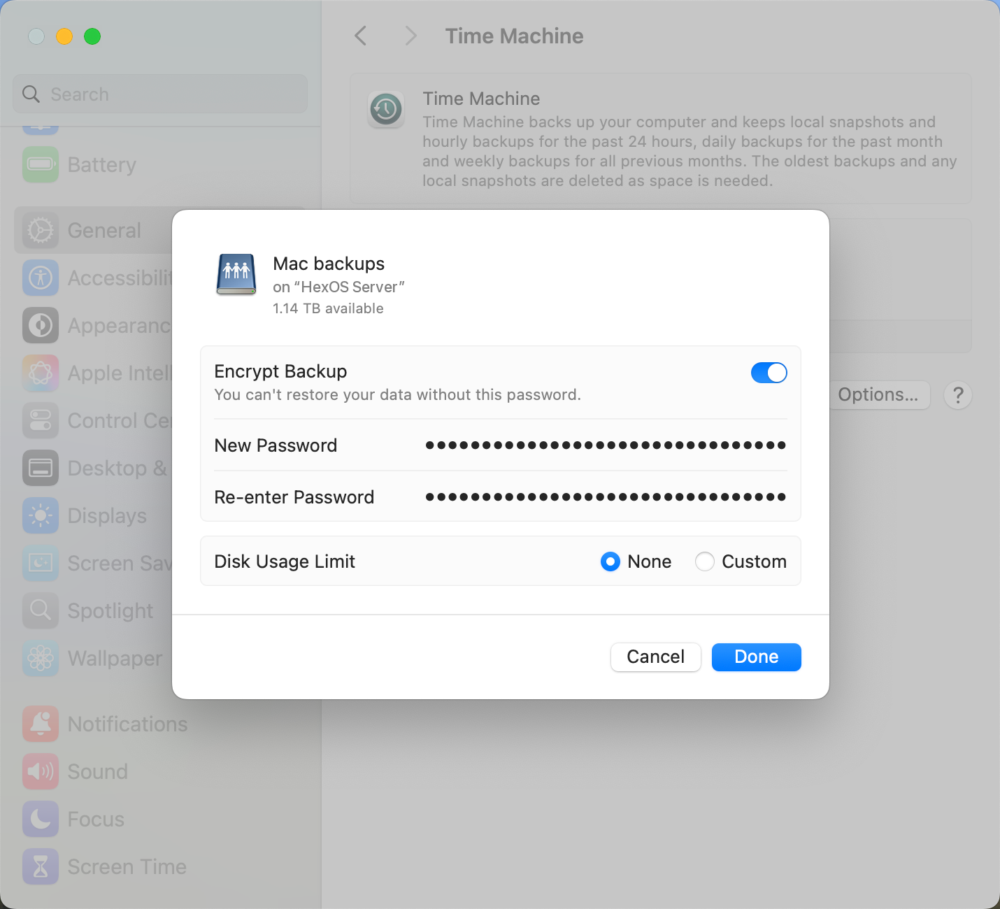{.medium .framed}

> **Warning:** If Time Machine warns that the destination is too small, choose a larger destination or increase the folder storage limit before continuing. Do not treat an accepted setup as a completed backup.
{.is-warning}

> **Danger:** Without the backup-encryption password, you cannot restore that encrypted Time Machine backup. HexOS does not recover this Mac-side password.
{.is-danger}

## Finish and verify the backup

After resolving capacity warnings and checking the chosen options, click **Done**. Follow [Apple's Time Machine instructions](https://support.apple.com/en-us/104984) to start a backup if one is not already running.

Keep **Time Machine** settings open to check the chosen destination. While the backup runs, its row shows a progress bar and how much has been copied. The example below is still copying; it is not a completed backup.

 The encrypted backup is still copying 

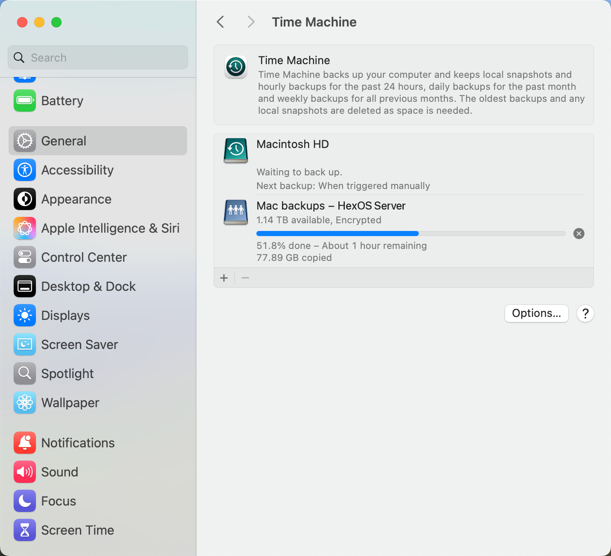{.medium .framed}

Wait for the destination to show a completed backup date. In this example, **Only backup** shows when the first backup finished. The destination also shows **Encrypted**. A progress bar alone does not establish that the backup completed.

 A completed encrypted backup on the HexOS server 

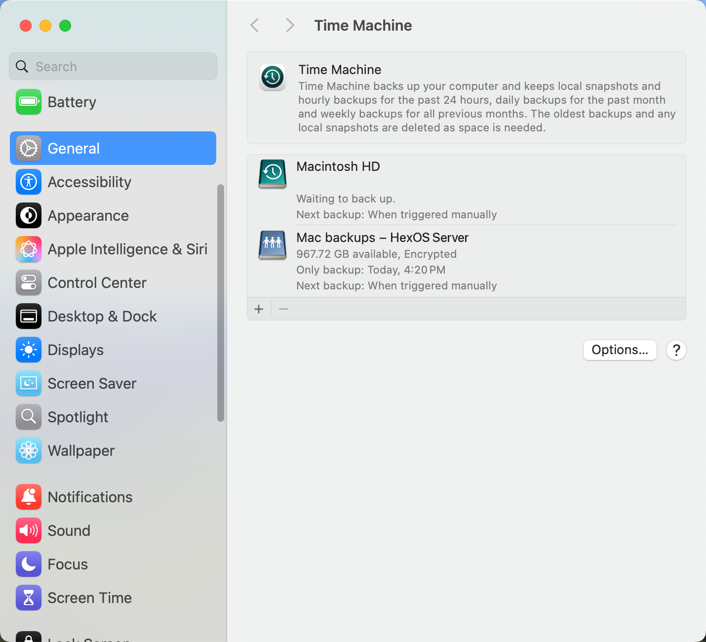{.medium .framed}

## Restore a sample file

Choose a small file that was included in the completed backup. Keep its original so you can compare the recovered copy. A file created after that backup will not be in it.

1. In **Finder**, open the folder containing the sample. Use **Command-Space** to open Spotlight. Type `Time Machine`, then open the **Time Machine** result marked **Applications**. This opens the backup browser for the folder you were viewing.

 Open the Time Machine application from Spotlight 

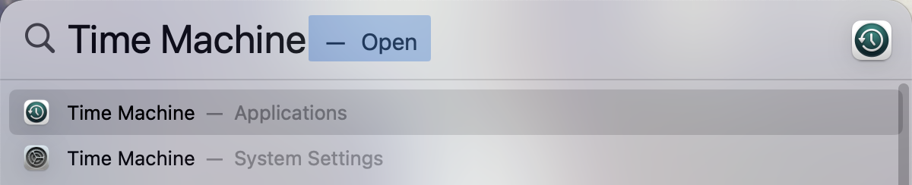{.medium .framed}

2. Use the upward arrow beside the window to move to an earlier backup. Check the displayed date, then click the sample file and **Restore**. The example uses the completed backup shown in settings above.

 Select the sample in the completed backup 

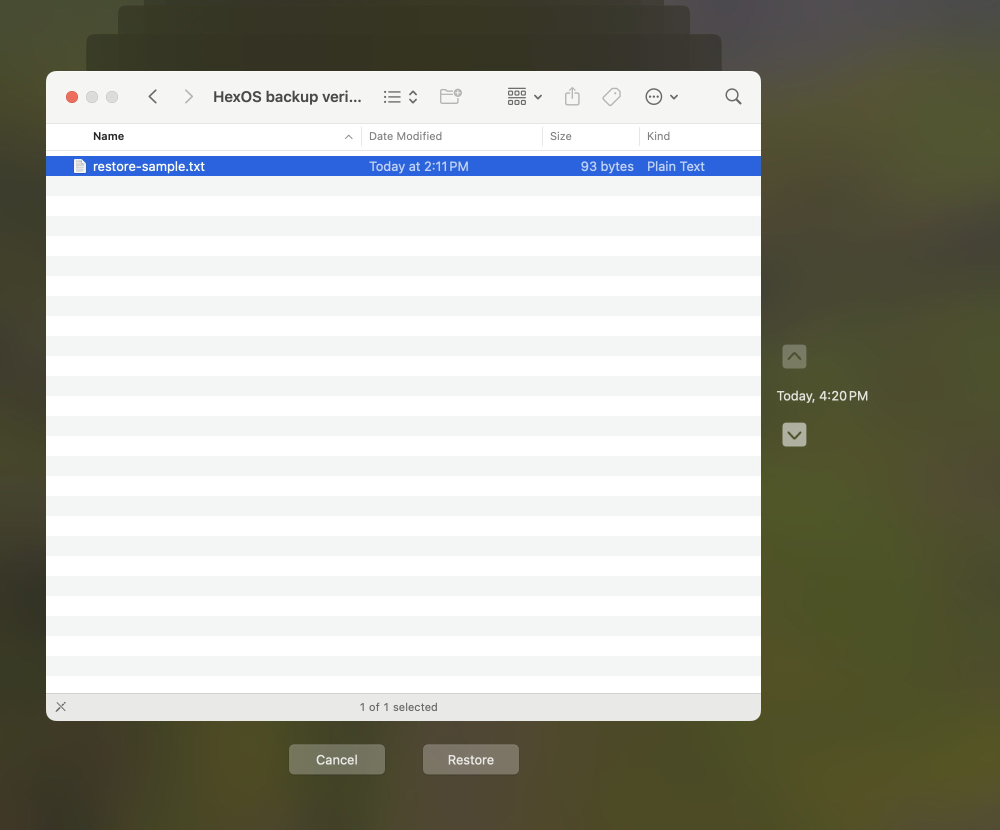{.medium .framed}

3. If the original still exists, click **Keep Both** when macOS asks about the matching name. This retains the original and adds the recovered copy. Do not click **Replace** for this comparison.

 Keep the original and the recovered copy 

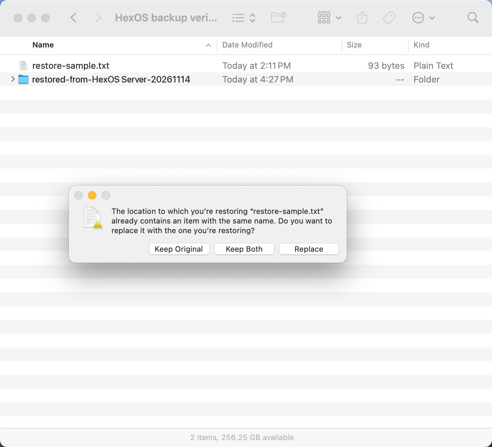{.medium .framed}

4. In **Finder**, click the recovered file and use the **Space bar** to preview it. Check its contents against the original. In this example, macOS added **(from backup)** to the recovered file's name.

 Preview the recovered sample beside its original 

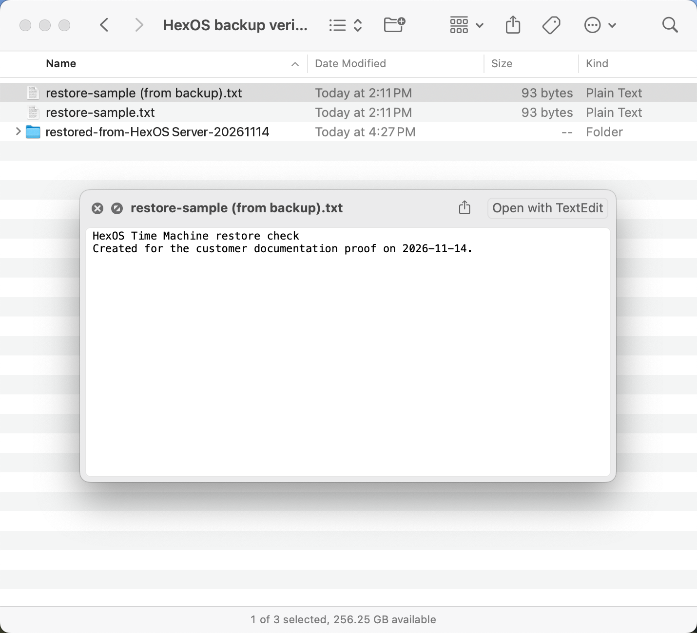{.medium .framed}

The test above completed an encrypted backup and recovered a matching sample on macOS 15.8.1 with TrueNAS 25.10.8. It does not test recovery of an entire Mac. Apple describes additional [Time Machine recovery options](https://support.apple.com/en-us/guide/mac-help/mh11422/mac).

## Keep backups available

Keep the server online and the folder unlocked when backups run. Adding the share to Login Items is not part of the tested setup above and does not prove that a backup completed.

For a folder that does not appear, first check that **Enable Time Machine** remains on and that the Mac can reach the server. See [access folder contents](/features/folders/how-to-access-folder-contents) for network connection steps. Apple also lists [supported Time Machine backup disks](https://support.apple.com/en-us/102423).

> **Contribute:** to help to improve HexOS documentation [join the #Docs channel on Discord](https://discord.com/invite/DjEp3WRHKz) today! Send feedback, suggestions or contribute a guide.
{.is-contribute}
