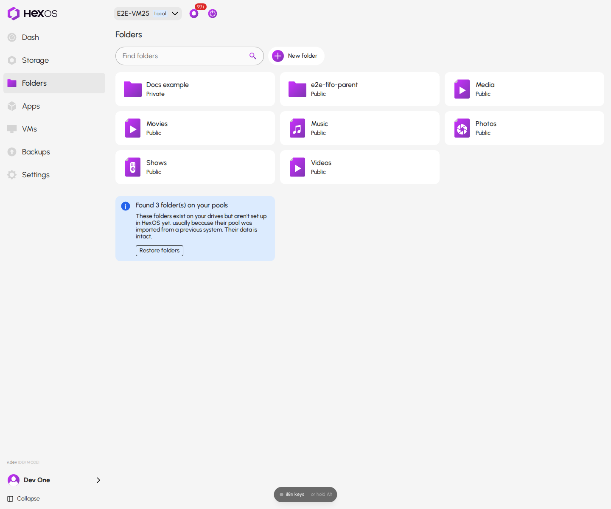
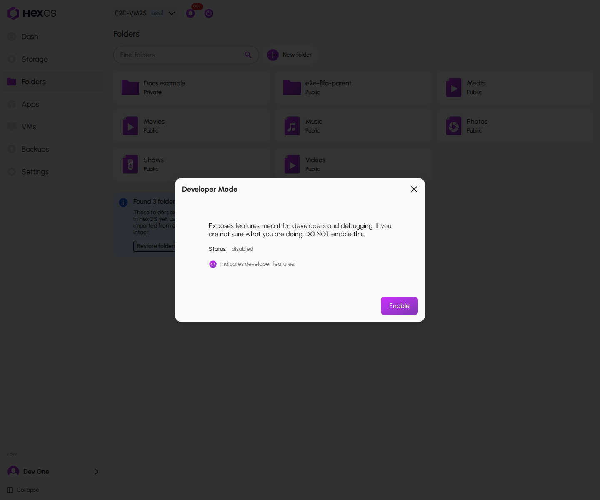
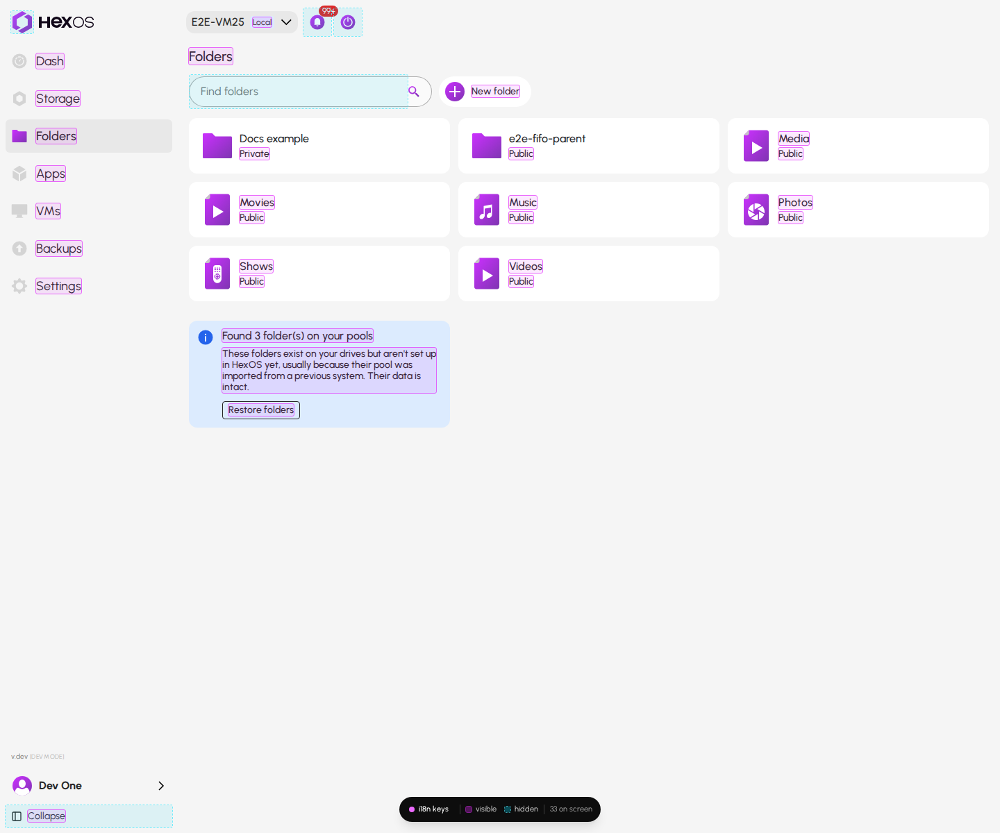
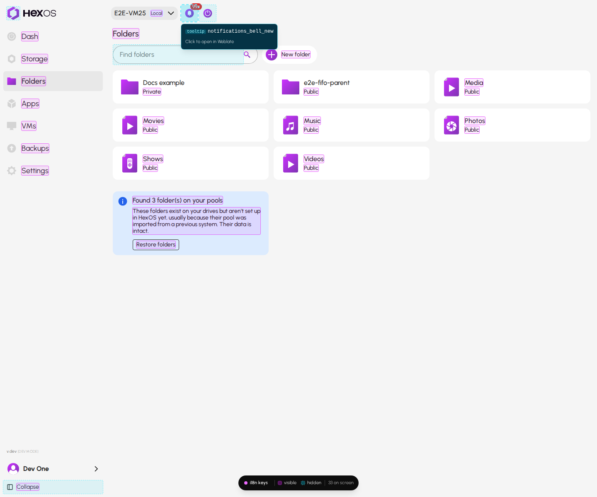
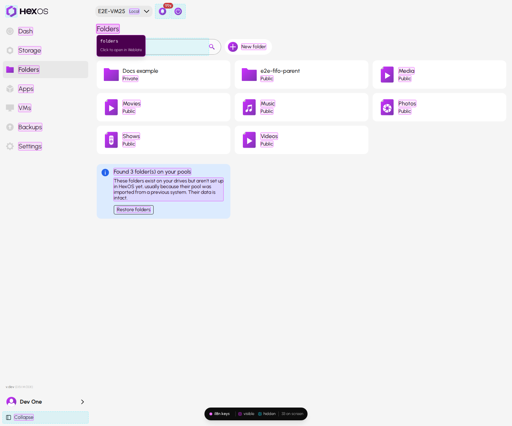

# Find a translation key

Short labels can appear in several places in the Command Deck. The key inspector helps identify the translation key for the text you are looking at.

Switch it on and point at translated text to see its key. Click the outline to open the matching Weblate entry. If the inspector reports a text-only match, check the result before editing it.

## Turning on developer mode

The inspector lives behind developer mode.

Find the version number at the bottom of the sidebar, or on the **Settings** screen. Click it 10 times within five seconds. The **Developer Mode** dialog opens: click **Enable**.

The version number now has **[DEV MODE]** next to it.

 Sidebar footer with developer mode enabled 

{.medium .framed}

To leave developer mode, click the version number 10 times again and click **Disable**.

 The Developer Mode dialog 

{.medium .framed}

> **Info:** Developer mode is saved to your account, so it follows you between browsers and devices. It does not change anything about how your server runs.
{.is-info}

## Switching on the inspector

With developer mode on, a small control appears at the bottom of every screen.

 The i18n keys control 

{.medium .framed}

There are two ways to look at a screen:

- Hold **Alt** (**Option** on a Mac) for a quick look. The outlines appear while you hold the key and disappear when you let go.
- Click **i18n keys** to keep the outlines on while you work through a screen. Press **Escape** to switch them off again.

Every translated string on screen is outlined. The control also shows how many strings are on the current screen.

 Folders screen with translated strings outlined 

{.large .framed}

## Reading the outlines

There are two kinds of outline:

| Outline | Means |
|---|---|
| Solid pink | Text you can read on screen |
| Dashed blue | Text that is in the page but not shown on screen |

Dashed blue outlines cover the strings that are easy to miss: screen reader labels, image descriptions, input placeholders, and tooltips. These usually sit directly on top of the label they belong to, so the different outline is what tells them apart.

Hover over an outline to see the key. For text that is not shown on screen, the inspector also names where the text lives, such as **aria-label** or **tooltip**.

 Key for a toolbar tooltip 

{.medium .framed}

An outline can hold more than one key. The inspector lists up to six, then tells you how many more there are.

## Opening a string in Weblate

Click any outline to open that string in Weblate, already filtered to the right key and set to the language you are using in HexOS.

 Key for text on screen 

{.large .framed}

## When the inspector is not sure

Sometimes a key is shown with this note:

> Matched on text alone — may not be the key in use

This means the inspector recognized the English text but could not confirm which key produced it. Treat those keys as possibilities rather than answers. This happens most often with text that was already on screen before the inspector started watching, and reloading the page usually solves it.

## What the inspector cannot find

A few strings do not get outlined:

- Text built from several strings joined together in one line
- Text that is changed after translation, such as a label that is converted to capital letters
- Tooltips, while the outlines are switched on. The outlines sit above the page, so a tooltip cannot open underneath one. To see the key for a tooltip, hover over it first, then hold **Alt** without moving the mouse.

Anything hidden behind a dialog or a menu is left out on purpose, so the inspector never draws outlines through the window on top.

> **Tip:** If you find text that reads badly and the inspector cannot name it, report it anyway. Post it in the [HexOS Discord Community](https://discord.gg/fCW2htvYdz) with a screenshot and the name of the screen, and the team can find it for you.
{.is-tip}

> **Contribute:** to help to improve HexOS documentation [join the #Docs channel on Discord](https://discord.com/invite/DjEp3WRHKz) today! Send feedback, suggestions or contribute a guide.
{.is-contribute}
