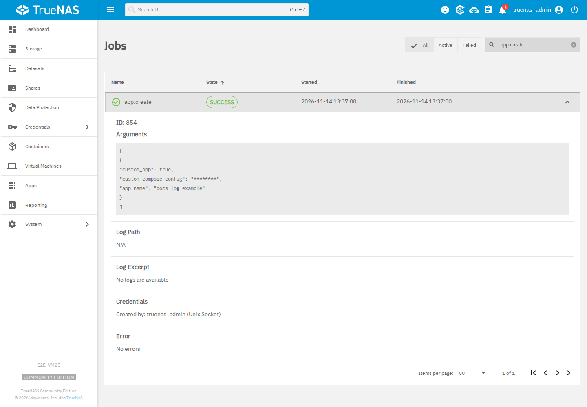
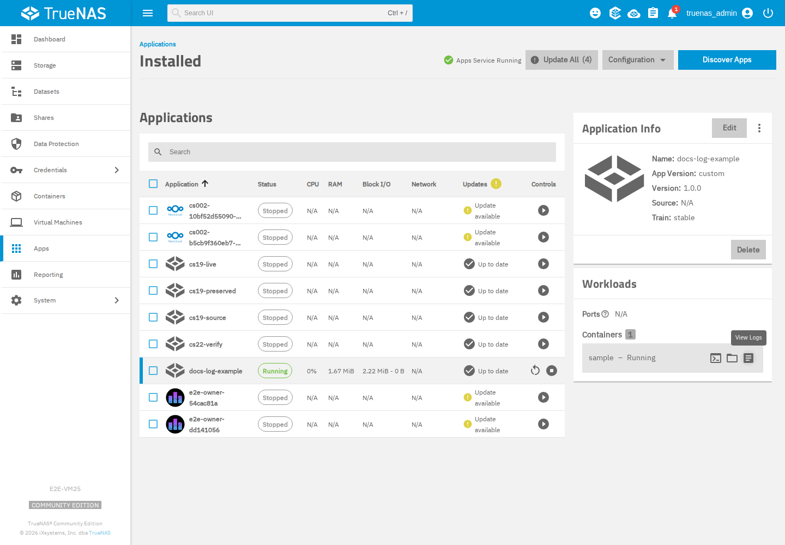
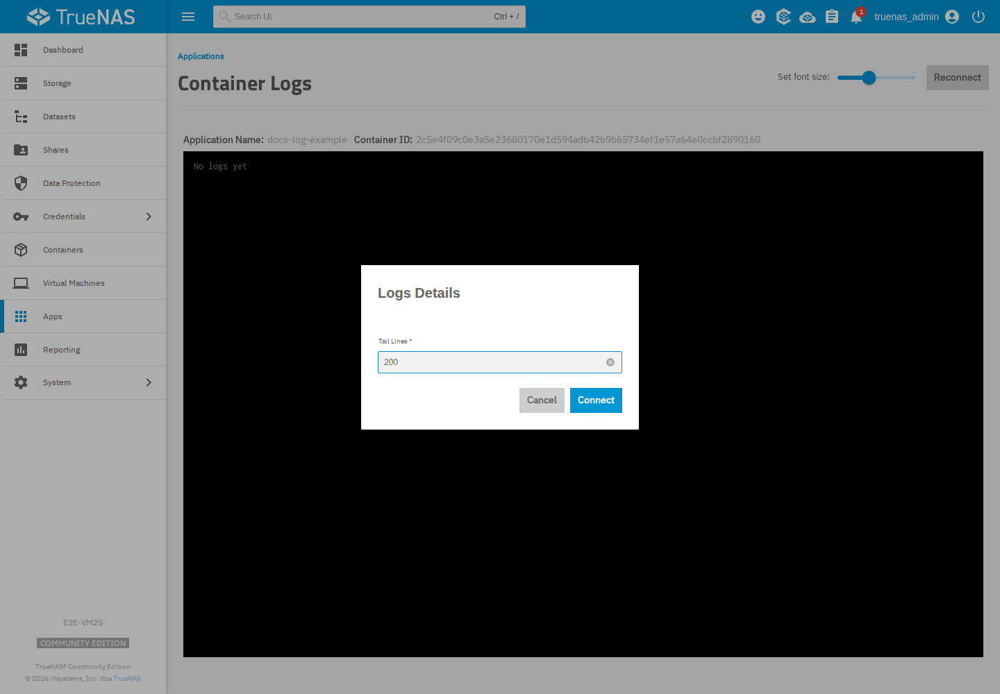
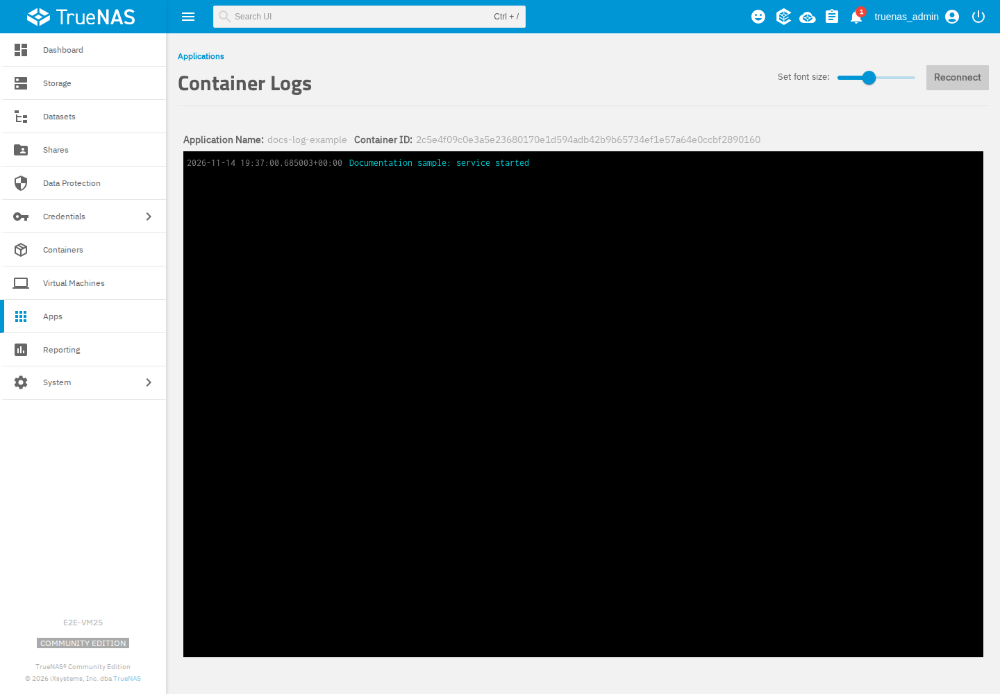
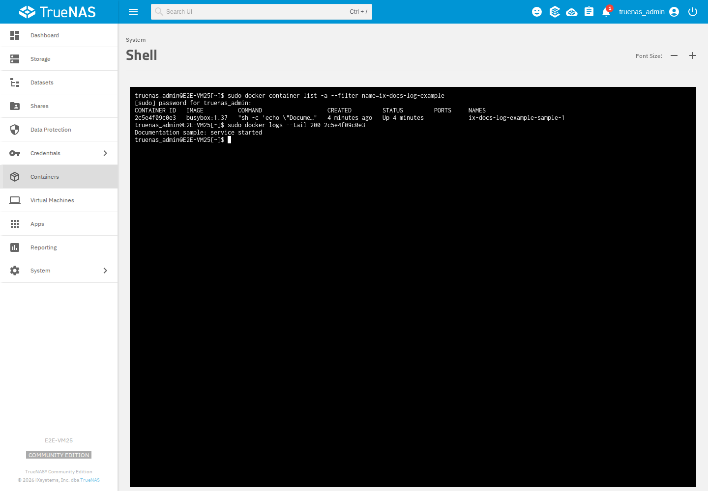

# Troubleshoot an app installation

Start with the failure shown in HexOS. Keep the full error text, app version and install-script version so you can identify the operation that failed.

## Check the failed task

Open the bell and check **Jobs** for the installation. Read the failed task and any child hook steps. Check the error before retrying; an app may have been partly installed even if a later hook failed.

**Retry** usually starts the failed hook again. A script using `awaitCheckpointRetry()` can retry its failed step without restarting the whole hook, but the script must implement that retry. **Skip**, when offered, continues without completing that hook or checkpoint. Check what the skipped hook was meant to configure before using the app.

Before-stop hooks have a shorter save window. They can delay the requested stop while saving, but a failure or timeout does not cancel it. See [Hooks reference](/features/apps/install-scripts/reference/hooks#before-stop-limits).

## Check a TrueNAS job

If the HexOS error does not explain the failure, open your server's TrueNAS interface from **Settings** > **TrueNAS**. Use the server's own address; the address and whether it uses HTTP or HTTPS depend on your installation.

Click the **Jobs History** icon at the top, then **Go to Jobs Page**. Find the matching installation or update job. Read its error details. Match the app name and operation instead of assuming the newest failed job is the one you need. Click the job row to expand its details.

 An expanded sample app creation job 

{.medium .framed}

## Read app logs

In TrueNAS, open **Apps**, then the installed app. Under **Workloads** > **Containers**, use **View Logs** for the container that failed. An app can have several containers, including its database.

 Find View Logs beside the container 

{.medium .framed}

In **Logs Details**, enter the number of **Tail Lines** to read, for example `200`. Click **Connect**.

 Choose how many log lines to read 

{.medium .framed}

Read the resulting **Container Logs** screen. The sample below shows a successful startup message; a failing app will have different output.

 Log output from the sample app 

{.medium .framed}

If the container has stopped or the interface does not provide its logs, open **System** > **Shell** in TrueNAS. Run `sudo docker container list -a` to list containers. Identify the exact app and container before continuing.

Copy its container ID, then run `sudo docker logs --tail 200 CONTAINER_ID`, replacing `CONTAINER_ID` with that ID. This reads the last 200 log lines. It does not change or restart the container. If `sudo` asks for your password, enter your TrueNAS administrator password; the terminal does not show its characters.

 Read logs for the sample container in Shell 

{.medium .framed}

The screenshot filters the container list to the sample app. Use your own container ID, not the ID in the picture.

> **Warning:** Logs can contain private information. Remove passwords, tokens and personal data before sharing them. Keep an unchanged private copy for your own troubleshooting.
{.is-warning}

## Common causes

| Problem | What to check |
|---|---|
| App is not ready | Confirm that `waitForApp()` uses the right endpoint, expected status and polling options before increasing the hook timeout. |
| App cannot be reached | Check the configured port and listening address. Confirm the endpoint belongs to this app. |
| OAuth or another input did not finish | Read the task's prompt and retry the input flow when offered. |
| Missing input | Compare the script's `inputs` declarations with the values the hook reads. |
| Missing directory | Check the configured base location and `ensure_directories_exists` entries. |
| Invalid app configuration | Compare `app_values` with the installed app version's TrueNAS schema. |
| Hook function not found | Match `entrypoint` to the exported async function in the hook script. |

### Permission errors

Identify the exact path and the user and group required by that app's current container. Compare the directory declaration with the current catalog script. An `owner` declaration belongs on an app-owned directory.

Do not copy another app's database owner or change ownership across a shared folder. A user and group used by one PostgreSQL app are not a general prescription for all PostgreSQL containers. See [Directory creation, ownership and snapshots](/features/apps/install-scripts/reference/schema#directory-creation-ownership-and-snapshots).

## Ask for help

Include the app name, TrueNAS version, app and script versions, the action you took and the full error with private values removed. Explain whether the app installed, whether any containers are running and which check failed.

Use the [HexOS Discord Community](https://discord.gg/fCW2htvYdz) for help. For a catalog-script change, follow [Contribute an app install script](/features/apps/install-scripts/contributing).
