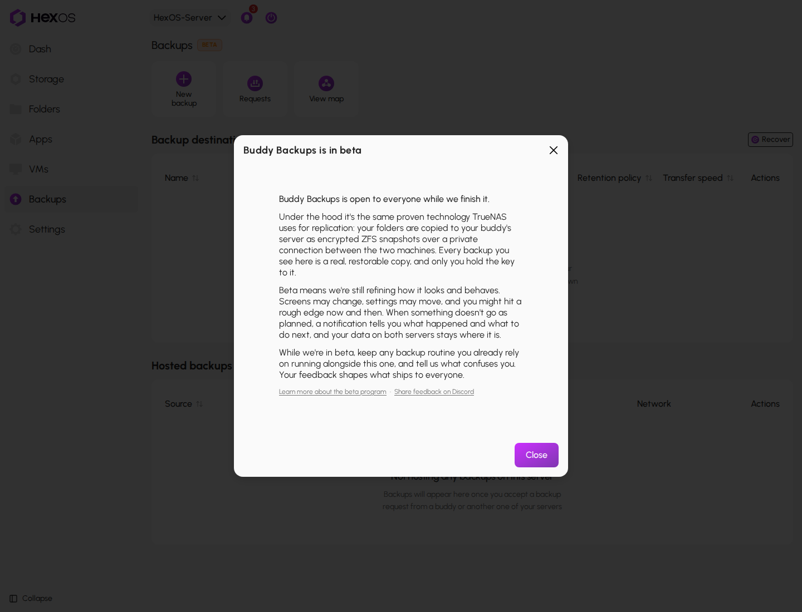
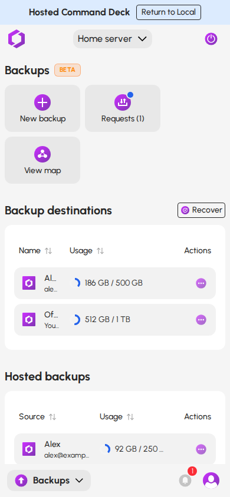

# Buddy Backups

> **Info:** Buddy Backups is in beta and requires access to the Buddy Backups feature. Keep an independent backup you already rely on while testing it. See [what beta means](/features/backups#what-beta-means).
{.is-info}

Buddy Backups keeps a copy of your most important folders on another server. That server can belong to a friend who also runs HexOS, or it can be a second server of your own. Check the feature access available for your server before setting up a connection.

Folders you send to a buddy are encrypted. Your files sit on their server, but they cannot open them.

## What beta means

Buddy Backups is in beta. Feature access and a connection to HexOS services are required. The Command Deck shows a **Beta** badge next to **Backups**. Click it to read a short note about the beta.

> **Info:** Some wording in the current beta note is too broad. Feature access is required. Wait for a completed backup and test a restore before relying on it. With managed recovery, HexOS can recover your key while you are signed in. Confirmed removal can delete stored copies. Retention settings can remove older restore points.
{.is-info}

 The Beta badge's note 

{.medium .framed}

What this means for you:

- **Your backups are real.** A completed backup provides restore points you can restore. Wait for the first transfer to finish, and test a restore before relying on it.
- **We are still finishing it.** Screens may change, settings may move, and you may find a rough edge now and then.
- **Check the activity center** for progress and operation results. Read the result of each operation. Confirmed removal and retention settings can delete stored copies and restore points.
- **Keep your current backup.** If you already have a backup you rely on, keep it running alongside Buddy Backups while it is in beta.
- **Tell us what confuses you.** Your feedback shapes the finished version. Share it in the [HexOS Discord Community](https://discord.gg/fCW2htvYdz).

### Known issues

We know about these and are working on fixes. This list changes as fixes ship.

- **Folders restored before restores asked who can open them are open to everyone on your network.** Restores now ask, but a folder restored before then came back with no password. If you restored a folder before then, set who can open it. See [Restore a folder](/features/backups/restore-a-folder#after-it-finishes).

## Why it exists

A redundant pool can protect against a drive failure. A pool that only stripes data across several drives does not provide that protection. It does not protect you from something that takes out the whole server:

- A fire, a flood, or a power surge
- Theft of the server
- Ransomware that encrypts every file the server can reach

An independent copy in another building helps protect against losing the whole server. Many people pay a cloud service for that. Buddy Backups uses spare space that you and your buddy already own instead.

## How it works

1. You choose the folders to protect and where the copy goes: a buddy's server or another server you own.
2. HexOS connects the two servers over a private, encrypted link. You do not need to change anything on your router.
3. On the schedule you choose, your server saves a restore point of each folder and sends it. The first backup copies everything. After that, each backup sends only what changed.
4. Each backup becomes a restore point on the other server. You can restore the newest one, or an older one from the time you chose to keep them.
5. A folder sent to a buddy must be encrypted. It stays encrypted on their server, and they cannot open it.

> **Info:** For a folder with an autogenerated key, managed key recovery can unlock a restored folder while you are signed in. A folder protected by a manual passphrase still needs that passphrase. If you chose to keep the recovery key yourself, HexOS asks for it once when you recover onto a new server. You can view your key in **Settings** > **Recovery key**. See [Recovery keys](/features/folders#recovery-keys).
{.is-info}

If you want the technical details, see [How Buddy Backups works](/features/backups/how-it-works).

## What you give and what you get

**You give** space on your server for your buddy's encrypted copy, and you keep your server running. You choose how much space. HexOS sets that space aside on your pool, so their backup cannot grow past it and your own files cannot take it.

**You get** the same in return: an offsite copy that updates on a schedule, restore points to go back to, and a way to rebuild onto a new server if yours is lost.

**You rely on** your buddy keeping their server running. Either of you can remove the connection, and removing it deletes the stored copy. For anything you cannot replace, keep a second destination.

## What you need

- **Buddy Backups feature access and a connection to HexOS services.**
- **Two servers running HexOS.** Yours and a buddy's, or two of your own.
- **Encrypted folders** for anything you send to a buddy. You can [turn on encryption for a folder](/features/folders#turning-on-encryption) at any time, even after it is created. Backups to your own server can include any folder.
- **Both servers online** while the backup is set up.
- **Your buddy's HexOS email**, if you back up to a buddy.

## Where to find it

Click **Backups** in the sidebar. The **Backups** page lists the backups this server sends and the backups it stores for others. The dashboard also has a **Backups** section with one card for each place this server backs up to.

The **Backups** page also works in your phone's browser.

 The Backups page on a phone 

{.small .framed}

## Compression

Backups are stored compressed. The space used depends on the files, compression and retained restore points; it is not guaranteed to be smaller than the current files alone.

A backup's **Quota** card shows the space in use as "1.8 GB of 20 GB": how much the copy uses, out of the space set aside for it. The used space includes stored data and older restore points, so do not compare it directly with the size of your current files.

How much smaller a copy gets depends on the files. Photos and videos are already compressed, so they shrink very little. Documents and other text often shrink a lot.

When you set up a backup, HexOS suggests how much space to ask for. The suggestion is based on the space your folders take on your pool, plus room to grow.

## What Buddy Backups is not

- **It is not a long-term archive.** Restore points are kept for the time you choose: 1 week, 2 weeks, 1 month, or 3 months. It protects you from a disaster or a recent mistake, not from something deleted a year ago.
- **It does not restore single files.** You restore a whole folder as a folder, then take what you need from it.
- **It is not a sync service.** Your files do not appear on other devices, and changes on one server do not change the other.
- **It does not replace a healthy pool.** Keep your drives healthy. A backup is your second copy, not your first.

## Where to go next

| I want to… | Guide |
|---|---|
| Set up my first backup | [Set up a backup](/features/backups/set-up-a-backup) |
| Store a backup for a friend | [Host a buddy's backup](/features/backups/host-a-buddys-backup) |
| Change what is backed up, how often, or how fast | [Manage your backups](/features/backups/manage-your-backups) |
| Get a folder back | [Restore a folder](/features/backups/restore-a-folder) |
| Rebuild after losing a server | [Recover a failed server](/features/backups/recover-a-failed-server) |
| Know what each removal deletes | [Removing backups](/features/backups/removing-backups) |
| Understand a notice or fix a failed backup | [Backup troubleshooting](/features/backups/troubleshooting) |
| Read the technical details | [How Buddy Backups works](/features/backups/how-it-works) |
