# Manage your backups

> **Info:** Buddy Backups is in beta and requires access to the Buddy Backups feature. Keep an independent backup you already rely on while testing it. See [what beta means](/features/backups#what-beta-means).
{.is-info}

A backup looks after itself once it is set up. This page shows where to find your backups and how to change them: which folders, how often, how fast, and how much space.

## Find your backups

Click **Backups** in the sidebar. The **Backups** page shows the server you are viewing. It has two tables:

- **Backup destinations**: the places this server's folders are backed up to. Columns: **Name**, **Usage**, **Folders**, **Schedule**, **Retention policy**, **Transfer speed**, and **Actions**.
- **Hosted backups**: the backups this server stores for your other servers or a buddy. Columns: **Source**, **Destination**, **Usage**, and **Actions**.

Click a row to open that backup. Above the tables are **New backup**, **Requests**, and **View map**.

 The Backups page 

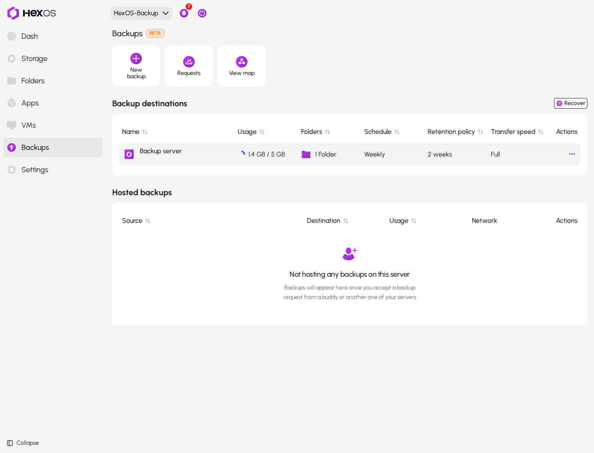{.medium .framed}

The dashboard also has a **Backups** section, with one card for each place this server backs up to. Each card shows how much of the space is used and how many folders it holds. Click a card to open that backup.

 The Backups section on the dashboard 

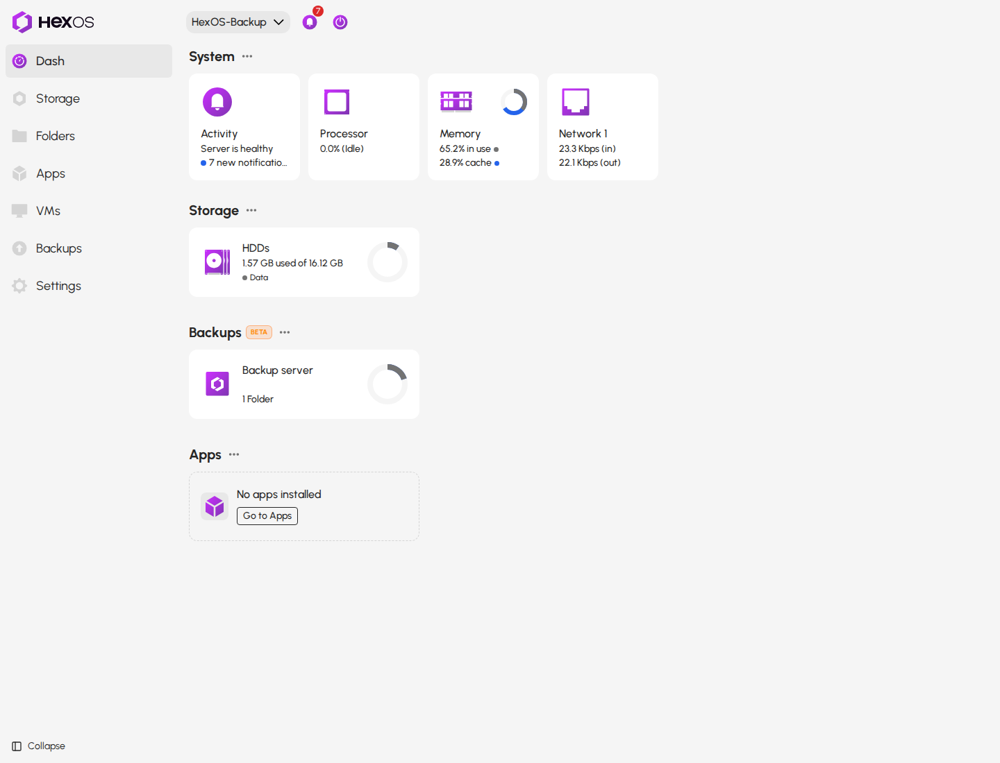{.medium .framed}

To remove the section from the dashboard, open its menu and click **Hide from dashboard**.

 Hide the Backups section 

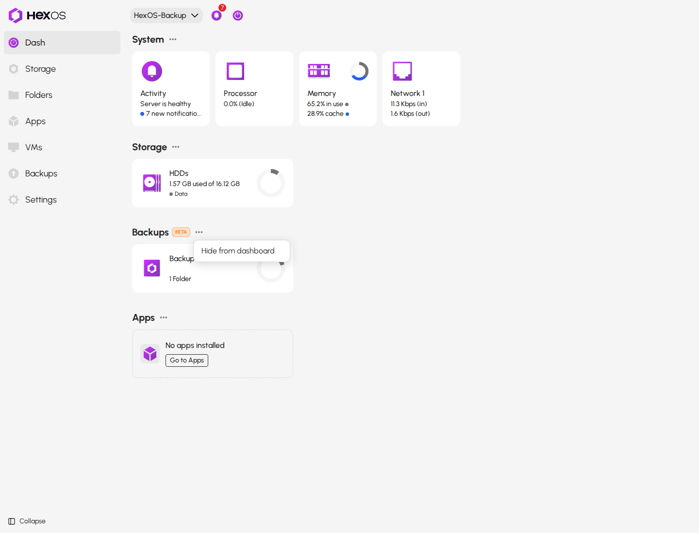{.medium .framed}

To show it again, go to **Settings** > **Preferences** > **Customize dashboard**. Turn on **Backups**.

 Show the Backups section again 

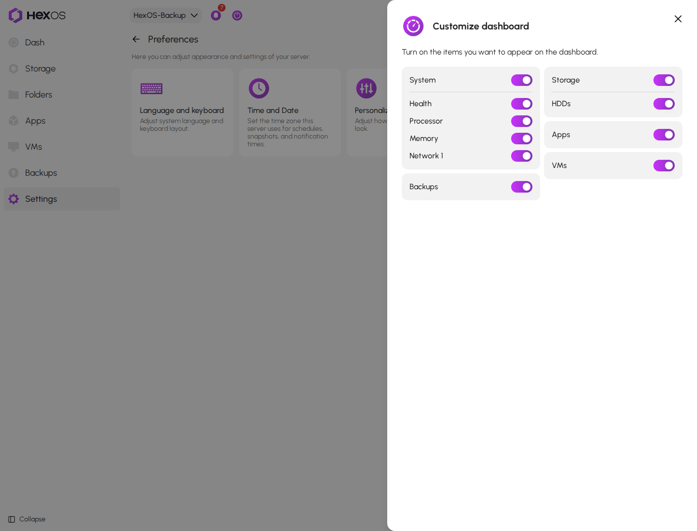{.medium .framed}

## A backup's page

Opening a backup you send shows four cards:

- **Quota**: the space used out of the space set aside, for example "1.8 GB of 20 GB". The used figure is compressed. See [Compression](/features/backups#compression).
- **Schedule**: for example "Weekly on Sunday at 23:00", "Daily at 02:00", or "Every hour", and when the next backup runs.
- **Transfer speed**: your speed setting and, once measured, the measured speed. On a buddy's backup it also says what your buddy's side is set to.
- **Retention policy**: how long restore points are kept, and how many there are.

 A backup you send 

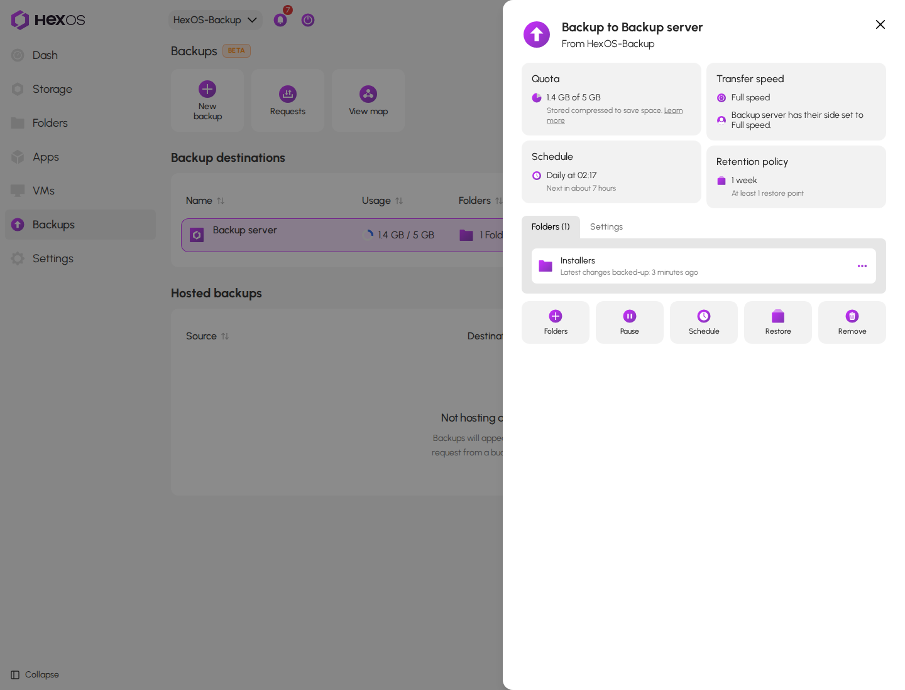{.medium .framed}

Below the cards is a row for each folder. It shows the folder's state, for example "Latest changes backed-up:" and a time, or "Backing up…" with a percentage. A folder with a problem shows what went wrong and **Show details**. See [Backup troubleshooting](/features/backups/troubleshooting).

Along the bottom are **Folders**, **Pause** (or **Resume**), **Schedule**, **Restore**, and **Remove**. Open the **Settings** tab to change **Transfer speed** or **Reserved space**. A backup shared with a buddy also has a name setting.

 Backup settings 

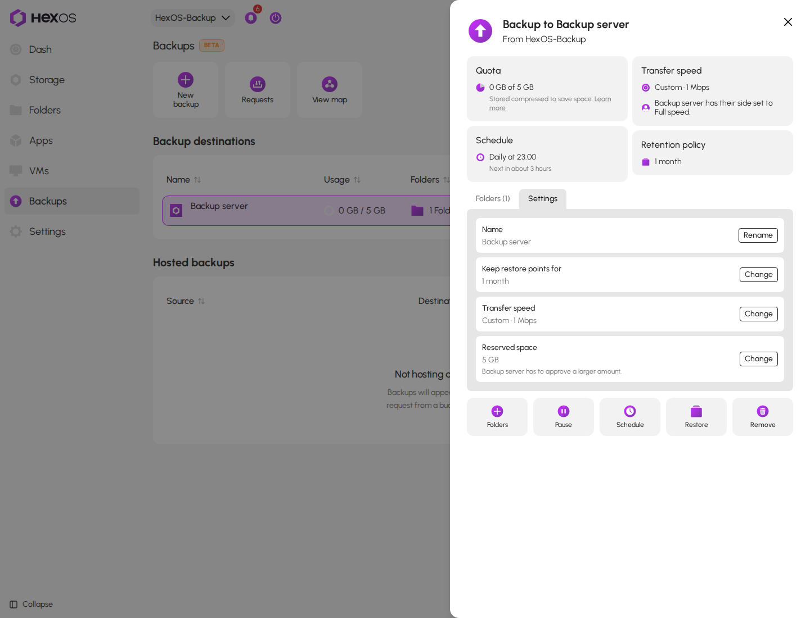{.medium .framed}

For a backup you store for someone else, see [Host a buddy's backup](/features/backups/host-a-buddys-backup).

## A folder's menu

Each folder row has a menu with:

- **Back up now**: back up this folder straight away.
- **Repair backup**: only shows when the folder's copy needs to start over. See [Backup troubleshooting](/features/backups/troubleshooting).
- **Restore from this backup**: see [Restore a folder](/features/backups/restore-a-folder).
- **Remove**: stop backing up this folder here, and delete its copy on the other server and its restore points on this one.

 A folder's menu 

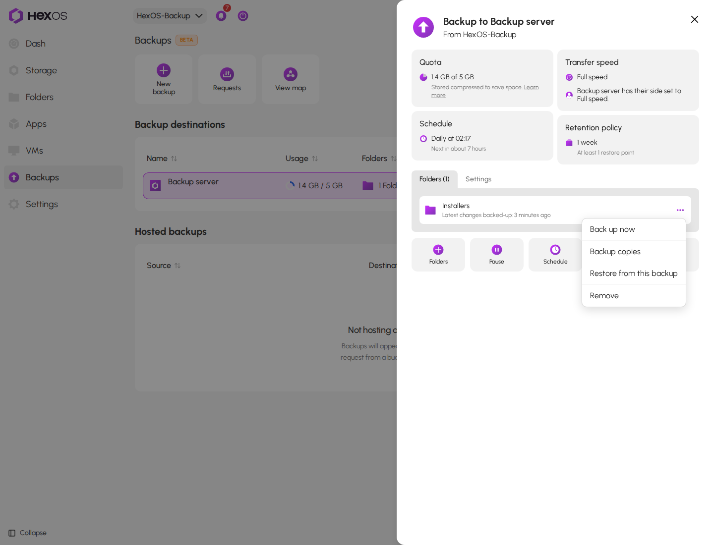{.medium .framed}

## Back up now

1. Open the folder's menu and click **Back up now**.
2. HexOS asks "Back up now?". Click **Back up now** again.

 Start a backup now 

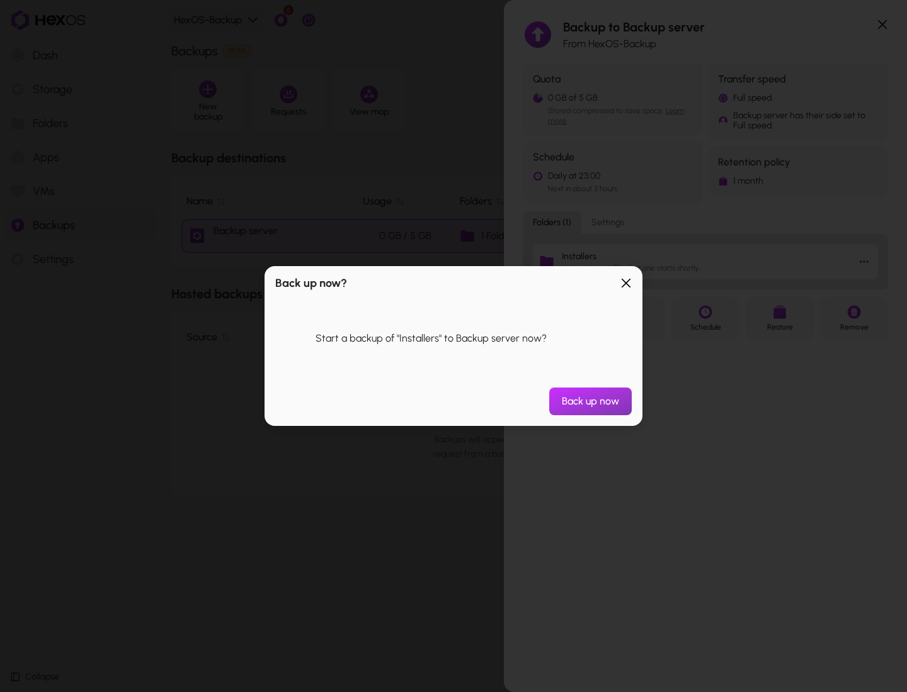{.medium .framed}

The folder's row and the activity center show the progress. A backup cannot start while the other server is offline.

## Stop a running backup

1. In the activity center, open the running backup.
2. Click **Stop backup**.

 Stop backup in the activity center 

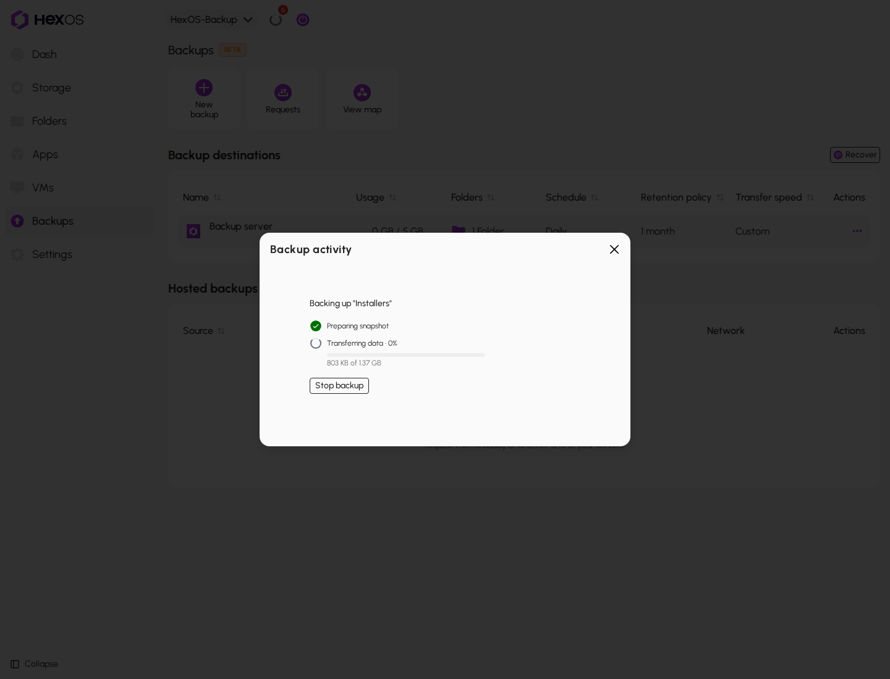{.medium .framed}

The activity item then says "Stopped. The next backup picks up from here." What already arrived is kept, and the next backup continues from where this one stopped.

## Change which folders are backed up

1. Click the **Folders** tile.
2. The **Folders** dialog says which folders back up to this destination. Check a folder to add it, or uncheck it to remove it.
3. Click **Save changes**.

 The Folders dialog 

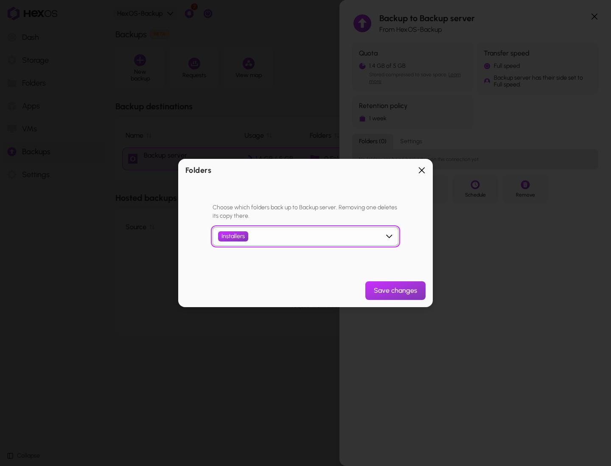{.medium .framed}

Click the folder picker to see the available folders.

 Choose folders to back up 

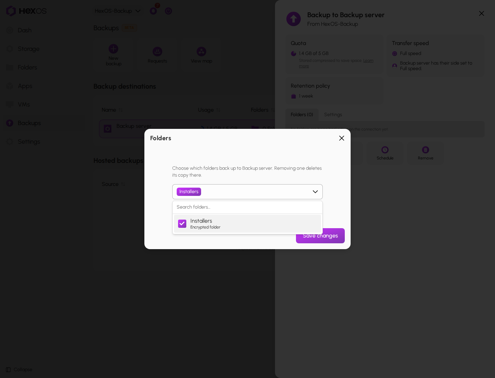{.medium .framed}

Each folder already in the backup shows how many restore points it has at the destination.

- **Adding a folder** starts copying all of it right away, so its first backup takes longer. If the folders you add need more than the free space set aside, the dialog warns you.
- **Removing a folder** changes the button to **Remove 1 folder and save**. HexOS then asks "Delete the stored backup of 1 folder?". Click **Delete and save** to confirm.

On a buddy's backup, folders that are not encrypted cannot be added yet. The dialog lists them with an **Encrypt…** button. When encryption finishes, HexOS adds the folder to the backup for you.

> **Danger:** Removing a folder from a backup deletes its copy and every restore point on the other server, and its restore points on your server. It cannot be undone. The folder on your own server is not touched. See [Removing backups](/features/backups/removing-backups).
{.is-danger}

## Change the schedule and retention

1. Click the **Schedule** tile.
2. In **Schedule & Retention**, choose how often backups run: **Weekly**, **Daily**, or **Hourly**. Hourly is only offered between your own servers.
3. For **Weekly**, choose the **Day** and **Time**. For **Daily**, choose the **Time**. Backups run on your server's local time.
4. Under **Keep restore points for**, choose **1 week**, **2 weeks**, **1 month**, or **3 months**.
5. Click **Save changes**.

 The Schedule & Retention dialog 

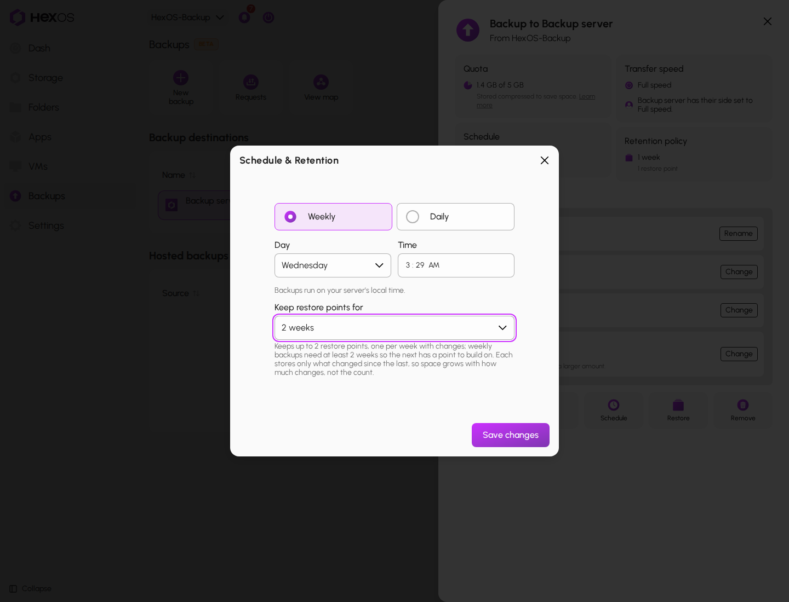{.medium .framed}

One schedule covers every folder in the backup. Folders do not have separate schedules.

Weekly backups need at least 2 weeks, so **1 week** is not offered for them. When you change how often backups run, choose how long to keep restore points again.

Each restore point stores only what changed since the one before. Restore points become eligible for cleanup after the time you choose. Some may stay longer while needed for backup history.

Keeping restore points for longer saves straight away. Keeping them for less time asks "Remove older restore points?" and previews how many go. The count is unavailable while the other server cannot be reached. Click **Shorten and remove** to confirm.

While a backup is paused, **Folders**, **Schedule** and **Back up now** are unavailable until you resume it. A pause made by you or your buddy still allows **Restore** and **Restore from this backup**. If your server is offline, the dialog cannot read the current schedule and asks you to try again later.

## Change the transfer speed

1. Open the backup's **Settings** tab and click **Change** beside **Transfer speed**.
2. Choose **Full speed**, **Smart**, or **Custom**. For **Custom**, type a limit in Mbps.
3. Click **Save changes**.

 The Transfer speed dialog 

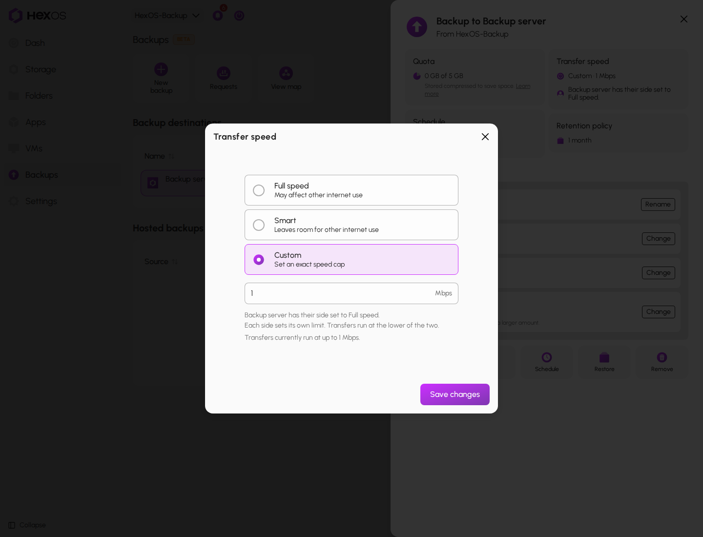{.medium .framed}

| Option | What it does |
|---|---|
| **Full speed** | No limit. May affect other internet use. |
| **Smart** | Limits speed based on your connection: half of the measured speed. |
| **Custom** | Sets an exact speed cap. |

To measure your connection, choose **Smart**, then click **Run speedtest** (or **Test again**). These buttons show only with **Smart** chosen. The dialog shows "Testing your internet connection…", then "Measured transfer speed:" and the result in Mbps.

 Smart transfer speed and the measured result 

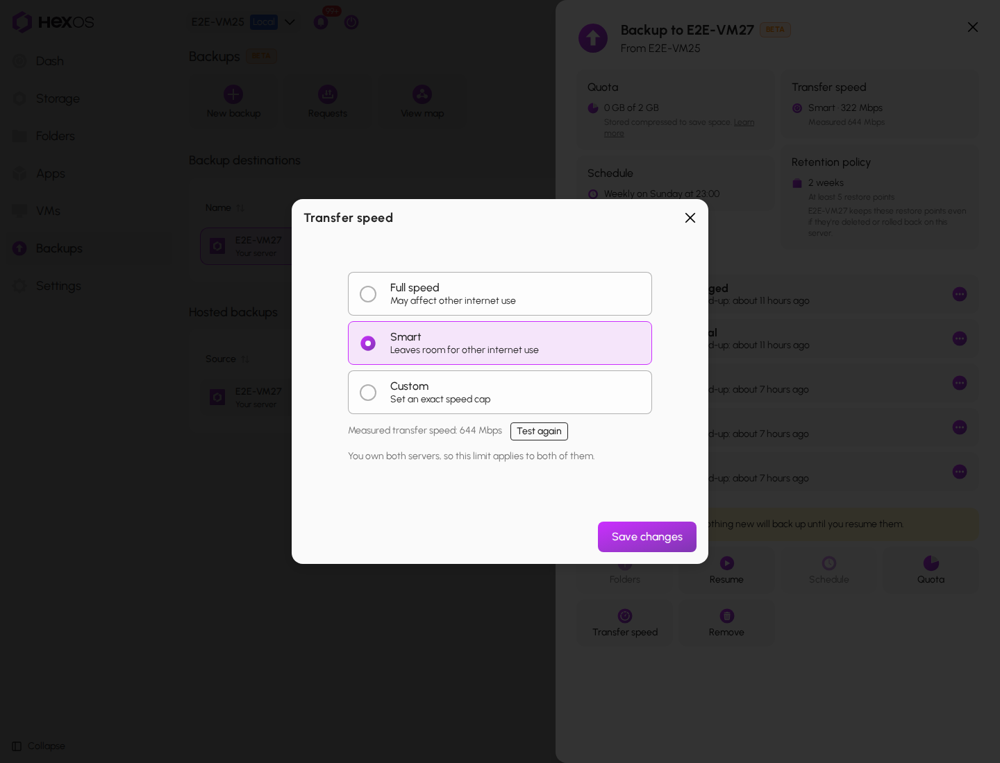{.medium .framed}

On a buddy's backup, each side sets its own limit and transfers run at the lower of the two. Once it is known, the dialog also says how fast transfers currently run. Between your own servers, the dialog says "You own both servers, so this limit applies to both of them."

## Space for your backup

The server that stores a backup decides how much space it gets. That space is set aside on its pool, so other files cannot take it and the backup cannot grow past it.

**If you own the other server:**

1. Open the backup's **Settings** tab and click **Change** beside **Reserved space**.
2. In **Storage quota**, enter the new amount under **Quota**.
3. Click **Save changes**.

 Storage quota 

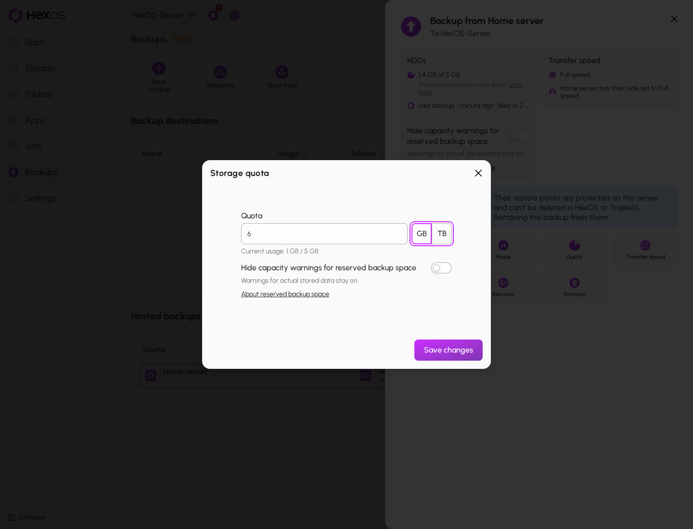{.medium .framed}

It cannot go below the space already used or still reserved for retained copies. Any increase must fit the pool’s remaining free space.

The dialog also offers **Hide capacity warnings for reserved backup space**. This affects warnings about space set aside for backups. Warnings for actual stored data stay on.

**If a buddy stores your backup**, only they can change it. You can ask them for more:

1. Click **Folders** in the sidebar and open any folder in this backup. In the **Backups** tab, open the backup's menu and click **Storage reservation**. If a backup already failed for lack of space, you can also click **Request more space** in its **Backup failed** dialog.
2. Enter the amount you need.
3. Click **Request change**. The dialog notes "The owner of the destination server must approve the change."

 Request more backup space 

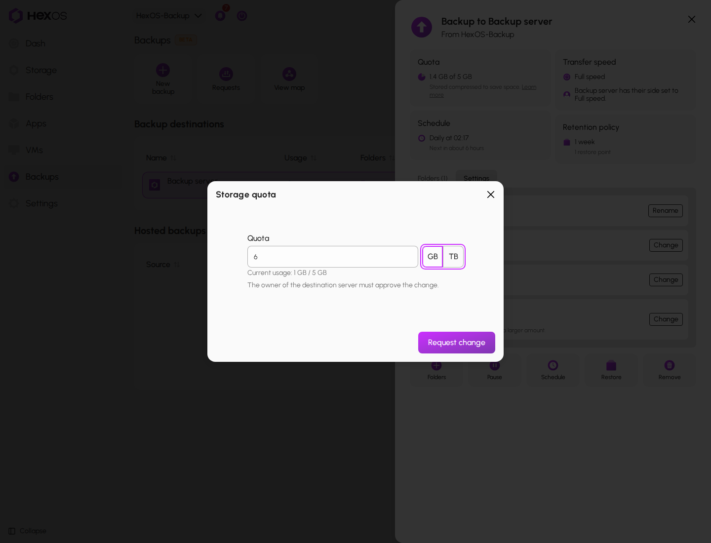{.medium .framed}

Your request waits on the **Backups** page under **Requests** > **Outgoing requests**, as "Awaiting approval for a storage change on" your buddy's name. You can withdraw it there. Your buddy approves or declines it. See [Host a buddy's backup](/features/backups/host-a-buddys-backup).

 A storage request awaiting approval 

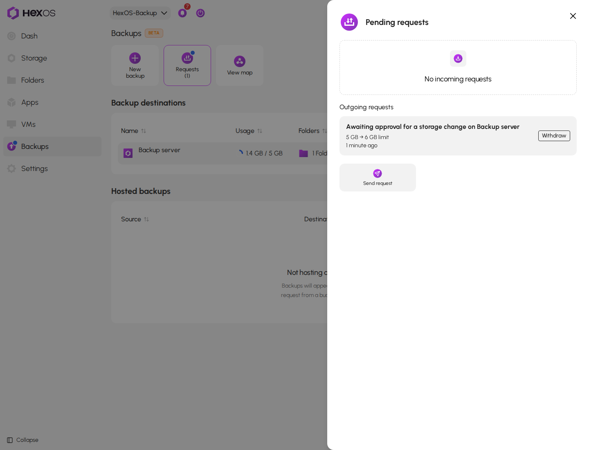{.medium .framed}

HexOS also checks ahead of time, every few hours while your server is online. If the next backup will not fit, both of you get a notice that says how much is needed. If HexOS is sure it will not fit, it also pauses the backup for space. It resumes on its own when there is room. A backup can still stop if the space fills before the check runs. See [Backup troubleshooting](/features/backups/troubleshooting).

## Pause and resume

1. Click the **Pause** tile.
2. HexOS asks "Pause this backup?". Click **Pause**.

 Confirm a pause 

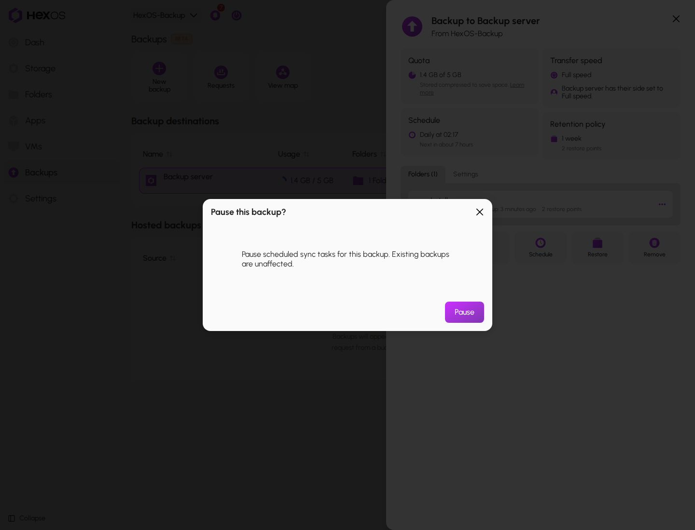{.medium .framed}

The tile becomes **Resume**, and the page says "Backups are paused. Nothing new will back up until you resume them."

 A paused backup 

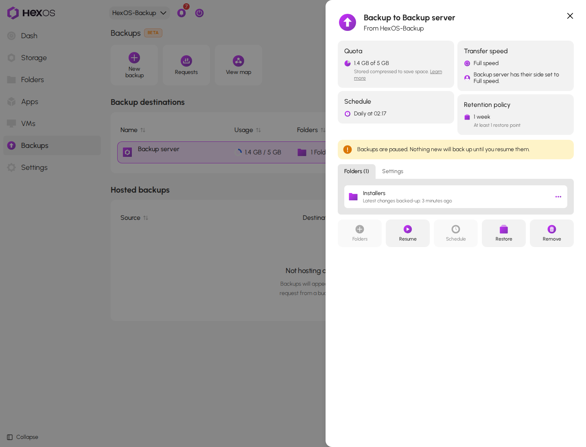{.medium .framed}

- A pause stops a backup that is running and stops new ones. Everything already stored stays, and so does the space set aside.
- On a buddy's backup, your buddy gets a notice that you paused.
- Only the person who paused can resume. If your buddy paused it, ask them to resume it. Between your own servers, you can resume from either side.
- A pause HexOS made because space ran short can be resumed by either side. It also resumes on its own when there is room.
- You cannot pause while a restore is running. The page says "A restore is running. Pausing is unavailable until it finishes."
- If the server that sends a paused backup is lost, recover the backup onto your new server. It stays paused there, and you can resume it from the new server. See [Recover a failed server](/features/backups/recover-a-failed-server).

To resume, click **Resume**, then confirm in **Resume this backup?**.

 Confirm resuming a backup 

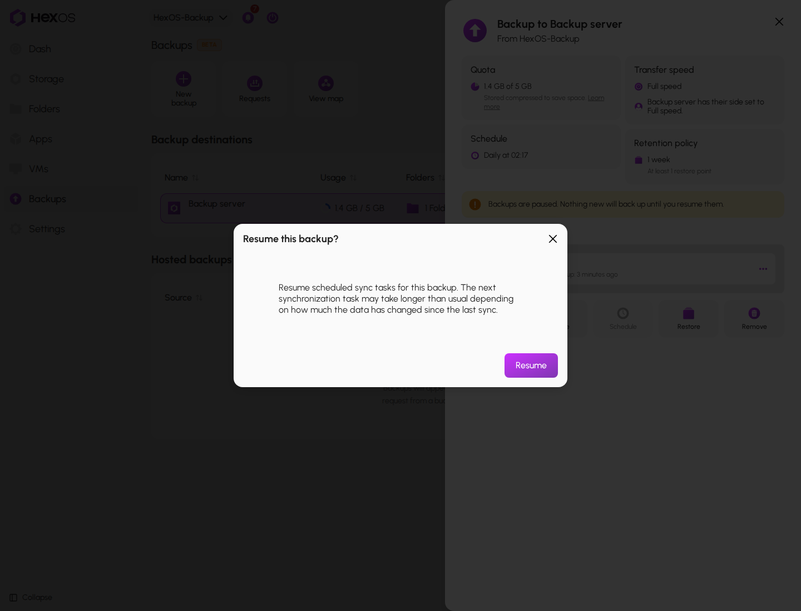{.medium .framed}

Pausing does not free space on the other server. To give the space back, remove the backup instead, which deletes the copy.

## Rename a buddy's backup

You and your buddy each keep your own name for each other. The other side never sees yours.

1. Open the backup's **Settings** tab and click **Rename** beside **Name**.
2. In **Rename this backup**, type a name under **Display name (optional)**. Leave it empty to use their server name or account email.
3. Click **Save**.

 Rename a backup 

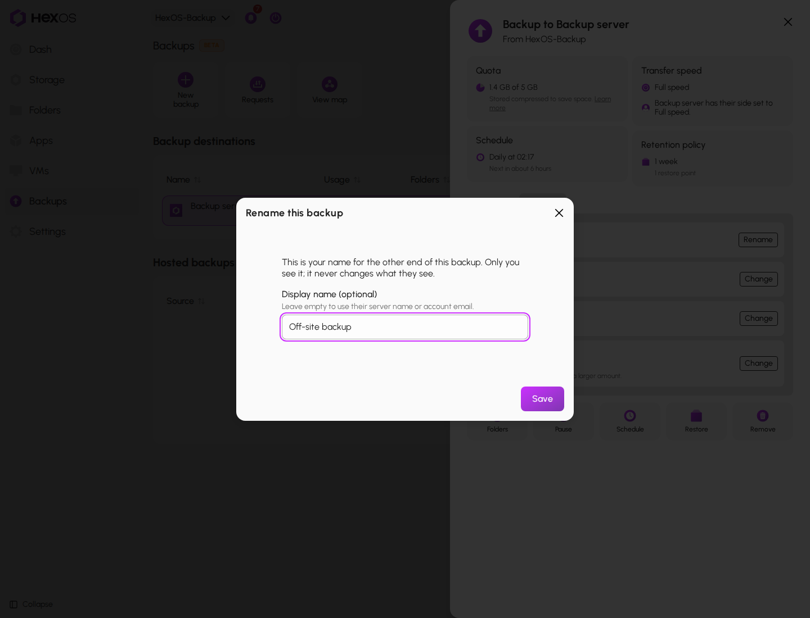{.medium .framed}

Backups between your own servers use the server name, so they have no name setting.

## The row menu on the backups page

Each row on the **Backups** page has a menu, so you can act without opening the backup. Depending on the backup, it offers **Folders…**, **Change pool**, **Pause backups** (or **Resume backups**), **Quota**, **Transfer speed**, **Schedule & Retention**, **Change server**, **Retry setup**, **Rename**, and **Remove connection**.

 A row's menu 

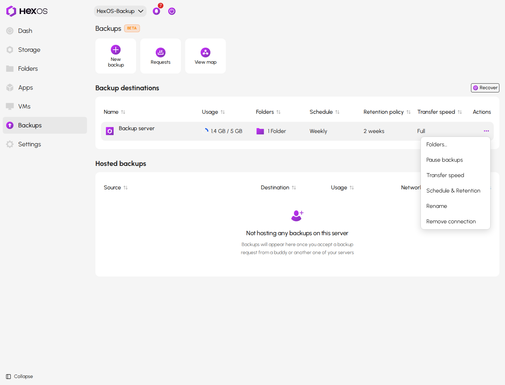{.medium .framed}

## On a folder's page

A folder's page lists every place it is backed up to in the **Backups** tab, with the state of each. Each one has a menu with **Back up now**, **Restore from this backup**, **Transfer speed**, **Schedule & Retention**, **Storage reservation**, **Remove backup destination**, and **Remove connection**. **Back up now** is unavailable while paused. You can restore a stored copy while you or your buddy has paused the backup. Restoring does not resume scheduled backups.

 Backup actions on a folder 

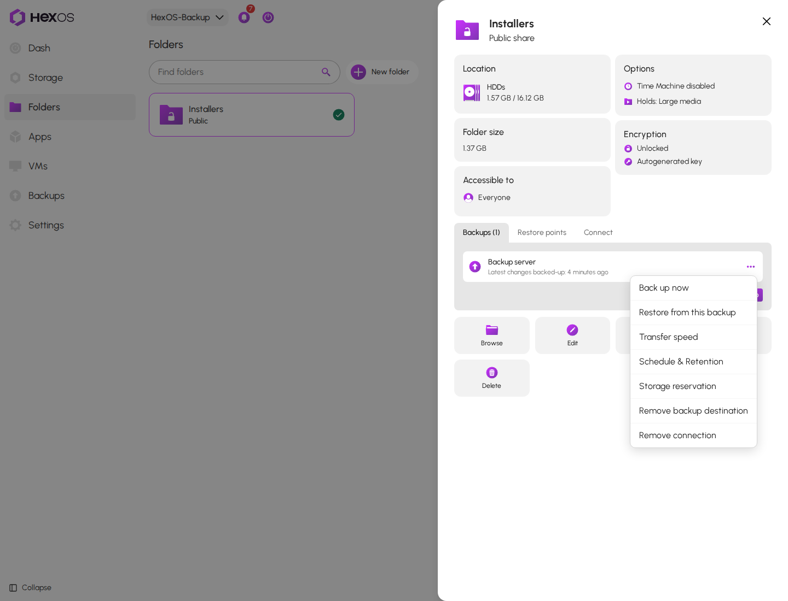{.medium .framed}

To add the folder to another backup, click **Backup**. See [Set up a backup](/features/backups/set-up-a-backup#back-up-from-a-folders-page).

## The backup map

On the **Backups** page, click **View map**. The **Backup map** draws your servers and the backups between them.

 The backup map 

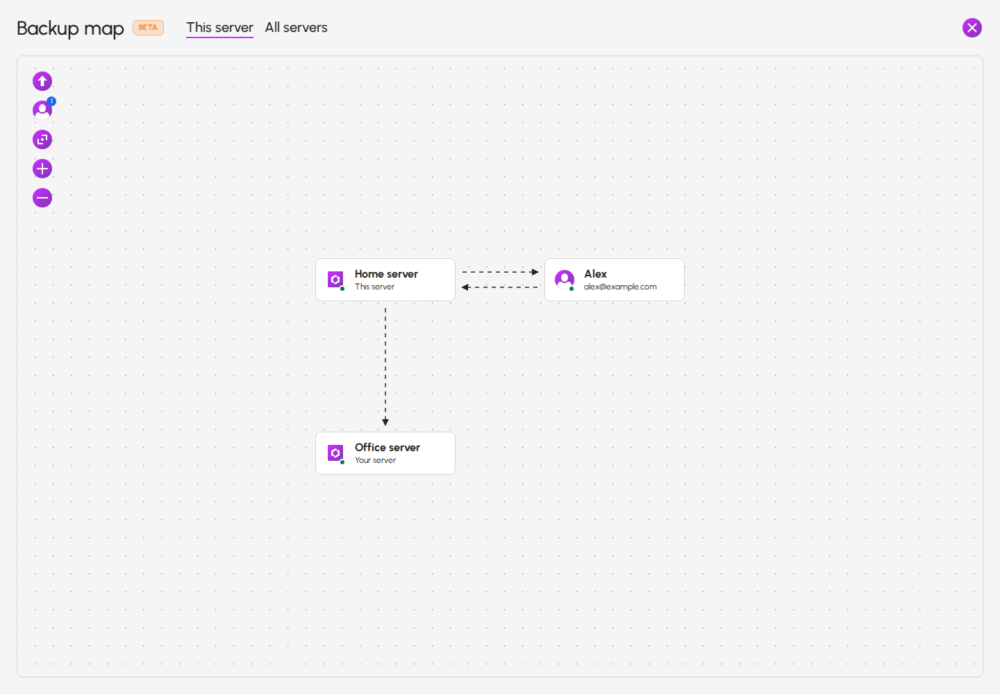{.medium .framed}

- **This server** shows the server you are viewing. **All servers** shows every server on your account.

- Each server shows whether it is online, partly connected, not responding, or offline. A server that is down looks faded.
- A line between two servers shows when a backup is paused, its last backup failed, or it is waiting for a server to come back.
- The map also lists your pending requests.
- Click a server to see what it backs up and what it stores.

> **Help:** A setting that will not save, or a message you do not recognize? See [Backup troubleshooting](/features/backups/troubleshooting) or ask in the [HexOS Discord Community](https://discord.gg/fCW2htvYdz).
{.is-troubleshooting}
