# Removing backups

> **Info:** Buddy Backups is in beta and requires access to the Buddy Backups feature. Keep an independent backup you already rely on while testing it. See [what beta means](/features/backups#what-beta-means).
{.is-info}

Several actions look alike but do very different things. Read this page before you click.

## The short version

| Action | What it deletes | Can you undo it? |
|---|---|---|
| Withdraw a request | Nothing. Nothing was copied. | Yes, send it again |
| **Decline** a request | Nothing. Nothing was copied. | Yes, they can send it again |
| **Cancel setup** on a new backup | Nothing. Setup never finished. | Yes, set it up again |
| **Cancel setup** on a backup you recovered | Not offered. Use **Retry now**, or **Remove connection** to delete it. | |
| **Pause** | Nothing. Copies and the space set aside stay. | Yes, by the person who paused |
| Remove a folder from a backup | That folder's copy and all its restore points on the other server, and its restore points on your server | **No** |
| **Remove connection** from the sending server | Every folder and every restore point on the other server, the space set aside, and the backup's restore points on your server | **No** |
| Delete a folder that is backed up | Its backup copies are permanently deleted. The local folder is kept for 30 days if you choose **Recently deleted**, or removed immediately if you choose permanent deletion. | Local recovery depends on the option chosen; backup-copy deletion cannot be undone. |
| **Repair backup** | That folder's copy on the other server, before a fresh copy is sent | **No** |
| **Change pool** or **Change server** (on a backup you store) | The old copy is removed after checking the new copy unless it holds restore points the new copy does not have. | Check the result; a retained old copy can need separate removal. |
| **Delete old copy** (after a move) | Restore points only the old copy held | **No** |
| Unclaim or reset a server that stores backups | Every backup that server stores for others | **No** |

Removing a backup connection does not remove your original source folder. A system wipe can erase local pools, so check the reset warning separately. Removing a connection also stops restores that are waiting to copy files or are still copying them. It does not discard a restore that has finished copying.

HexOS deletes a backup copy only when someone confirms one of the actions on this page. If the other server is offline then, the delete finishes when it is back. HexOS also removes older restore points under your retention settings and can clean up unfinished copies left by failed or stopped transfers. Some stopped restores leave a copy behind. See [Restore a folder](/features/backups/restore-a-folder) for when to use **Discard restore** or **Remove copy**.

## Restore points on your own server

Your server keeps the restore points it made too. When you remove a folder or a connection from the server that sends the backup, they are deleted along with the copies on the other server, under the same confirmation. Your folders are not touched.

- If your server stays offline and cleanup is delayed, its restore points expire under the saved retention period instead of being deleted immediately.
- If your buddy removes the connection, or their server is reset or unclaimed, the restore points on your server stay.
- Some older removed backups left restore points without a cleanup schedule. Eligible points are now scheduled under their saved retention period, never sooner than two weeks after HexOS schedules their cleanup.

## Pausing is not removing

**Pause** stops backups. Everything stored stays where it is, and the space stays set aside. On a buddy's backup, the other side gets a notice.

- Only the person who paused can resume. Between your own servers, you can resume from either side.
- A pause HexOS made because space ran short can be resumed by either side, and can resume automatically once HexOS can verify there is enough room.

Pausing does not free space on the other server. To give the space back, remove the connection.

## Withdraw a request or cancel setup

On the **Backups** page, click **Requests**. Under **Outgoing requests**, click **Withdraw** on the request, then **Withdraw request** to confirm. Nothing was copied, so nothing is deleted.

 An outgoing backup request 

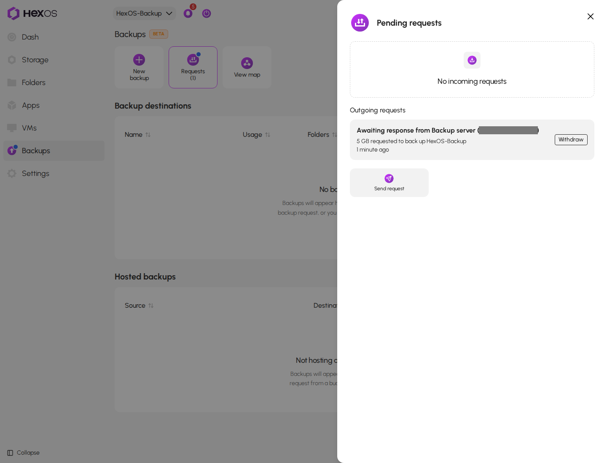{.medium .framed}

 Confirm withdrawing a request 

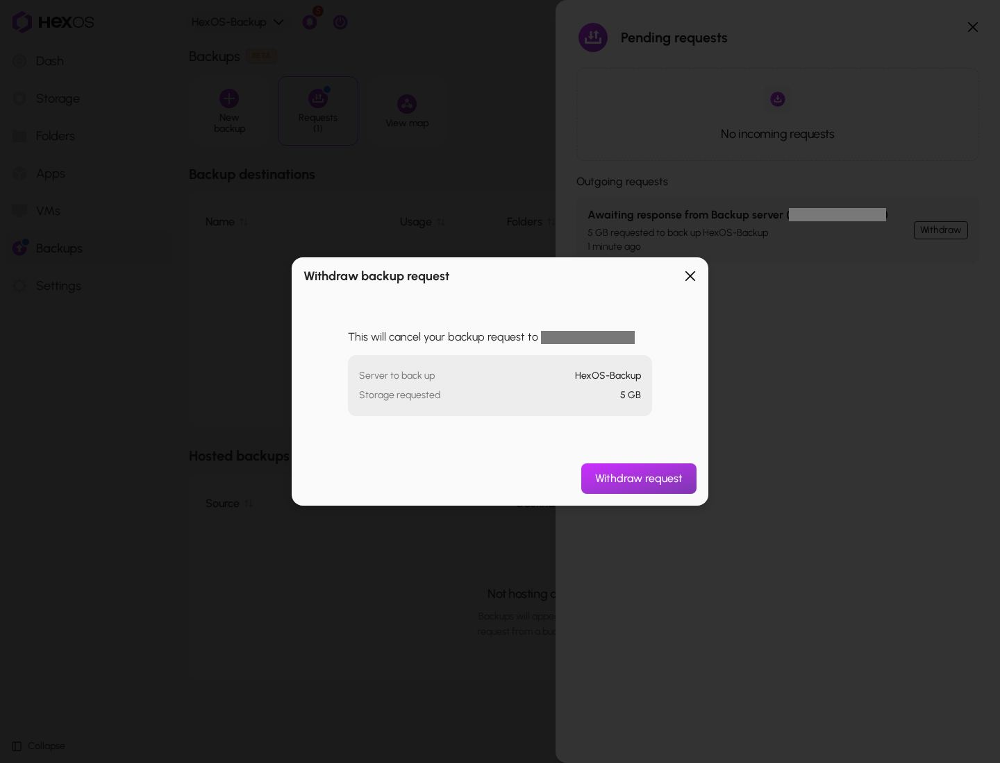{.medium .framed}

If a new setup fails, open its activity item. Click **Cancel setup** to abandon it.

 Cancel an unfinished new setup 

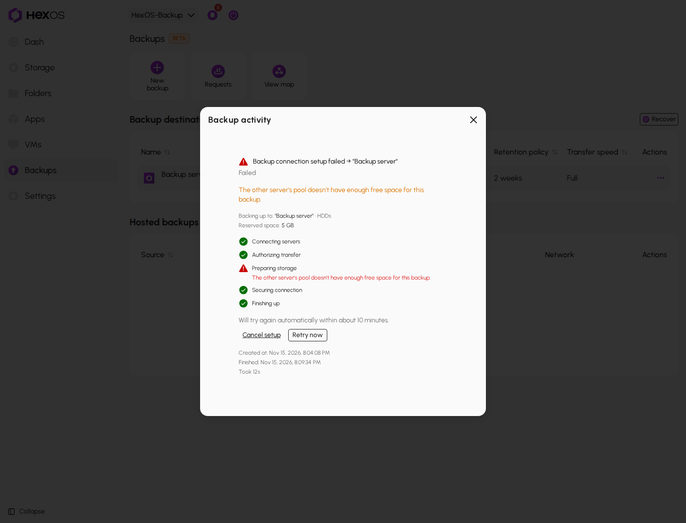{.medium .framed}

Click **Cancel setup** again in **Cancel this backup setup?**. That removes the connection. This action is offered only when the backup has no history to preserve.

 Confirm canceling setup 

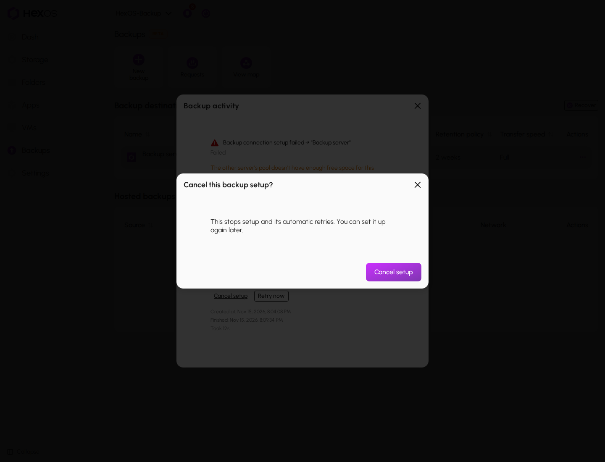{.medium .framed}

A backup you recovered onto a new server offers **Retry now** instead. Removing that connection requires the separate deletion confirmation.

 Retry a recovered backup setup 

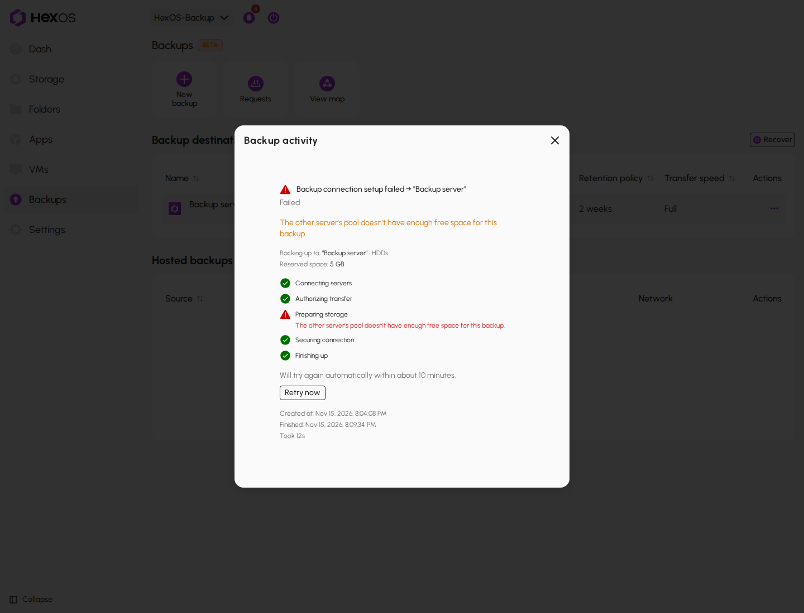{.medium .framed}

## Remove a folder from a backup

You can do this in three places:

- **The folder's menu on the backup's page:** click **Remove**. HexOS asks you to confirm, and explains that the folder stays on your server while its copy and restore points on the other server go. Click **Remove from backup**.

 Remove a folder from a backup 

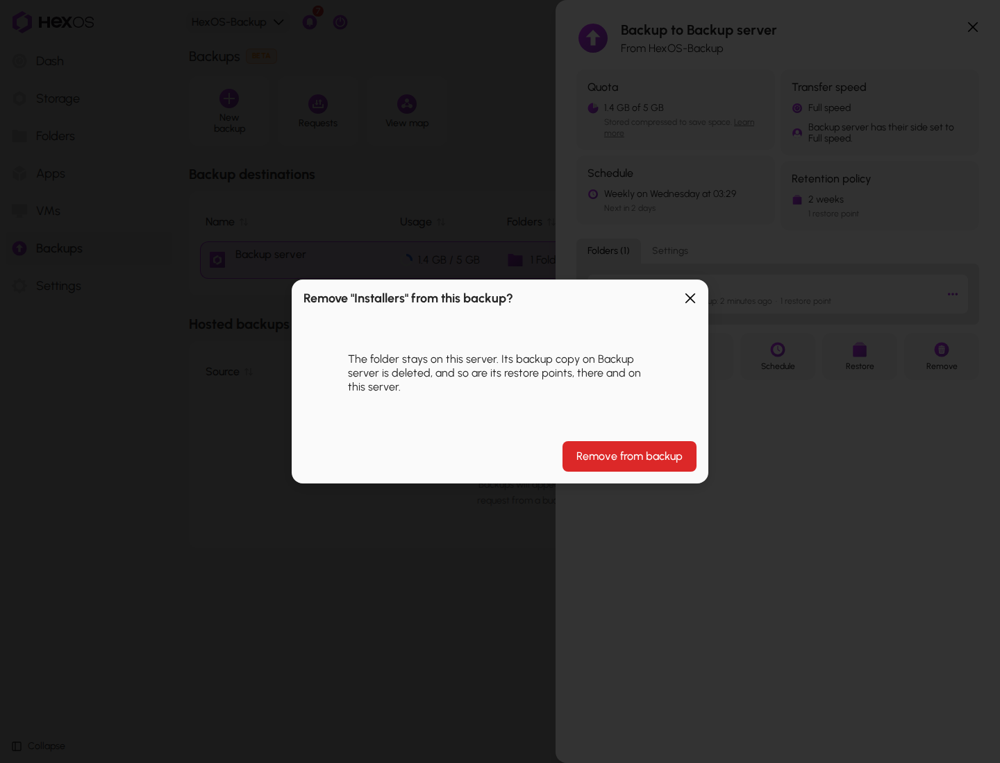{.medium .framed}

- **The Folders dialog:** uncheck the folder and click **Remove 1 folder and save**, then **Delete and save** to confirm.

 Uncheck a folder 

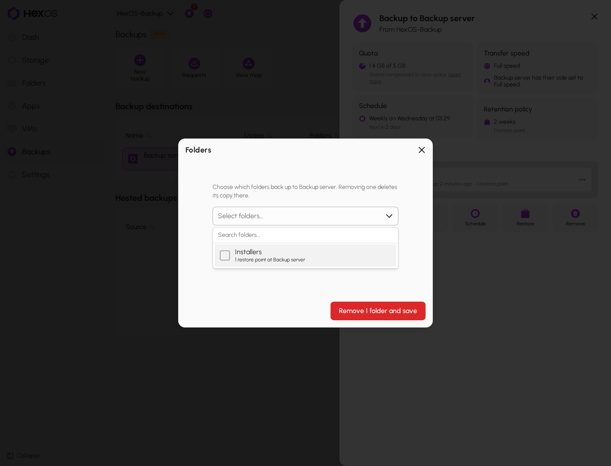{.medium .framed}

 Read the folder removal warning 

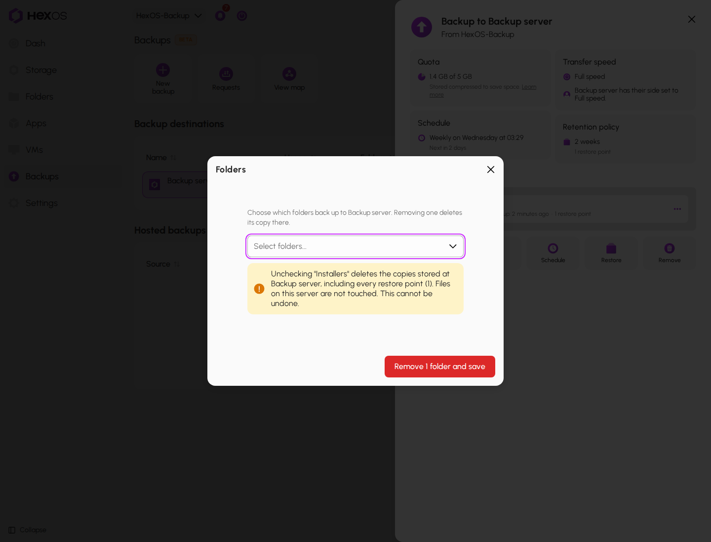{.medium .framed}

 Confirm removal from the Folders dialog 

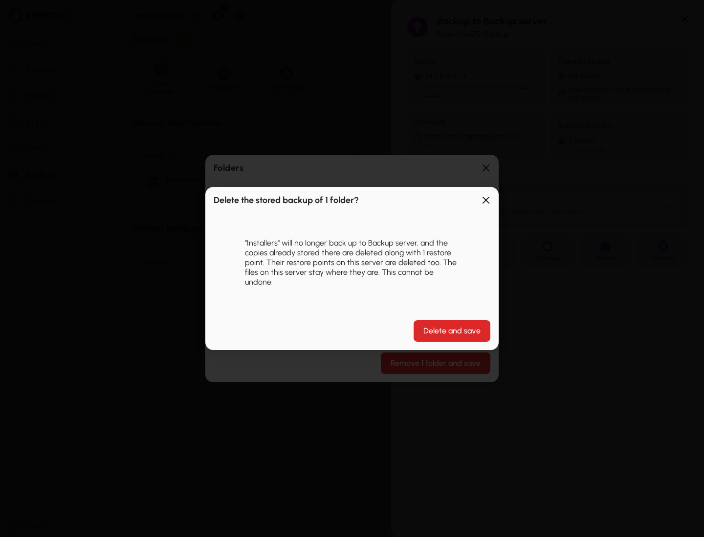{.medium .framed}

- **The folder's own page:** in the **Backups** tab, open the backup's menu and click **Remove backup destination**, then **Remove destination**.

 Remove a backup destination from the folder 

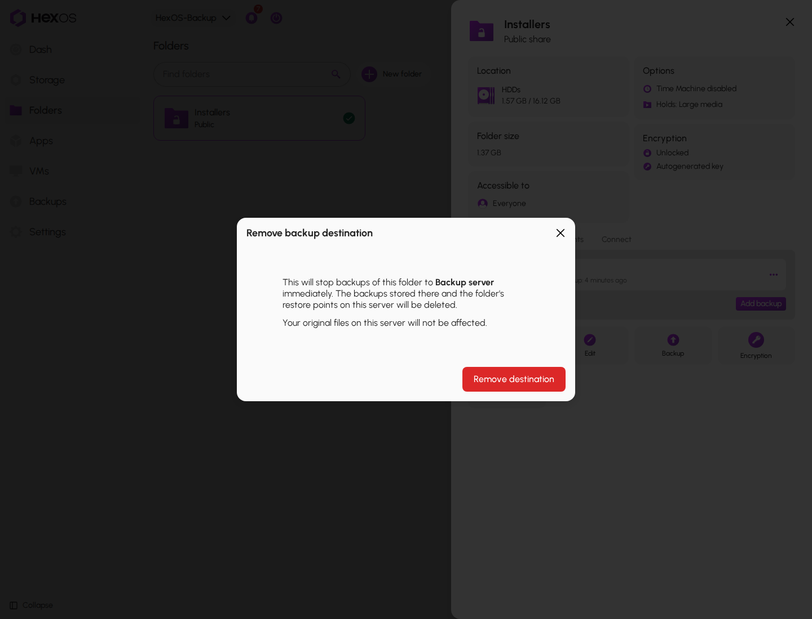{.medium .framed}

The folder on your server stays. Its copy on the other server, and every restore point of it, is deleted for good, and so are its restore points on your server.

> **Info:** If the other server is offline, its copy is deleted when that server is back online. Until then it still uses space there, and you can't add a folder with the same name to that backup.
{.is-info}

## Remove a connection

Click the **Remove** tile on the backup's page, or **Remove connection** in the row's menu on the **Backups** page.

From the sending server, the **Remove connection** dialog says "Removing this connection stops all backups between this server and" the other side. A red box says every restore point is permanently deleted, on the other server and on this one, and the space set aside is released. Your folders on this server are not touched. It also suggests: "To stop backups without losing anything, pause the connection instead."

To go ahead, check "I understand that removing this connection permanently deletes all of its backups." and click **Remove connection**.

An eligible new setup can offer **Cancel setup** without the deletion checkbox. A license hold or previous cancellation refusal can change the available action.

From the hosting server, removal deletes its hosted copies. The sending server keeps its own restore points.

 The Remove connection dialog 

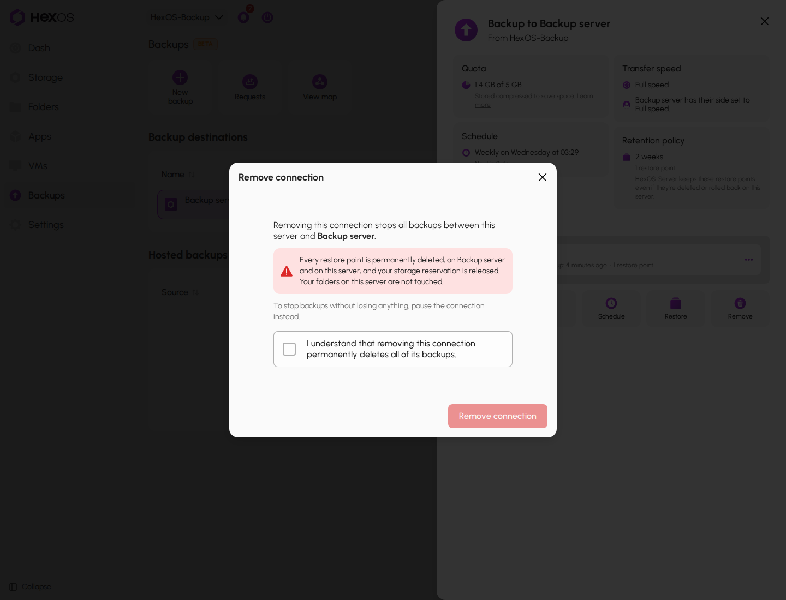{.medium .framed}

> **Danger:** Removing a connection cannot be undone. The hosted backup copies and their restore points are deleted. Removing from the sending server also deletes its local restore points for that connection.
{.is-danger}

> **Danger:** Either side can remove a connection. If you store a buddy's backup, you can delete it, and they get a notice. If a buddy stores yours, they can delete yours. Keep a second destination for anything you cannot replace.
{.is-danger}

If the other server is offline when you remove a connection, the dialog says so. The backups are deleted once HexOS can reach it again.

## Deleting a folder that is backed up

> **Danger:** Deleting a folder that is backed up **always deletes its backup copies too**. There is no way to delete the folder and keep its copies. If you want to keep the backup, do not delete the folder.
{.is-danger}

When you click **Delete** on a folder that is backed up, the dialog names the servers it backs up to. It says "A backed-up folder can only be deleted together with its backup copies, so they will be permanently deleted from there too."

Read the local deletion options as well as the backup warning. **Recently deleted**, when offered, keeps the local folder for 30 days. Permanent deletion removes it immediately. Confirm the backup-copy warning before continuing. Bringing the local folder back does not bring back deleted backup copies.

 Deleting a folder that is backed up 

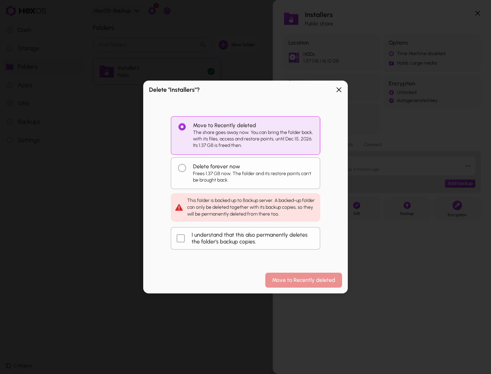{.medium .framed}

A copy on a server that is offline at the time is deleted when that server is back online. If you only want to free space on your server, restore anything you need first, or keep the folder.

## Unclaiming or resetting a server that stores backups

Open **Settings** > **Reset**. Before unclaiming a server that stores a buddy's backup, click **Unclaim system**. Read the warning about the hosted copies. Check the acknowledgement that your buddy will need to send a new backup request and upload again. Click **Proceed with unclaim** only when you are ready to delete those copies.

 Unclaim a server that hosts a backup 

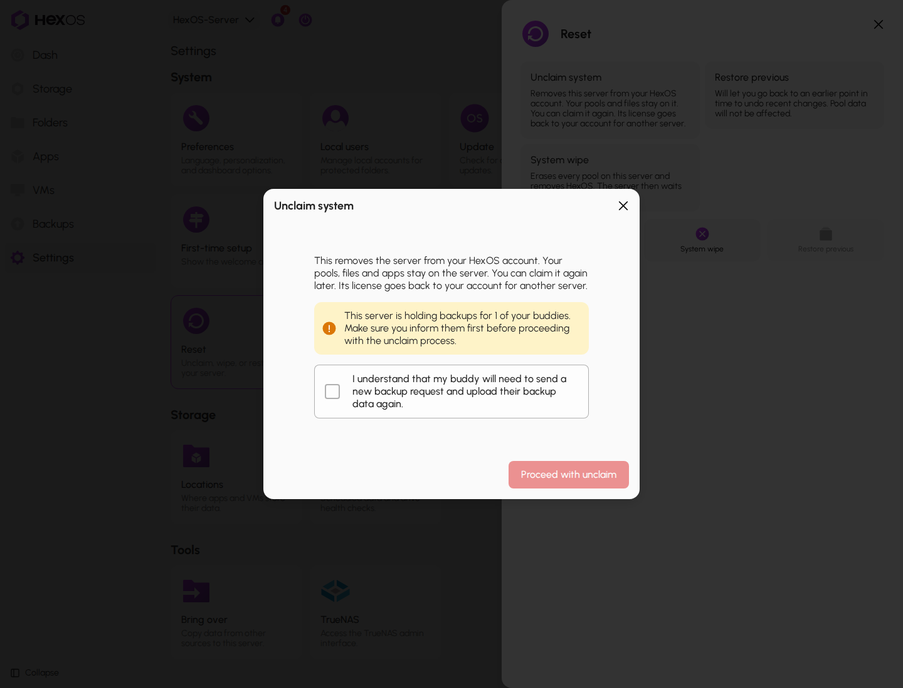{.medium .framed}

A system wipe also erases the server's local pools. Use it only when you are ready to lose the files, apps and virtual machines on those pools.

1. Click **System wipe**. Read the warning, type the displayed server name, then click **Proceed with wipe**.

 The system wipe warning 

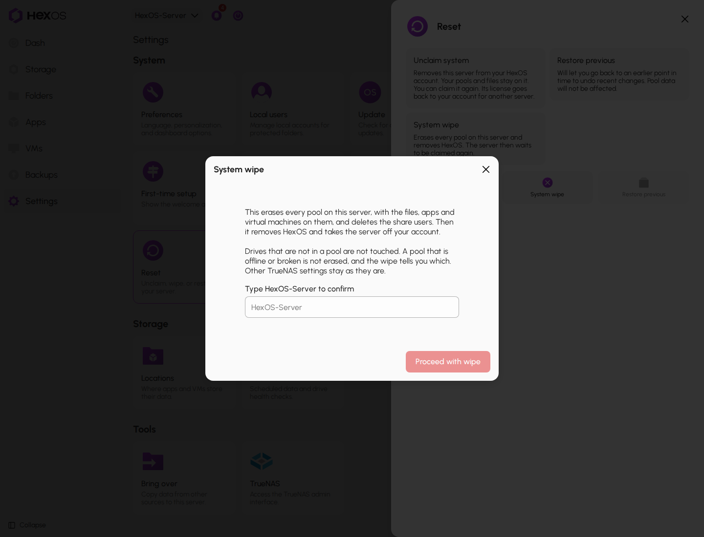{.medium .framed}

2. In **ARE YOU SURE?**, type the server name again. Click **Yes, Delete everything**.

 The final system wipe confirmation 

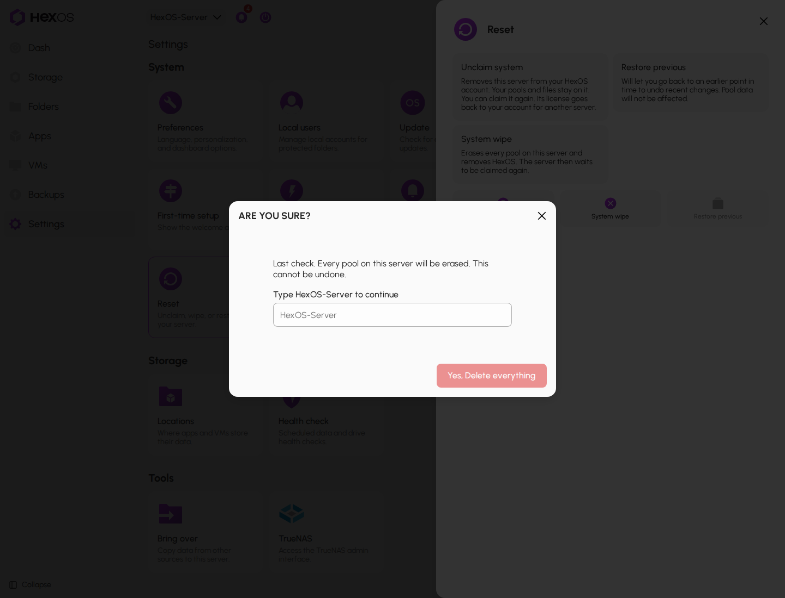{.medium .framed}

3. If the server stores backups for others, **Hosted backup deletion** lists whose copies will be deleted. Check the acknowledgement about sending a new request and uploading again. Click **Delete hosted backups** to start the wipe.

 Acknowledge deletion of hosted backups 

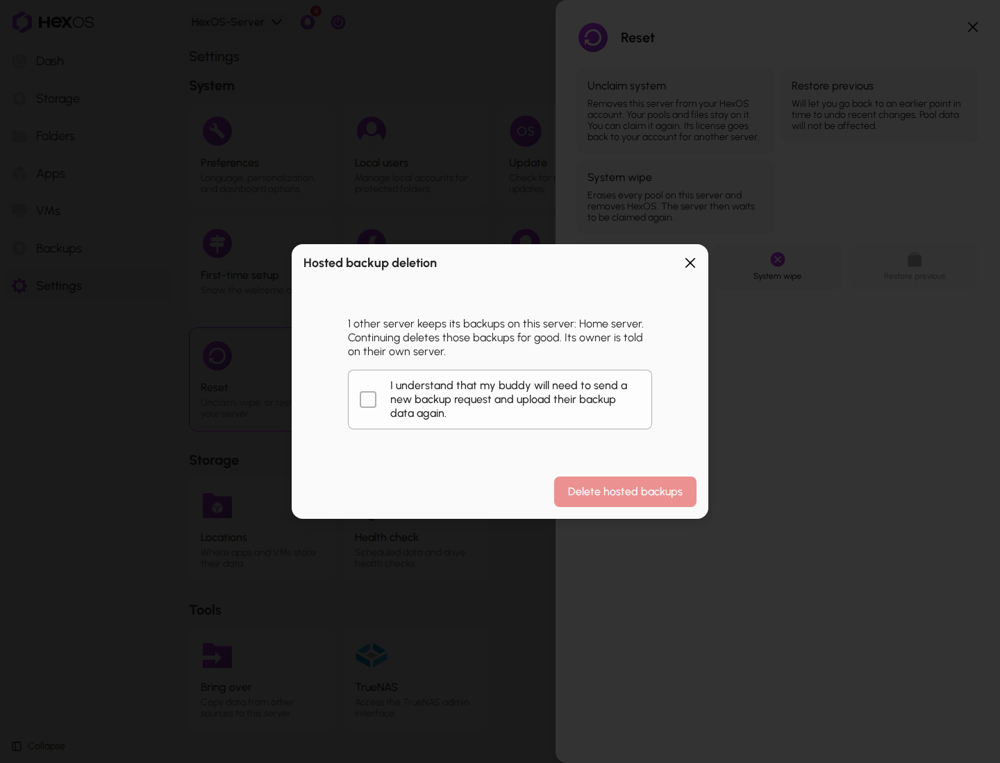{.medium .framed}

4. Wait for the wipe to finish. Read its result before claiming or reusing the server. When the wipe succeeds, HexOS returns to server setup. The other owners receive a notification. Their original source folders and local restore points remain on their own servers.

 Server setup after a completed wipe 

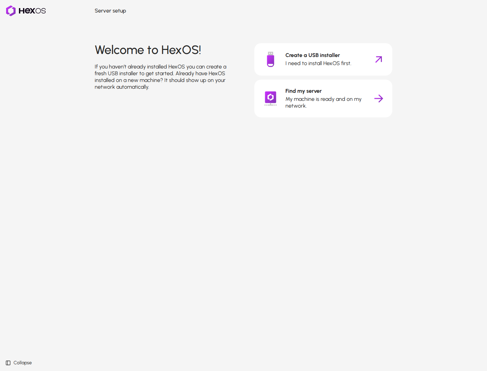{.medium .framed}

> **Info:** The current removal notification can describe the direction of the deleted copy incorrectly. When a destination server is unclaimed or wiped, it is the copy stored there that is deleted. Check your backup destinations before relying on that connection again.
{.is-info}
> **Danger:** Unclaiming or resetting a server permanently deletes every backup it stores for others. The unclaim dialog's "Pool data will not be affected" means the server's own files.
{.is-danger}

Before you unclaim, reset, rebuild, or sell a server that stores backups:

1. Tell your buddy first.
2. Open each hosted backup, click **Remove**, then **Remove connection**. This tells them.
3. Then unclaim or reset the server.

In the normal unclaim flow that keeps sent copies, unclaiming your server does not delete the backups it sent elsewhere. They are kept as **Retained backups**, so a new server can take them over. See [Recover a failed server](/features/backups/recover-a-failed-server).

## Wait for a restore to finish

> **Warning:** While a restore is running, do not remove the folder from the backup or remove the connection. Both delete the copy the restore reads from.
{.is-warning}

## Old restore points are removed on their own

The retention period controls when older restore points become eligible for cleanup. Some points may stay longer while needed for backup history. You choose the time in **Schedule & Retention**: 1 week, 2 weeks, 1 month, or 3 months. Choosing a shorter time shows a removal preview when the other server can be reached, then asks for confirmation. If it cannot be reached, the count is unavailable. Weekly backups require at least two weeks of retention.

 Confirm a shorter retention period 

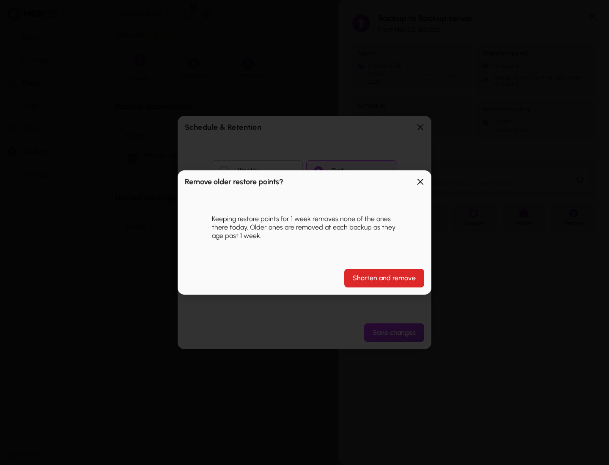{.medium .framed}

> **Help:** Not sure what a button will do? Ask in the [HexOS Discord Community](https://discord.gg/fCW2htvYdz) before you click it.
{.is-troubleshooting}
