# Restore a folder

> **Info:** Buddy Backups is in beta. A completed backup provides restore points. Test a restore to check that your files are available. Beta means we are still finishing it, so screens may change and you may find a rough edge. Keep any backup you already rely on running alongside it. [What beta means](/features/backups#what-beta-means)
{.is-info}

A restore brings a backed-up folder back onto your server as a folder. It never overwrites a folder you already have. You can restore to check a file, compare versions, or undo a mistake without replacing the current folder.

Only you can restore your own backups. The buddy who stores your copy cannot open or restore it.

## Before you start

- Restore from the server whose folder it is: the one that sends the backup.
- You can restore from a backup you or your buddy paused. The pause still stops new backups. A maintenance hold or a missing license on the sending server can prevent a restore.
- The server that stores the backup must be online. If it is offline, the dialog says it cannot list restore points yet.
- The pool you restore to needs room for the whole folder.
- If the folder uses a passphrase, have it ready. The restore cannot finish without it.

> **Info:** For an autogenerated folder key, HexOS can open the saved copy with your sign-in when recovery is **Managed**. If you kept the original server's recovery key yourself, have its emergency kit ready. See [Recovery key and emergency kit](/features/folders/recovery-key).
{.is-info}

## Start a restore

1. Open **Backups** on the server whose folder you want to restore. Click the backup under **Backup destinations**.
2. Click **Restore** at the bottom of its details panel. You can also open a folder's menu and click **Restore from this backup**.

 The Restore tile in the backup details 

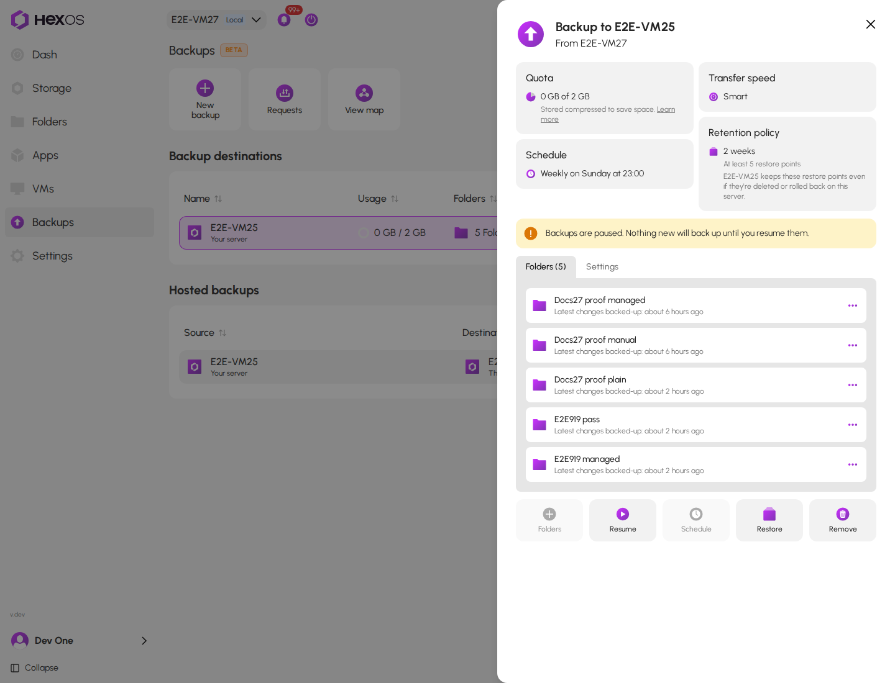{.medium .framed}

3. In **Folder**, choose the folder and a **Restore point**. **Latest backup** uses the newest available copy. Enter a name in **Restore as**. HexOS creates a new folder and leaves your current folder unchanged. If **Passphrase (optional)** appears, you can enter the backup's passphrase now or leave it blank to enter later. Click **Continue**.

 Choose the folder, restore point and new name 

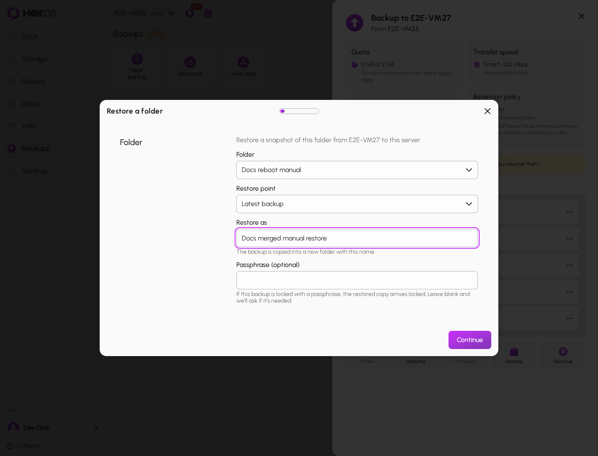{.medium .framed}

4. In **Location**, choose the pool for the restored folder. It needs enough room for the whole folder. Click **Continue**.

 Choose where to restore the folder 

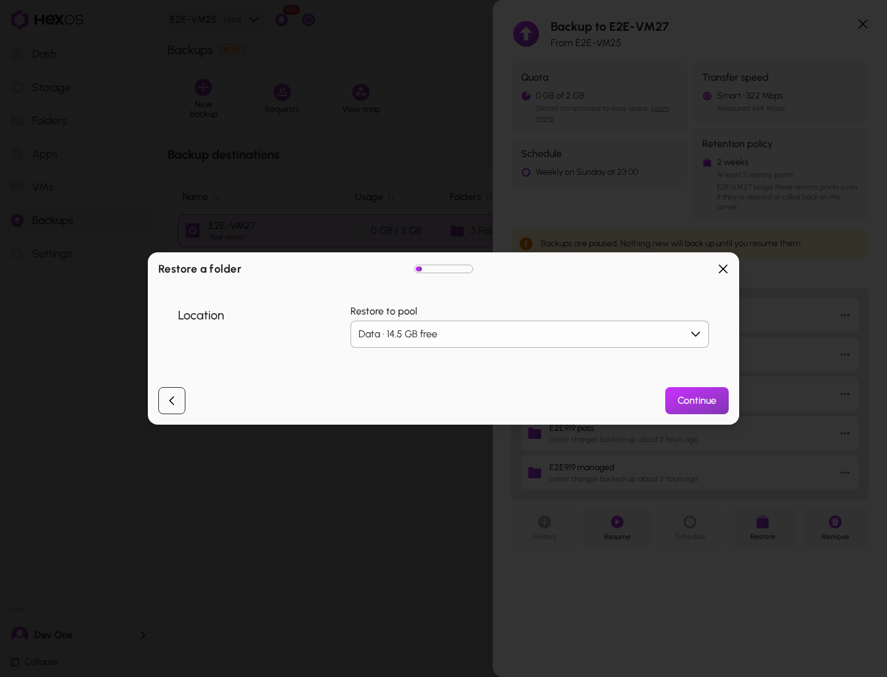{.medium .framed}

5. In **Access**, check who can open the restored folder. If the original folder still exists, HexOS starts with its current access. Choose **Private** to select users and give each **Full Access** or **View Only**. Choose **Public (Everyone)** only if everyone on your network should have access. Click **Continue**.

If the original folder no longer exists, the restore starts with no users assigned. HexOS may also leave users unselected if it cannot read or copy the original permissions. Check the selected users and their access before continuing.

 Check access to the restored folder 

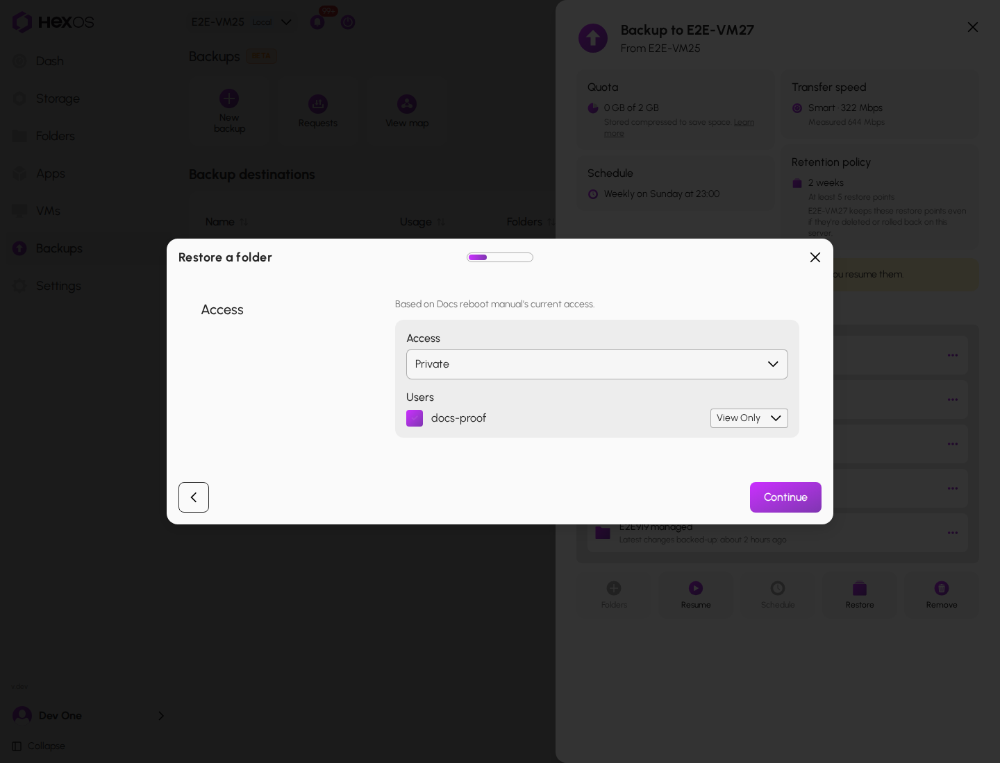{.medium .framed}

6. Check the **Review** cards. Use a card's pencil button to change it. Click **Restore**.

 Review the new folder before starting 

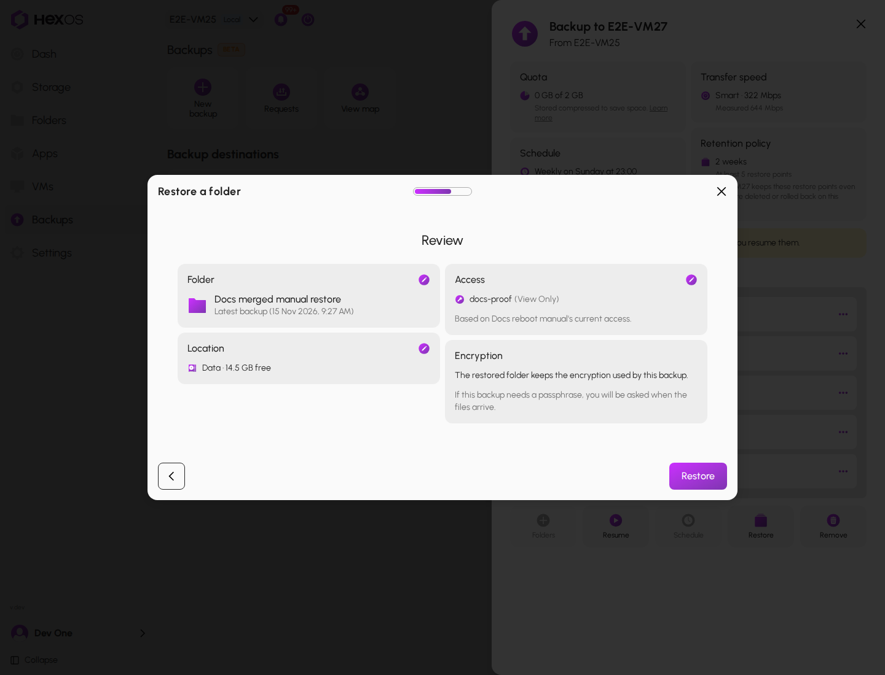{.medium .framed}

If HexOS already has all the choices it needs, the dialog opens at **Review**. Use the pencil buttons to check or change those choices.

The restored folder keeps the encryption used by the backup you selected. This can differ from the original folder's current encryption setting.

HexOS confirms with **Restore started**. Follow the restore in the **Activity Center**. Wait for completion before opening the restored folder; copying the data is only part of the restore.

> **Warning:** A restore point marked **Damaged** cannot be fully read on the other server, so its restore may stop partway. Choose another restore point, or repair the backup first. See [Backup troubleshooting](/features/backups/troubleshooting).
{.is-warning}

You can also start from the original folder's page. Open its **Backups** tab, open the backup's menu, then click **Restore from this backup**.

 Restore from the original folder's Backups tab 

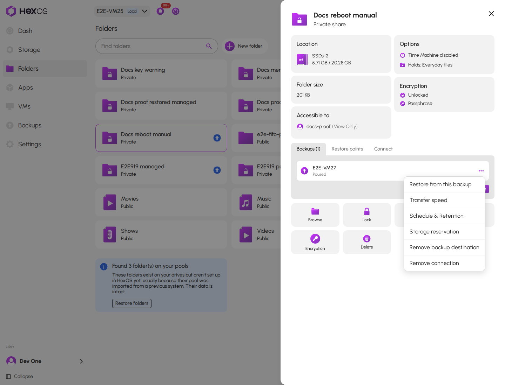{.medium .framed}

## Unlocking the restored folder

A restored encrypted folder arrives locked.

**Autogenerated key:** with **Managed** recovery, the folder normally unlocks while you are signed in. The restore may say **Couldn't unlock automatically.** Click **Continue** if it does.

 Continue when automatic unlocking needs your help 

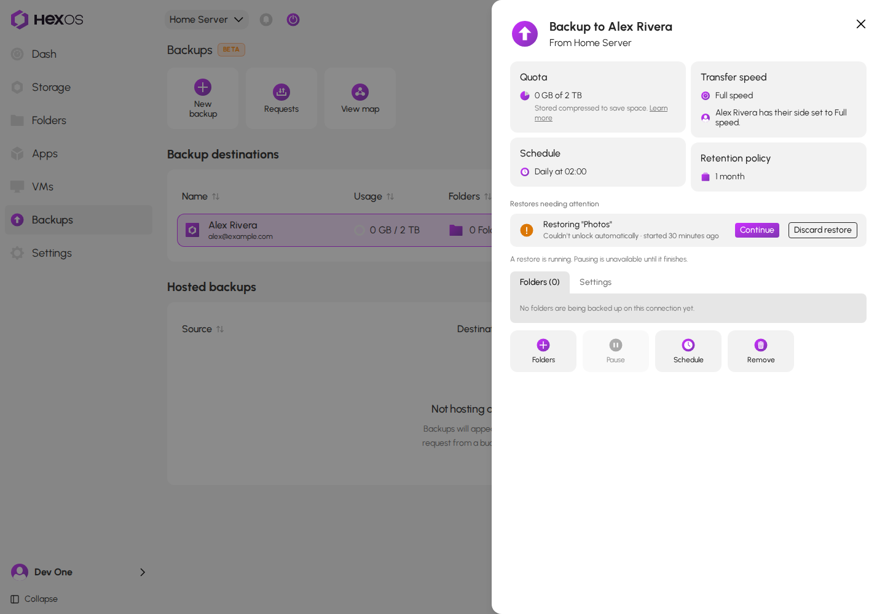{.medium .framed}

In **Continue the restore**, click **Continue restore**. HexOS asks if it needs a recovery key or a passphrase. If **Recovery key needed** appears, use the emergency kit for the server named in the prompt. Follow [When HexOS asks for a recovery key](/features/folders/recovery-key#when-hexos-asks-for-a-recovery-key).

 Confirm that HexOS should finish the restore 

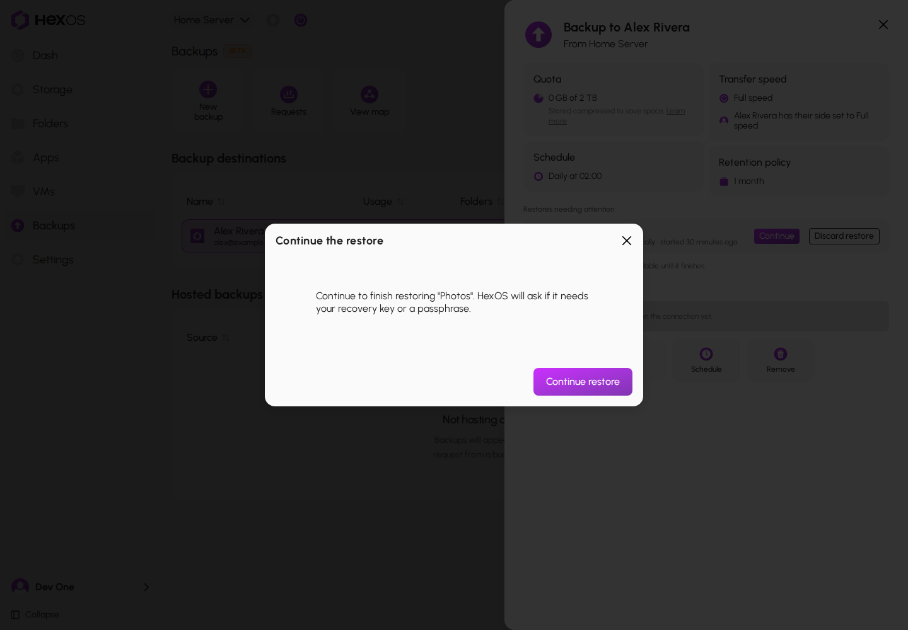{.medium .framed}

**Passphrase:** if you typed the passphrase in the dialog, the restore copies the data and unlocks the folder in one go. If you left it empty, the restore copies the data first, then waits. You get a notice that the folder "is waiting for its passphrase".

To finish a restore that is waiting:

1. Click the notification bell at the top of the Command Deck. Open the restore under **Jobs**, then click **Enter passphrase**. Or, on the backup's page under **Restores needing attention**, click **Unlock**.

 A restore waiting for a passphrase in Backup activity 

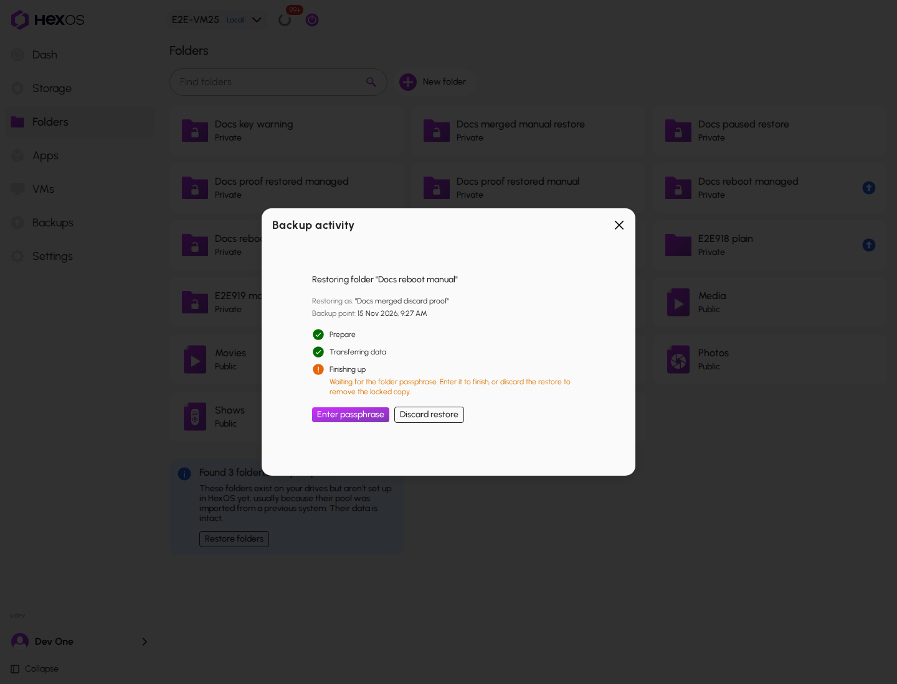{.medium .framed}

2. Type the passphrase and click **Unlock and finish**.

 Enter the passphrase after the copy arrives 

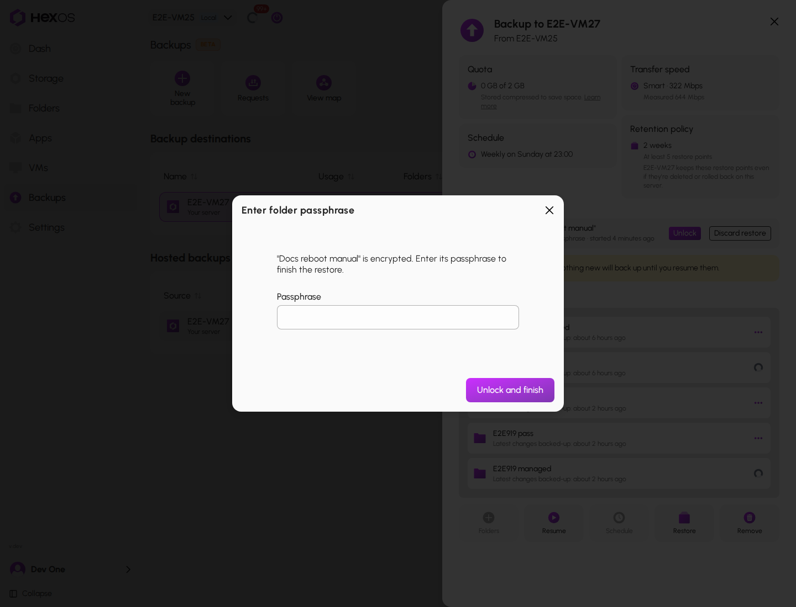{.medium .framed}

If the passphrase is wrong, the restore stays locked. The dialog stays open, clears the passphrase field and shows **That passphrase didn't unlock the folder. Try again.** Type the correct passphrase and click **Unlock and finish** again.

 Try again after a rejected passphrase 

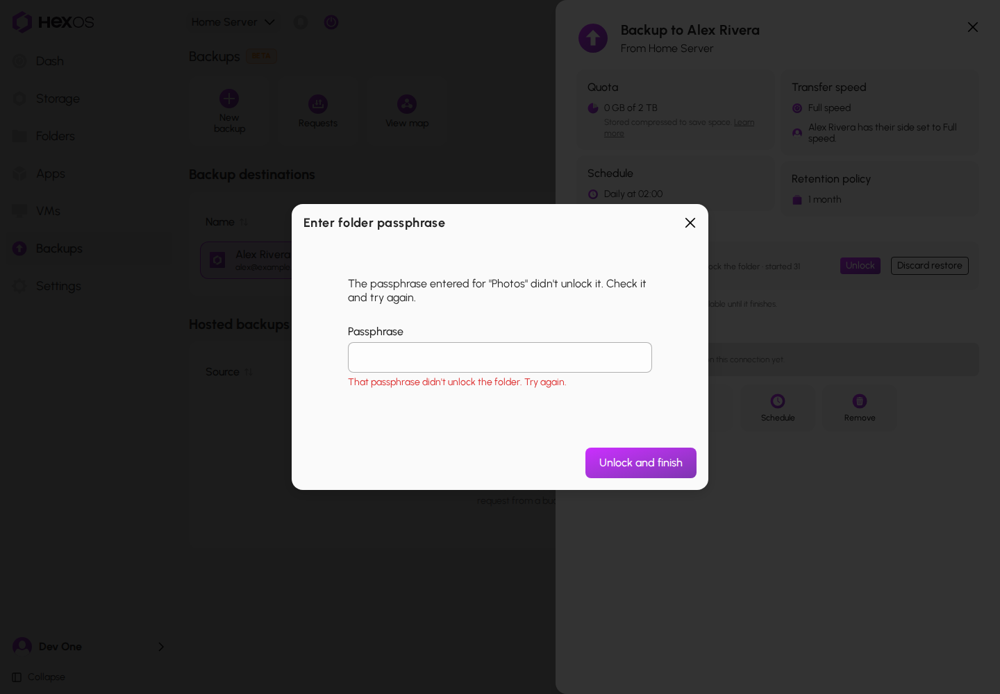{.medium .framed}

If you cannot find the passphrase, close the dialog. Click **Discard restore**, then **Discard restore** again in "Discard this restore?". That removes the locked copy from your server; anything left behind shows under **Restores needing attention**. The backup itself stays, so you can restore again later.

 Discard a restore whose main folder is still locked 

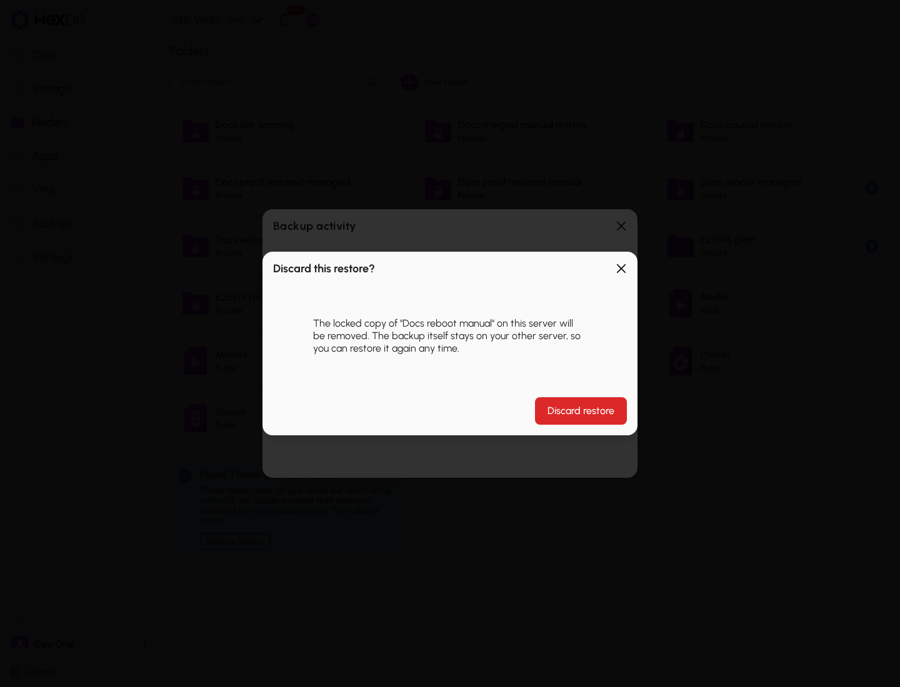{.medium .framed}

> **Tip:** For a large folder with a passphrase, start the restore without it. The data copies while you look for the passphrase, and HexOS asks for it when the data has arrived.
{.is-tip}

### A folder inside the backup has its own passphrase

A folder inside the restored copy can have a different passphrase. HexOS names that inner folder when it asks you to unlock it. Enter the passphrase for the named folder. The outer folder's passphrase may not open it.

 HexOS names the inner folder that needs a passphrase 

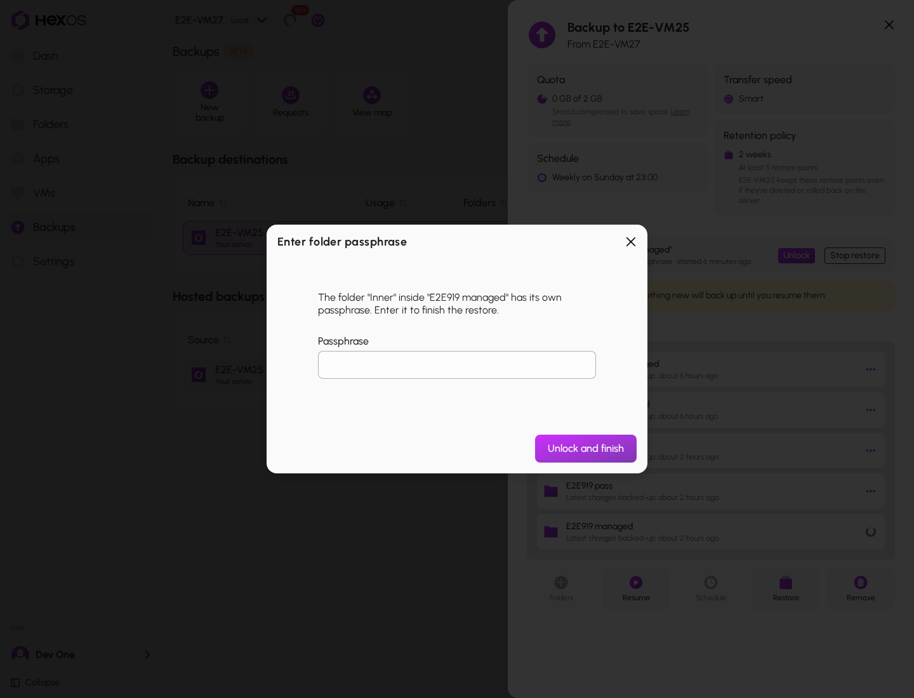{.medium .framed}

HexOS waits until the inner folders are unlocked before sharing the restored folder. If the outer folder is already readable, click **Stop restore**, then **Stop restore** in **Stop this restore?** to stop without deleting the received copy. Only **Remove copy** deletes that leftover copy.

 Stop the restore while keeping the received copy 

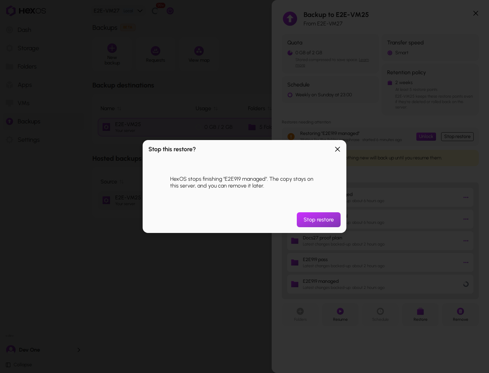{.medium .framed}

## While it runs

The Activity Center shows the progress. A large folder can take a long time. Click the notification bell, then open the restore under **Jobs**. Click **Stop restore** to stop an unfinished transfer.

 Follow or stop a restore in Backup activity 

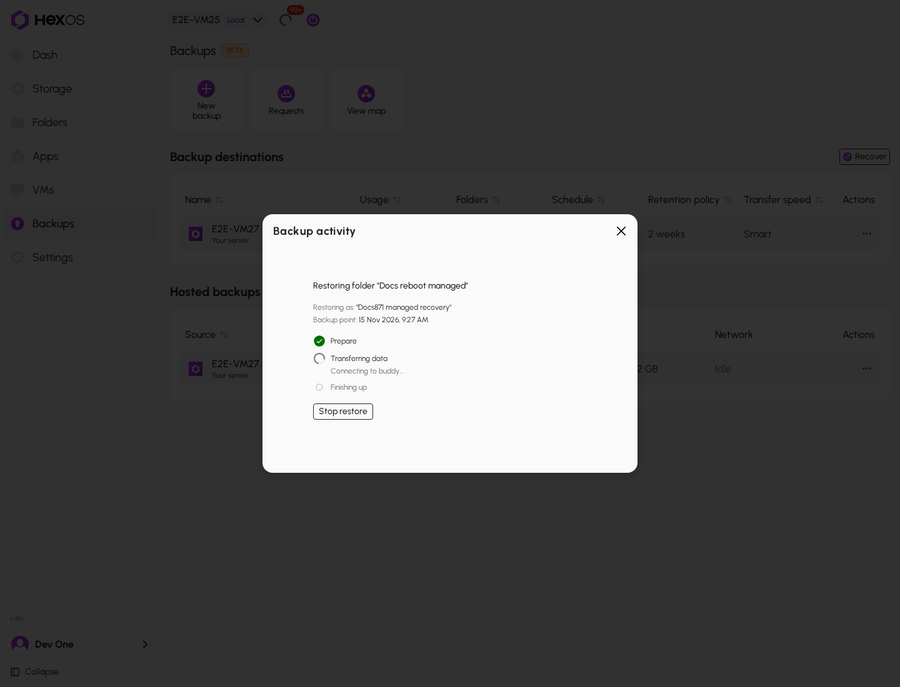{.medium .framed}

> **Warning:** Let a restore finish before you remove the folder from the backup or remove the connection. Removing either deletes the copy the restore reads from.
{.is-warning}

## After it finishes

You get a notice that the folder was restored. It says who can open it, for example "Your folder is back. Sharing access was granted to" the people you chose. If someone you chose is no longer on this server, the notice says they "could not be matched to the accounts you selected, so they were left out." The folder shows with your other folders, on the pool you chose. Your original folder, if it still exists, is unchanged.

 The restored folder appears with your other folders 

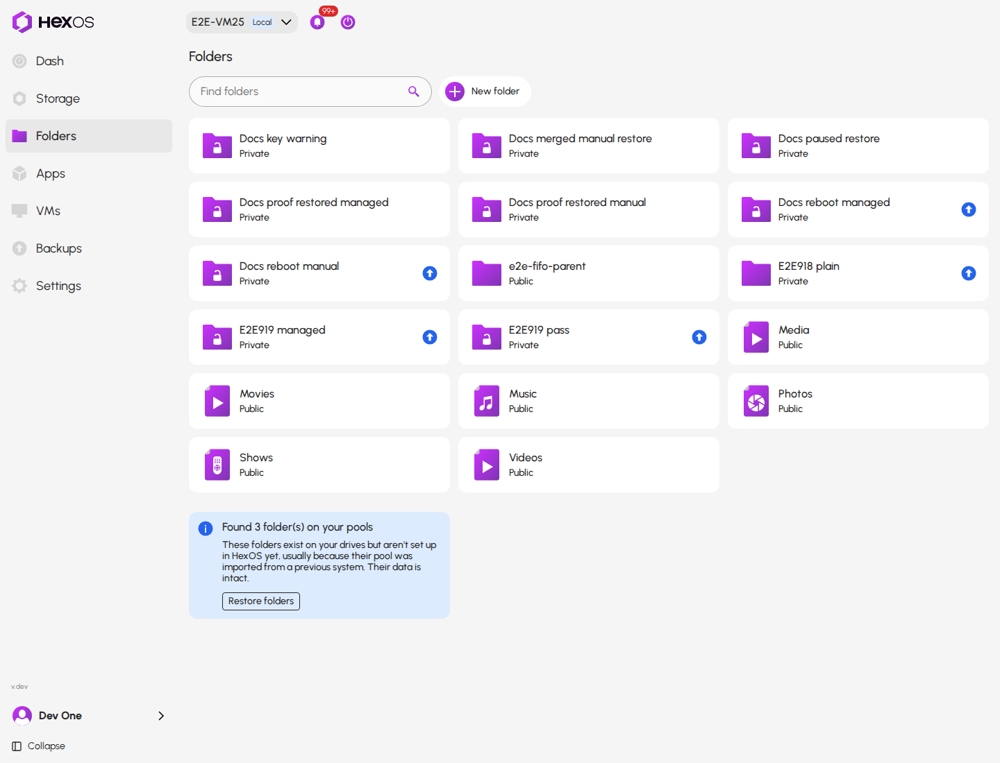{.medium .framed}

To change who can open the folder later, see [Folder permissions](/features/folders#folder-permissions).

> **Warning:** Folders restored before restores asked who can open them came back open to everyone on your network, with no password. If you restored a folder before then, set who can open it. See [Folder permissions](/features/folders#folder-permissions).
{.is-warning}

## If sharing could not be finished

Your files are restored, but HexOS could not finish or verify sharing. The restore says one of these:

- "Your files are restored, but HexOS could not finish setting up sharing. Try again." On the backup's page, under **Restores needing attention**, click **Try again**. Nobody can open the folder over the network until it finishes.
- "Update this server, then press Try again to finish sharing the folder." Update HexOS on this server, then click **Try again**.
- "Your files are restored, but HexOS could not verify the network share settings. It has stopped setting up sharing. Contact support." HexOS cannot verify the share settings. Ask for help in the [HexOS Discord Community](https://discord.gg/fCW2htvYdz).

 A restore waiting for Try again 

{.medium .framed}

If HexOS asks for a server update, finish the update before retrying.

 Update the server before retrying sharing 

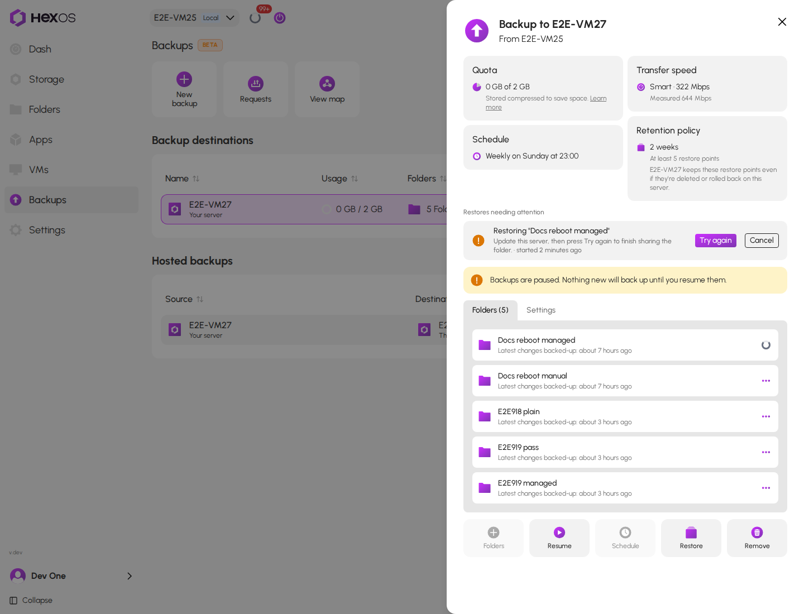{.medium .framed}

If HexOS cannot verify the share settings, contact support before changing them.

 Sharing has stopped for a settings review 

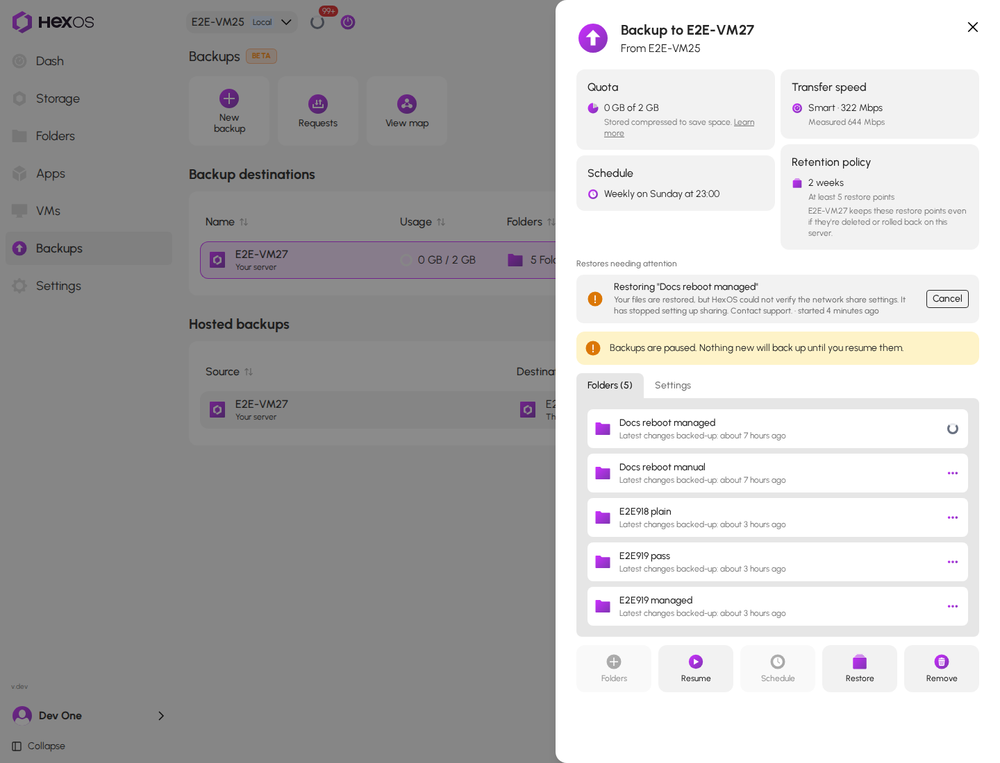{.medium .framed}

**Cancel** on a restore like this keeps the restored files.

## A restore that did not finish

A restore that failed or was stopped can leave a copy behind. The backup's page then shows it under **Restores needing attention**: "Left a copy on this server as" and the name, "that never became a folder."

1. Click **Remove copy**.

 A stopped restore with a leftover copy 

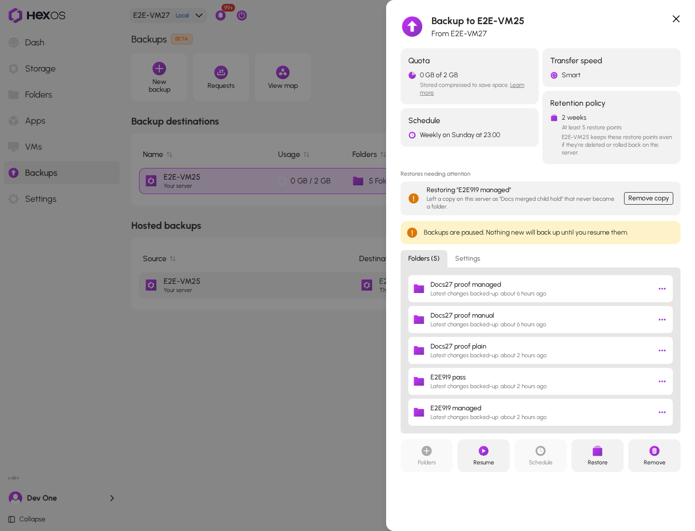{.medium .framed}

2. In **Remove the leftover copy?**, click **Remove copy**.

 Confirm removal of the leftover copy 

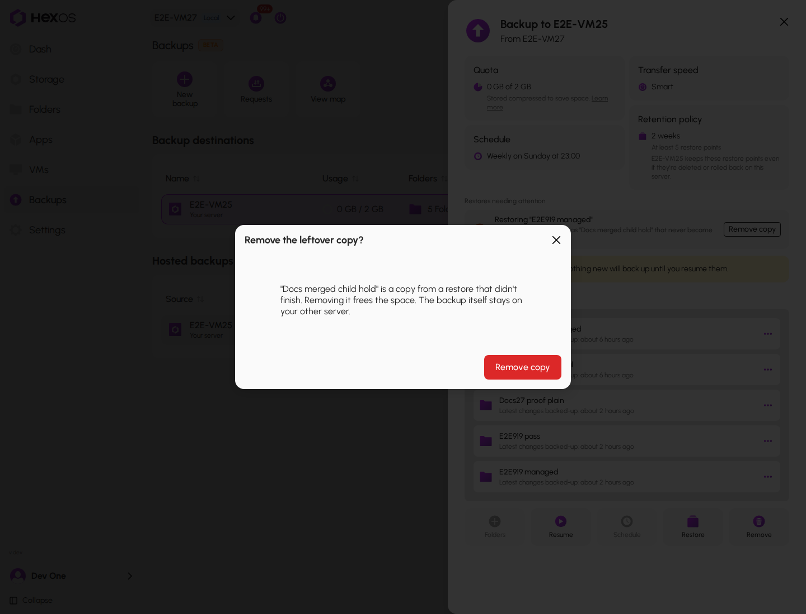{.medium .framed}

This frees the space. The backup itself stays where it is.

## What you can and cannot restore

**Whole folders only.** You cannot pull back a single file. Restore the folder, copy out what you need, then delete the restored folder if you no longer want it.

**Any restore point you still keep.** You choose how long restore points are kept in **Schedule & Retention**: 1 week, 2 weeks, 1 month, or 3 months. Restore points become eligible for removal under the retention period you choose.

> **Warning:** Restore points are not an archive. If you need a version for longer than you keep restore points, restore it now and keep it as its own folder.
{.is-warning}

## If your server is gone

This page assumes your server still works. If the server itself is lost, the copies on the other server are kept, and a new server on your account can take them over. See [Recover a failed server](/features/backups/recover-a-failed-server).

> **Help:** A restore waiting on a passphrase you cannot find, or one that will not start? See [Backup troubleshooting](/features/backups/troubleshooting) or ask in the [HexOS Discord Community](https://discord.gg/fCW2htvYdz).
{.is-troubleshooting}
