# Create a new folder

1. Log in to the [Command Deck](https://deck.hexos.com).
2. Go to the **Folders** screen in the side menu.

 Folders screen 

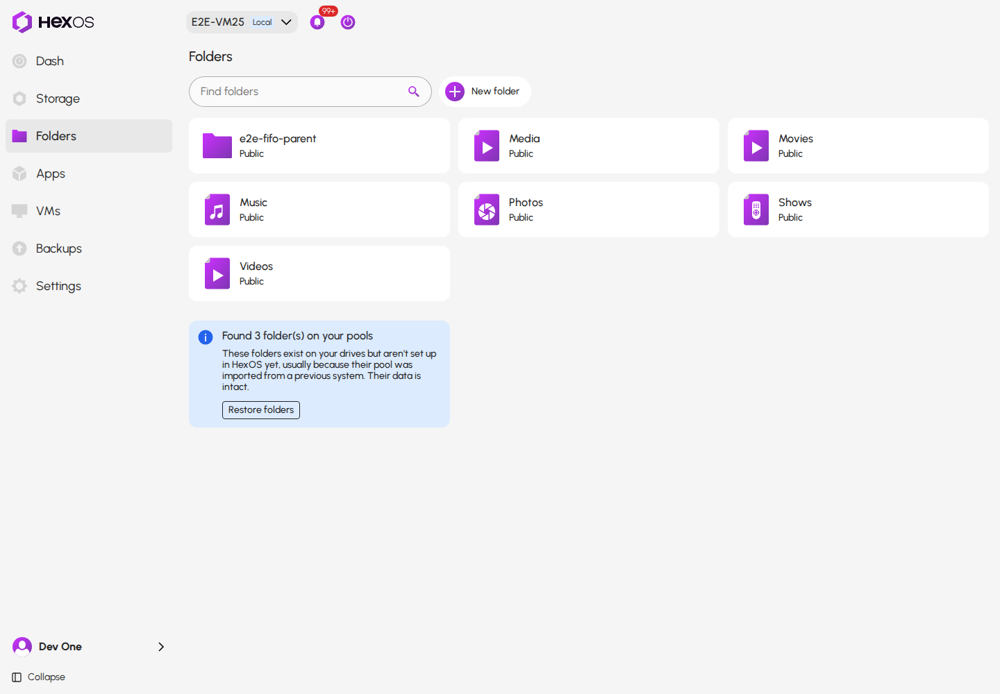{.medium .framed}

3. Click the **New folder** button.

 New folder button 

{.medium .framed}

This opens the **Create Folder** dialog. It has five steps: **General**, **Access**, **Options**, **Encryption** and **Review**. Click **Continue** to go to the next step and **Back** to go back.

 Create Folder dialog 

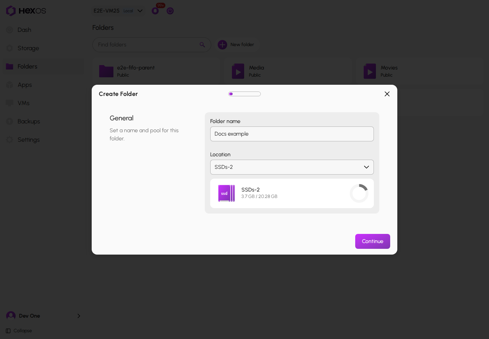{.medium .framed}

You can also start the same folder wizard from **Settings** > **Locations** when choosing a location. The encryption choices depend on your sign-in and available features. This guide shows the HexOS-account flow with managed encryption available.

## General

### Folder name
- Choose a folder name.

> **Warning:** Folder name cannot be modified after folder creation.
{.is-warning}

### Folder location
- Choose the pool you would like your folder to be in.
  - If you only have one pool then it will automatically be selected for you.

> **Warning:** Folder location cannot be modified after folder creation.
{.is-warning}

 Folder location pool selection 

{.medium .framed}

## Access
The **Access** step starts with **Public**, which allows people on your network to use the folder. Choose **Private** to limit access to selected local users, then choose **View Only** to allow reading or **Full Access** to allow writing as well. If there are no local users, use **New user**. See [Folder permissions](/features/folders#folder-permissions).

 Access step 

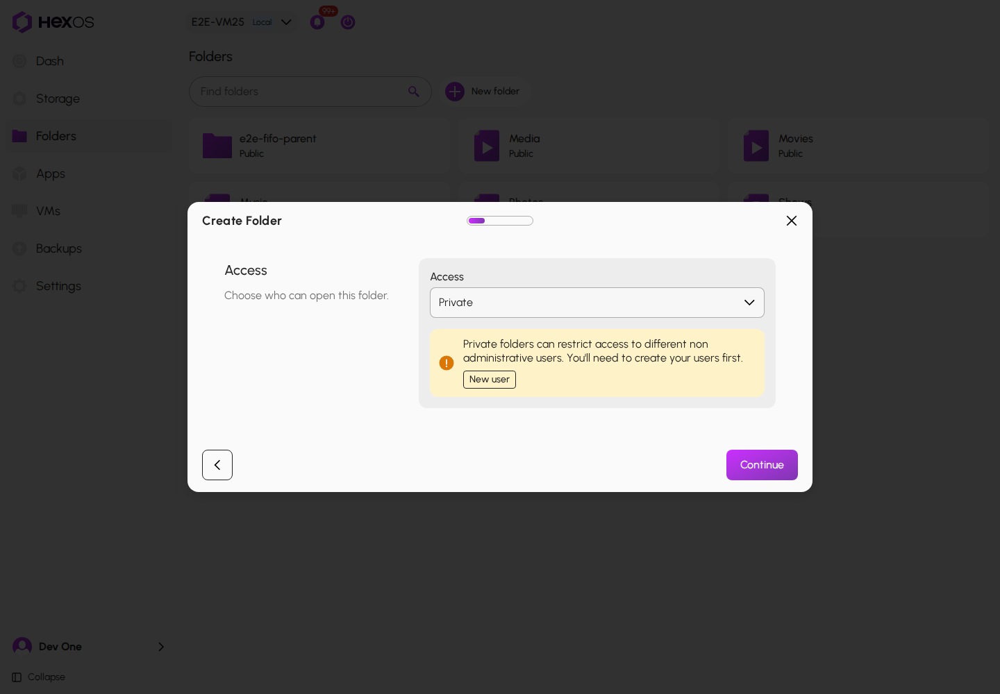{.medium .framed}

The example below shows **View Only**. A Time Machine destination needs **Full Access** so the Mac can write backups.

 User with view-only access 

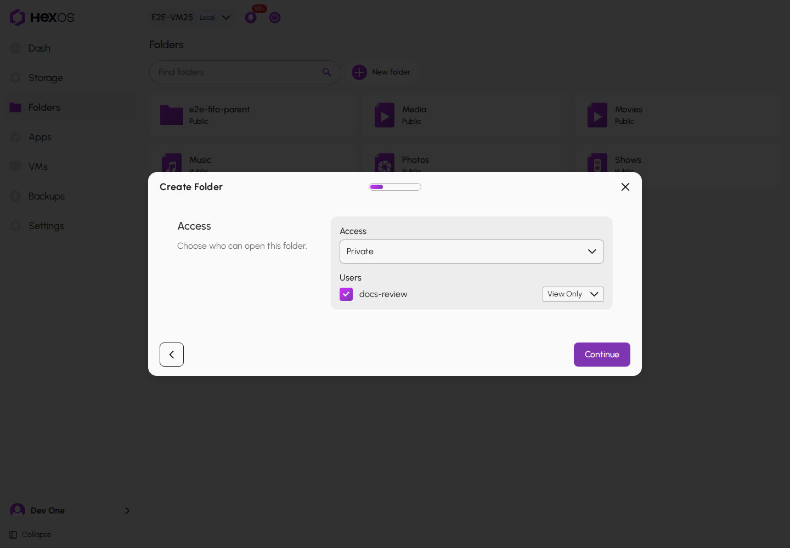{.medium .framed}

## Options

### Folder storage limit
Optional. In this section you can set a maximum amount of disk space the folder may use. This helps manage disk usage when multiple people or applications share your server.

### What the folder will hold

Under **What will this folder hold?**, choose **Everyday files** for documents, downloads and app data, or **Large media** for movies, shows and videos. The default is **Everyday files**.

### Backup for macOS

Turn on **Enable Time Machine** if this folder will receive Mac backups. If you also set a storage limit, check the effective limit shown here. Continue with the [Time Machine guide](/community/community-guides/TimeMachineInstall) to connect the Mac.

 Storage limit and backup options 

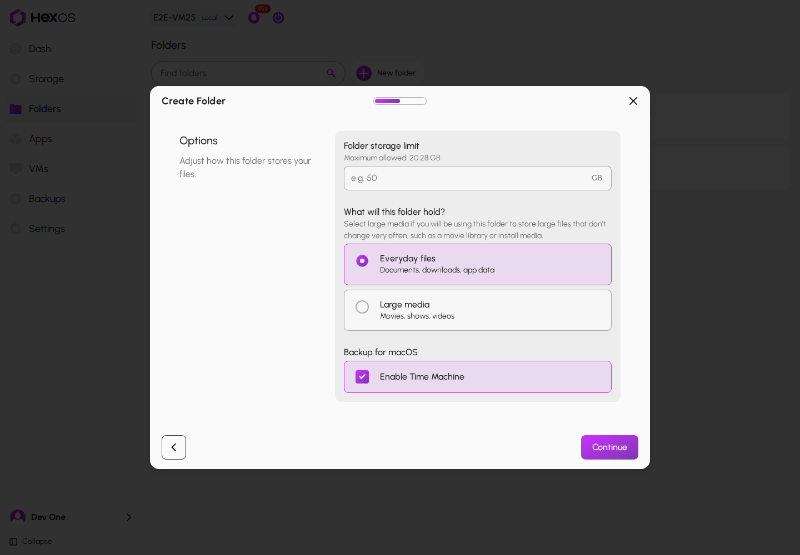{.medium .framed}

## Encryption

With managed encryption available for your signed-in HexOS account, **Autogenerated (recommended)** is selected. Check the available choices before continuing:

- **Autogenerated (recommended):** "HexOS keeps a copy of the key that only your sign-in can open." With **End-to-end encryption**, that copy also needs your recovery key. The folder unlocks by itself when your server starts, and there is nothing to remember.
- **Passphrase:** "Enter it after every restart. If it's lost, nobody can open the folder." Type a passphrase of at least 8 characters in **Passphrase** and again in **Confirm passphrase**.
- **Don't encrypt:** **Leave encryption off for this folder**. The folder cannot be backed up to another person's server until you encrypt it.

 Encryption step with Autogenerated selected 

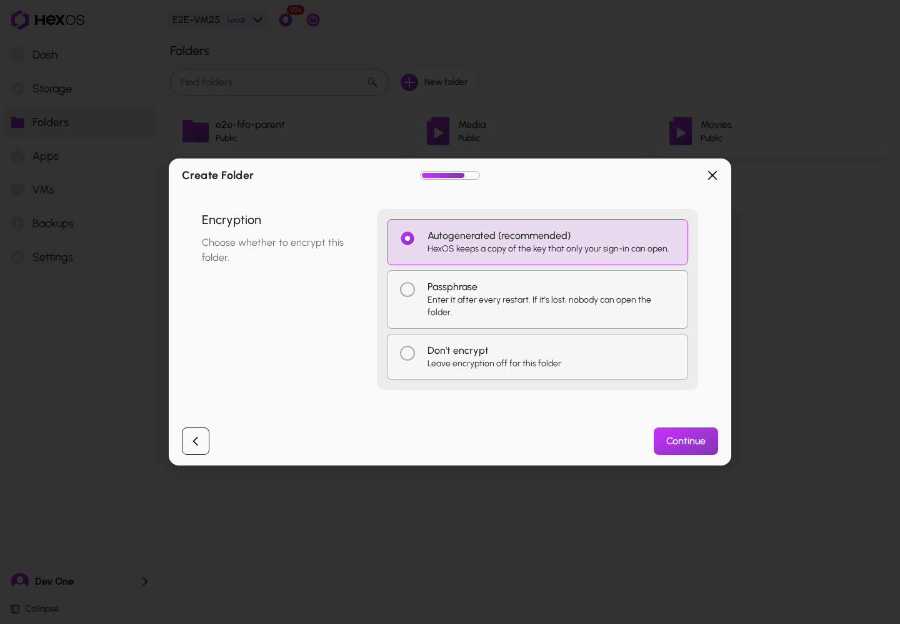{.medium .framed}

 Encryption step with Passphrase selected 

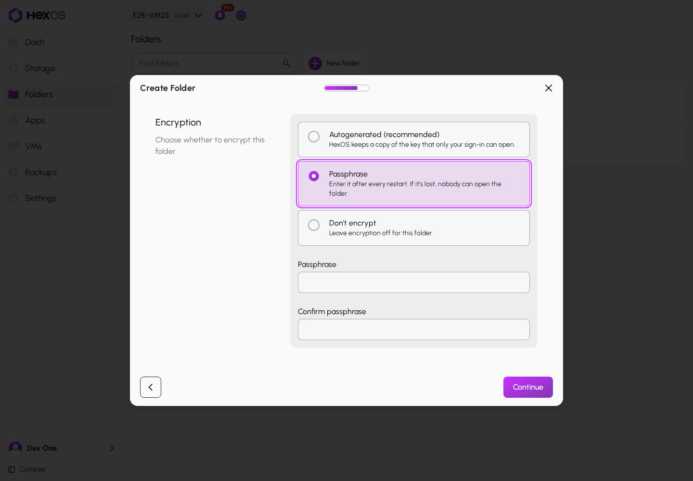{.medium .framed}

> **Danger:** If you choose **Passphrase** and lose the passphrase, nobody can open the folder or its backups. HexOS does not store your passphrase on its servers and cannot get it back. Write it down and keep it somewhere safe.
{.is-danger}

> **Warning:** An autogenerated key unlocks the folder for anyone who starts your server, because the key is kept on the server's boot drive. If the folder must stay unreadable when someone takes the whole server, choose **Passphrase**.
{.is-warning}

You can change an encrypted folder between **Autogenerated** and **Manual** later from the folder's page, and a folder you did not encrypt can be encrypted later. What each choice protects is explained in [Encrypted folders](/features/folders/encryption).

## Review and create the folder

The **Review** step shows your choices. Its **Encryption** card shows **Autogenerated key**, **Manual passphrase** or **Not encrypted**. This example uses **Full Access**, Time Machine and **Don't encrypt**; choose the protection your folder needs.

 Review step 

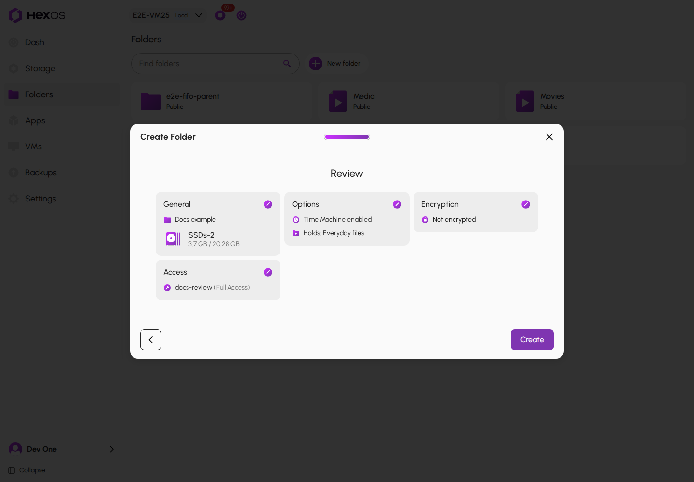{.medium .framed}

If you wish to adjust any settings, click **Back**, or click the edit button at the top right of a card to go back to its step. When you are ready, click **Create** and the folder will be created. When a folder is created you will see it on the **Folders** screen.

## Editing folder settings

To edit the settings of a folder go to the **Folders** screen and click the folder you wish to edit.

 Selecting a folder to edit 

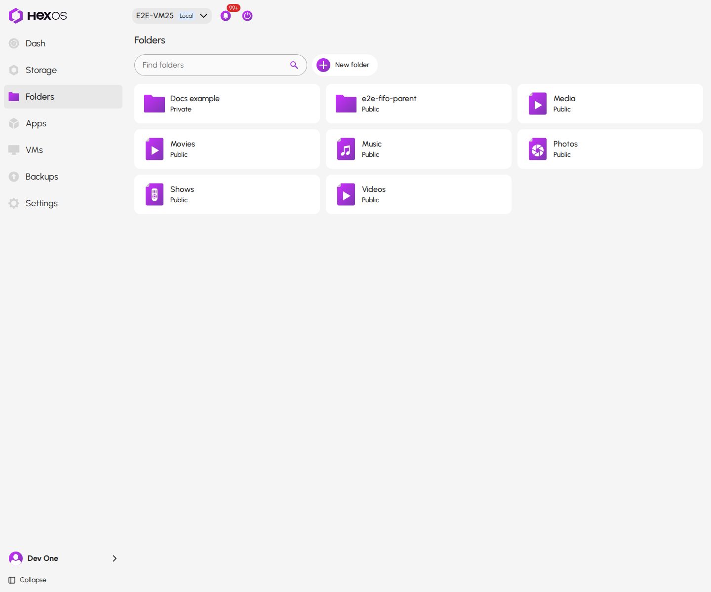{.medium .framed}

Then click **Edit**.

 Edit button 

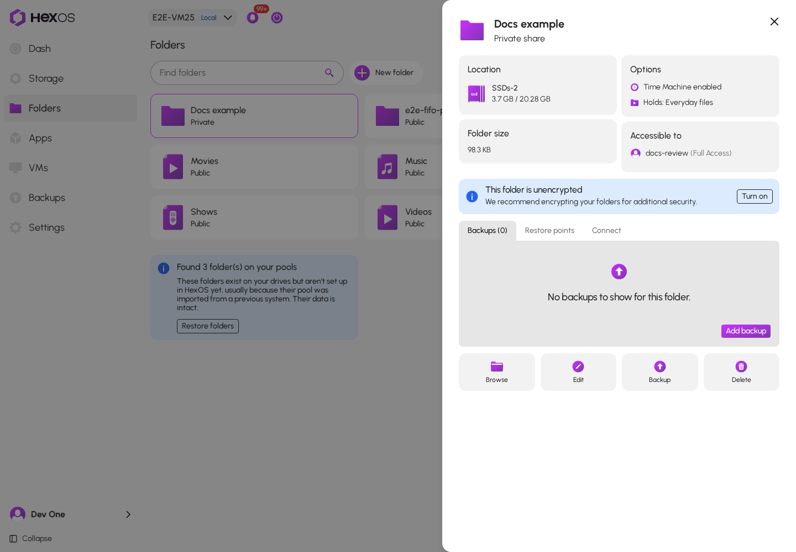{.medium .framed}

The **Edit Folder** dialog shows what may be edited. Folders cannot be renamed after creation. The **Encryption** step only shows the folder's current state and says "Change encryption from the folder's page." To change encryption, use the **Encryption** tile or the **Turn on** button on the folder's page (see [Encrypted folders](/features/folders/encryption#change-how-a-folders-key-is-kept) and [Turn on encryption for a folder](/features/folders/turn-on-encryption)).

 Edit Folder dialog, Encryption step 

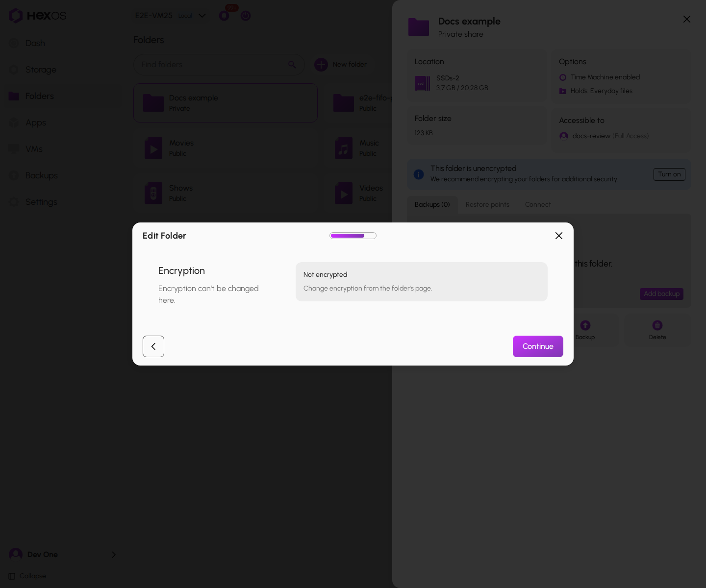{.medium .framed}

Check every card in **Review**. This example keeps the local user on **Full Access** for Time Machine. Click **Save changes** to save.

 Saving updated folder permissions 

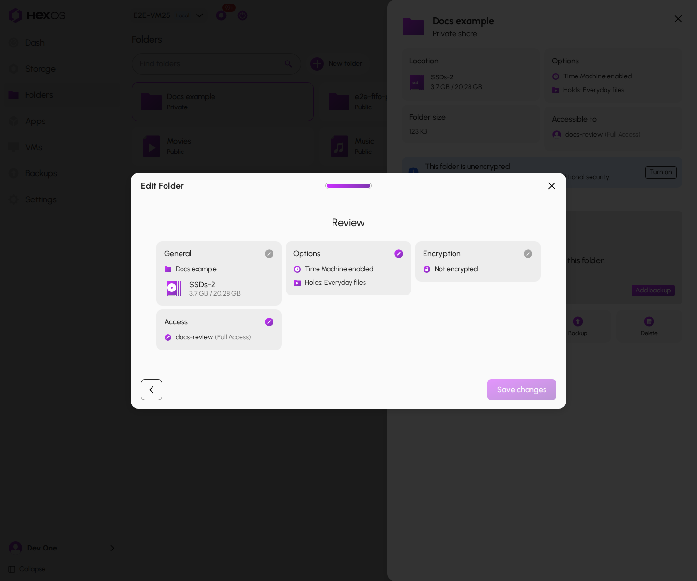{.medium .framed}

