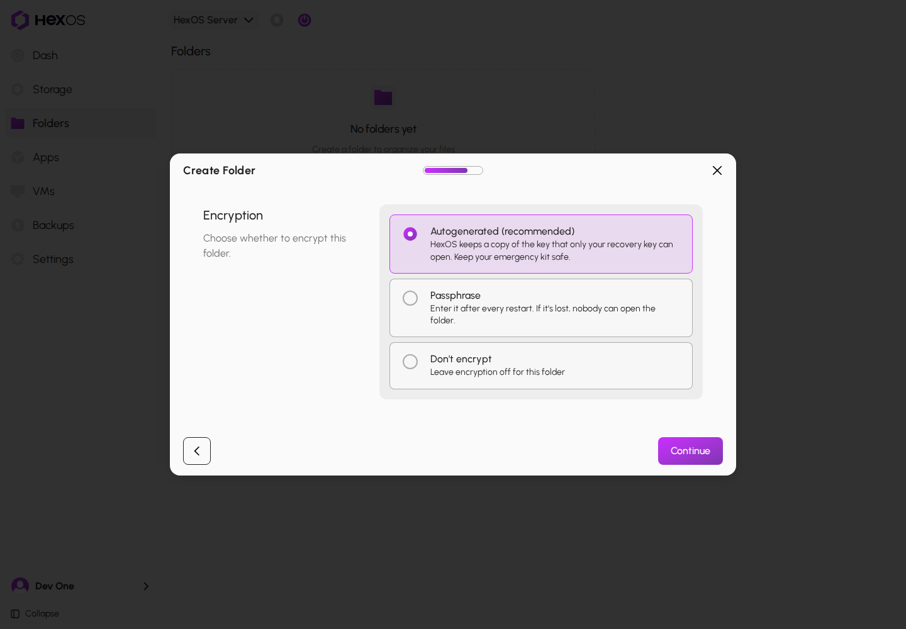
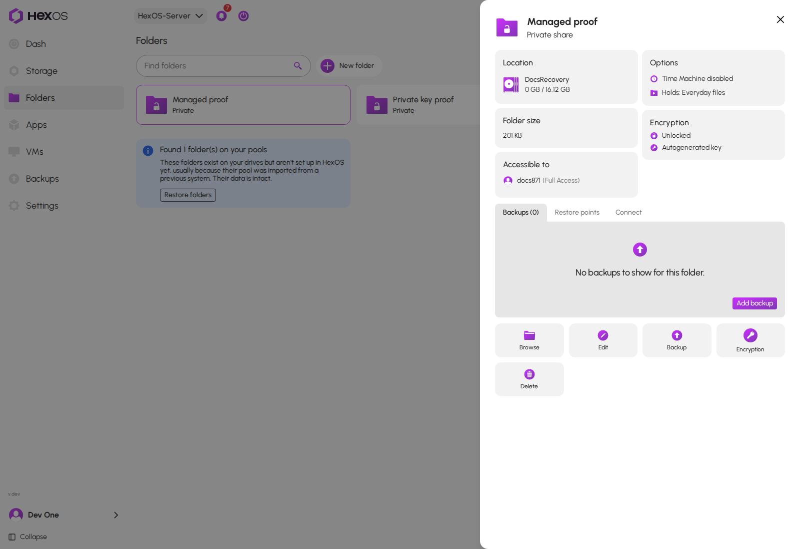
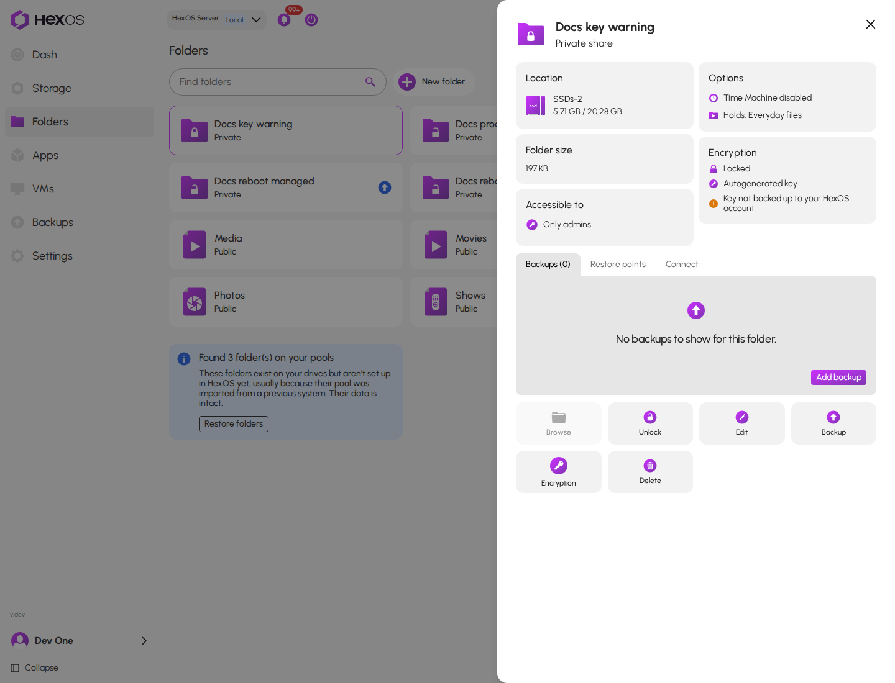
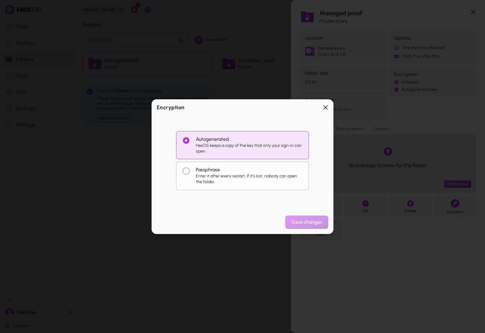
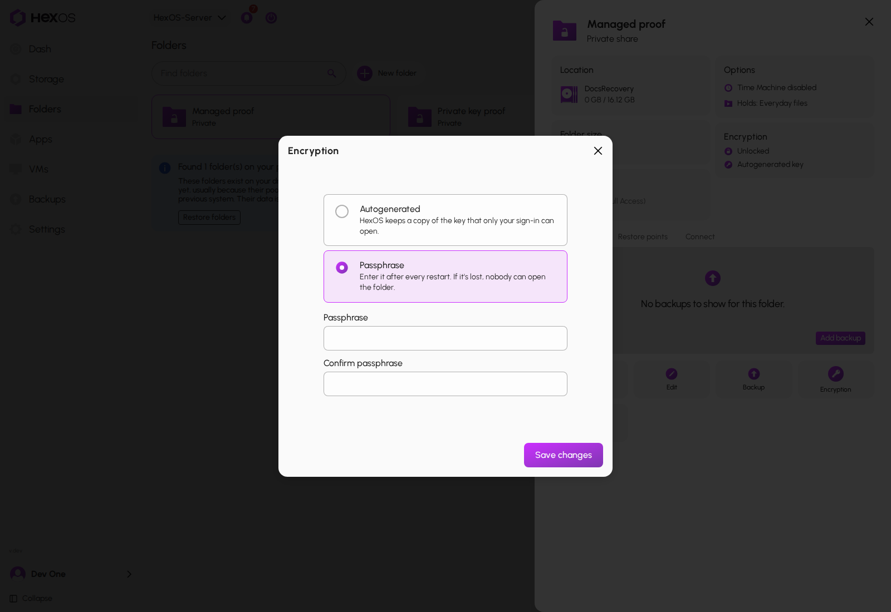
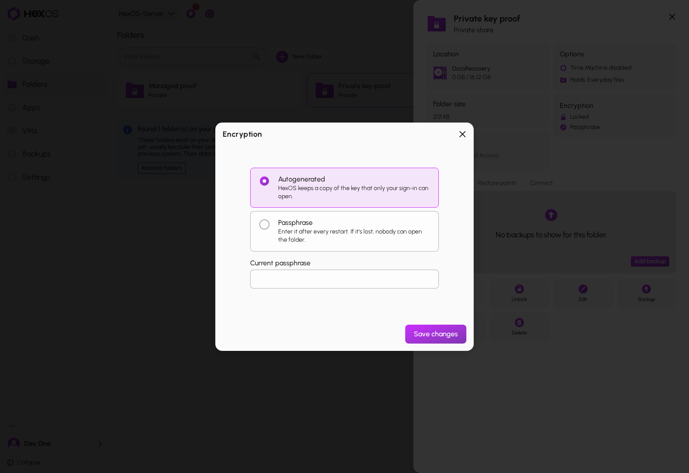
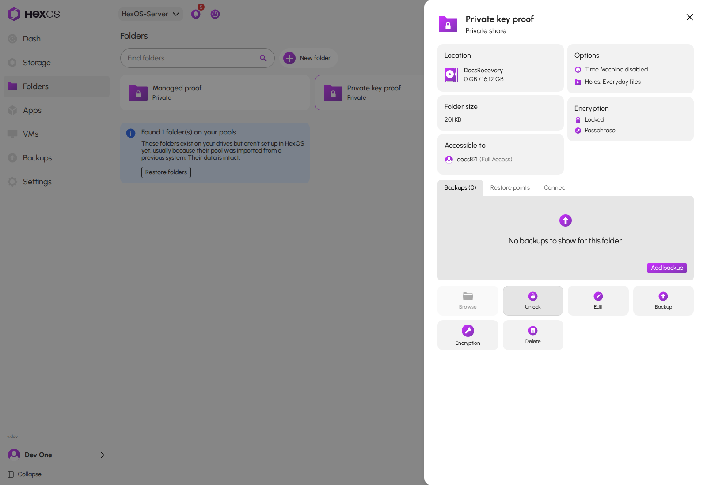
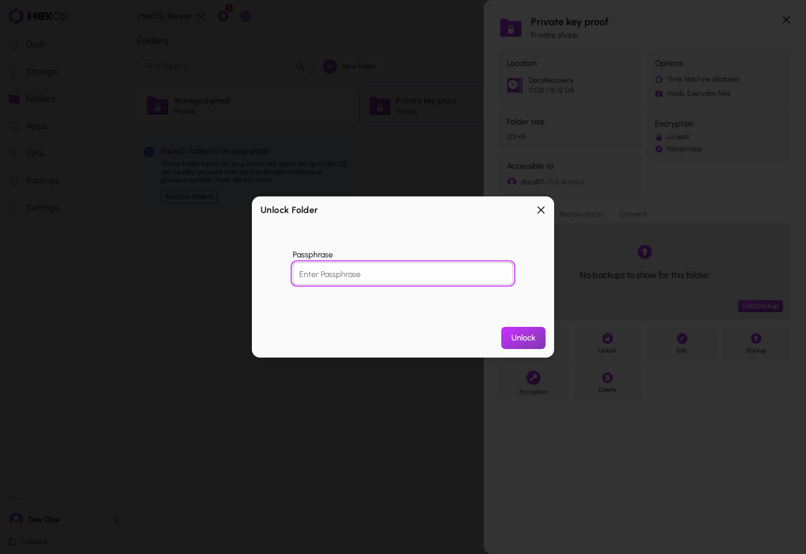
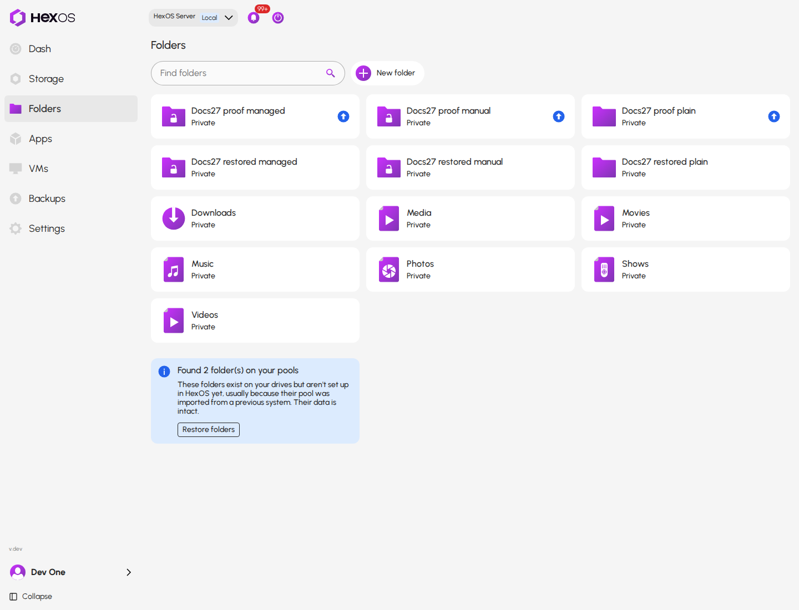
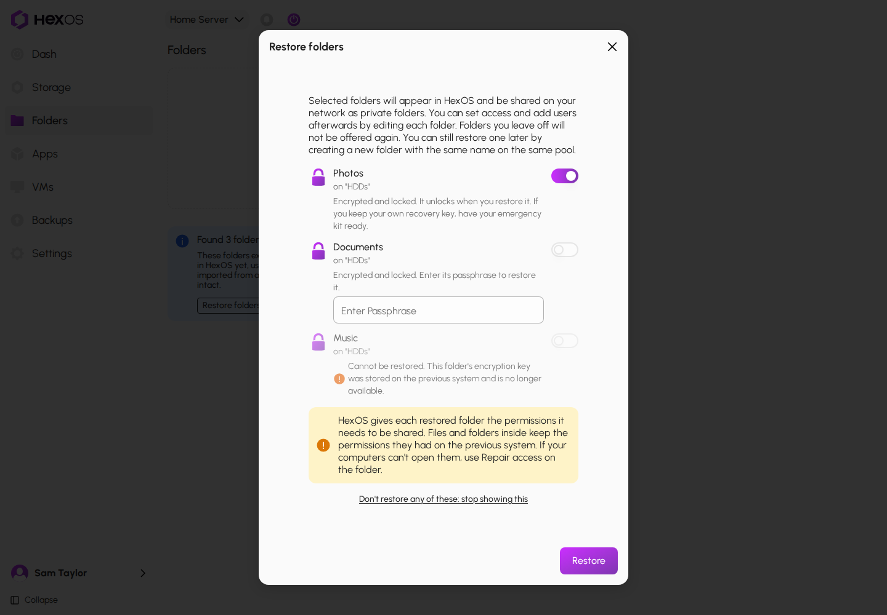

# Encrypted folders

An encrypted folder keeps its files scrambled on your drives. Only the folder's key can turn them back into readable files. This page explains what that protects, how the key is kept, and how to lock, unlock and restore an encrypted folder.

When managed encryption is available for your signed-in HexOS account, the folder wizard starts with **Autogenerated (recommended)**. Check the available choices before creating the folder. To encrypt a folder you already have, see [Turn on encryption for a folder](/features/folders/turn-on-encryption).

## How the key is kept

Each encrypted folder uses one of two ways to keep its key:

- **Autogenerated (recommended):** the folder unlocks by itself when your server starts. With **Managed** recovery, your HexOS sign-in can open the saved key copy. With **End-to-end encryption**, only your recovery key can open that copy. Keep your emergency kit safe.
- **Passphrase:** "Enter it after every restart. If it's lost, nobody can open the folder." You choose a passphrase of at least 8 characters.

 Autogenerated encryption when you keep the recovery key 

{.medium .framed}

A folder can also be left unencrypted (**Don't encrypt**). The choice says **Leave encryption off for this folder**. An unencrypted folder can only back up to your own servers.

Each server also has a recovery key, which locks the copies of its folder keys that HexOS keeps. You choose who keeps the recovery key: HexOS (**Managed**, the default) or only you (**End-to-end encryption**). See [Recovery key and emergency kit](/features/folders/recovery-key).

## What encryption protects

| | Autogenerated, recovery key **Managed** | Autogenerated, recovery key **End-to-end encryption** | **Passphrase** from the start |
|---|---|---|---|
| Unlocks by itself when the server starts | Yes | Yes | No. You type the passphrase. |
| Can be locked from HexOS | No | No | Yes |
| A storage drive taken out of the server on its own can be read | No | No | No |
| Someone who takes the whole server, boot drive included, can read it | Yes. It unlocks when they start the server. | Yes. It unlocks when they start the server. | No. It stays locked after a restart. |
| HexOS can open the folder's key for a request signed in to your account | Yes | No, once the old keys are removed (see below). It needs your recovery key. | No. HexOS does not store the passphrase. |
| A buddy who stores your backup can read it | No | No | No |
| To open a backup after the server is lost, you need | Your HexOS sign-in | Your HexOS sign-in and your recovery key | Your HexOS sign-in and your passphrase |

The table is about files written while the folder is encrypted. A folder you encrypted later can leave pieces of its old unencrypted files on the drives until that space is used again, so erase a drive before you sell it or send it back.

> **Warning:** Choose **Passphrase** if you need a folder to stay unreadable when someone takes the whole server. An autogenerated key is kept on the server's boot drive so the folder can unlock by itself, and that also unlocks it for whoever starts the server.
{.is-warning}

> **Danger:** A **Passphrase** that is lost cannot be recovered by anyone, including HexOS. The folder and backups created with that passphrase stay unreadable. Copies made before switching from an autogenerated key may still open with their earlier key. Keep the passphrase somewhere safe, away from the server.
{.is-danger}

**A folder that switched from Autogenerated to Passphrase** works like a passphrase folder from then on. HexOS still keeps its earlier key copies. They no longer unlock the folder on your server, but they do open copies of the folder made before the switch, such as a buddy's backup until the next backup after the switch arrives, a backup on a paused connection, or a disk image. With **Managed**, HexOS can open those older copies for a request signed in to your account. After older managed key copies have been removed, **End-to-end encryption** requires your recovery key to open those copies. The same applies to a folder you encrypted later with **Passphrase**, because the conversion runs on an autogenerated key until it finishes. While that conversion runs, your server holds the passphrase until the conversion finishes or is discarded; HexOS servers do not store it.

**Old keys after a key change.** A key change does not encrypt your files again: it changes the key that unlocks them. When a folder gets a new key (for example after you switch the recovery key to **End-to-end encryption**), HexOS keeps the old key until every backup of the folder has received the new key. If HexOS could open the old key before the change (with **Managed**), it still can until then, for a request signed in to your account. A folder whose files do not change keeps its old key until they do, and a backup on a paused connection keeps it too. **Settings** > **Recovery key** lists the folders still waiting. An old key still opens any copy of the folder made before the change, such as a disk image or a backup that never ran again. HexOS cannot encrypt an already encrypted folder again from the start.

Where each copy of a key is kept is shown in [Where your keys are kept](/features/folders#where-your-keys-are-kept).

## The page of an encrypted folder

Open **Folders** and click the folder. An encrypted folder shows an **Encryption** card that says whether it is **Locked** or **Unlocked**, and whether it uses an **Autogenerated key** or a **Passphrase**.

 Folder page of a folder with an autogenerated key 

{.medium .framed}

The tiles at the bottom of the page are **Browse**, **Edit**, **Backup**, **Encryption** and **Delete**. A folder with a manual passphrase also has a **Lock** tile (or **Unlock** while it is locked), right after **Browse**.

 Folder page of a folder with a manual passphrase 

{.medium .framed}

**Key not backed up:** if HexOS has no copy of an autogenerated folder's key, the card says **Key not backed up to your HexOS account**. This is rare. While the folder is unlocked and the account has the required license, HexOS attempts to fix it when you open the folder's page: the line changes to **Backing up the key to your HexOS account…** and then goes away. If the line stays, check the server connection and license before opening the page again.

 Key not backed up warning on the Encryption card 

{.medium .framed}

A folder that inherits its parent folder's encryption uses that folder's key. Its card says "Inside {parent}, so its key can't be changed here", and it has no **Encryption** tile and no **Lock** tile. It locks and unlocks with the outer folder. When the outer folder can be locked, the page says "This folder uses the key of {parent}, so it locks and unlocks with {parent}."

## Change how a folder's key is kept

When your license and the folder state allow it, you can change between **Autogenerated** and **Passphrase**. Only the way the key is kept changes; your files are not encrypted again. Wait for the operation to finish before using the new setting.

1. Open the folder's page and click **Encryption**.

 Encryption dialog 

{.medium .framed}

2. Click the way you want the key kept:
    - **Passphrase:** type the new passphrase in **Passphrase** and again in **Confirm passphrase**. It must be at least 8 characters.
    - **Autogenerated:** if the folder is locked, type its **Current passphrase**.

 Passphrase chosen, with the passphrase fields 

{.medium .framed}

 Current passphrase for a locked folder 

{.medium .framed}

3. Click **Save changes**. HexOS confirms with **The folder now uses your passphrase** or **The folder's key is now autogenerated**.

Things to know:

- A locked folder with an autogenerated key cannot change until it is unlocked: "Unlock the folder first, then change how its key is kept."
- Switching to **Autogenerated** means the folder unlocks by itself at every start, and HexOS keeps a locked copy of its key with your HexOS account. Keep the old passphrase until every backup of the folder has received the new key: backups made before it still open only with the passphrase.
- Switching to **Passphrase** means you type the passphrase after every restart. HexOS keeps the folder's earlier key, which still opens copies made before the switch (see [What encryption protects](#what-encryption-protects)).
- The **Encryption** tile is off while the folder is being encrypted.

> **Warning:** If the folder is backed up to a buddy, run a backup after you change how its key is kept, and check that it finishes. See [Known issues](#known-issues).
{.is-warning}

## Lock and unlock a folder

Only a folder with a **Passphrase** can be locked from HexOS. A locked folder and its contents cannot be seen or opened by anyone on the network, and **Browse** is not available.

**To lock it:** open the folder's page and click **Lock**. HexOS confirms with **Successfully locked folder**.

You cannot lock a folder while a running VM reads it directly. HexOS says **Folder in use by a virtual machine**. Stop the VM first. See [Direct folder access](/features/vms/plex-media-server#direct-folder-access).

**To unlock it:**

1. Open the folder's page and click **Unlock**.

 Locked folder with the Unlock tile 

{.medium .framed}

2. Type the folder's passphrase in **Passphrase**.
3. Click **Unlock**. HexOS confirms with **Successfully unlocked folder**.

 Unlock Folder dialog 

{.medium .framed}

A folder with a manual passphrase is locked again every time the server restarts, until you unlock it.

**A folder with an autogenerated key** unlocks by itself and has no **Lock** tile. If one is ever locked (for example, because TrueNAS lost its copy of the key), the folder's page shows **Unlock**. Click it: HexOS opens the folder with your sign-in, and there is no passphrase to type. If you keep the server's recovery key yourself, enter it from your Emergency kit when **Recovery key needed** appears. Click **Use this key**, then click **Unlock** again. See [Recovery key needed](/features/folders/recovery-key#when-hexos-asks-for-a-recovery-key). If it fails, HexOS says why, or **Couldn't unlock the folder**.

**A folder that inherits its parent folder's encryption** locks and unlocks with that folder. A folder with its own encryption key can need a separate passphrase. If the outer folder is locked, the page says "This folder is inside {parent}, which is locked. Unlock {parent} first, then this folder."

## Folders with a passphrase

Folders encrypted before autogenerated keys existed use a passphrase, just like a folder with **Passphrase**:

- After every restart, the folder stays locked until you unlock it.
- You can lock and unlock it from the folder's page.
- When you restore a backup of it, HexOS asks for the passphrase.
- To have it unlock by itself and get a key copy with your HexOS account, switch it to **Autogenerated** (see [Change how a folder's key is kept](#change-how-a-folders-key-is-kept)). Older backups of it still need the passphrase.

## Restore an encrypted folder

**From a backup.** A restored encrypted folder arrives locked. With an autogenerated key and **Managed** recovery, it normally unlocks while you are signed in. If you kept the original server's recovery key yourself, have its emergency kit ready. HexOS asks for a recovery key or a passphrase if it needs one. The steps are in [Restore a folder](/features/backups/restore-a-folder#unlocking-the-restored-folder).

**After reinstalling HexOS or importing a pool.** When HexOS finds folders on your pools that are not set up in HexOS yet, the **Folders** screen shows **Found 2 folder(s) on your pools** (with your number) and a **Restore folders** button.

 Restore folders notice 

{.medium .framed}

1. Click **Restore folders**.
2. Each locked folder shows what it needs:
    - A folder with an autogenerated key says it is **Encrypted and locked**, and it unlocks when you restore it. If you kept the original server's recovery key yourself, have that server's emergency kit ready. HexOS asks for its recovery key if needed (see [When HexOS asks for a recovery key](/features/folders/recovery-key#when-hexos-asks-for-a-recovery-key)).
    - A folder with a passphrase says it is **Encrypted and locked** and asks for the passphrase. Typing it selects the folder.
    - A folder encrypted with a key file made in TrueNAS says it **Cannot be restored**, because its key was stored on the previous system. Unlock it in TrueNAS with the key you exported, as described in [Import pools to HexOS](/troubleshooting/migrating/import-existing-pools) under "Import keys for encrypted data".
3. Check that each folder you want to restore is selected, then click **Restore**.

 Restore folders dialog with encrypted folders 

{.medium .framed}

> **Warning:** An available folder you switch off will not be offered again. You can restore it later by creating a folder with the same name on the same pool. A locked passphrase folder stays available if you have not entered its passphrase.
{.is-warning}

> **Info:** "HexOS gives each restored folder the permissions it needs to be shared. Files and folders inside keep the permissions they had on the previous system. If your computers can't open them, use Repair access on the folder." Set each folder's access after it is restored. See [Repair access to a folder](/features/folders/repair-access).
{.is-info}

## Buddy Backups of encrypted folders

A buddy's server stores your encrypted folder exactly as it is on your drives, and never gets a key. Your buddy cannot read your backup. A folder must be encrypted before it can be backed up to another person's server; if it is not, the backup offers to encrypt it (see [Turn on encryption for a folder](/features/folders/turn-on-encryption#encrypt-a-folder-from-a-backup)). How this works is in [How Buddy Backups works](/features/backups/how-it-works#encryption-raw-send).

## Messages you might see

| Message | What it means and what to do |
|---|---|
| Folder keys can't be stored right now, so nothing was encrypted. Try again in a few minutes. | HexOS could not save its copy of the new key, so nothing changed. Try again in a few minutes. |
| Folder keys were requested too many times in a short time. Wait a few minutes and try again. | To protect your keys, HexOS limits how often they can be opened. Wait a few minutes, then try again. |
| Your sign-in couldn't be confirmed for this folder's key. Sign in again and retry. | Sign out of the Command Deck, sign in again, and repeat what you were doing. |
| The server restarted before the folder's key was used. Nothing was encrypted; try again. | Nothing changed. Try again. |
| Unlock the folder before backing up its key to your HexOS account. | Unlock the folder, then open its page again. |
| This server's recovery key isn't set up yet. Open the server once while it's online, then try again. | Open the server in the Command Deck while it is online, then try again. |
| That isn't the recovery key this needs. Check it and try again. | Each server has its own recovery key. Use the Emergency kit of the server that HexOS names. |
| That doesn't look like a recovery key. Check for a typo and try again. | Check the key for a typing mistake. |
| That took too long, so nothing was changed. Start again. | Start the step again from the beginning. |

> **Help:** If a message does not go away, contact HexOS support at support@hexos.com or ask on [Discord](https://discord.com/invite/DjEp3WRHKz).
{.is-troubleshooting}

## Known issues

These behaviors can affect folder encryption. Check the actual result before relying on a changed setting.

- **Folders can take a few minutes to refresh after a pool import.** If old folder cards remain or **Restore folders** is missing, wait a few minutes, then reload **Folders**.

- **"The folder contains other datasets, which can't be converted with it yet." is unclear.** This message appears only when a dataset inside the folder already has encryption of its own. Datasets inside the folder that are not encrypted are converted with it and do not cause this message.
  **Meanwhile:** contact HexOS support.
- **A folder in no backup can be reported as backed up.** When your server cannot reach the HexOS servers, the folder's page can say "The folder is already backed up to one of your own servers. Remove it from that backup first, then encrypt it." even for a folder that is in no backup. HexOS does this on purpose to stay safe, but the words are wrong.
  **Meanwhile:** if the folder is in no backup, check that the server shows as online in the Command Deck, wait a few minutes and open the folder's page again.
- **Check backups after a key change.** after you change how such a folder's key is kept, open the folder's page. Under **Backups**, open the backup's menu, click **Back up now**, then click **Back up now** again to confirm. Check that the backup finishes.
