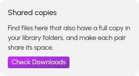
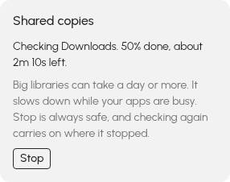
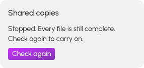
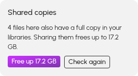
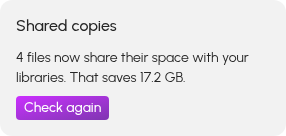

# Shared copies

A download manager such as Sonarr or Radarr can copy a finished download into your library while the download keeps seeding. Your server then stores the same file twice: once in **Downloads** and once in your library. The **Shared copies** card finds these files and makes each pair share its space. Both files stay complete, and your downloads keep seeding.

## Where to find it

Open **Folders** and click your **Downloads** folder. The **Shared copies** card is in the folder's info panel.

 Shared copies card on the Downloads folder 

{.medium .framed}

The card only shows on the folder set as your **Downloads** location in **Settings** > **Locations**. It compares **Downloads** with your library folders on the same pool: **Media**, **Movies**, **Shows**, **Music** and **Videos**.

The card says why it can't run when:

- **Downloads** isn't set up as a folder yet.
- There is no library folder on the same pool as **Downloads**.
- **Downloads** or your library folders are encrypted. Encrypted folders can't share space with other folders.
- **Downloads** is locked. Unlock it first.

## Check for copies

Click **Check Downloads**. HexOS reads the files in **Downloads** and in your library folders, and compares them byte for byte. Two files only count as copies when every byte is the same, whatever their names. The check reads your files and changes nothing.

HexOS skips:

- Files smaller than 64 MB.
- Files changed in the last hour, and downloads that are still in progress.
- Files that already share their space.

 A check in progress, with the time left 

{.medium .framed}

The card shows how much of the check is done. After about a minute, it also shows how much time is left.

> **Info:** A check reads every possible copy in full. A big library can take a day or more. The check slows down while your apps are using the same drives, so apps like Immich or Jellyfin keep working. When your apps are busy, the time left grows.
{.is-info}

## Stop and carry on later

You can click **Stop** at any time. Every file stays complete. HexOS remembers the files it has already compared. When you click **Check again**, the check carries on where it stopped and doesn't read those files again.

 A stopped check 

{.medium .framed}

> **Tip:** If an app feels slow while a check runs, click **Stop**. Click **Check again** later, for example at night.
{.is-tip}

## Free up the space

When the check finds copies, the card says how many files have a full copy in your libraries and how much space sharing them frees. Click **Free up** to share them.

 Files found by the check 

{.medium .framed}

For each file, HexOS:

1. Makes a copy of the library file that shares its space with it.
2. Compares that copy with the file in **Downloads**, byte for byte.
3. Swaps the two in one step, so the file in **Downloads** is always complete.

Your library files are only read, never changed. The file in **Downloads** keeps its name, owner, permissions and dates, so your download client keeps seeding it.

 Files sharing their space 

{.medium .framed}

A file that changed after the check is left as it was. The card says how many were left.

> **Info:** If **Downloads** has restore points, they keep the space of the replaced copies until they expire. The card tells you when this is the case.
{.is-info}

If the first file saves no space, HexOS stops and changes nothing else. The card says **HexOS stopped after the first file, because sharing it saved no space.**

> **Help:** If a check or a share doesn't finish, ask in the [HexOS Discord Community](https://discord.gg/fCW2htvYdz).
{.is-troubleshooting}
