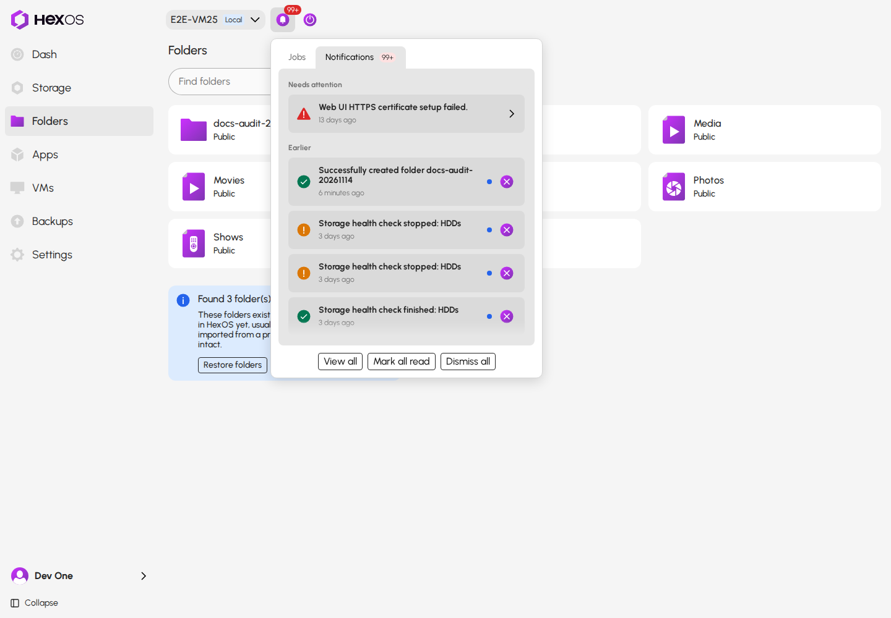
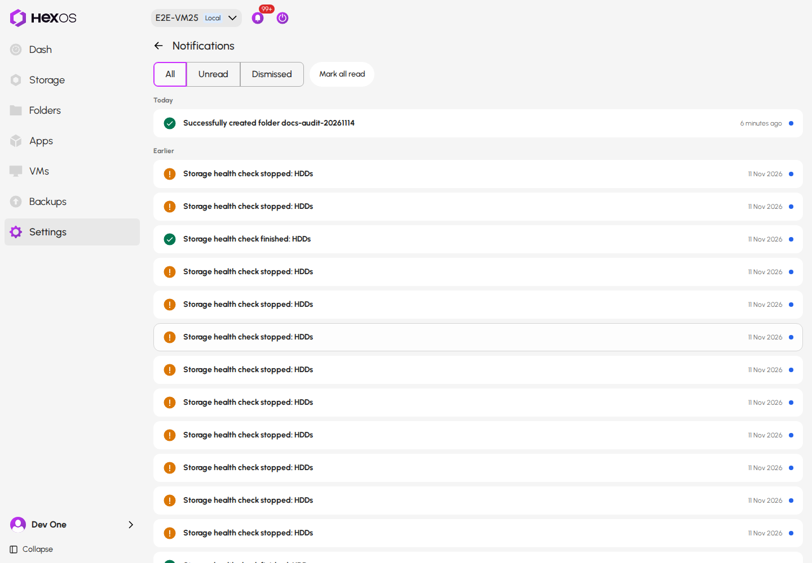

# Notifications

The bell opens your server's jobs and notifications. Check it when HexOS reports a problem or when you want to follow work that is still running. Selected server alerts can also be emailed, depending on the alert and available service. Email does not replace checking the Command Deck.

## Open the notification bell

Click the bell. It has **Jobs** and **Notifications** tabs. When work is running, it can open on **Jobs**. Otherwise, it opens on **Notifications**.

The badge includes items that need attention and unread earlier messages. It is not simply a count of all unread notifications.

 Jobs and notification controls 

{.medium .framed}

## Read and dismiss messages

In **Notifications**, review **Needs attention** first. These items can require an action on the server. **Earlier** holds other messages.

Use **Mark all read** in the bell to mark unread **Earlier** messages as read. **Dismiss all** dismisses earlier messages and eligible finished tasks. It does not dismiss every unresolved issue, stop running jobs or repair the cause of a warning.

Read a warning before dismissing it. If it describes a storage or drive problem, follow the linked guidance and check the server's condition afterward.

## View notification history

Click **View all** in the bell, or open **Settings** > **Notifications**. The history page has **All**, **Unread** and **Dismissed** tabs.

 Notification history 

{.medium .framed}

Click a tab to filter the history. **Mark all read** on this page marks the open unread messages as read. Running work is shown in the bell's **Jobs** tab; history is for reviewing earlier activity.

## Types of notification

| Type | What to check |
|---|---|
| App or server task | Read its status and any error before retrying the action. |
| Update | Read which app or server component the update applies to. |
| Folder or user change | Check that the requested change finished. |
| Storage or hardware warning | Open the affected item and follow the relevant troubleshooting guide. |
| Achievement | Read the message about the feature you used. |

A drive health warning needs investigation. It does not by itself prove that the drive must be replaced. See [drive failure troubleshooting](/troubleshooting/drive-failure) for the checks and replacement guidance.
