# HexOS Anywhere

HexOS Anywhere gives an app on your server its own web address, such as `https://jellyfin.k7pqm4tz.relay.hexos.com`. You can open it from anywhere: a phone on mobile data, a laptop at work, or a friend's TV. You don't change anything on your router, and your home IP address stays private.

You choose which apps get an address. Every other app, and the rest of your server, stays reachable only at home.

## How it works

1. A visitor opens your app's address. It leads to our relay, not to your home.
2. The relay passes the visit on to your server over a private, encrypted link. It doesn't decrypt anything: the connection stays encrypted from the visitor's browser all the way to your server.
3. Your server holds the certificate for the address. It shows the sign-in page and decides who gets in.
4. A visitor who gets in reaches the app's own web page, just as they would at home.

Because the relay never decrypts the connection, we can't see the pages, passwords or files that pass through it. The relay does see which address was visited, the visitor's internet address, when, and how much data moved. Visitors see the relay's internet address, never yours.

## Get HexOS Anywhere

HexOS Anywhere is an add-on for HexOS Lifetime, at $29 a year for each server you add it to. Every HexOS plan includes it.

- **You already own Lifetime.** Add HexOS Anywhere to a server from your account on [hexos.com](https://hexos.com).
- **You're buying Lifetime.** Checkout offers HexOS Anywhere for each server the license covers. You can leave it off and add it later from your account.

HexOS Anywhere renews every year. If you cancel, it stops renewing and keeps working until the end of the year you paid for.

On a server without it, the app's **Anywhere** tab and **Settings** > **Anywhere** still open, with "HexOS Anywhere needs a license to use" at the top. The notice offers a way to add it to that server.

 Anywhere needs a license 

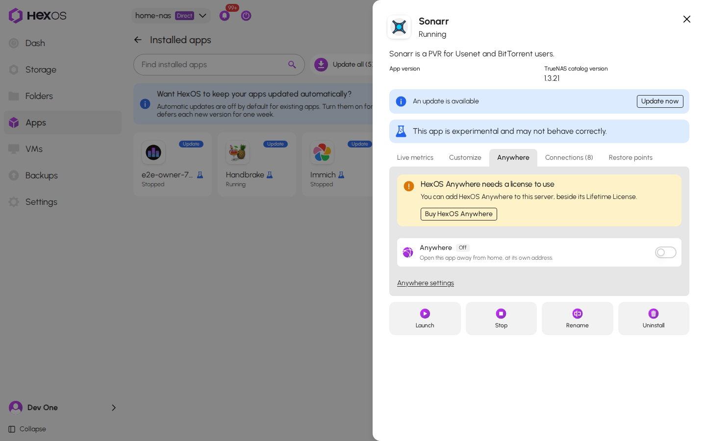{.medium .framed}

If HexOS Anywhere ends on a server, for example when a payment is past due, its addresses are paused. Each one shows **Paused**, and visitors can't reach it. Nothing is deleted: your addresses, your sign-in, your devices and your rules stay as they are. Once the server has HexOS Anywhere again, the same addresses start working again. While an address is paused, you can still turn it off or remove your domain.

## Turn on HexOS Anywhere for an app

1. Open the app from your dashboard or the **Apps** screen, and click its **Anywhere** tab.
2. Turn on the **Anywhere** switch.

 Anywhere tab with the switch off 

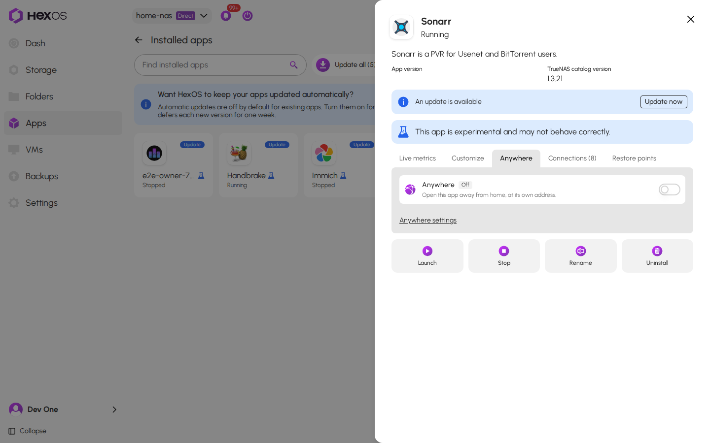{.medium .framed}

3. The first time you turn on an app, the Command Deck asks you to **Choose how visitors sign in**. Pick **Password** or **PIN code**, type it, and click **Save** (see [Sign-in](#sign-in)).

 Choose how visitors sign in 

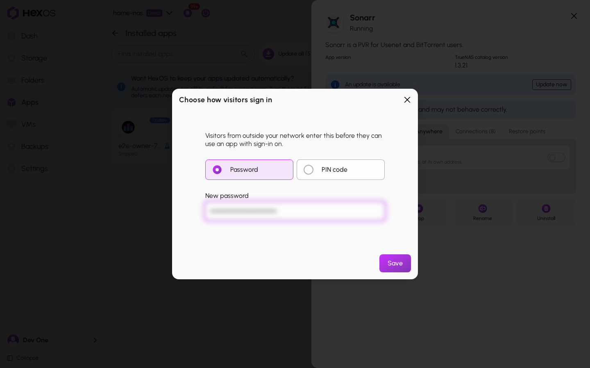{.medium .framed}

The app gets its address right away. We suggest the app's name, such as `jellyfin`. The Command Deck confirms it, for example "Jellyfin is reachable at `https://jellyfin.k7pqm4tz.relay.hexos.com`". The badge next to **Anywhere** reads **Connecting** while we set the address up, then **On**. This usually takes a few minutes. If it still says **Connecting** after 15 minutes, see [An address that never finishes connecting](#an-address-that-never-finishes-connecting).

There is no Apply button in this tab. Each switch saves on its own a moment after you flip it.

Click the address to open it, or click **Copy address** next to it to share it.

 An app's address with the badge On 

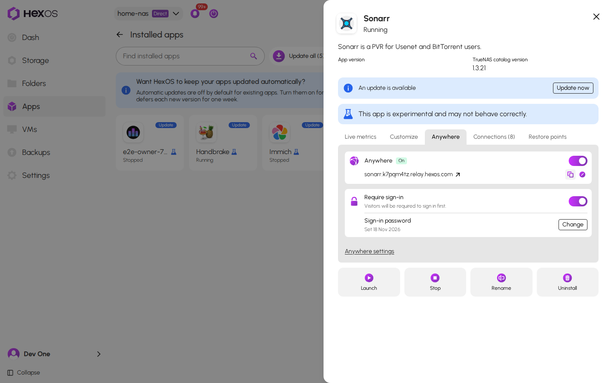{.medium .framed}

> **Tip:** When you're away from home, an app's **Launch** button opens its HexOS Anywhere address. If the app doesn't have one yet, the Command Deck offers to turn it on with **Turn on and open**.
{.is-tip}

### Your address

Until you add a domain of your own, an address has three parts: the name of the app, a short label we pick for your server, and `relay.hexos.com`. Every app on the server shares the same label. **Settings** > **Anywhere** > **Overview** shows your server's part under **Remote access URL**, and lists every app you share under **Apps**.

 Anywhere overview 

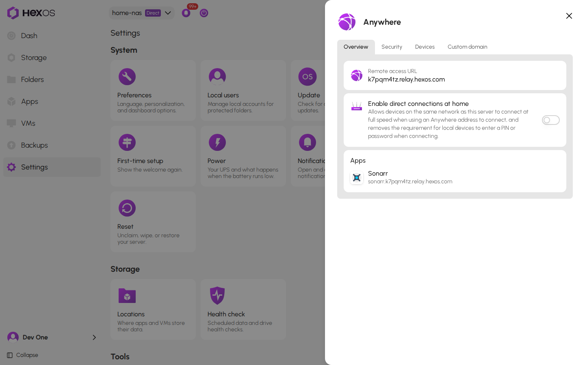{.medium .framed}

With your own domain, the address is the app's name followed by your domain, such as `jellyfin.example.com`. See [Use your own domain](#use-your-own-domain).

### Apps with more than one web page

Some apps have more than one web page. Scrutiny, for example, also has an InfluxDB page. The **Anywhere** tab of such an app has one section for each page, titled with its name, such as **Anywhere: InfluxDB**. Each page gets its own switch and its own address (`scrutiny` and `scrutiny-influxdb`), so you can share one without the other.

### If an app has no Anywhere tab

An app has an **Anywhere** tab only when it has a web page that TrueNAS lists for it. The tab doesn't appear for:

- **Apps that only work at home**, such as Ollama.
- **Apps with no web page listed.** You can spot these: the app's **Launch** button stays grayed out even while the app is running.

An app with no web page listed usually has **Host Network** turned on in TrueNAS. With that setting on, TrueNAS doesn't list the app's web page, so HexOS has no page to give an address to. HexOS installs most apps, Plex and Jellyfin among them, with **Host Network** off.

> **Warning:** Kodi and Scrypted need **Host Network**. HexOS installs them with it on. Leave it on for those two apps.
{.is-warning}

To turn **Host Network** off for an app:

1. In the Command Deck, open **Settings** > **TrueNAS** and click the **TrueNAS** button. Sign in with the username `truenas_admin` and your server password.

 TrueNAS button in Settings 

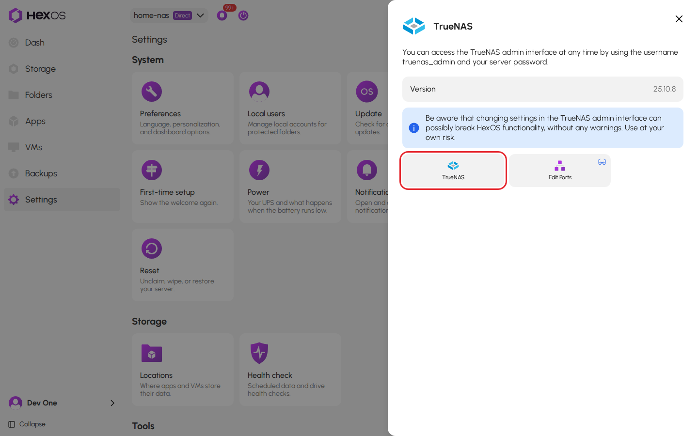{.medium .framed}

2. In the TrueNAS menu on the left, click **Apps**.

 Apps in the TrueNAS menu 

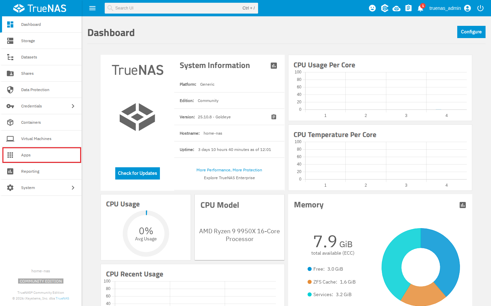{.medium .framed}

3. Click the app in the list, then click **Edit**.

 Edit button for the app 

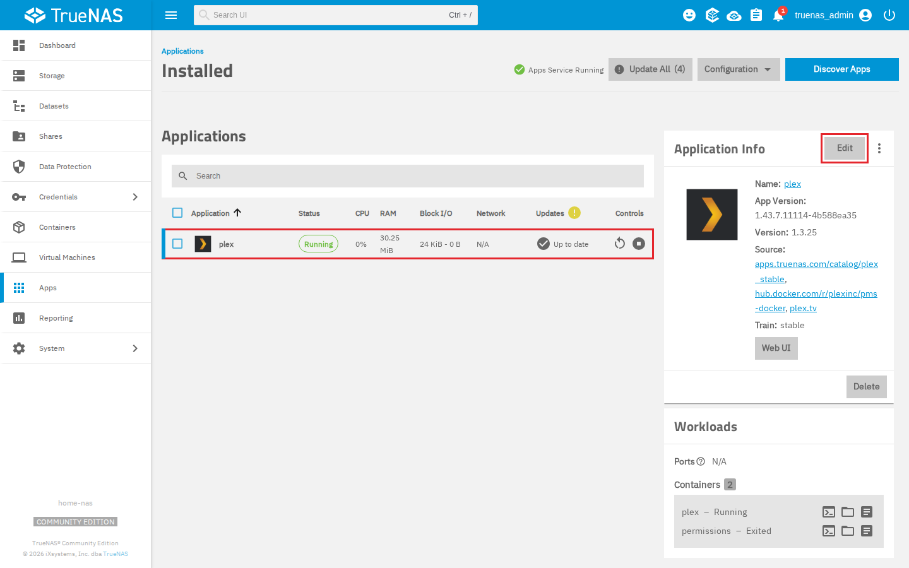{.medium .framed}

4. Scroll down to **Network Configuration** and untick **Host Network**.

 Host Network checkbox 

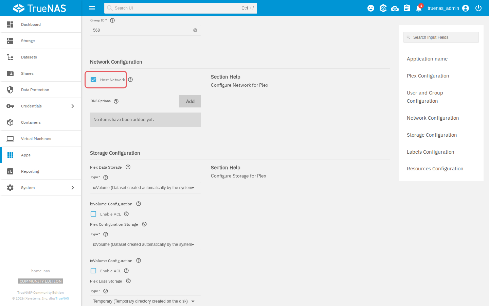{.medium .framed}

5. A port section for the app's web page appears, such as **WebUI Port** for Plex. Leave **Port Bind Mode** on **Publish port on the host for external access**, and leave the port number as it is (32400 for Plex).

 WebUI Port section 

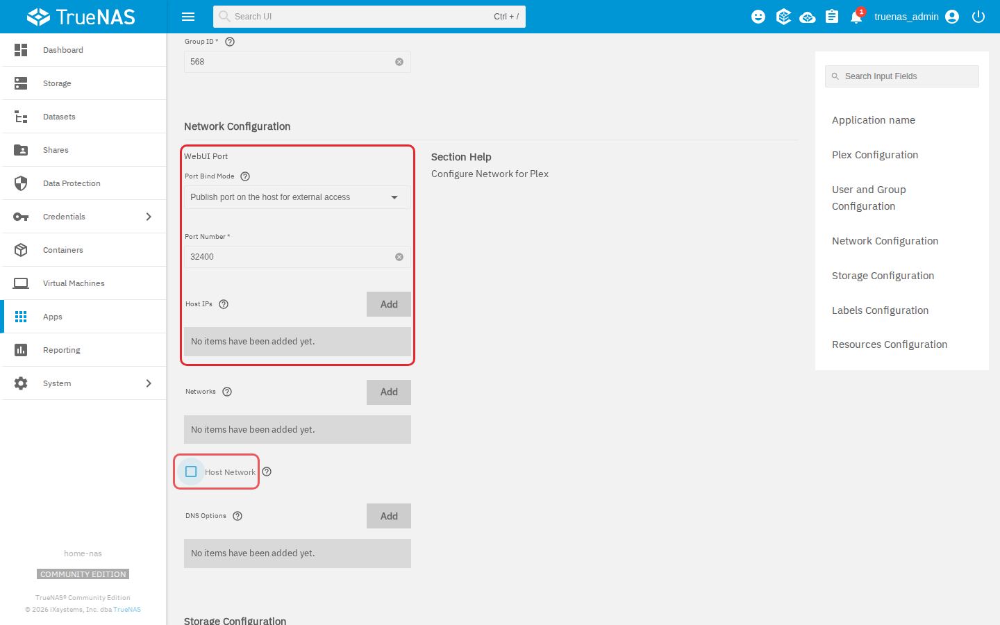{.medium .framed}

6. Scroll to the bottom and click **Update**. The app restarts, which takes a minute or two. Its data and settings stay as they are.

 Update button 

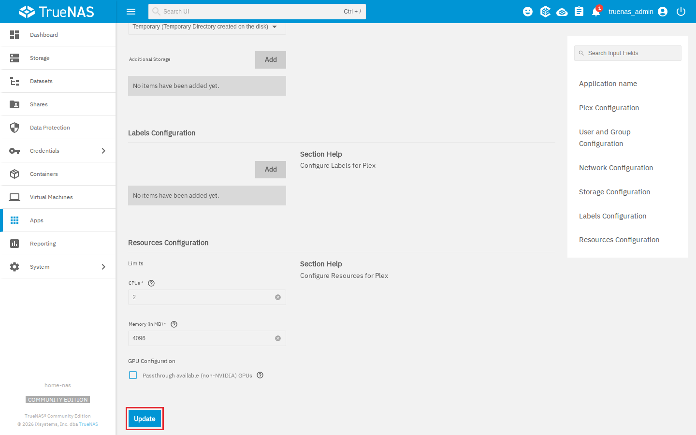{.medium .framed}

7. Back in the Command Deck, reload the page and open the app. Its **Launch** button works again, and its **Anywhere** tab is there.

### Change an address

Click **Edit address** next to the address, type a new name, and click **Save**. Use lowercase letters, numbers and hyphens. Press Escape to keep the old name.

 Editing an address 

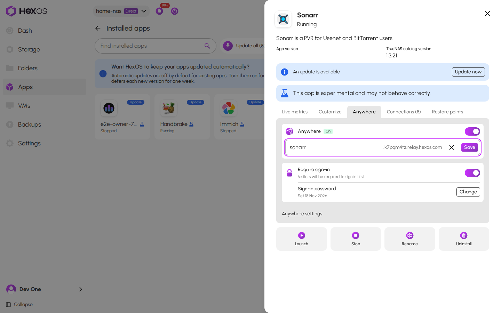{.medium .framed}

The old address stops working at once, and it doesn't send visitors on to the new one. Update your bookmarks and the address in any TV or phone app. Browsers have to sign in again on the new address. Devices you approved keep their approval.

Each name can be used once across all the servers on your account. If another app already uses it, the Command Deck says which one, for example "Jellyfin on old-nas uses this address. Pick another."

### Turn it off

Turn off the **Anywhere** switch. The address stops working at once. If you turn it on again later, the app gets the same address back, with the same sign-in setting.

Uninstalling an app turns its address off too. If you install the app again and turn it on, it gets its old address back.

## Sign-in

With **Require sign-in** on, anyone who opens the address in a browser sees our sign-in page first. They enter your server's password or PIN code, and then they reach the app. If the app has a login of its own, it still asks for it.

- **One password or PIN code for the whole server.** Every app with sign-in on asks for the same one. A password has at least 8 characters. A PIN code has exactly 6 digits.
- **Signed in for 30 days.** A browser that signs in stays signed in on that address for 30 days. Each address is separate: signing in to Jellyfin doesn't sign you in to Immich.
- **Too many wrong tries.** After five wrong tries from one internet address in 15 minutes, we turn that visitor away from every app on your server for 15 minutes. They see "Too many attempts. Try again in 15 minutes."
- **A PIN code has an extra limit.** After 30 wrong PIN codes from any addresses in 15 minutes, we pause PIN sign-in for 15 minutes. Browsers already signed in and devices you approved keep working.
- **A change signs everyone out.** TV and phone apps that got in because someone signed in (listed as **Signed in**) have to get in again too. Devices you approved yourself stay approved.

To change it, open **Settings** > **Anywhere** > **Security**. Under **Sign-in**, click **Change**. You can switch between a password and a PIN code there. We keep only a scrambled form of it, so the Command Deck can never show it to you. If you forget it, set a new one.

 Anywhere security settings 

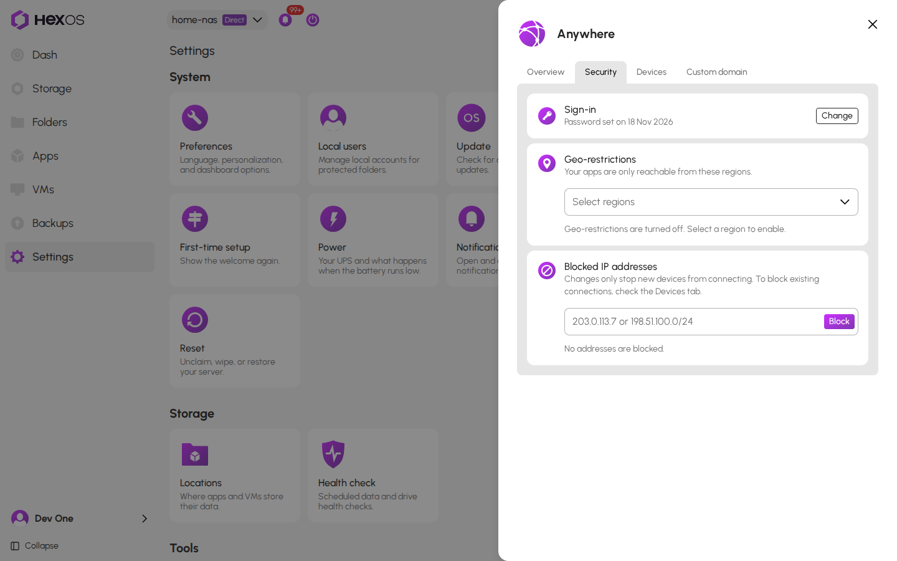{.medium .framed}

### Turning sign-in off

With **Require sign-in** off, anyone who has the address reaches the app's own login page. **Settings** > **Anywhere** marks these apps **No sign-in**.

We still watch an app without sign-in: if the app turns one visitor away ten times in 10 minutes, we block that visitor for 30 minutes.

When you turn sign-in back on, the Command Deck asks you to confirm, because TV and phone apps will be turned away until you approve each one.

> **Warning:** An app without sign-in is open to anyone on the internet who finds its address. Turn sign-in off only for an app with a strong login of its own, and keep that app up to date.
{.is-warning}

## TV and phone apps

Apps on a TV or a phone, such as the Plex and Jellyfin apps, can't show a sign-in page. The first time one connects to an address with sign-in on, we turn it away, and it waits for you to approve it.

1. You get a notification, such as "A device is waiting to use Jellyfin". Click **Review devices**.

 Device waiting notification 

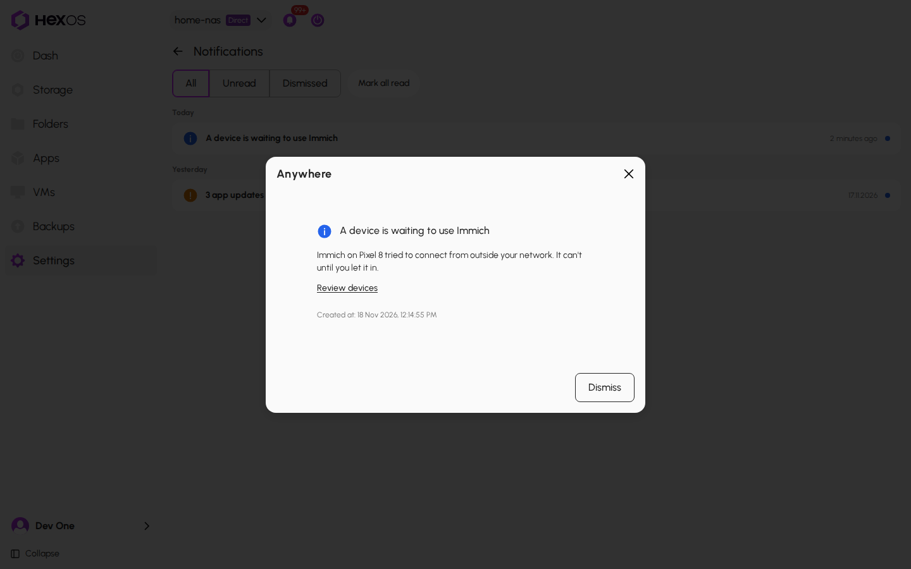{.medium .framed}

2. The app's **Anywhere** tab lists the device under **Waiting for approval**, with the app and device it says it is, and the address it came from.
3. Click **Approve**.

 A device waiting for approval 

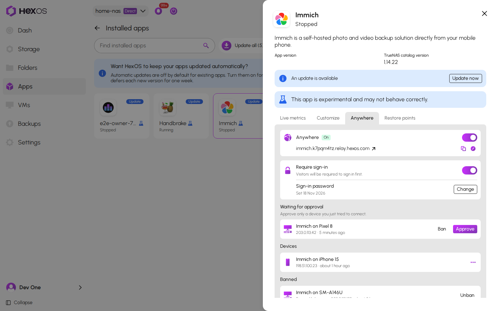{.medium .framed}

Approve only a device you just tried to connect. If you don't recognize one, click **Ban**. A device you leave waiting is dropped after 7 days.

Once approved, the device works from any network. An approval covers one app: a TV you approved for Jellyfin still needs approval for Plex.

Some apps show our sign-in page inside the app. Signing in there is enough: the device gets in without a separate approval, and it is listed as **Signed in**.

With sign-in off, TV and phone apps go straight to the app and need no approval.

> **Info:** A device can wait for approval only when its app tells us which device it is. The Jellyfin TV apps, the Emby and Plex apps, and the Immich phone apps do. Many other apps' clients send nothing we can tell apart from a stranger, so they are turned away and never show up under **Waiting for approval**. To use one of those away from home, turn **Require sign-in** off for that app.
{.is-info}

### The Jellyfin app on an Android phone

The Jellyfin app for Android phones never shows up under **Waiting for approval**. The app opens our sign-in page out of sight, so you can't type the password, and after a few seconds it goes back to its server list with an error.

To use it away from home, turn off **Require sign-in** for Jellyfin:

1. Open Jellyfin from your dashboard and click its **Anywhere** tab.
2. Turn off **Require sign-in**.

 Require sign-in switch 

{.medium .framed}

3. In the Jellyfin app on your phone, connect to Jellyfin's HexOS Anywhere address, such as `https://jellyfin.k7pqm4tz.relay.hexos.com`.

Jellyfin still asks for its own username and password, so use a strong password for every Jellyfin user. Read the warning in [Turning sign-in off](#turning-sign-in-off) before you do this.

### Manage your devices

**Settings** > **Anywhere** > **Devices** lists every device in three groups: **Waiting for approval**, **Devices** you let in, and **Banned**.

 Anywhere devices list 

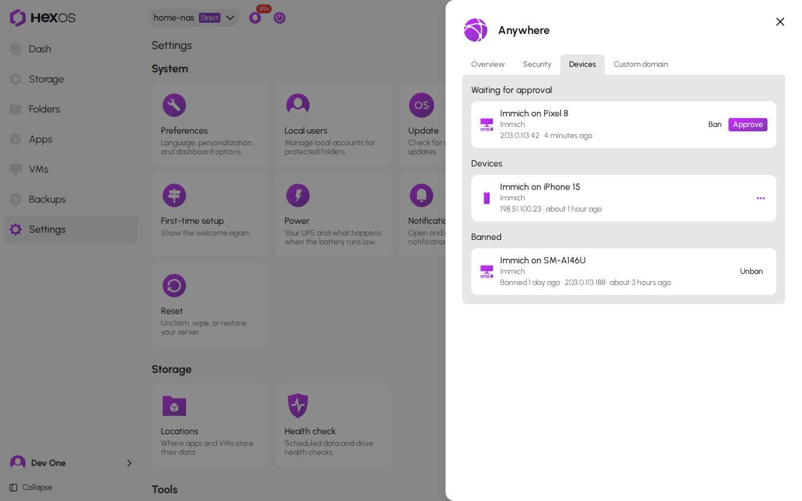{.medium .framed}

- **Remove** takes a device's access away. It waits for you again the next time it connects.
- **Ban** turns a device away for good. It isn't told it's banned, and it doesn't show up as waiting again.
- **Unban** lets a banned device ask to connect again.

Remove and Ban are in the menu next to a device you let in.

## Limit where visitors come from

**Settings** > **Anywhere** > **Security** has two more ways to keep visitors out. Both apply to every address on the server, and to your Command Deck address. The relay checks them before a visitor reaches your server.

- **Geo-restrictions.** Click **Select regions**, choose the regions you and your people connect from, and click **Apply**. From then on, only those regions can reach your apps. Everyone else is turned away, and that includes you when you travel somewhere else. To take a region off the list, click the X on its chip. With no regions listed, every region can connect. You can list up to 50.

 Select regions 

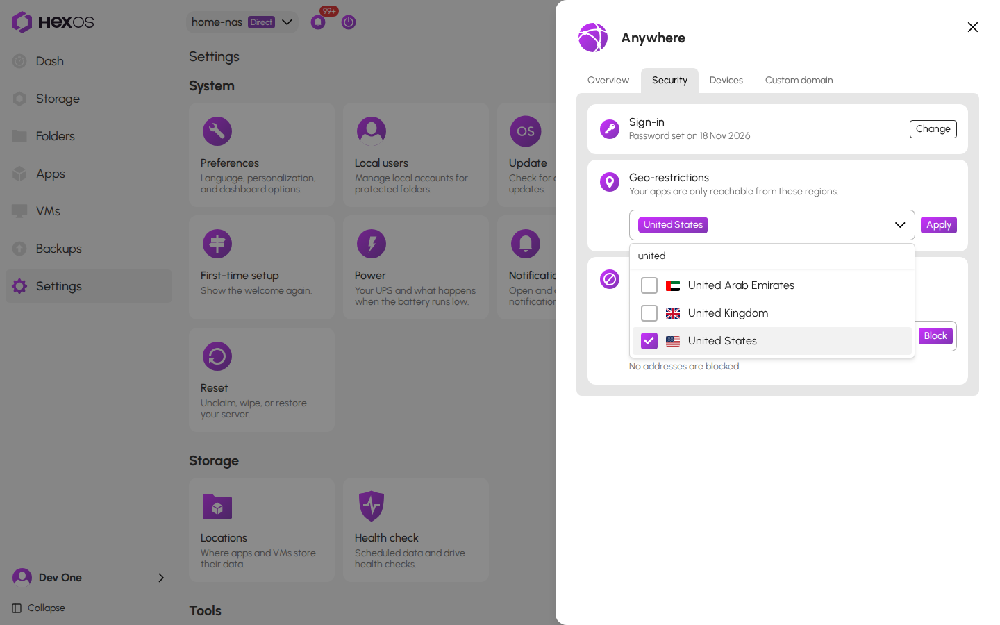{.medium .framed}

- **Blocked IP addresses.** Type an address, or a range such as `198.51.100.0/24`, and click **Block**. To unblock one, click the X next to it. You can block up to 200.

Regions follow where the relay thinks a visitor's internet address is. A visitor using a VPN can appear to be somewhere else.

A change stops new connections. A device that is already connected stays connected until it reconnects. To turn a device away at once, ban it in the **Devices** tab.

## Use your own domain

If you own a domain, your apps can use it: Jellyfin answers at `jellyfin.example.com` instead of its relay address.

1. Open **Settings** > **Anywhere** > **Custom domain**.
2. Type your domain and click **Continue**.

 Custom domain tab 

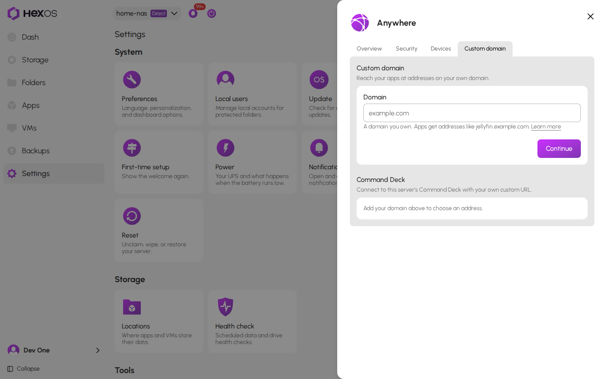{.medium .framed}

3. Add the DNS record the Command Deck shows at your DNS provider, then click **Re-check** until the badge reads **Verified**.

 The DNS record to add 

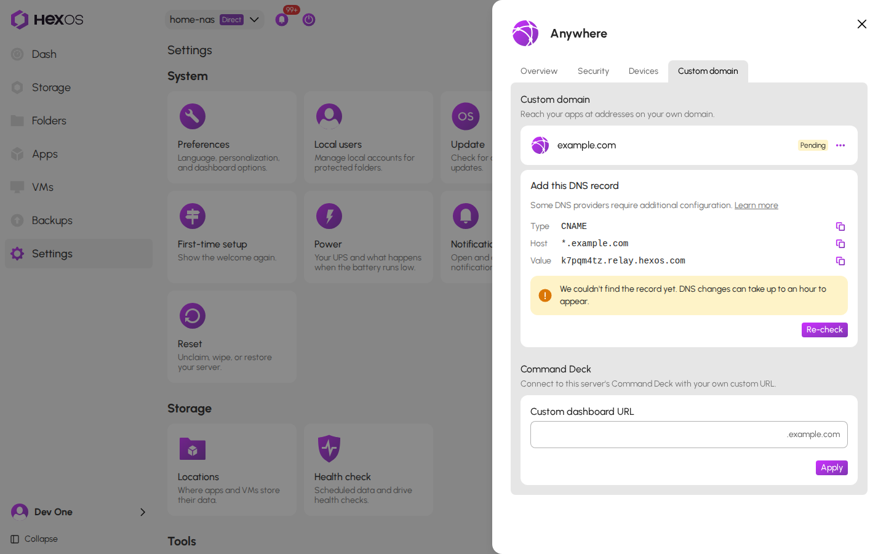{.medium .framed}

Once your domain is verified, each app answers only at its address on your domain, and its relay address stops working. Update your bookmarks and the addresses in TV and phone apps. If you remove the domain later, your apps go back to their relay addresses.

 An app's address on your own domain 

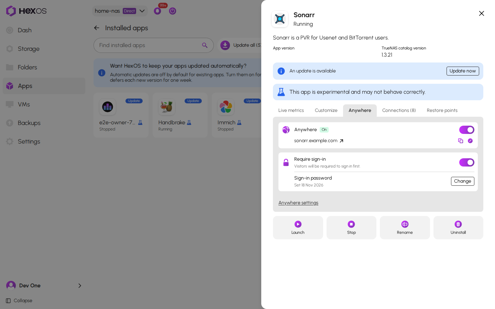{.medium .framed}

The records, and what to watch for at common DNS providers, are in [Use your own domain with HexOS Anywhere](/features/remote-access/custom-domain).

## Open your Command Deck from anywhere

With your domain verified, you can give your server's Command Deck an address on it too, such as `deck.example.com`. Under **Command Deck** in the **Custom domain** tab, type a name and click **Apply**. It needs no extra DNS record, and you sign in there with your HexOS account as usual. See [Command Deck](/features/remote-access/custom-domain#command-deck) for the details.

 Command Deck address field 

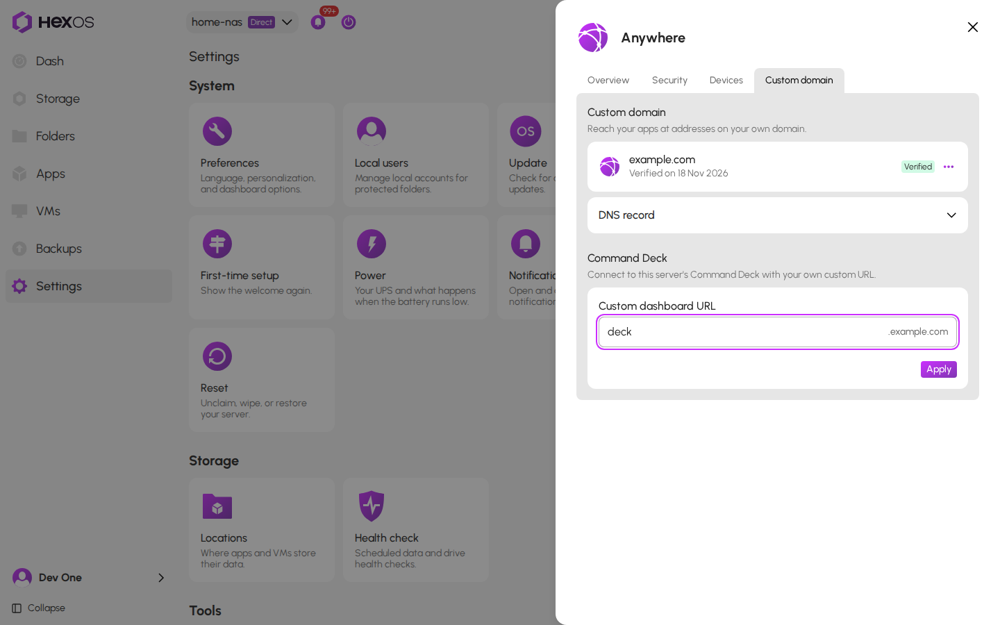{.medium .framed}

## Good to know

- **Speed.** Each server's HexOS Anywhere traffic is limited to 10 Mbit/s in each direction, because every visit crosses a relay that all owners share. Large downloads and very high-quality video can be slower than at home.
- **VPN.** An app whose internet traffic goes through a VPN can have a HexOS Anywhere address too. Visits still reach it.
- **Plain http.** A visitor who types an address with `http://` is sent on to `https://`.
- **One set of rules per server.** The sign-in, the regions and the blocked addresses belong to the server. There are no separate passwords or rules for each app.
- **Certificate alerts.** Your server watches the public logs where certificates are listed. If a certificate appears for one of your addresses that your server didn't ask for, you get a notification, such as "A certificate for `jellyfin.example.com` was issued outside HexOS". If you or someone you trust asked for it, you can ignore it. If not, contact us.

## When something needs attention

Each address has a badge next to **Anywhere** in the app's tab, and next to the app in **Settings** > **Anywhere**.

| Badge | What it means |
|---|---|
| **Off** | HexOS Anywhere is off for this app. |
| **Connecting** | We are setting the address up. This usually takes a few minutes. If it takes longer than 15 minutes, see [An address that never finishes connecting](#an-address-that-never-finishes-connecting). |
| **On** | The address works. |
| **Needs attention** | Something went wrong. The reason is written under the badge. |
| **Paused** | The server doesn't have HexOS Anywhere right now. See [Get HexOS Anywhere](#get-hexos-anywhere). |

When an address needs attention, we try again every few minutes on our own. To try again now, turn the **Anywhere** switch off, then on again. The app keeps the same address.

| You see | What to do |
|---|---|
| The relay could not be updated | Wait a few minutes, or turn **Anywhere** off and on in the app's **Anywhere** tab. |
| The relay holds an entry for this address that this HexOS did not make | Choose another address, or contact support to have it released. |
| Jellyfin on old-nas uses this address. Pick another. | Choose another name. A server you still own keeps its names, even while it's offline, until you unclaim it or change its address. |
| An app has no **Anywhere** tab | See [If an app has no Anywhere tab](#if-an-app-has-no-anywhere-tab). |
| A TV or phone app can't connect | Look for it under **Waiting for approval** in the app's **Anywhere** tab. If it never shows up there, see [TV and phone apps](#tv-and-phone-apps). |
| Too many attempts. Try again in 15 minutes. | Wait 15 minutes, then sign in with the right password or PIN code. |

### An address that never finishes connecting

An address normally goes from **Connecting** to **On** within a few minutes. While it says **Connecting**, a browser that opens the address shows a security or certificate error, such as `SSL_ERROR_INTERNAL_ERROR_ALERT` in Firefox. That's expected until the badge reads **On**.

If it still says **Connecting** after 15 minutes:

1. Check that your server shows as online in the Command Deck.
2. Open the app's **Anywhere** tab, turn the **Anywhere** switch off, wait a few seconds, and turn it on again. The app keeps the same address.

 Anywhere switch 

{.medium .framed}

3. Wait another 15 minutes.

If it still says **Connecting** after that, [ask us on Discord](https://discord.com/invite/DjEp3WRHKz) and tell us your server's name. An address that stays on **Connecting** this long won't fix itself, and it doesn't show a reason. Don't reinstall the app or HexOS to fix it.

### A phone app that worked at home stops working

A phone app you set up before HexOS Anywhere may still have your server's old address saved, starting with `http://`. We send every `http://` visit on to `https://`, and some apps don't follow that. The Nextcloud apps, for example, then fail with an error such as "308".

1. In the app, sign out or remove your server.
2. Sign in again with the app's HexOS Anywhere address, starting with `https://`. Copy it with **Copy address** in the app's **Anywhere** tab.

 Copy address button 

{.medium .framed}

> **Help:** If something here doesn't match what you see, or an address stays stuck, [ask us on Discord](https://discord.com/invite/DjEp3WRHKz).
{.is-troubleshooting}

> **Contribute:** to help to improve HexOS documentation [join the #Docs channel on Discord](https://discord.com/invite/DjEp3WRHKz) today! Send feedback, suggestions or contribute a guide.
{.is-contribute}
