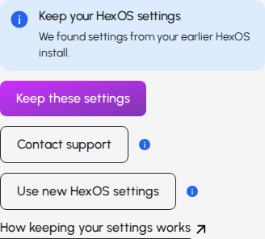
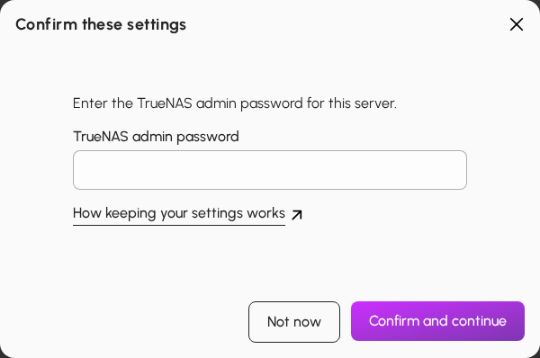
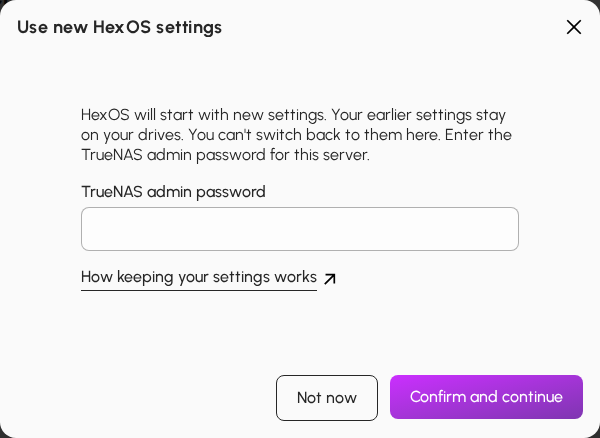
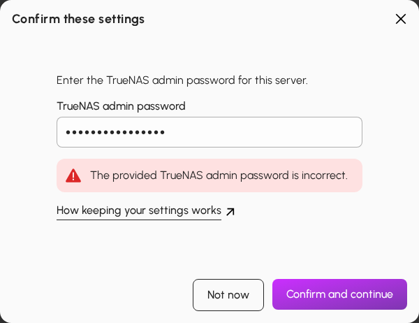
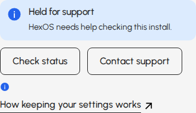

# Keep your HexOS settings after a reinstall

HexOS saves its settings on your drives. When you move those drives to a fresh TrueNAS install, HexOS may find the settings again and ask what to do with them. This page explains the two choices and what each one keeps.

Neither choice deletes your files, folders or other apps. The choice is about the settings HexOS saved for itself.

## When you see this

You may see the **Keep your HexOS settings** message when all of these are true:

- You installed TrueNAS again, or installed it on a new machine or a new virtual machine.
- You moved the drives or virtual disks from your earlier HexOS server to it.
- You are setting the server up in HexOS, or you clicked **Recover** in the **Recover your server** dialog.

The message says **We found settings from your earlier HexOS install.** During setup it appears below the setup steps.

 The Keep your HexOS settings message with its two choices 

{.medium .framed}

HexOS may offer two choices:

- **Keep these settings** carries on with the settings from your earlier install.
- **Use new HexOS settings** starts HexOS with new settings and leaves the earlier ones unused.

> **Requirement:** If HexOS asks you to confirm either choice, use the current TrueNAS admin password for this server. It may be different from the password on your earlier install.
{.is-success}

> **Info:** HexOS can offer **Use new HexOS settings** on TrueNAS 25.10 or later, before version 28. Outside that range, this choice is hidden.
{.is-info}

## Keep these settings

Choose this when you want to reuse your earlier HexOS settings.

1. Click **Keep these settings**.
2. If the **Confirm these settings** dialog opens, type the TrueNAS admin password for this server in the **TrueNAS admin password** box.
3. Click **Confirm and continue**.

 The Confirm these settings dialog 

{.medium .framed}

HexOS checks the password with TrueNAS. If the checks pass, HexOS returns you to setup or continues recovery. If you see **Your settings are ready to continue.**, click **Continue**.

Sometimes HexOS can already tell that the earlier server was yours. Then it continues without asking for the password.

Click **Not now** to close the dialog without applying your choice. You can make the choice later.

The information icon next to the buttons says **Keeping your settings may require you to sign in to some services again.** The next two lists explain what that covers.

### What is kept

- Saved HexOS preferences and completed task history, with the exceptions below.
- Passwords that HexOS saved for your apps.

### What you need to do again

HexOS asks for the password when it can't confirm by itself that the earlier server was yours. In that case it clears a few things from the earlier install to keep your accounts safe:

- Cloud accounts, including iCloud, connected through **Bring over**. Connect them again.
- Your provider setup in **VPN**. Add your provider again.
- The **Remote management** setting. It goes back to on.
- Unfinished HexOS jobs from the earlier install, such as a copy or a restore. They show as failed in Activity Center.

Anyone who was signed in to the server on your home network is signed out and needs to sign in again.

> **Info:** HexOS keeps a copy of the earlier settings on your drives before it clears anything. HexOS support can use this copy if something goes wrong.
{.is-info}

## Use new HexOS settings

Choose this when you want HexOS to start again, as it does on a new server.

1. Click **Use new HexOS settings**.
2. The **Use new HexOS settings** dialog opens. Type the TrueNAS admin password for this server in the **TrueNAS admin password** box.
3. Click **Confirm and continue**.

 The Use new HexOS settings dialog 

{.medium .framed}

The dialog says **HexOS will start with new settings. Your earlier settings stay on your drives. You can't switch back to them here.**

What this means:

- HexOS starts with new settings, as it does on a new server.
- Your earlier settings stay on your drives. HexOS does not delete them, and it does not use them.
- This choice does not delete your files, folders or other apps.

> **Warning:** Once HexOS accepts this choice, you can't switch back to your earlier settings from HexOS.
{.is-warning}

> **Danger:** If you later unclaim this server or use **System wipe**, HexOS can delete its own app and the earlier settings from your drives. See [Reset](/features/settings/reset).
{.is-danger}

If you see **New settings are not available for this server right now.**, HexOS can't start with new settings on this server. You can still click **Keep these settings**.

## Wrong password

If the password is wrong, the dialog says **The provided TrueNAS admin password is incorrect.** Your choice is not applied. Type the password again and click **Confirm and continue**.

 The message for a wrong password 

{.medium .framed}

Use the password for the TrueNAS admin account used to add this server to HexOS, usually `truenas_admin`. Use its current password, not your HexOS account password.

You can try five times in 15 minutes. After that HexOS says **Too many attempts. Please wait before checking again.** Wait 15 minutes, then try again.

> **Tip:** Not sure the password is right? Open the TrueNAS screen of this server in your browser and try signing in with that admin account. Use the same password here.
{.is-tip}

## Two-step sign-in on TrueNAS

If the TrueNAS admin account uses two-step sign-in, the dialog says **TrueNAS needs your authentication code.** after you click **Confirm and continue**. An **Authentication code** box appears. Type the code from your authenticator app and click **Confirm and continue** again.

## Held for support

You may see **Held for support** with the message **HexOS needs help checking this install.**

 The Held for support message 

{.medium .framed}

What this means:

- HexOS has paused this setup or recovery. Contact support if it stays held.
- The hold does not delete your files, apps or earlier settings.
- The usual buttons to try again or start over are hidden while the server is held, so that nothing is changed by mistake.

What to do:

1. Click **Contact support**. The **Get support** dialog opens with links to **Community forum**, **Discord** and **Troubleshooting guides**.
2. Tell the team that your server shows **Held for support** after you moved your drives.
3. Click **Check status** at any time. This only reads the status again. It does not change anything on your server.

> **Help:** You can also ask in the [HexOS Discord Community](https://discord.gg/DjEp3WRHKz) or the [community forum](https://hub.hexos.com/).
{.is-troubleshooting}

## Other messages

- **HexOS could not finish checking the settings.** Click **Check status** to read the latest status.
- **These settings cannot be used on this server right now.** HexOS can't use the earlier settings here, for example when they belong to another HexOS account. Click **Contact support**.

## What carries over and what does not

| | **Keep these settings** | **Use new HexOS settings** |
|---|---|---|
| Your files and folders | Not deleted by this choice | Not deleted by this choice |
| Your other apps | Not deleted by this choice | Not deleted by this choice |
| HexOS settings from the earlier install | Used again, with the exceptions above | Stay on your drives, not used |
| Passwords HexOS saved for your apps | Kept | Not used |
| Cloud accounts in **Bring over** and your **VPN** provider | Set up again if HexOS needed confirmation | Set up again |
| Can you change your mind later? | Not from HexOS | Not from HexOS |
