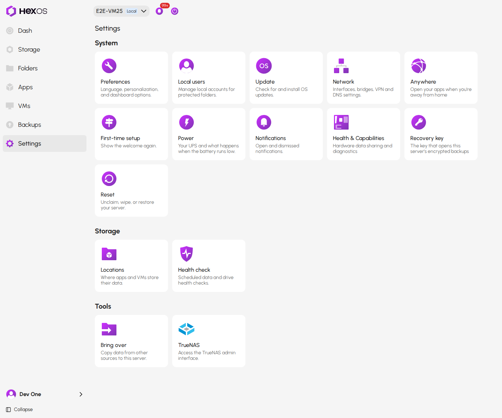

# Settings

Open **Settings** from the sidebar. Tiles are grouped into **System**, **Storage** and **Tools**. Some depend on your server's hardware, configured pools, account or available features.

 Settings groups and available controls 

{.medium .framed}

## System

### Network

Configure your server's network connection and how devices reach it. 
- Set up network interfaces with static IPs.
- Review the network interfaces and global network configuration shown for the server.

### Preferences

Fine-tune your HexOS experience with dashboard controls.  
- Toggle dashboard items or sections.
- Switch to dark mode.
- Change the server name through **Personalization**.
- Choose how dates and temperatures are written. See [Personalization](/features/settings/personalization).
- Enable [experimental features](/features/settings/experimental-features/).

### First-time setup

Show the welcome banner again for the server you have open. See [Show the welcome banner again](/getting-started/setup/CompleteSetup#show-the-welcome-banner-again).

### Recovery key

"The key that opens this server's encrypted backups." Here you can view and copy this server's recovery key, choose who keeps it (**Managed** or **End-to-end encryption**), rotate it, and download its **Emergency kit**. See [Recovery key and emergency kit](/features/folders/recovery-key).

### Health & Capabilities

Hardware data sharing and diagnostics for the server you have open. See [Health & Capabilities](/features/health-and-capabilities).
- Choose whether this server shares hardware data with HexOS. Sharing is off until you turn it on.
- Run diagnostics to check your server's storage, memory, network, apps and hardware.

### Local users

Create and manage the local users who connect to private shared folders. These credentials are separate from your HexOS account. See [folder permissions](/features/folders#folder-permissions).

### Update and power

Use **Update** to check for operating-system updates. **Recheck** looks for TrueNAS updates only. **Power** configures a supported uninterruptible power supply (UPS) and what happens when its battery runs low.

> **Info:** HexOS updates itself. You do not need to install HexOS updates. In TrueNAS, the **Apps** screen lists HexOS as an app named **hexos**. When that row shows **Update available**, HexOS installs the update on its own. This happens when TrueNAS next reports the update, or when HexOS next restarts. During the update, the Command Deck may disconnect for about a minute.
{.is-info}

If an old USB UPS remains after you replace it, see [Remove a disconnected UPS](/features/settings/remove-a-disconnected-ups).

### Notifications

Review previous messages in **Notifications**. See [Notifications](/features/notifications).

### Reset actions

Read each reset action carefully. Some remove ownership or permanently erase data. See [Reset](/features/settings/reset).

- **Unclaim system** removes this server from your HexOS account. Check the confirmation for any hosted backups that must be deleted before unclaiming.
- **System wipe** erases every pool on this server and removes HexOS, then the server waits to be claimed again.
- **Restore previous** will let you choose to go back to a previous point in time to undo any recent changes. (Pool data will not be affected) It is not available yet.

## Storage

### Locations

A location editor which allows for customizations of system folder paths. 
- Select where applications install. 
- Choose the locations for downloads, documents, media, and other system folders across your storage pools.
- A location is always a folder inside a pool, such as `HDDs/Videos`. A whole pool cannot be chosen as a location.

Choosing a location is not a procedure for moving an existing library. Read the confirmation and any **Used by** restrictions before changing it. Use the appropriate migration guide when existing data must move.

> **Info:** A location cannot be changed while apps or VMs are using it. The **Used by** list on each location shows what is using it. A location saved as a whole pool on an earlier version is the exception. It shows a notice, and you can change it to a folder after you confirm.
{.is-info}

### Health check

Open **Health check** for the storage checks offered on this server. Review any results and the recommended action before changing drives or pools.

## Tools

**TrueNAS** opens the server's TrueNAS interface. **Bring over**, when available, helps with its supported import workflow. Advanced changes made directly in TrueNAS can affect what HexOS manages, so follow a guide for the specific task.
