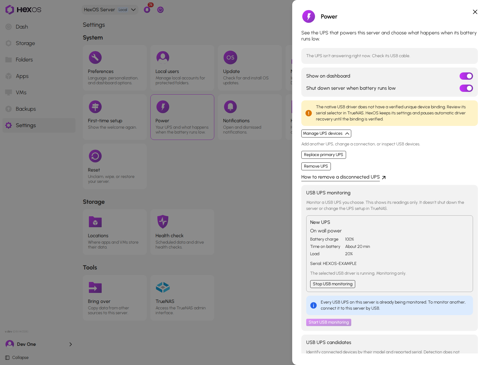
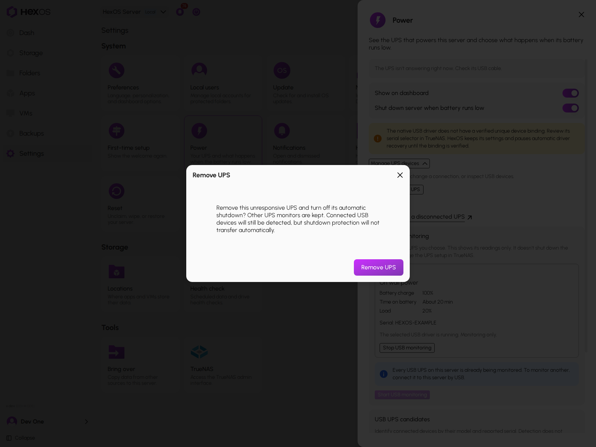
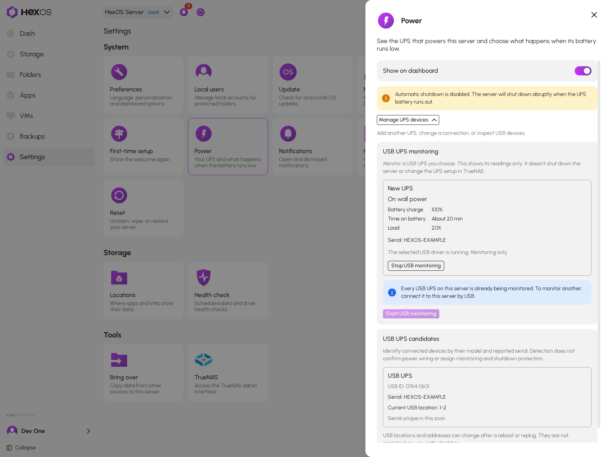

# Remove a disconnected UPS

If you replace a USB UPS, HexOS may still show the old primary UPS with a connection warning. **Remove UPS** removes that old primary from Power settings. Other UPS monitors keep their settings.

> **Warning:** Removal turns off the old primary UPS's automatic shutdown. It does not transfer shutdown protection to the replacement. A UPS labeled **Monitoring only** supplies readings but does not shut down your server.
{.is-warning}

## Before you begin

Use this action only when you have intentionally disconnected or replaced the old UPS. If you still need it, check its power and USB cable first.

**Remove UPS** appears for an unresponsive USB primary that HexOS set up. It is not offered for a responding UPS, a UPS managed in TrueNAS, or a setup controlled by A/B protection. The server needs a HexOS version that supports this action.

## Remove the old primary

1. Open your server in the Command Deck. Click **Settings**, then **Power**. Click **Manage UPS devices** if that section is closed. Review the old primary's connection warning, then click **Remove UPS**.

 Remove the unavailable primary in Power settings 

{.medium .framed}

2. Read the confirmation. Click **Remove UPS** to continue. To cancel without changing the UPS settings, click the **Close** button at the top of the dialog.

 Confirm removal and the loss of the old shutdown protection 

{.medium .framed}

3. Wait for removal to finish. The old primary's connection warning and shutdown switch disappear. Any separate UPS monitors remain. In this example, **New UPS** still supplies readings as a separate monitor.

 The separate USB monitor remains after removal 

{.medium .framed}

## Check the replacement

Leave the replacement UPS's USB cable connected to the server. HexOS continues scanning for supported USB devices. If the replacement already has a separate monitor, its readings remain available after removal.

Detection alone does not start monitoring or enable automatic shutdown. A newly detected device needs an explicit monitoring setup. Review the device's identity before using **Start USB monitoring**. Do not assume that a battery percentage means shutdown protection is enabled.

If HexOS requests a USB monitor update, follow that request before starting another monitor. Updating an older monitor runtime can require stopping and restarting its USB monitors, which temporarily interrupts their readings. Removal itself does not perform that update.

## If removal does not finish

If an error notification covers the confirmation, click its **Close** button before trying again. If settings changed during removal, reload Power settings and review their current state.

If HexOS reports an unfinished primary UPS change, use **Review UPS recovery** to review the available action. **Finish UPS removal** completes an interrupted removal; it does not restore the old shutdown protection. Contact [HexOS Discord Community](https://discord.gg/fCW2htvYdz) if HexOS cannot verify the current setup. Do not enable the retired UPS service directly in TrueNAS to clear a warning.
