# Storage
This is where you'll find your pools, drives and handle storage related tasks.

This screen allows you to
- Create new pools.
- Swap drives.
- Fix problems related to storage.

## Creating storage pools

A pool combines drives into storage. Its layout determines how much space is available and how many drive failures it can tolerate. A single drive has no redundancy; a mirror adds protection, while supported RAIDZ layouts also allow later capacity growth.

> **Danger:** Creating a pool erases the selected drives. Check their identities and keep a separate backup of anything you need before continuing.
{.is-danger}

1. Open **Storage** and click **New pool**. Choose a configuration offered for the unused drives, then click **Continue**.

 Choose a pool configuration 

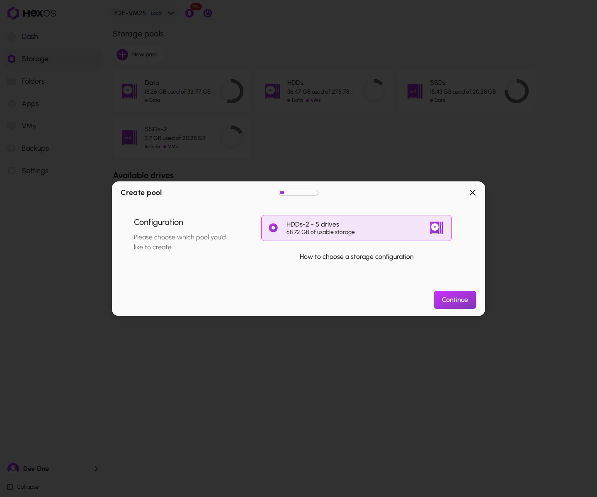{.medium .framed}

2. In **Drives**, check the drives you want to use. Read the usable-capacity and protection summary. Review the drive-test warning; an offered drive is not necessarily tested or healthy. Click **Continue**.

 Select drives and review protection 

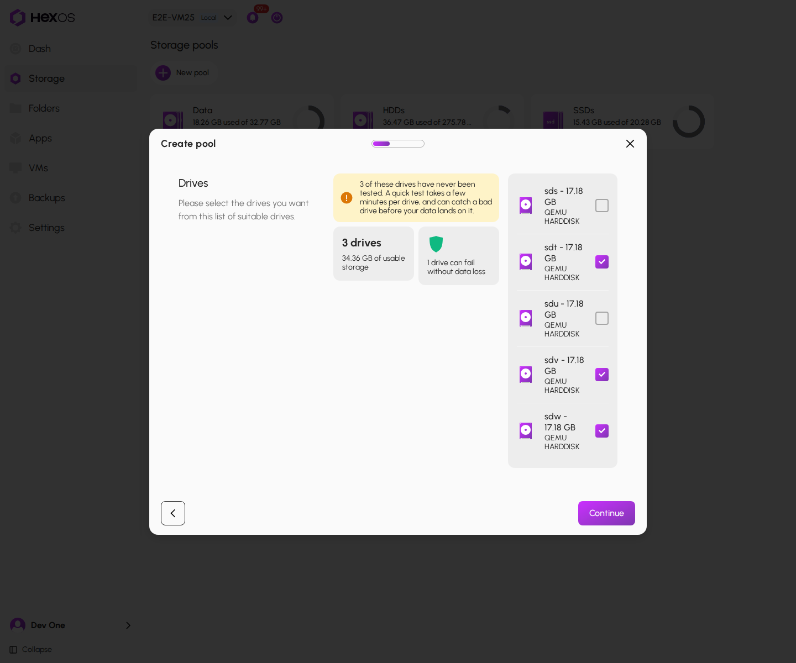{.medium .framed}

3. Enter a display name in **Pool name (optional)**, then click **Continue**.

 Name the pool 

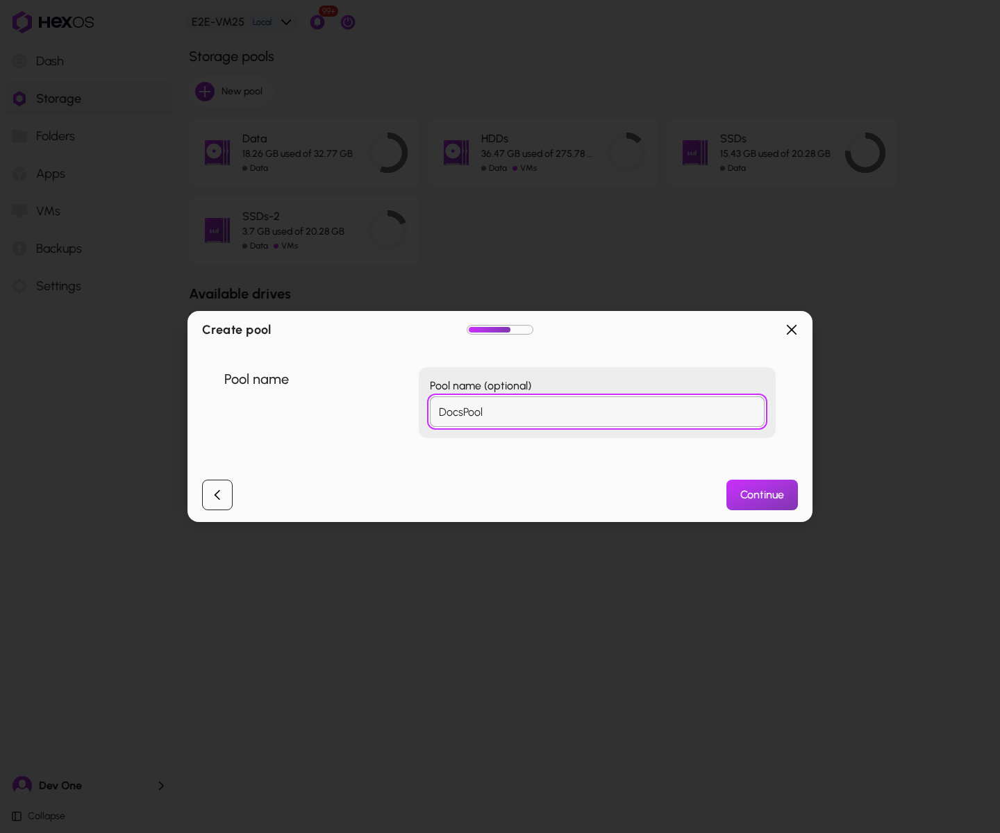{.medium .framed}

4. Review every listed drive. Check **I understand that any existing data on the selected drives will be permanently deleted.** only after confirming the selection, then click **Create pool**.

 Confirm the drives that will be erased 

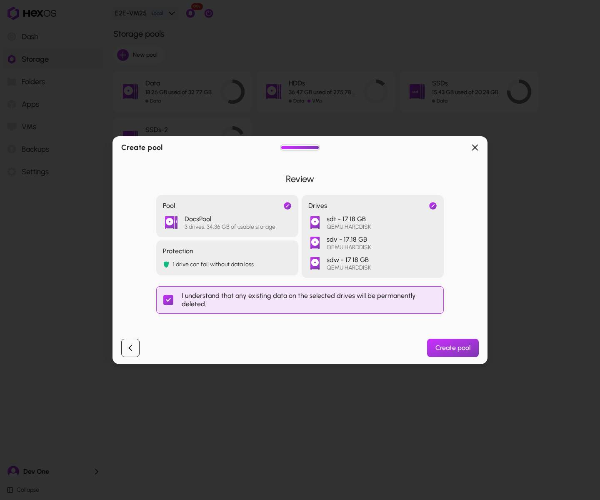{.medium .framed}

5. Wait for creation to finish. Open the resulting pool and check the drive count, layout, capacity and protection. A submitted request alone is not a completed pool.

 The completed three-drive RAIDZ1 sample pool 

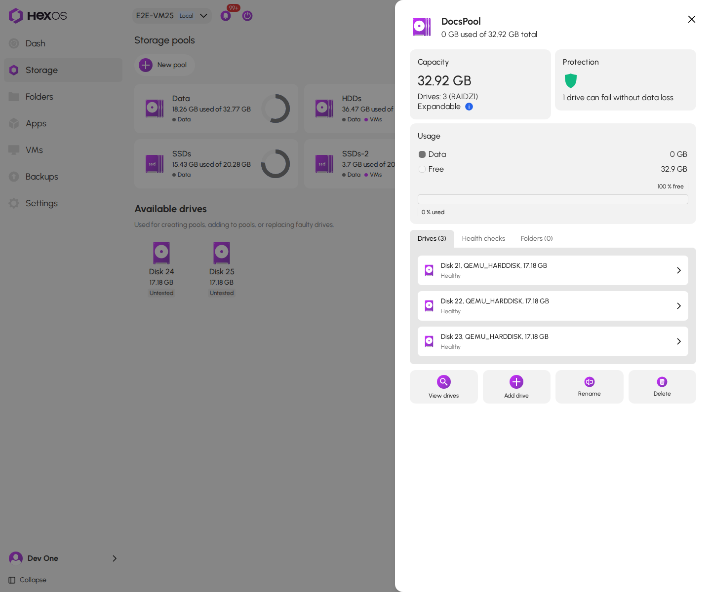{.medium .framed}

## Replacing drives

Drives can fail. A redundant pool can rebuild a replacement drive when enough working copies or parity remain. Check the actual pool health and keep a backup before starting a replacement.

The storage interface will show an alert when there are problems relating to your pools and drives. When drives start showing errors on [SMART](https://www.truenas.com/docs/scale/25.10/scaletutorials/storage/disks/drivehealthmanagement/index.html#smart-tests-options-for-community-edition) tests, having I/O problems, or go missing entirely, you'll see visual indicators right in the interface. 

When a drive needs replacement, HexOS will look at your available unused drives and suggest suitable replacements.  

If you don't yet have a replacement drive, check out our guide before buying [selecting drives](/articles/selectingDrives).

### How to replace a drive

1. Connect a suitable replacement drive. Open **Storage**, click the affected pool, then click **View drives**.

 Open the pool and its drives 

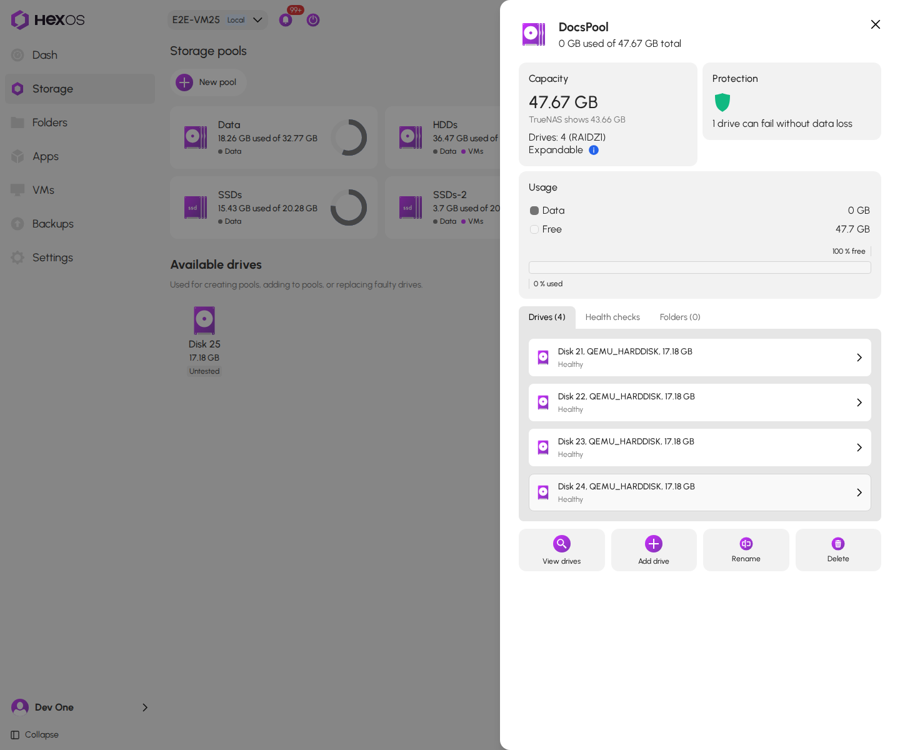{.medium .framed}

2. Click the drive being replaced. Check its device and serial number, then click **Replace**. Do not identify a physical drive by its position in the list alone.

 Identify the drive before replacing it 

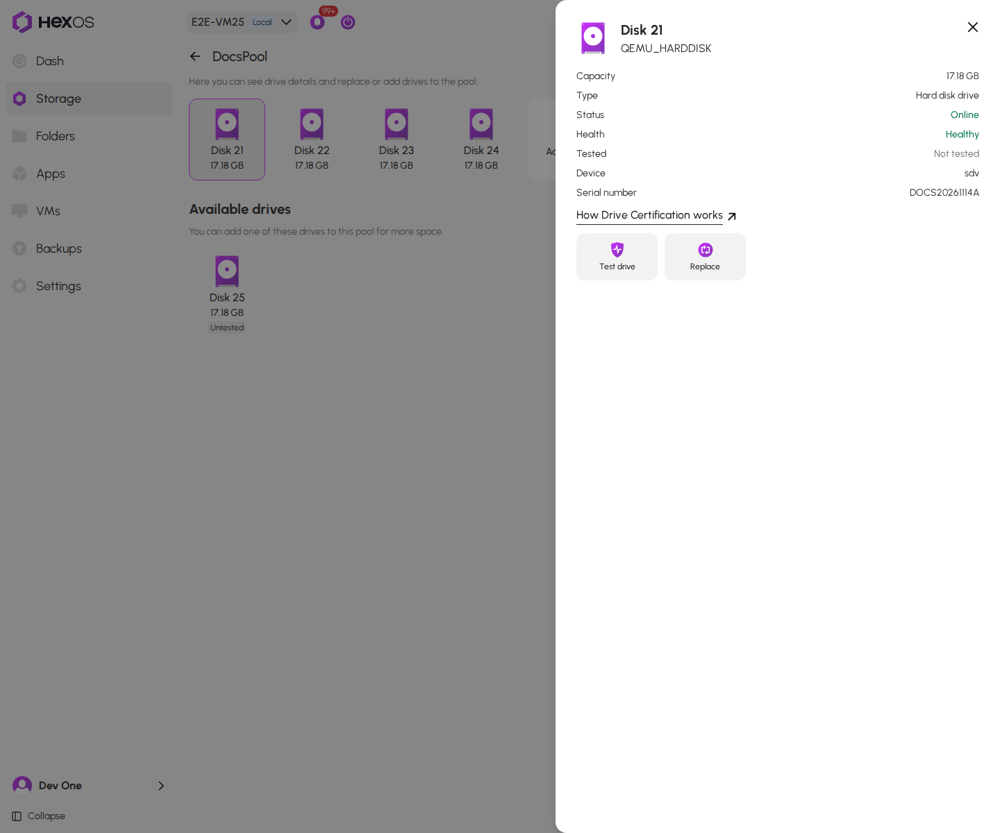{.medium .framed}

3. Choose the unused target under **Select Replacement Drive**. Read every warning. If the pool has no protection during rebuilding, you must acknowledge that warning before continuing.

> **Danger:** The replacement drive's existing contents will be erased. Keep the old connected drive in place until rebuilding finishes. A degraded pool may not survive another drive failure.
{.is-danger}

4. Check the target again, then click **Replace Drive**.

 Confirm the unused replacement drive 

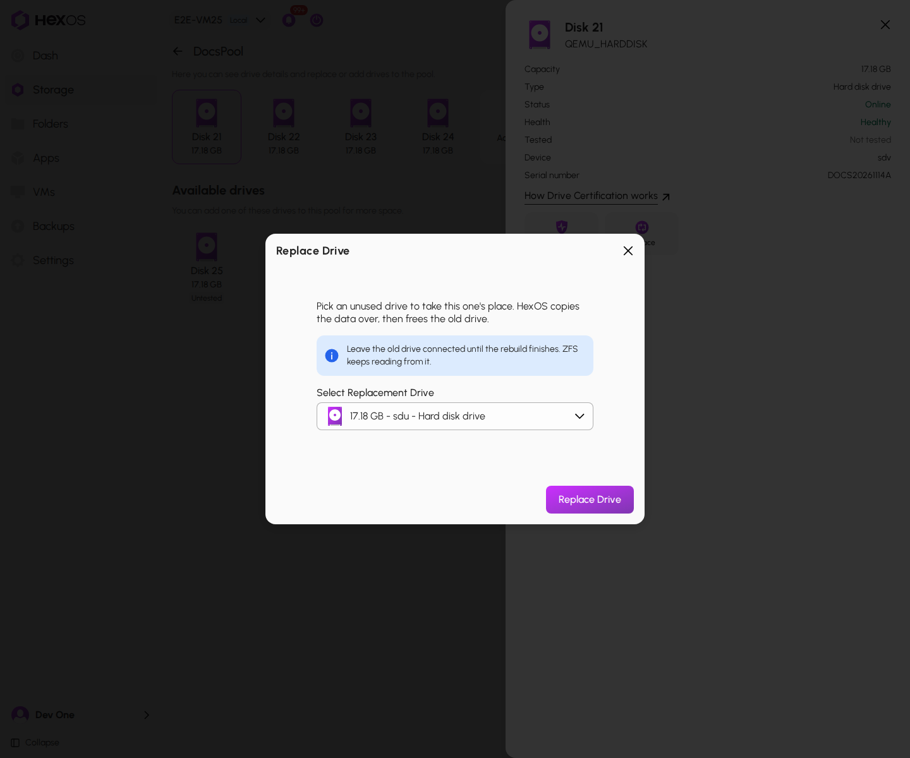{.medium .framed}

5. Open the bell, then **Jobs**, to monitor replacement activity. Wait for the activity and rebuilding to finish. Reopen the pool and check that the replacement is present and the pool has no unresolved errors. Check that sample files still open before removing the old drive.

 The sample pool after a completed replacement 

{.medium .framed}

## Growing your storage

As your server usage grows, you might need more storage capacity. HexOS gives you options to expand your storage.

### Add a drive to a RAIDZ pool

This procedure applies to a supported RAIDZ pool with **Add drive** available. Adding a mirror to a single-drive pool is a different action, described below. If an action is unavailable, read its reason before continuing.

1. Connect a suitable unused drive. Open the pool from **Storage**, then click **Add drive**.

 Add drive on the sample RAIDZ1 pool 

{.medium .framed}

2. Select one candidate. Check its serial number and capacity, then click **Continue**.

 Choose one drive to add 

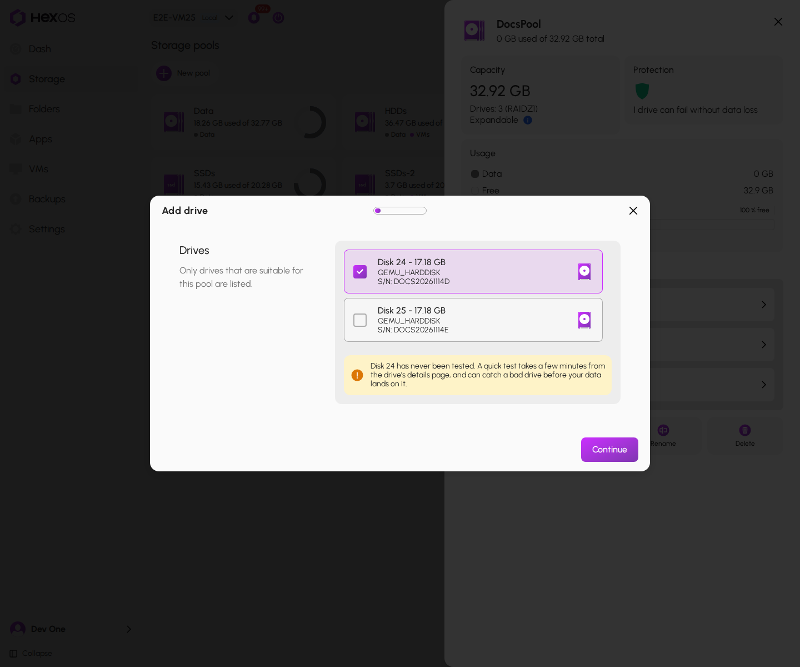{.medium .framed}

3. Review the pool and selected drive. Check **I understand that this will permanently modify my pool and cannot be undone.** only after reviewing the change, then click **Add Drive**. Any existing data on the added drive will be erased.

 Review the permanent pool change 

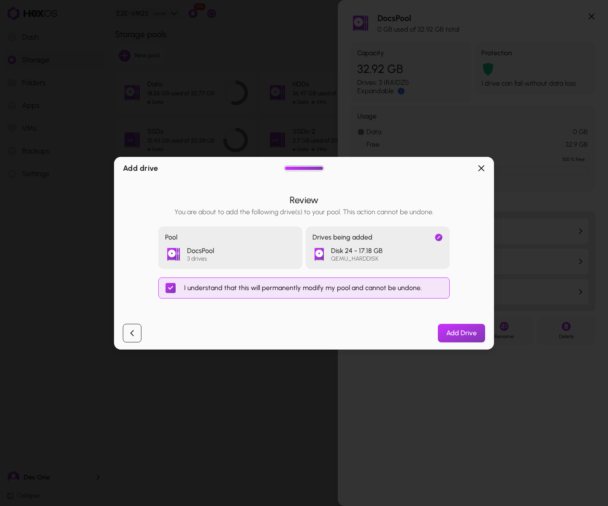{.medium .framed}

4. Open the bell, then **Jobs**, to monitor expansion activity. Wait for it to finish. Check the resulting drive count, protection and capacity. Open sample files to confirm they are still accessible. The example below has expanded from three drives to four; the capacity figures can differ from TrueNAS because HexOS explains usable capacity separately.

 The expanded four-drive sample pool 

{.medium .framed}

### Add protection to a single-drive pool

A single-drive pool has no redundancy. Where offered, **Add redundancy** opens **Mirror this drive**. This adds another copy of the data rather than increasing usable capacity. The pool gains that protection only after rebuilding completes.

> **Danger:** The added drive will be erased. Confirm its serial number and keep a separate backup before continuing.
{.is-danger}

1. Open the single-drive pool from **Storage**. Click **Add redundancy**.

 Add redundancy on a single-drive pool 

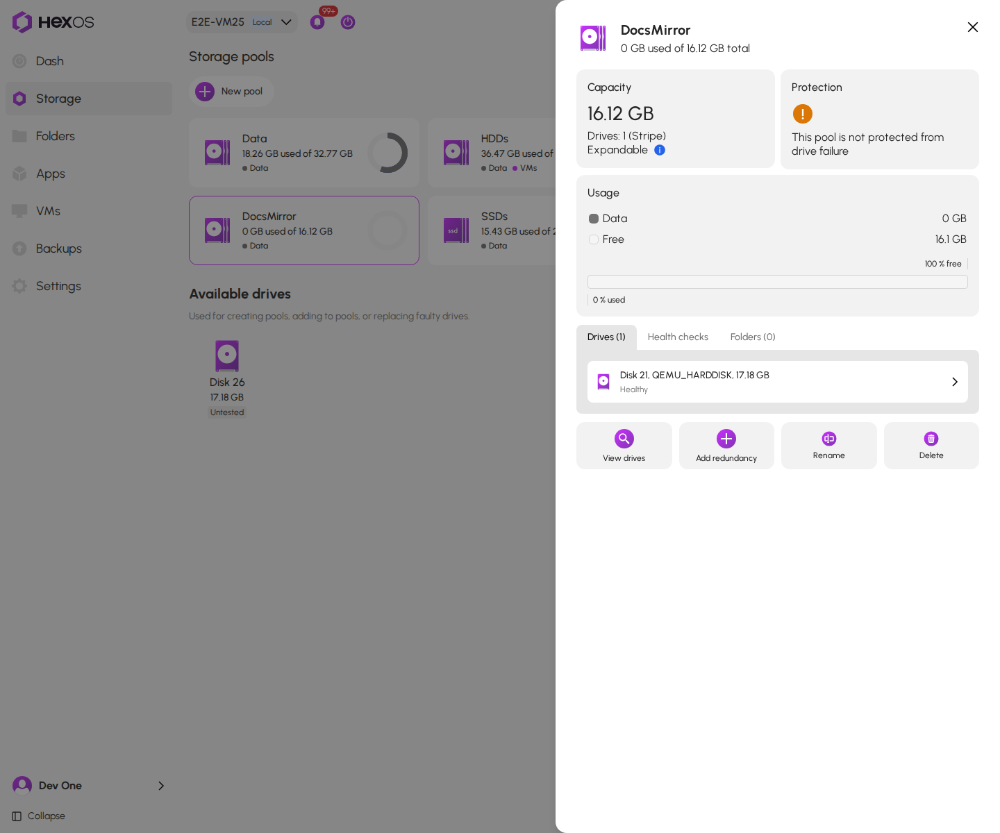{.medium .framed}

2. In **Mirror this drive**, check the unused drive you want to add. Confirm its serial number and capacity, then click **Continue**.

 Choose the drive for the mirror 

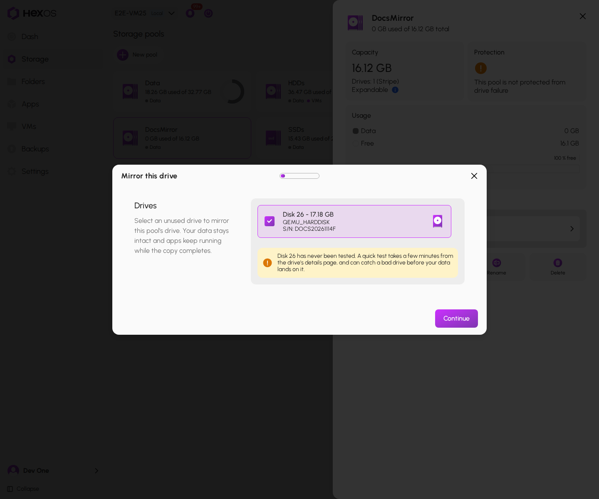{.medium .framed}

3. Review the pool and added drive. Check **I understand that this will permanently modify my pool and cannot be undone.** after reviewing the change. Click **Add redundancy**.

 Review the mirror change 

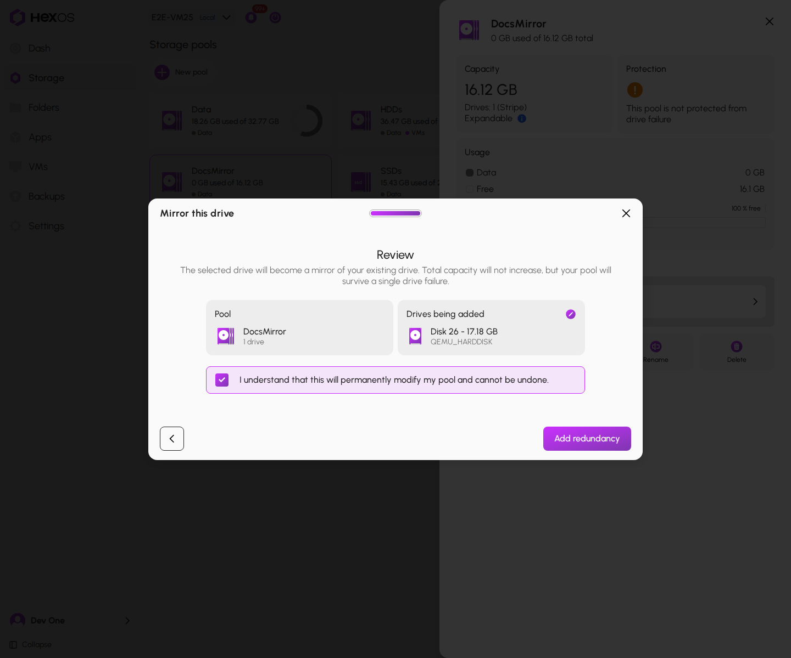{.medium .framed}

4. Open the bell, then **Jobs**, to monitor the activity. Wait for the activity and rebuild to finish. Open the pool again. Confirm that it reports two drives in a mirror and one-drive protection. Check that your files are accessible. The usable capacity should remain about the same.

 The completed two-drive mirror 

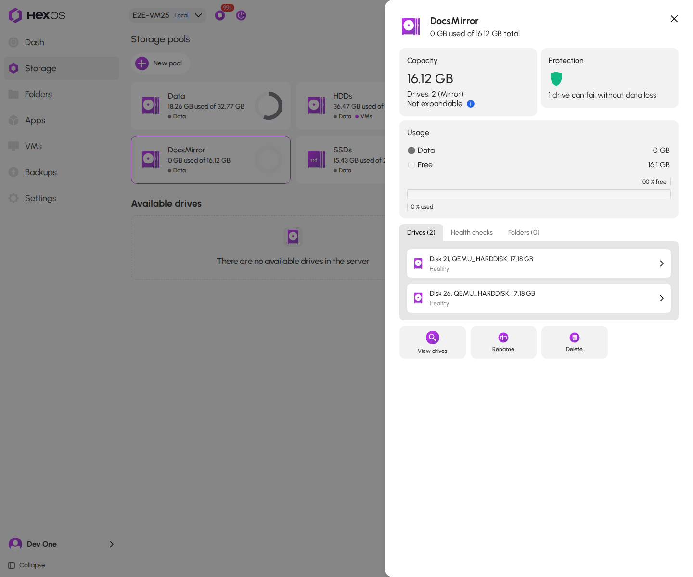{.medium .framed}

### Expanding drives 

This is how you can upgrade individual drives one at a time. The process for this is the same as replacing individual drives that have failed.

### Using drives of different sizes

You can add or swap in a drive that is larger than the other drives in the pool. Choose a suitable replacement offered by HexOS. Check its identity and warnings; an offered drive is not necessarily tested or healthy.

Within a mirror or RAIDZ drive group, the smallest member limits how much space each member contributes. A pool can contain more than one group. When you pick a larger drive, HexOS shows this message:

**You can use this disk, but some capacity won’t be available until all disks are replaced with larger ones.**

What this means for each option:

| Option | What happens | What you get |
|---|---|---|
| **Add drive** | The larger drive joins the pool. | The larger drive is used as if it were the size of the smallest drive in that drive group. The remaining space on it is not used. |
| **Replace** | HexOS copies the data from one drive to the larger drive. The old drive becomes an unused drive. | The smallest member limits the extra capacity. Upgrade the limiting members, then check the growth result. |

To use the full capacity of larger drives:

- Replace one drive in the pool with a larger drive. Follow the steps in [How to replace a drive](#how-to-replace-a-drive).
- Wait for the replacement to finish.
- Repeat for the remaining smaller members that limit the affected drive group.

After replacement finishes, HexOS checks for unused capacity when the pool is healthy and no other pool operation is active. It can then grow the pool automatically. Check the activity result rather than assuming growth has finished. The Activity Center shows **Growing pool into its bigger drives** and then **Pool grown to use its bigger drives**.

> **Info:** Capacity growth is designed to preserve your files. Keep a separate backup before changing the pool.
{.is-info}

> **Warning:** When replacing a connected drive, leave the old drive connected until the replacement finishes. Check the pool's actual remaining protection; do not assume a degraded pool can tolerate another failed drive.
{.is-warning}

## Delete an extra pool

Delete a pool when you want to erase its storage and make its drives available for another use. Deleting a pool also deletes its folders and files.

> **Danger:** Pool deletion permanently erases the selected pool. Copy anything you need to separate storage and check that the copy opens before continuing. Deletion cannot be undone.
{.is-danger}

1. Open **Storage**, then open the pool you want to delete. Check its name and drives. Click **Delete**.

 Delete button in the pool info panel 

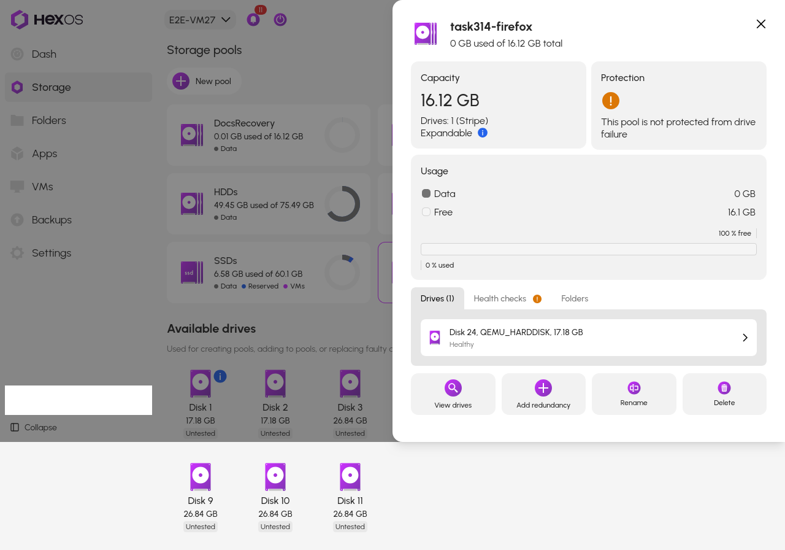{.medium .framed}

2. Read the warning. Type the pool name shown above the confirmation field, then click **Delete pool**.

 Confirm the pool name before deletion 

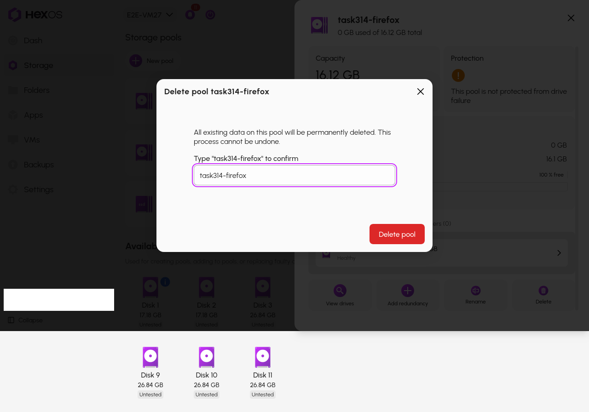{.medium .framed}

3. Wait for deletion to finish. HexOS may reconnect while removing its access to that pool. Check **Storage**: the deleted pool should be gone, and the other pools should still be present. A submitted request alone does not mean deletion has finished.

 Storage after the extra pool is deleted 

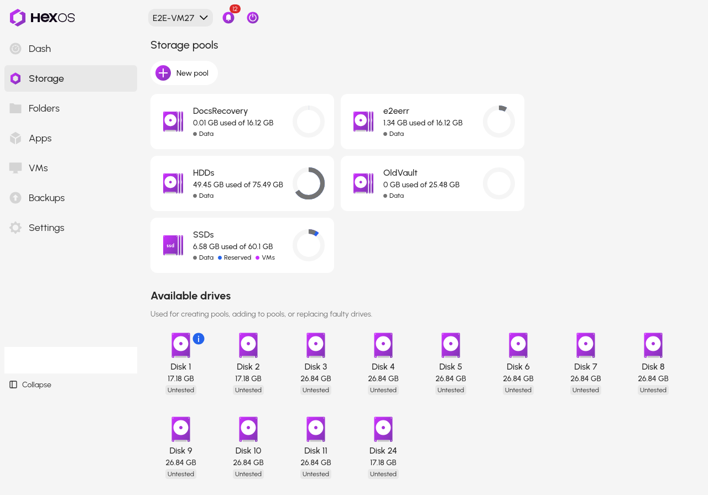{.medium .framed}

### Why is an empty pool still in use?

An app can be configured to access a pool even when that pool has no files. Empty storage does not mean that nothing uses it.

HexOS removes its own managed access as part of deletion. Other app dependencies still block deletion, including apps that are stopped. Move the app's storage or remove the app's use of the pool before trying again. Do not remove an app's storage if you need to keep its data.

If HexOS can't read the settings of every installed app, it won't delete the pool, because it can't confirm that no app uses it. Try again. If the message keeps coming back, contact support.

You cannot delete your only pool or the pool currently used for Apps. A pool used by a virtual machine, Buddy Backups or an active storage operation may also be blocked. Follow the message shown in HexOS before trying again.

If deletion fails, read its **Activity Center** entry and check whether the pool is still listed in **Storage**. Keep the drives connected while you investigate. If the result is unclear, contact support with the pool name and a screenshot of the error.

If HexOS cannot confirm the result, the **Activity Center** entry explains when a server restart is needed before another attempt. HexOS does not automatically repeat an unconfirmed deletion.

## Critical errors

Read the pool's status and error before changing drives or restarting the server.

- **Degraded:** Protection is reduced. Check the affected drives and preserve accessible important files. The status alone does not prove that all files are intact.
- **Offline:** The pool is unavailable. Check the reported drive and connection state. Do not format or initialize drives to try to bring an existing pool back.
- **Multiple drive problems:** Stop unnecessary writes and seek help if failures exceed the layout's protection. For irreplaceable data, consider professional recovery before attempting further changes.

See [drive failure troubleshooting](/troubleshooting/drive-failure) and [storage and drive issues](/troubleshooting/storage-and-drives).

## Understanding capacity usage

File sizes and pool usage can differ because of compression, redundancy, metadata, restore points and shared blocks. A single number does not identify the cause. See [Why your pool size changes](/troubleshooting/pool-size) for the measurements HexOS shows.

## Where to go next

| I want to… | Guide |
|---|---|
| Test one drive and understand its report | [Drive Certification](/features/storage/drive-certification) |
| Know what the deep check does to my drives | [Deep check](/features/storage/deep-check) |
| Understand a notice about drive errors | [Drive errors](/features/storage/drive-errors) |
| Keep a nightly copy of apps on a single drive | [App backups](/features/storage/app-backups) |
| Get my apps back after the apps drive fails | [When the apps drive fails](/features/storage/apps-drive-failed) |
| Grow a two-drive mirror into a three-drive pool or reclaim space after expanding | [Grow a mirror and reclaim space](/features/storage/growing-a-mirror) |

## Checking a pool

- [**Pool check progress**](/features/storage/pool-check-progress) - Find the estimated time remaining and understand paused or unavailable estimates.
