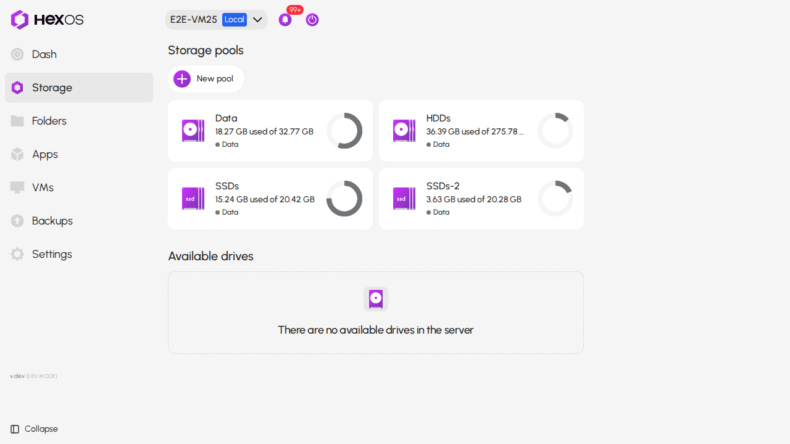
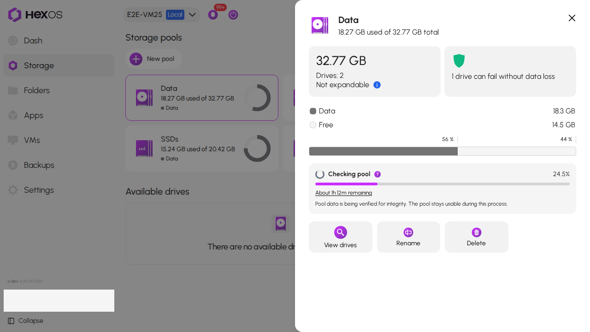

# Pool check progress

A pool check, also called a scrub, reads stored data to check its integrity. You can keep using the pool while the check runs. HexOS shows its progress and, when available, TrueNAS's estimate of the time left.

 Checking stored files 

{.medium}

## Find the time remaining

1. In **Command Deck**, click your server and open **Storage**. Click the pool being checked.

 Pool card on the Storage screen 

{.medium .framed}

2. In the pool's panel, find **Checking pool**. The percentage shows progress. A line such as **About 1h 12m remaining** shows the estimated time left.

 Checking pool with an estimated time remaining 

{.medium .framed}

You do not need to start another check to see the estimate. The panel refreshes while the current check runs. Click the time estimate to open this guide in a new tab.

## Why the estimate changes

TrueNAS estimates the time using the work left and the check's processing rate. Other activity on the server can change that rate, so the estimate can go up or down. It is not a promised finish time.

The percentage and the time estimate answer different questions. The percentage shows how much of the check is done. The estimate describes how long the remaining work might take at the measured rate.

## Other messages

- **Check paused** means TrueNAS reports the check as paused. HexOS does not show a running time estimate while it is paused.
- **Time estimate unavailable** means HexOS does not have enough information to show an estimate. This can happen before progress is measurable, when TrueNAS has no usable estimate, or when an older HexOS server version does not report whether the check is paused. This message alone does not mean the check failed.
- If HexOS loses its connection or cannot refresh the pool, it hides the time estimate rather than showing an old value as current.

The time estimate disappears when the check stops running. Its disappearance alone does not prove the check succeeded. Check the pool's status and any notices for errors. For help with reported errors, see [Files that can't be read on a pool](/troubleshooting/pool-data-errors).

> **Info:** Time remaining is shown for **Checking pool**. This guide does not describe a drive rebuild or a pool expansion.
{.is-info}

## Sources

- [TrueNAS 25.10 pool query fields](https://api.truenas.com/v25.10.0/api_methods_pool.query.html)
- [TrueNAS 25.10.7 scan time calculation](https://github.com/truenas/py-libzfs/blob/eb1d2d7ab73e8de88723d937ff8ff2917ec6b87b/libzfs.pyx#L2737-L2747)
