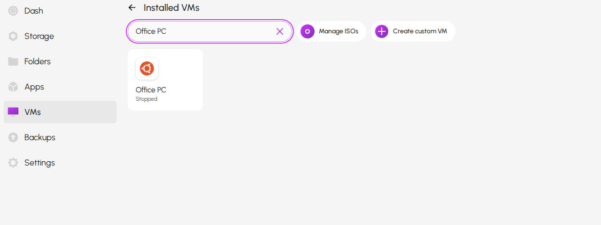
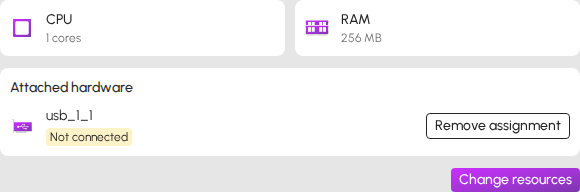
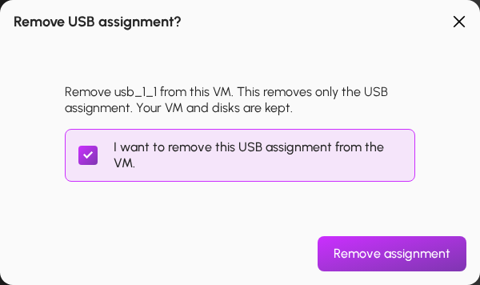
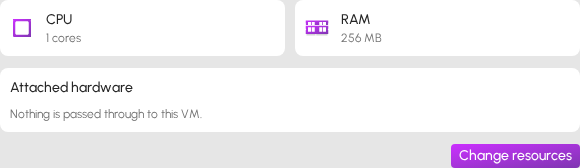
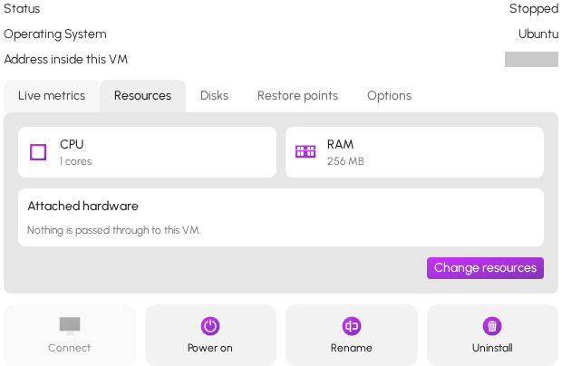

# Start a VM after disconnecting a USB device

A USB device assigned to a VM can prevent that VM from starting when it is disconnected. Removing the assignment keeps the VM and its disks. The USB device will no longer be assigned to that VM.

> **Requirement:** This guide starts with a stopped VM. If the VM is still running, save your work inside it before shutting it down.
{.is-success}

## Find the disconnected device

1. Click **VMs** in the menu, then **Installed VMs**. Click the VM that cannot start. You can use **Find installed VMs** to find it by name.

 Find the stopped VM 

{.medium .framed}

2. Click **Resources**. Under **Attached hardware**, find the USB row marked **Not connected**. Click **Remove assignment** beside that row.

 Disconnected USB assignment under Resources 

{.medium .framed}

## Remove the assignment

3. Check that the dialog names the USB assignment you want to remove. Click **I want to remove this USB assignment from the VM.**, then click **Remove assignment**.

 Confirm removal of the USB assignment 

{.medium .framed}

The USB row should disappear. The VM remains stopped. If it had no other assigned hardware, **Attached hardware** will show **Nothing is passed through to this VM.**

 The disconnected assignment is removed 

{.medium .framed}

## Start the VM

4. Click **Power on**.

 Power on after removing the disconnected assignment 

{.medium .framed}

5. Check that the VM shows **Running**. This confirms that the VM started. Its operating system may still need time to finish starting.

 The VM is running 

{.medium .framed}

## If the VM still cannot start

If another USB assignment is still disconnected, the VM may still refuse to start. Each disconnected assignment has its own **Remove assignment** button.

If the USB row says **Connection status unknown**, HexOS could not verify the device's connection. Check which device was assigned before deciding whether to remove it.

[Learn about Virtual Machines](/features/vms).
