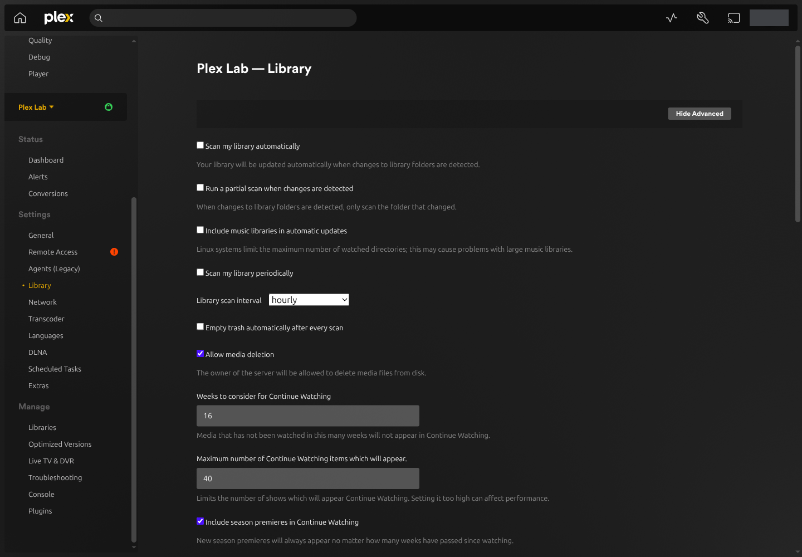
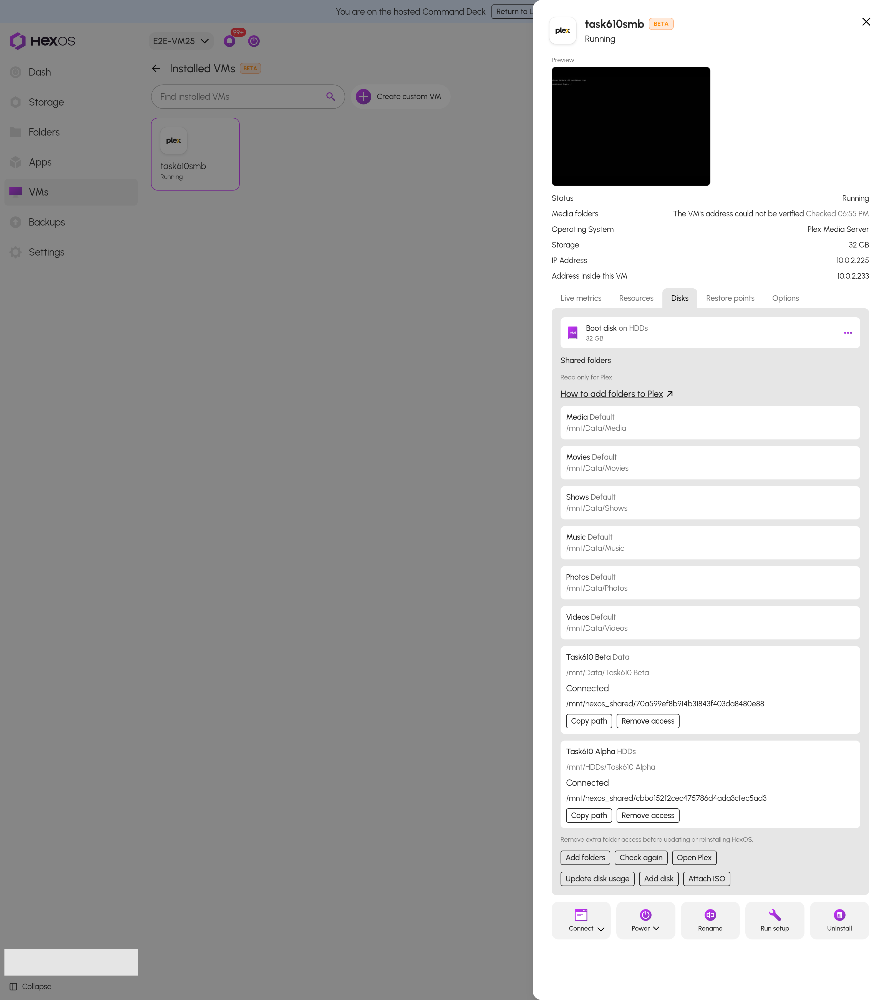
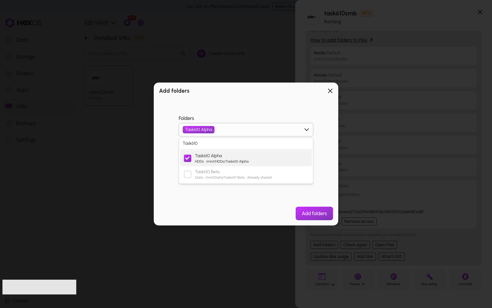
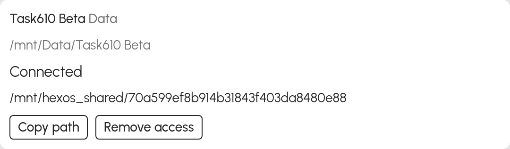
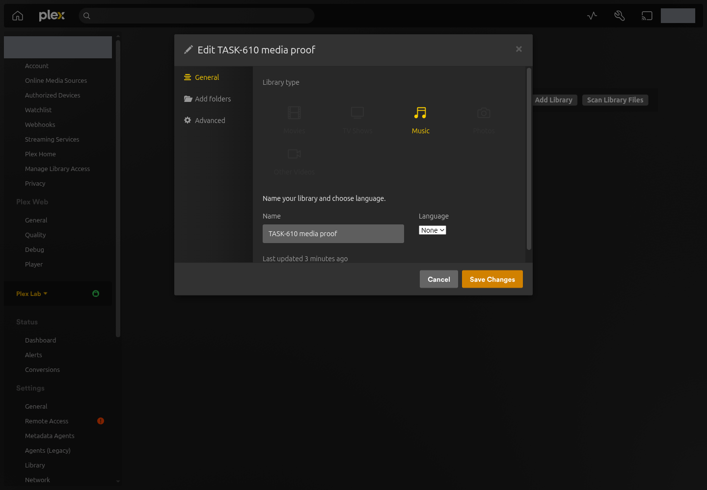
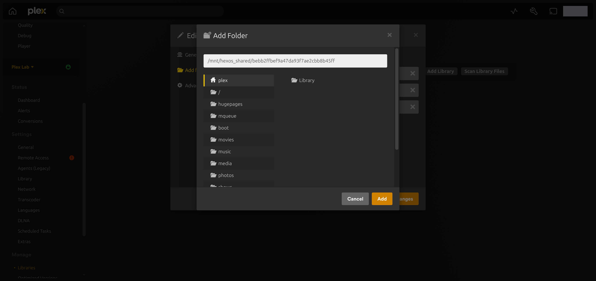
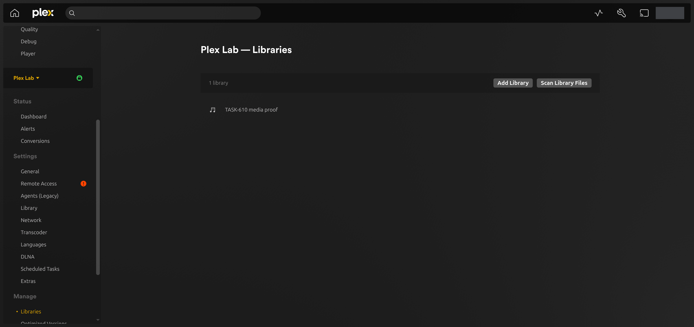
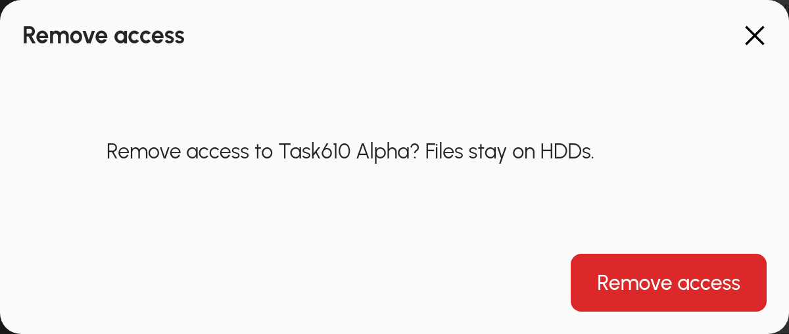

# Add folders to a Plex VM

**Shared folders** lets a Plex VM installed by HexOS read additional folders from your server. The folders can be on different pools. Your files stay where they are.

The six folders provided during installation remain in place. Adding folders does not recreate your Plex libraries. After a folder connects, you choose which existing Plex library should include it.

> **Requirement:** This feature must be available for your server. Use a running Plex VM installed from the HexOS catalog. Each folder must already appear in **Folders**, be unlocked, and have file sharing turned on.
{.is-success}

## Protect your Plex library during an outage

Plex can remove a missing item's library information when it scans. Turn off automatic trash emptying before adding network folders. HexOS checks this setting but does not change it for you.

1. Open your Plex server. Click **Settings**, choose your server, then click **Library**. If needed, click **Show Advanced**.

 Open the Plex Library settings 

{.medium .framed}

2. Clear **Empty trash automatically after every scan**. Click **Save Changes**. Leave this setting off while using shared folders.

 Turn off automatic trash emptying 

{.medium .framed}

This protects library information when a folder is temporarily unavailable. A file that you intentionally remove may remain listed in Plex until you empty that library's trash yourself. See [Plex's explanation of library trash](https://support.plex.tv/articles/200289326-emptying-library-trash/).

## Connect your folders

1. In the Command Deck, choose your server. Click **VMs** > **Installed VMs**, then your Plex VM. Open **Disks** and find **Shared folders**.

 Shared folders in the Disks tab 

{.medium .framed}

2. Click **Check again** if HexOS still asks you to change the Plex setting. Click **Add folders**. Choose the folders you want. Check the pool and path beneath each name, then click **Add folders** in the dialog.

 Choose folders from your pools 

{.medium .framed}

HexOS prepares network folder access if the VM needs it. Follow the task in **Activity Center**. The VM and Plex stay running.

3. Wait for **Connected** or **Folder is empty**. **Folder is empty** means Plex can open the folder, but it contains no files or folders. Click **Copy path** beside the folder you want to use.

 Copy a connected folder's path 

{.medium .framed}

The copied path is the address inside this VM. Use it in Plex. It is different from the folder address you use on your computer.

## Add the path to your existing Plex library

1. Click **Open Plex**. In Plex, click **Settings**, choose your server, then click **Libraries** under **Manage**. Click **Edit Library** beside the library you want to extend.

 Edit the existing Plex library 

{.medium .framed}

2. Click **Add folders** > **Browse for media folder**. Paste the path you copied from HexOS into the folder path field and click **Add**. Keep the library's existing folders. Click **Save Changes**.

 Add the copied path without removing existing folders 

{.medium .framed}

3. Back on **Libraries**, click **Scan Library Files**. When the scan finishes, open a new item and play it. Check an item from the original folder too.

 Scan the library after adding a folder 

{.medium .framed}

Repeat for other folders. A single library can include more than one folder. HexOS does not choose libraries, move media, or edit your watched history. See [Plex's instructions for editing libraries](https://support.plex.tv/articles/200289266-editing-libraries/).

## Remove access

In **Disks** > **Shared folders**, click **Remove access** beside an added folder and confirm. Your media stays on its original pool. The six **Default** folders do not have this button.

 Remove an added folder's access 

{.medium .framed}

If the folder is busy, stop playback or a scan using it and click **Check again**. HexOS waits for a normal disconnect. It does not force Plex to stop.

Plex's library still lists the old path until you edit the library. Remove that path from **Add folders** when you no longer want Plex to use it. Leave any other library paths in place.

## When a folder needs attention

| What you see | What to do |
| --- | --- |
| **Checking result** | Click **Check again**. HexOS checks the existing task before trying to continue it. |
| **Not connected** | Check that the source pool and folder are available, sharing is on, and the VM is running. Then click **Check again**. |
| **Folder not found** | Check the original folder in **Folders**. A new folder with the same name is not automatically treated as the original. |
| **Needs attention in Folders** | Open the folder in **Folders** and check its sharing and lock status. |
| **Folder access could not be prepared. Contact support.** | Contact support. Leave the existing VM and folders in place. |
| **Access needs attention. Contact support before changing this VM.** | Contact support. Do not delete or recreate the VM or account to clear this message. |
| **A HexOS update is pending. Check again after it finishes.** | Wait for the existing update. Contact support if it remains pending. |
| A request to turn off automatic trash emptying | Follow the Plex settings steps above, then click **Check again**. |

Keep automatic trash emptying off during an outage. Do not delete and recreate your library to reconnect a folder. A successful folder remains connected if another folder in the same task fails.

## What stays the same

The original six folders keep their existing sharing method. Additional folders use network sharing. HexOS mounts them read only for Plex, so Plex cannot change the media through those paths. Someone administering the whole VM may have broader access through other accounts or public shares.

The VM keeps its current Plex settings and libraries. HexOS does not replace an existing sharing password. A VM using direct folder access gets a separate account for its additional network folders.

Remove extra folder access before updating or reinstalling HexOS. An older HexOS version may not understand the added access. Turning off this feature stops new additions; **Check again** and **Remove access** remain available.
