# Install HexOS

> **Thank you:** @Mawson for the original guide, with edits by @gingerling
{.is-contribute}

## Before you begin

You will need:

- [To purchase a HexOS license](https://hexos.com/store)
- [Server hardware](/getting-started/overview#system-requirements)
- An 8 GB or larger USB drive that can be safely erased
- An ethernet cable to connect your server to your router or network switch
- A display, keyboard and optionally a mouse to connect to your server
- A separate computer to create a bootable USB installer and set up your server after installation

## Create the installation USB

The recommended way is **HexOS Imager**. It downloads the latest HexOS installer, checks that the download is complete and unmodified, and writes it to your USB drive in one step. There is no separate ISO to find or verify.

> **Warning:** The USB drive will be **erased** during this process. Make sure there is nothing on it you want to keep.
{.is-warning}

### Install HexOS Imager

Download the version for your computer. These are all the same release, built for each operating system:

| Your computer | Download |
|---|---|
| Windows | [HexOS-Imager-v2.1.6-20261011-Setup.exe](https://github.com/eshtek/etcher/releases/download/v2.1.6%2B20261011/HexOS-Imager-v2.1.6-20261011-Setup.exe) |
| Mac with Apple silicon (M1 or newer) | [HexOS-Imager-v2.1.6-20261011-arm64.dmg](https://github.com/eshtek/etcher/releases/download/v2.1.6%2B20261011/HexOS-Imager-v2.1.6-20261011-arm64.dmg) |
| Mac with an Intel processor | [HexOS-Imager-v2.1.6-20261011-x64.dmg](https://github.com/eshtek/etcher/releases/download/v2.1.6%2B20261011/HexOS-Imager-v2.1.6-20261011-x64.dmg) |
| Linux, Debian or Ubuntu (x64) | [HexOS-Imager-v2.1.6-20261011-x64.deb](https://github.com/eshtek/etcher/releases/download/v2.1.6%2B20261011/HexOS-Imager-v2.1.6-20261011-x64.deb) |
| Linux, Debian or Ubuntu (arm64) | [HexOS-Imager-v2.1.6-20261011-arm64.deb](https://github.com/eshtek/etcher/releases/download/v2.1.6%2B20261011/HexOS-Imager-v2.1.6-20261011-arm64.deb) |
| Linux, Fedora or RHEL (x64) | [HexOS-Imager-v2.1.6-20261011-x64.rpm](https://github.com/eshtek/etcher/releases/download/v2.1.6%2B20261011/HexOS-Imager-v2.1.6-20261011-x64.rpm) |
| Linux, Fedora or RHEL (arm64) | [HexOS-Imager-v2.1.6-20261011-arm64.rpm](https://github.com/eshtek/etcher/releases/download/v2.1.6%2B20261011/HexOS-Imager-v2.1.6-20261011-arm64.rpm) |

All downloads, including a `SHA256SUMS.txt` file for checking them, are on the [HexOS Imager release page](https://github.com/eshtek/etcher/releases/tag/v2.1.6%2B20261011). HexOS Imager does not update itself yet, so check that page for newer versions.

> **Info:** On Windows, the installer is signed by Eshtek Inc. Because the signing certificate is new, Windows may still show a "Windows protected your PC" message. Click **More info** and check that the publisher reads **Eshtek Inc.**, then click **Run anyway**. Do not continue if the publisher does not match.
{.is-info}

> **Info:** On a Mac, the app is signed and notarized. macOS can still ask you to confirm opening a downloaded app the first time.
{.is-info}

### Write HexOS to the USB drive

1. Plug the USB drive into your computer. Open **HexOS Imager**.

 Open HexOS Imager 

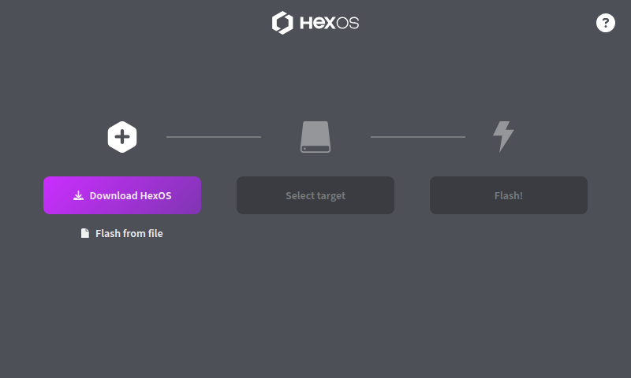{.medium .framed}

2. Click **Download HexOS**, then **Download and verify**. Wait for the download and checksum check to finish. If a matching installer is already saved, HexOS Imager uses that copy.

 Download and verify the HexOS installer 

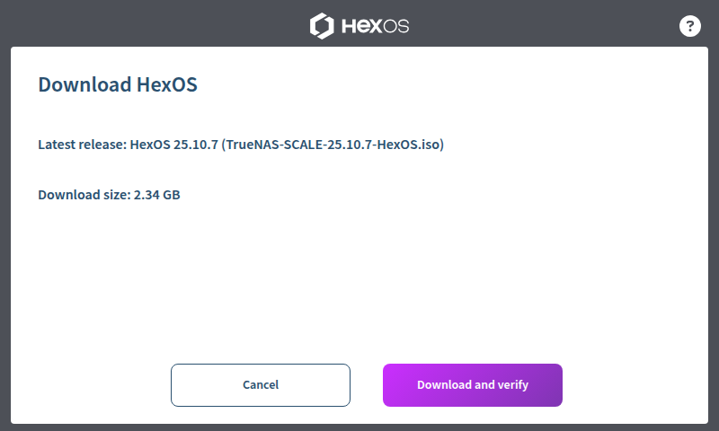{.medium .framed}

3. Click **Select target**. If a drive is already selected, click **Change** to check it. Click the checkbox beside your USB drive, then **Select 1**. Check its name and size carefully. The test drive shown below has a different name from your USB drive.

 Choose only the USB drive you intend to erase 

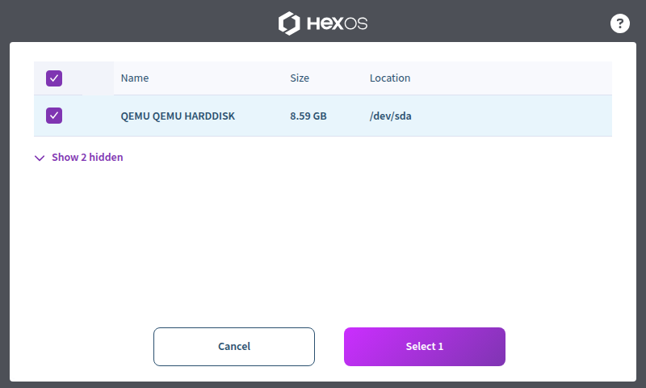{.medium .framed}

4. Check the installer and target drive once more. Click **Flash!**. Everything on that USB drive will be erased.

 Check the target before clicking Flash 

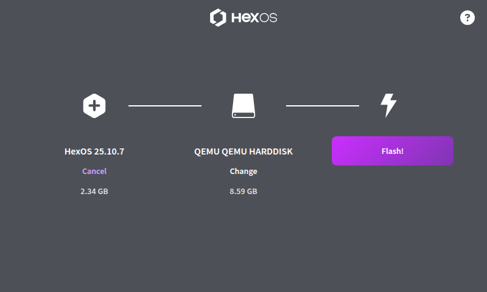{.medium .framed}

5. Wait while HexOS Imager writes and checks the USB drive. Leave the drive connected until this finishes.

 Wait for writing and verification to finish 

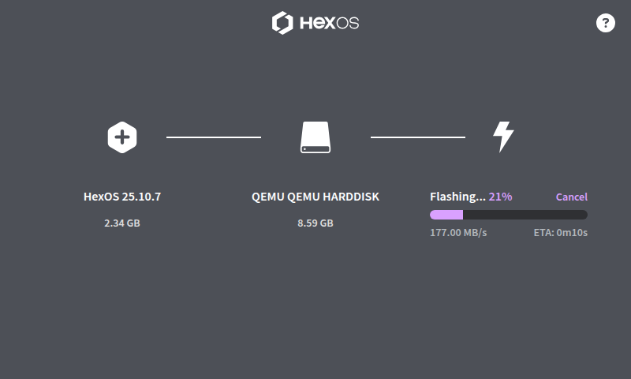{.medium .framed}

6. Check that **Flash Completed!** shows **1 Successful target**. Remove the USB drive. It is ready to use in the next section. If flashing or verification fails, leave the server running its existing system and try writing the USB again.

 The installation USB is ready 

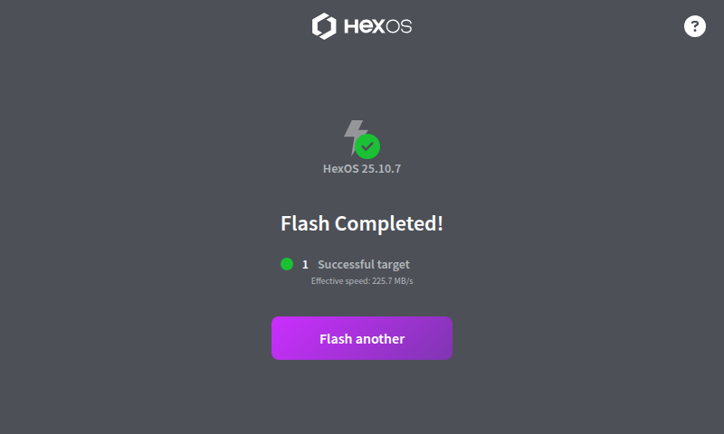{.medium .framed}

> **Warning:** If Windows asks to format the USB drive after flashing, cancel. Formatting it would erase the installer.
{.is-warning}

> **Tip:** If you already have a HexOS ISO file, you can use **Flash from file** instead of **Download HexOS**. The rest of the steps are the same.
{.is-tip}

### Alternative: use your own imaging tool

If you would rather use a tool you already have, download the installer yourself and write it with [Balena Etcher](https://etcher.balena.io/#download-etcher) or another imaging tool that supports ISO files.

Current version: **HexOS 25.10.7**, released September 3, 2026.

- [Download HexOS 25.10.7](https://downloads.hexos.com/TrueNAS-SCALE-25.10.7-HexOS.iso)
- [Backup download link](https://hexos-downloads.sfo3.cdn.digitaloceanspaces.com/TrueNAS-SCALE-25.10.7-HexOS.iso), if the first link is slow or unavailable
- SHA256 checksum: `a7abaf7636a57e62ca65ad324c906b4059c0963da2a238f8bfb96ee7476ffbb2`

Compare the checksum against the file you downloaded before writing it. A checksum that does not match means the download is incomplete or corrupted, and the resulting USB will not install correctly.

> **Warning:** Do not use Rufus to create the installation USB. It has caused unbootable installers for HexOS users. Use HexOS Imager or Balena Etcher.
{.is-warning}

 Verify your download (optional) 

Two small files are published next to the installer:

- [Checksum file](https://downloads.hexos.com/TrueNAS-SCALE-25.10.7-HexOS.iso.sha256), the SHA256 checksum shown above
- [Signature file](https://downloads.hexos.com/TrueNAS-SCALE-25.10.7-HexOS.iso.gpg), a GPG signature from the iXsystems security team

**Check the checksum**

Run one of the following commands in the folder where you saved the installer, then compare the result to the SHA256 checksum shown above. The two must match exactly.

- Windows (PowerShell): `Get-FileHash TrueNAS-SCALE-25.10.7-HexOS.iso -Algorithm SHA256`
- macOS: `shasum -a 256 TrueNAS-SCALE-25.10.7-HexOS.iso`
- Linux: `sha256sum TrueNAS-SCALE-25.10.7-HexOS.iso`

**Check the signature**

Checking the signature confirms that the installer was built by iXsystems, the makers of TrueNAS. This needs GPG installed on your computer, for example [Gpg4win](https://www.gpg4win.org/) on Windows or [GPG Suite](https://gpgtools.org/) on macOS. Most Linux distributions include it.

1. Download the signature file to the same folder as the installer.
2. Import the iXsystems signing key: `gpg --keyserver hkps://keys.openpgp.org --recv-keys C8D62DEF767C1DB0DFF4E6EC358EAA9112CF7946`
3. Verify the installer: `gpg --verify TrueNAS-SCALE-25.10.7-HexOS.iso.gpg TrueNAS-SCALE-25.10.7-HexOS.iso`

The output should include `Good signature from "IX SecTeam <security-officer@ixsystems.com>"` and the key fingerprint `C8D6 2DEF 767C 1DB0 DFF4 E6EC 358E AA91 12CF 7946`.

> **Info:** GPG will also print a warning that the key is not certified with a trusted signature. This is expected. It only means you have not personally marked the iXsystems key as trusted on your computer.
{.is-info}

## Installation process

- Insert the USB into your server and power it on.

### Getting to the boot screen

If you do not see the boot screen (shown in the next section) right away, the following are common issues:

#### Boot device order

Your server might be trying to boot from a different drive, for example an old Windows install on one of the hard drives.
To fix this, first enter the BIOS. Usually this is done by pressing `F1`, `F2`, `F10`, `F12` or `Del` while the machine is turning on.
Then in the BIOS, change the order of boot drives so your USB drive is at the top. Then save and restart.

#### UGREEN NAS: turn off the watchdog

Some UGREEN configurations have a watchdog that can interrupt installation by restarting the system. If yours repeatedly restarts, check the model-specific guidance in [UGREEN NAS keeps restarting](/troubleshooting/ugreen-watchdog) to turn it off.

#### Disabling Secure Boot

If the installer reports a "security policy violation", check the firmware's Secure Boot setting and your motherboard's boot instructions. The message alone does not establish the cause.

For instructions on how to disable Secure Boot, search for "[your motherboard model here] disable secure boot". You can also search for the motherboard user manual, and search within that for "secure boot".

#### Start the USB drive in UEFI mode

Some HexOS features, such as the memory test, need your server to start in UEFI mode. The mode you start the USB drive in is the mode HexOS is installed in.

If you use your motherboard's boot menu, it often shows the USB drive twice. Choose the entry whose name starts with **UEFI**, for example **UEFI: USB Flash Disk 1.00, Partition 1**. See [UEFI boot mode](/troubleshooting/uefi-boot-mode) for pictures and the boot menu key for your motherboard.

### Boot screen

Once you see this screen, you are ready to boot into HexOS and install it:

- Choose **Start HexOS Installation** (the default option).
- The installer continues automatically if you leave this option selected.

 HexOS installer boot screen 

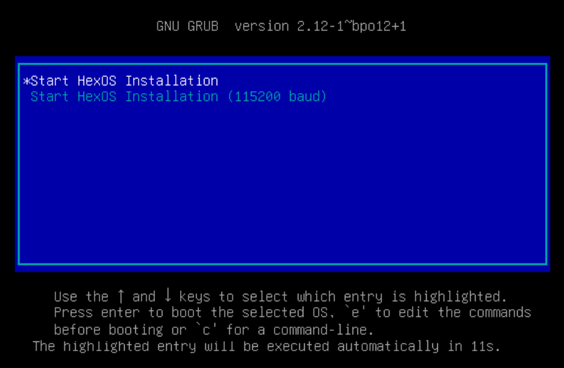{.medium .framed}

### Installation menu

- Once the system loads, use the arrow keys to choose **Install/Upgrade**, then press `Enter`.

 Install/Upgrade menu option 

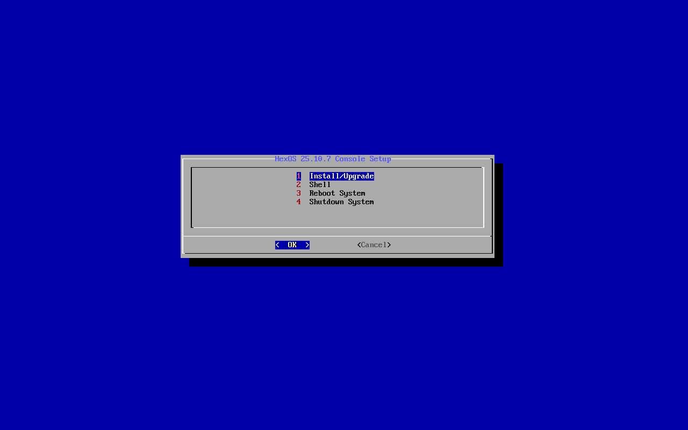{.medium .framed}

### Select installation drive

What you see now will depend on how many drives you have in your server. The drive or drives you choose to install HexOS on will not be available to store data on.

- Use the arrow keys to choose your installation drive or drives. Press the space bar to select each drive.
- **[*]** in the first column indicates the device is selected.
- Check the selected drives, then press `Tab` to highlight **OK** and press `Enter`.

 Installation drive selection 

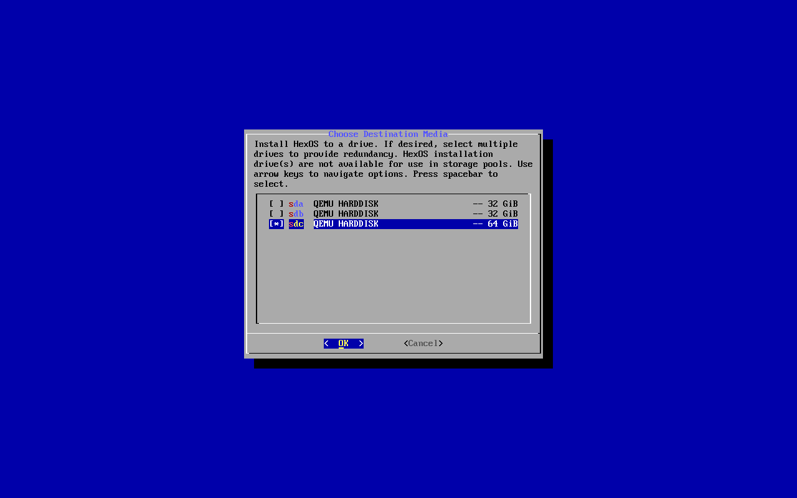{.medium .framed}

### Confirm drive erasure

Check the drive names in the warning. Use the arrow keys to choose **Yes** only if every listed drive can be erased, then press `Enter`.

> **Danger:** Installation erases every partition and file on the selected drives. These drives will not be available for your storage pools.
{.is-danger}

 Drive erasure confirmation 

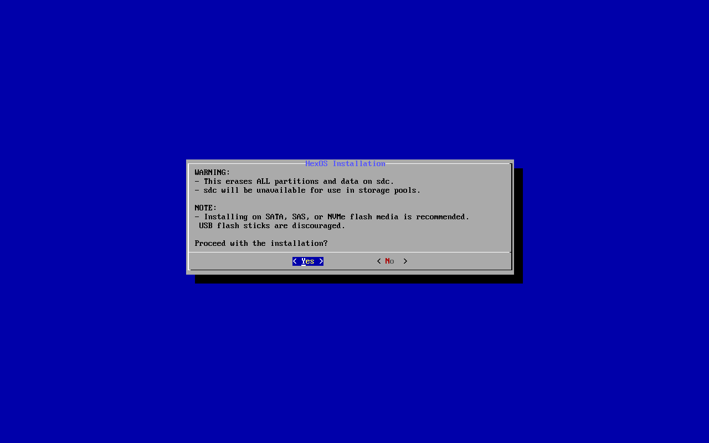{.medium .framed}

### User account setup

Enter a password for the administrative user `truenas_admin`. Press `Tab` to move to **Confirm Password** and enter it again. Press `Tab` to highlight **OK**, then press `Enter`.

> **Danger:** Save this password. You will need it later to reach the TrueNAS interface and to recover the server.
{.is-danger}

> **Info:** If you use a non-US keyboard, be careful with special characters in the password. The installer uses a [US keyboard layout](https://en.wikipedia.org/wiki/British_and_American_keyboards#/media/File:KB_United_States-NoAltGr.svg), so some symbols may not be the ones printed on your keys.
{.is-info}

 Administrative password entry 

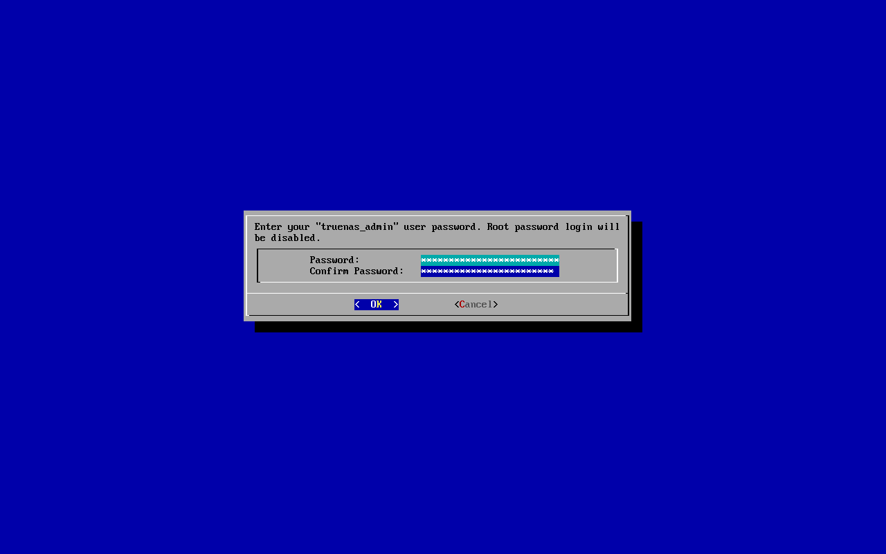{.medium .framed}

### Installation progress

Wait for the installation to finish. The screen shows progress as HexOS copies files and configures the system.

 Installation progress screen 

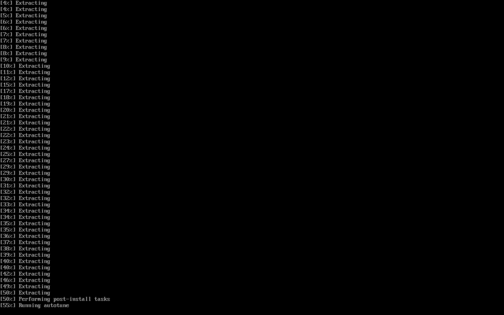{.medium .framed}

### Installation complete

When **Installation Succeeded** appears, press `Enter` with **OK** selected. Remove the installation USB drive.

 Installation complete prompt 

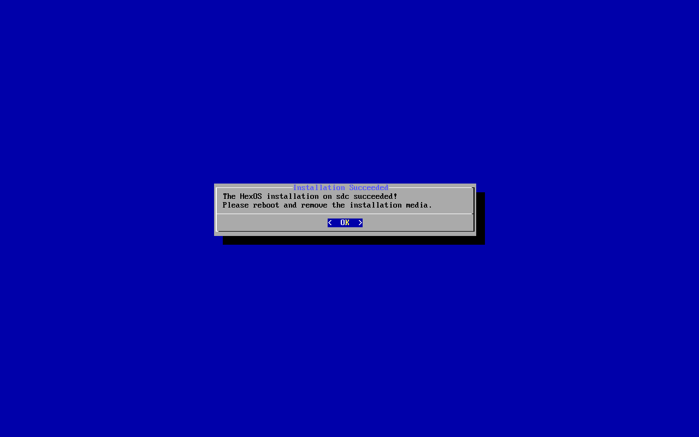{.medium .framed}

Use the arrow keys to choose **Reboot System**, then press `Enter`.

 Reboot menu option 

{.medium .framed}

## First boot

### Boot screen

The installed system’s boot menu appears. Leave the first **HexOS GNU/Linux** entry selected. It starts automatically.

 Boot selection screen 

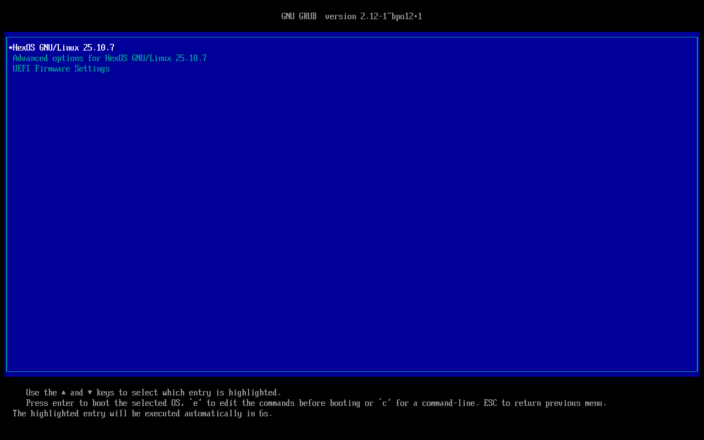{.medium .framed}

### Wait for startup to finish

The console shows startup messages. Wait for the **Console setup** screen to list the server's web addresses.

> **Tip:** If boot fails, check that HexOS is at the top in your BIOS boot device order. The instructions are at the top of this guide.
{.is-tip}

 Console setup screen 

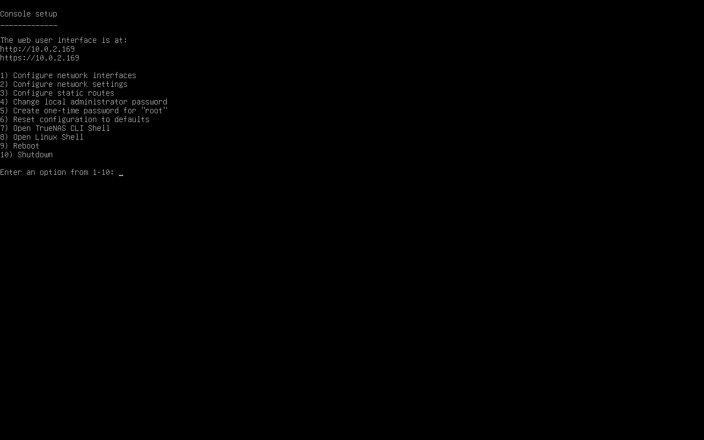{.medium .framed}

**Installation complete!**

## Next step

- Open a browser window on your laptop and go to [https://deck.hexos.com/](https://deck.hexos.com/) to configure your server

> **Help:** Installer will not boot, or stuck partway? See [Installation issues](/troubleshooting/installation) or ask in the [HexOS Discord Community](https://discord.gg/fCW2htvYdz).
{.is-troubleshooting}

> **Contribute:** to help to improve HexOS documentation [join the #Docs channel on Discord](https://discord.com/invite/DjEp3WRHKz) today! Send feedback, suggestions or contribute a guide.
{.is-contribute}
