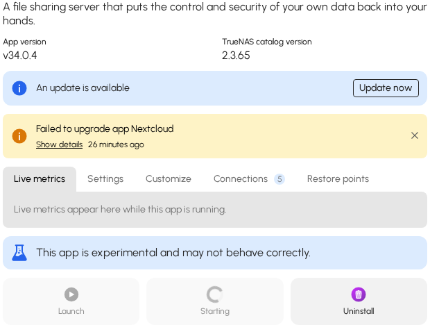
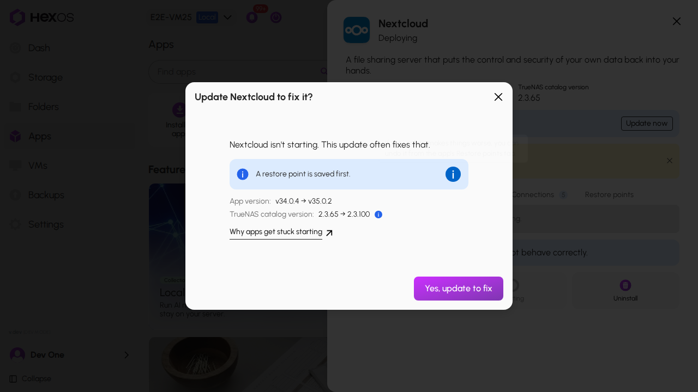

# App stuck starting

Sometimes an app shows **Deploying** for a long time, or **Crashed**, and never starts. This page explains one common cause and how HexOS fixes it with an update.

## Why an app gets stuck

An app has two parts. The app's program comes from TrueNAS. The app's files are kept in your folders on the server.

Some apps, such as Nextcloud, can update their own files from inside the app. After that, the files are newer than the program. The app then refuses to start, because it cannot use files from a newer version. It tries again and again, so HexOS shows **Deploying** or **Crashed**.

The fix is to update the app's program to the newer version. HexOS offers this update when one is available.

## Update the app to fix it

1. In the Command Deck, click **Apps**, then click the app.
2. Next to **An update is available**, click **Update now**.

 Update now on an app that is stuck 

{.medium .framed}

3. The dialog says the app isn't starting and that the update often fixes this. Read the restore point line, then click **Yes, update to fix**.

 Update to fix dialog 

{.medium .framed}

> **Info:** When the dialog says **A restore point is saved first.**, HexOS saves your app's folders before it changes anything. If the update makes things worse, you can undo it from the app's **Restore points** tab. When it says **No restore point can be saved for this app.**, the update still runs, but there is nothing to undo it with.
{.is-info}

4. The activity list shows **Updating to fix** while the update runs. Wait until it finishes. The app then starts on its own.

 Updating to fix in the activity list 

{.medium .framed}

> **Warning:** A stopped app cannot be updated. If the app shows **Stopped**, click **Start** first.
{.is-warning}

## If the update does not fix it

If the app still does not start after the update, the activity list says **Updated, but it still isn't starting**. The app's page then shows a **Get help** button instead of **Update now**, because there is no newer version to try.

The app has a different problem than the one on this page. Click **Get help** to reach the community and the HexOS team.

> **Help:** Ask on the [HexOS Discord](https://discord.gg/DjEp3WRHKz). Say which app it is and what the app's page shows.
{.is-troubleshooting}
