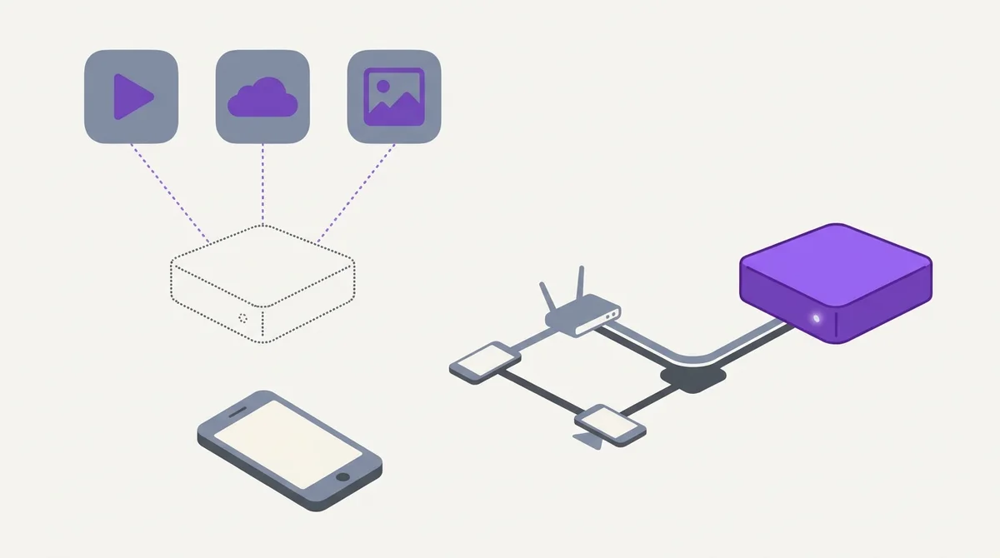
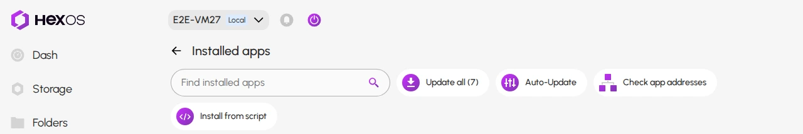
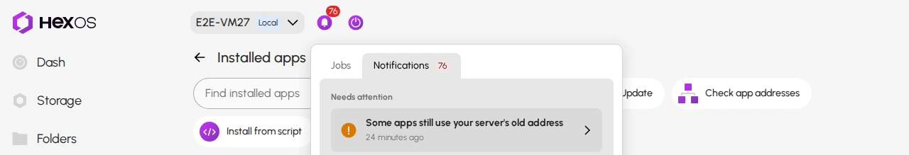
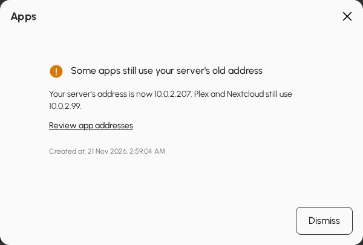
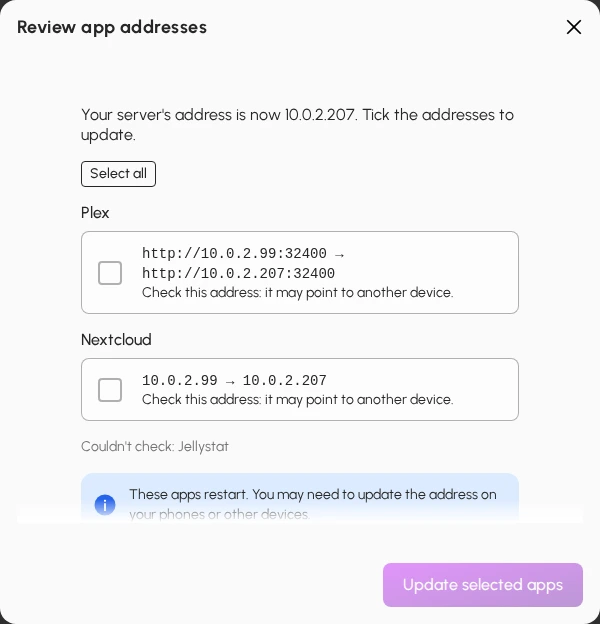
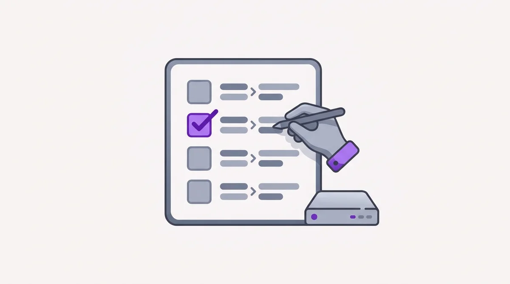
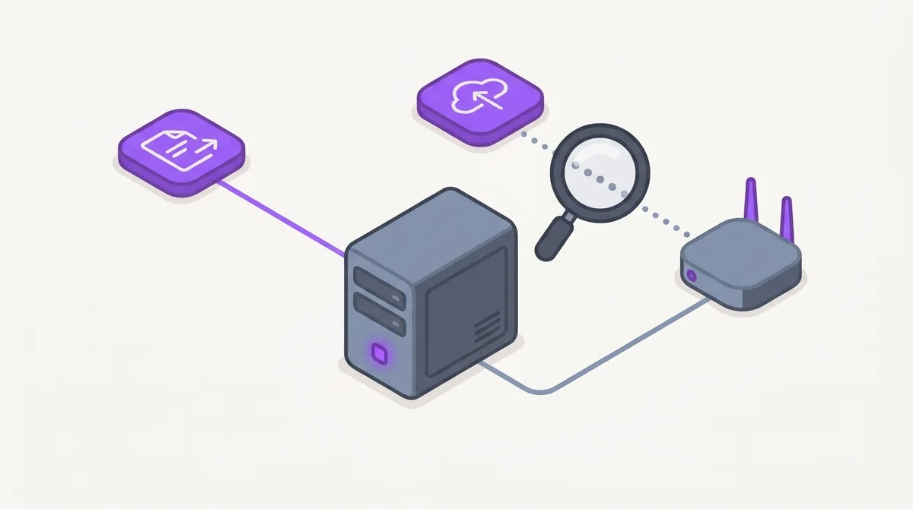
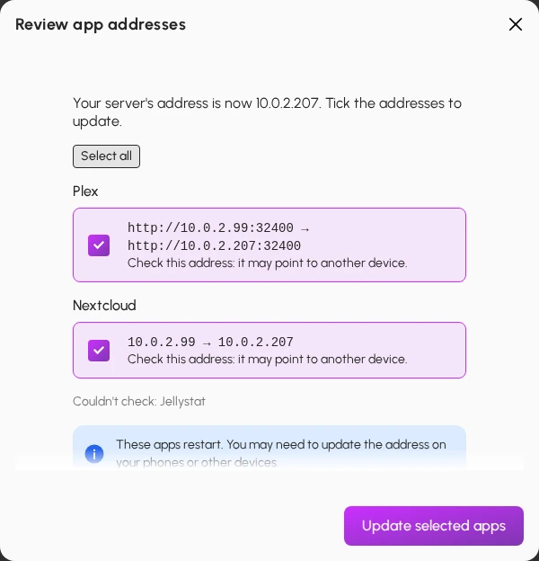
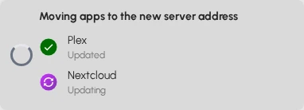
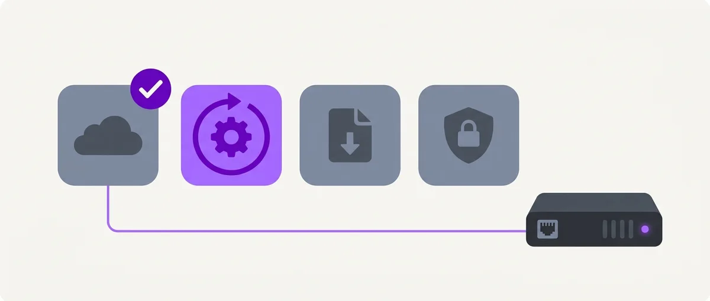

# Apps still use your server's old address

Your server has an address on your home network, such as `192.168.1.50`. If that address changes, some apps keep the old one, and your TVs, phones and computers can no longer find them. This page explains why that happens and how to update those apps from the Command Deck.

{.medium}

## When this happens

You may see one or more of these after your server's address changed:

- Plex on your TV or phone can't find your server at home.
- An app's page does not open from a bookmark that worked before.
- The Command Deck shows the message **Some apps still use your server's old address**.

A server's address usually changes when you replace or reset your router, move the server to another network port or network card, or change your router's settings.

## Why apps keep an old address

Some apps need to know your server's address. When HexOS installs such an app, it writes the address into the app's settings for you. This happens once, during the install.

If the address changes later, the app still has the old one saved. Restarting the app or the server does not help, because the old address is part of the app's settings. Plex, for example, keeps telling your devices to look for it at the old address.

HexOS now finds these saved addresses and offers to update them. It only looks at the places where an app's HexOS install puts the server's address.

## Before you start

> **Requirement:** Your server must be online and connected to HexOS Cloud. Apps that are running restart during the update, so choose a time when nobody is using them. Wait for any app install to finish first.
{.is-success}

> **Info:** This feature is being turned on for servers in stages. If you do not see **Review app addresses** or **Check app addresses**, it is not turned on for your server yet.
{.is-info}

## Open the review

There are two ways to open the review. Both open the same dialog.

### From your installed apps

1. In the Command Deck, click **Apps**.
2. Above your installed apps, click **Check app addresses**. The button shows when at least one app is installed.

 Check app addresses button on the Apps screen 

{.medium .framed}

### From the message

1. In the Command Deck, click the bell at the top. If the bell opens on **Jobs**, click **Notifications**.
2. Under **Needs attention**, click **Some apps still use your server's old address**.

 The message under Needs attention 

{.medium .framed}

3. The message opens. It names your server's new address, the apps, and the old address they use. Click **Review app addresses**.

 Review app addresses in the opened message 

{.medium .framed}

### The review opens

The **Review app addresses** dialog opens. HexOS reads your apps again each time it opens, so wait a few seconds for the list.

 Review app addresses dialog 

{.medium .framed}

The addresses in the pictures on this page are examples. Yours will be different.

If the dialog says **All your apps use your server's address**, followed by the address, there is nothing to update and you can close it.

If it says **HexOS found no old addresses in the apps it could check.**, HexOS found nothing to update, but it could not check every app. The apps it could not check are named after **Couldn't check:**. See [An app could not be checked](#an-app-could-not-be-checked) below.

## Choose the addresses to update

The dialog first shows your server's address as it is now. Below that, each app has a heading, and each saved address has its own row.

A row shows the old address, an arrow, and the new address. For example, `http://10.0.2.99:32400 → http://10.0.2.207:32400` means the app's saved address would change from the first to the second.

No box is checked when the dialog opens. HexOS leaves the choice to you, because it cannot always know whether an old address belonged to your server.

{.medium}

Under each row is one of two lines:

- **Your server's old address** means HexOS has a record that your server used this address before. Check this box.
- **Check this address: it may point to another device.** means the address is not your server's address now, but HexOS has no record that your server ever used it. Most of the time it is still your server's old address, because HexOS starts keeping this record only when this feature is turned on for your server. Read the address before you check the box.

How to decide for a row that says **Check this address: it may point to another device.**:

1. Look at the old address in the row.
2. If it is the address your server had before the change, check the box.
3. If you typed a different device's address into this app yourself, such as another computer on your network, leave the box empty.

{.medium}

> **Tip:** If every row shows your server's old address, click **Select all** to check them all at once.
{.is-tip}

Whenever HexOS could not check an app, the dialog has a line that starts with **Couldn't check:** and names it. See [An app could not be checked](#an-app-could-not-be-checked) below.

## Update the apps

1. Check the box on each address you want to update. The **Update selected apps** button can be clicked once at least one box is checked.

 Addresses checked and ready to update 

{.medium .framed}

2. Click **Update selected apps**. The dialog closes and the Command Deck shows **Updating your apps**.
3. Click the bell to follow the progress. The task is named **Moving apps to the new server address**.

 Moving apps to the new server address in the bell 

{.medium .framed}

HexOS updates one app at a time. A running app restarts when its turn comes. The other apps keep running. A stopped app stays stopped, and uses the new address the next time you start it.

{.medium}

Under each app's name, the task shows where that app stands:

| What the task shows | What it means |
|---|---|
| **Waiting** | The app's turn has not come yet. |
| **Updating** | HexOS is saving the new address and the app is restarting. |
| **Updated** | The new address is saved. |
| **Skipped** or a short reason | HexOS left the app as it was. See the sections below. |
| **Couldn't update. Nothing was changed.** | The update did not work. The app's settings are as they were. |
| **Address saved, but the app didn't start** | The new address was saved, but the app had a problem when it restarted. |
| **Not tried. An earlier app failed.** | HexOS stopped at an earlier app. Nothing was changed for this one. |
| **Not tried. Your server wasn't ready. Try again later.** | Another app install on the server was still being finished. Nothing was changed for this one. |
| **HexOS couldn't confirm this one. Check the app.** | HexOS sent the change but could not see how it ended. |

When everything worked, the task ends with **Moved apps to the new server address**.

## Check that it worked

1. Click **Apps**, then click **Check app addresses**. The dialog should say **All your apps use your server's address**, followed by your server's address. Any address you chose not to update is still listed, which is expected.
2. Open one of the updated apps and check that it loads.
3. On a TV or phone at home, open the app that could not find your server before, such as Plex. It should now find the server. If it does not, close the app on that device and open it again.

## Update your other devices

HexOS updates the address inside your apps. It cannot update things outside your server. If you used the old address anywhere else, change it there to the new one:

- Bookmarks in your browser that open an app.
- An app on your phone, TV or computer where you typed the server's address during setup.

## If something does not go as expected

### The task could not move every app

The task ends with **Couldn't move every app to the new server address**. HexOS stops at the first app it cannot update, so that only one app needs your attention. The apps after it show **Not tried. An earlier app failed.** Their settings were not changed.

1. Click the bell and look at the task to see which app has a problem.
2. Open that app from **Apps** and check whether it starts. If it shows **Address saved, but the app didn't start**, the address is already updated. If the app is not running, click **Start**.
3. Click **Check app addresses** again. Check the boxes for the apps that are still listed, then click **Update selected apps**.

### HexOS could not confirm an app

The app shows **HexOS couldn't confirm this one. Check the app.** HexOS sent the new address but lost track of the result, for example because the server restarted at that moment. HexOS does not try again by itself, because the first try may still be finishing.

You do not need to restart your server. HexOS checks again on its own, and it also checks each time you open the review.

1. Wait a few minutes.
2. Open the app and check that it works.
3. Click **Check app addresses**. If the app is still named after **Couldn't check:**, close the dialog, wait a minute, and click **Check app addresses** again.

Until HexOS knows how that update ended, it names the app after **Couldn't check:** and does not offer it again. Other changes to that app, such as an update, wait too. The app becomes available again once HexOS knows how the update ended. The review then lists the app only if it still uses the old address.

### An app was skipped

HexOS checks every app again right before it changes it. If something is different from what you reviewed, HexOS leaves that app as it was and says why:

- **Changed since you reviewed it** means the app's saved address was changed after you opened the review.
- **Reinstalled since you reviewed it** means the app was removed and installed again, or its install details changed.
- **No longer installed** means the app was removed.
- **The server's address changed again** means your server no longer had the address you reviewed, or HexOS could not read the server's network details at that moment.

Click **Check app addresses** to get a new list. If your server's address keeps changing, see [Keep the address from changing again](#keep-the-address-from-changing-again) first.

### Your server was not ready

HexOS waits while another app install on the server is still being finished. It does not update addresses during that time, and nothing is changed.

- If you just clicked **Update selected apps**, the dialog says **HexOS couldn't start the update. Try again.**
- If the update was already running, the apps that were left show **Not tried. Your server wasn't ready. Try again later.**

Try again later. Click the bell and wait until no app install is running. Then click **Check app addresses** and update the apps that are still listed.

### The list changed while you were reviewing

The list you were looking at was no longer the newest one, for example because an app finished installing. Nothing was updated. HexOS reads the list again. If addresses are still listed, the dialog says **Something changed on your server. Here is the new list.** Check the boxes again in the new list, then click **Update selected apps**.

### HexOS could not check your apps

If the dialog shows a message such as **Your server's address looks like it is still changing.** or **HexOS couldn't read your apps right now.**, followed by **Nothing will change. Try again later.**, HexOS could not be sure of the facts it needs. It changes nothing in that case. Wait a few minutes, then open the review again.

If the dialog says **Update HexOS on this server to check app addresses.**, your server's HexOS version is too old for this feature. Update HexOS, then try again.

### An app could not be checked

The dialog names the app after **Couldn't check:**. There are two usual reasons.

The first is an earlier update that HexOS could not confirm. See [HexOS could not confirm an app](#hexos-could-not-confirm-an-app) above.

The second is that HexOS could not read where that app keeps the server's address. This is usual for an app that is not in the HexOS app list, such as a custom app you added in TrueNAS. HexOS changes nothing in that app. If the app needs your server's address, change it in the app's own settings.

### An app still uses the old address but is not in the list

HexOS only updates addresses in the places where an app's HexOS install puts them. Some apps also save the server's address in their own settings pages. Open the app and change the address there.

### The server restarted during the update

Nothing is sent twice. When the server is back, apps that were still waiting show **Not tried. An earlier app failed.** and the task ends with **Couldn't move every app to the new server address**. The message lists the apps that still use the old address. Click **Review app addresses** to continue with those.

## Is my data safe?

Yes. The update changes only the addresses you checked, inside the app's settings. It does not change your files, your media, or anything the app has saved. All other settings of the app stay as they were.

## Keep the address from changing again

Your router decides which address your server gets. Most routers can always give the same address to the same device. Routers call this an address reservation, a DHCP reservation or a static lease. Look for it in your router's settings, in the list of connected devices, and turn it on for your server.

> **Help:** If an app still cannot be reached after these steps, ask on the [HexOS Discord](https://discord.gg/DjEp3WRHKz). Say which app it is and what the task in the Command Deck shows.
{.is-troubleshooting}
