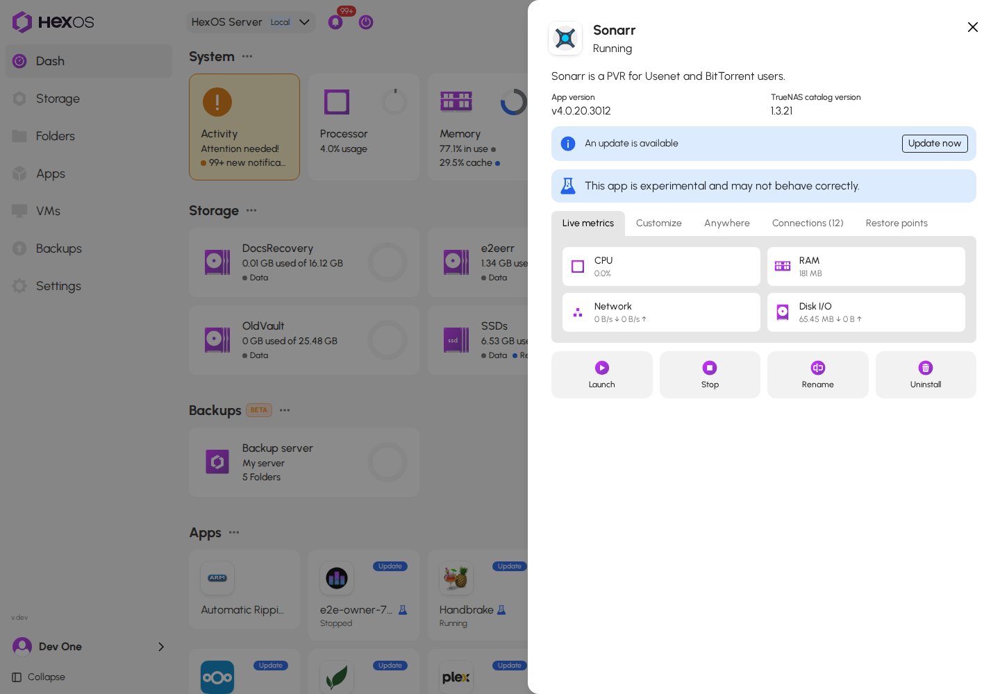
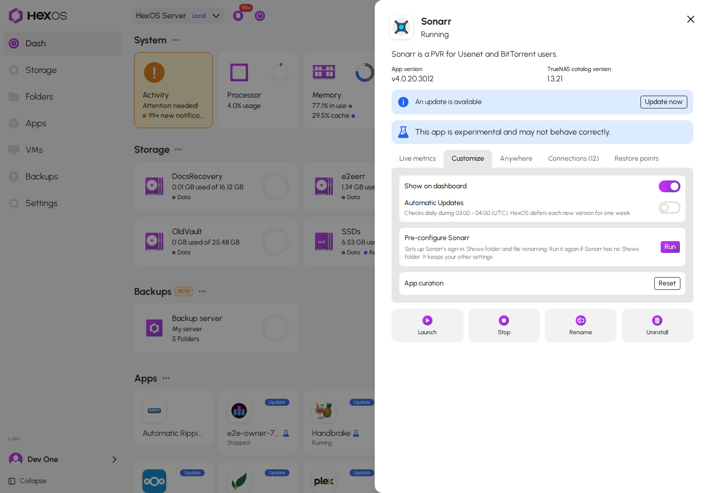
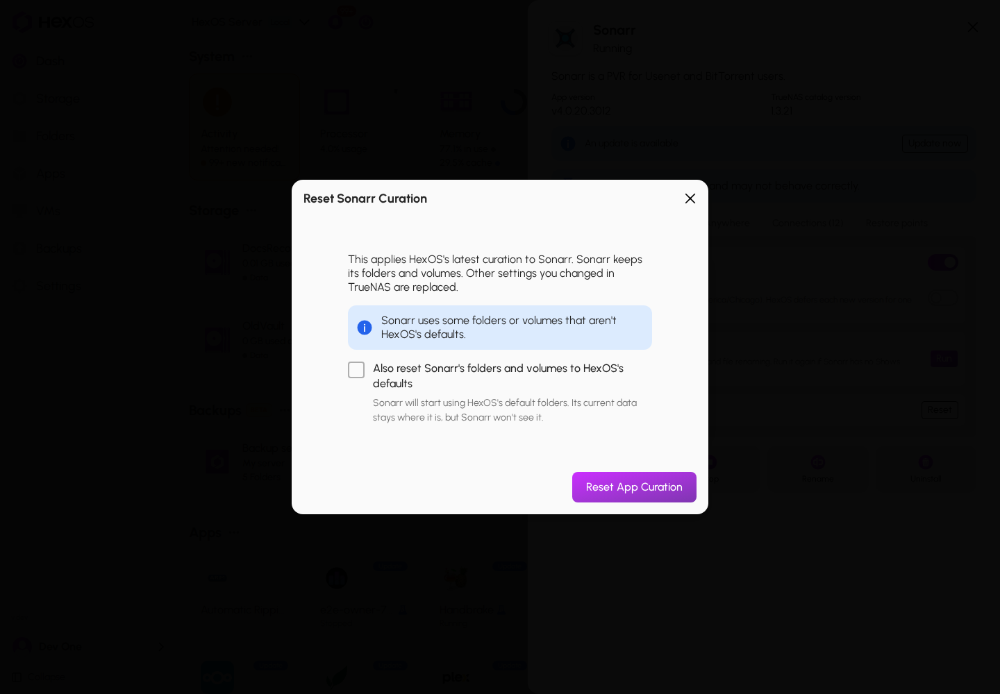
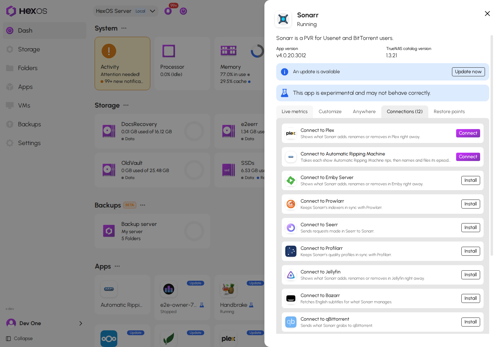
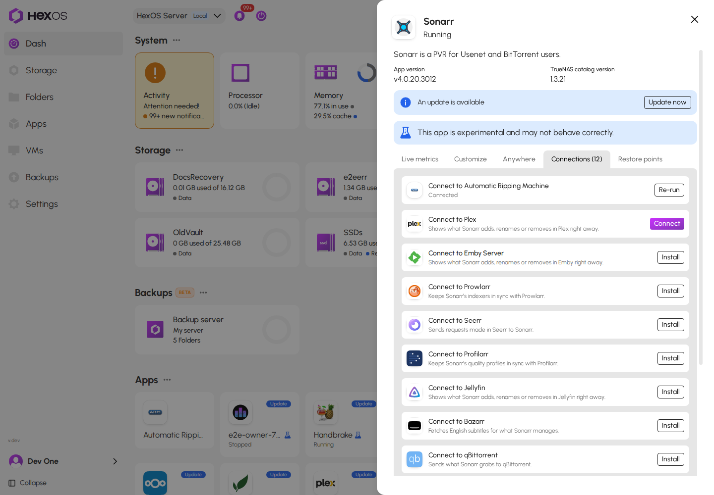

# Connect ARM to Radarr or Sonarr

If HexOS says Radarr or Sonarr cannot reach the folder Automatic Ripping Machine rips into, its folder access may need updating. This can happen when you changed the app's download folder in TrueNAS.

Automatic Ripping Machine (ARM) saves rips in its own folder inside Downloads. A download client, such as qBittorrent, uses a different folder. An app that can access only the download client's folder cannot see ARM's rips.

The updated HexOS curation adds separate access to ARM's folder. Follow these steps for each affected app. The screenshots show Sonarr; the same controls are available for Radarr.

> **Requirement:** Start Automatic Ripping Machine and the affected app before connecting them. Use a HexOS version and app catalog that include the ARM folder-access update.
{.is-success}

> **Warning:** Reset App Curation replaces other settings managed by HexOS, including settings you changed in TrueNAS. Review those changes first. Leave the option to reset folders and volumes unchecked to keep the app connected to its existing data.
{.is-warning}

## Apply the updated curation

1. In the Command Deck, click your **Sonarr** or **Radarr** app to open its info panel.

 Open the app's info panel 

{.medium .framed}

2. Click **Customize**, then **Reset** beside **App curation**.

 Reset App Curation in Customize 

{.medium .framed}

3. If the dialog offers **Also reset Sonarr's folders and volumes to HexOS's defaults**, leave it unchecked. For Radarr, the option names Radarr instead. Click **Reset App Curation** and wait for the app's update to finish.

 Keep the existing folders and volumes 

{.medium .framed}

> **Info:** Updating the app's version alone does not apply the new curation. Use **Reset App Curation** for this repair.
{.is-info}

## Reconnect ARM

4. Open the app's **Connections** tab. Find **Connect to Automatic Ripping Machine** and click **Connect**. If the row already shows a completed connection, use **Re-run**.

 Connect to Automatic Ripping Machine 

{.medium .framed}

5. Wait for the connection to finish. The row should show **Connected**. Repeat these steps for the other app if both Radarr and Sonarr had the problem.

 The connection is complete 

{.medium .framed}

## If the connection still fails

If HexOS reports a conflicting folder mapping, another folder may be using the access path ARM needs. Contact HexOS support before changing it. Include the app name and the full error message. Do not reset the app's folders to try to clear this warning.

If HexOS cannot verify folder access, it leaves the existing folder mappings and any saved ARM connection unchanged. If HexOS asks you to update HexOS, update it before trying the connection again.
