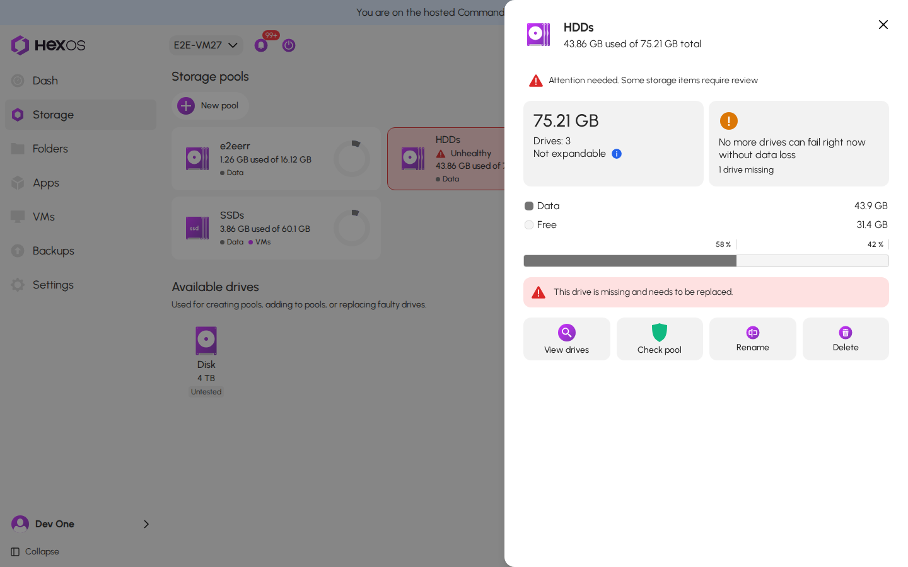
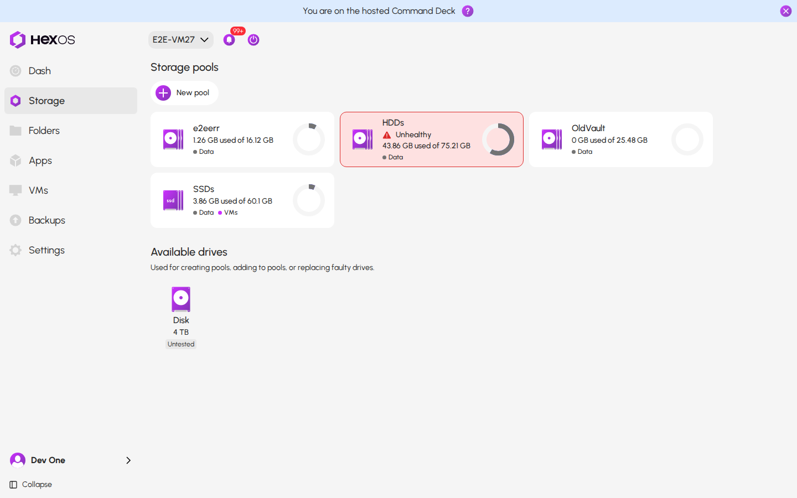
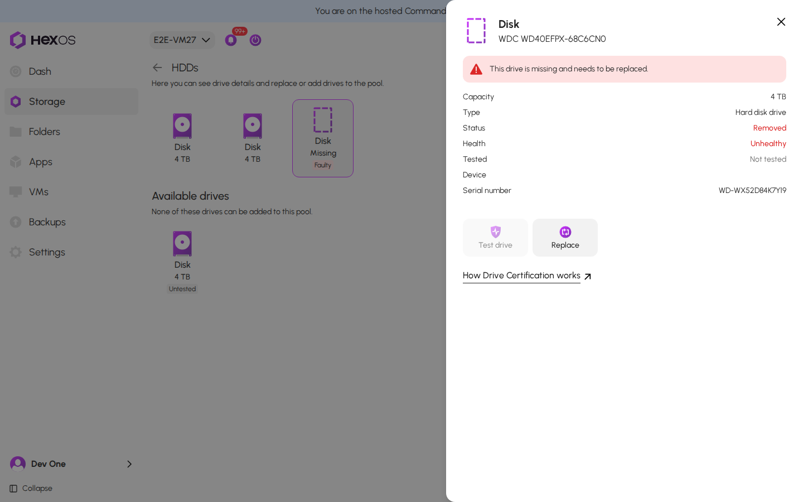
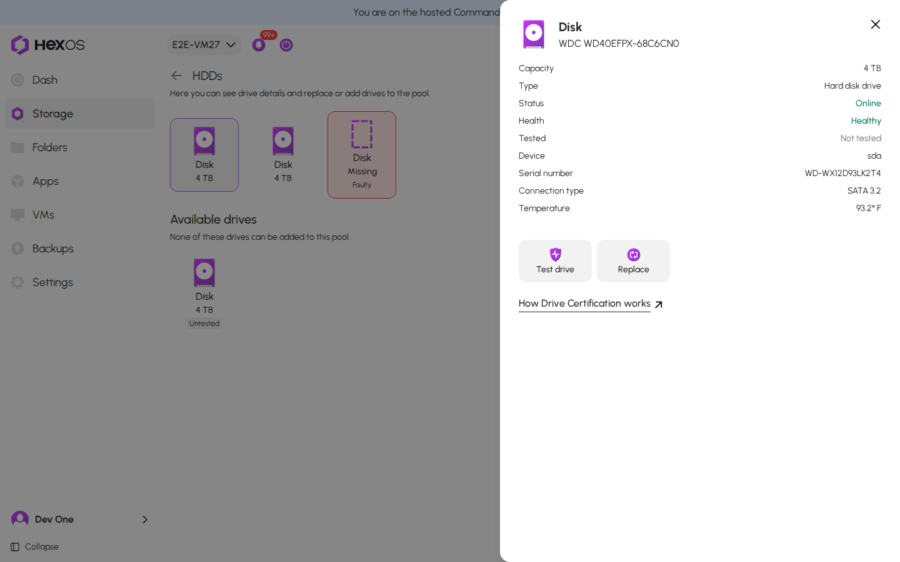
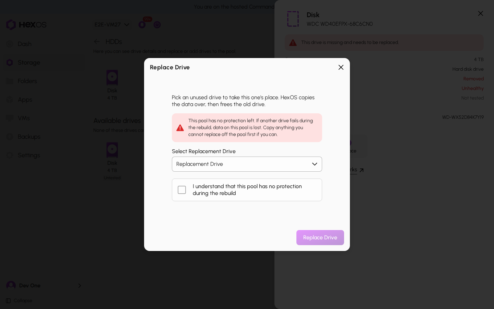
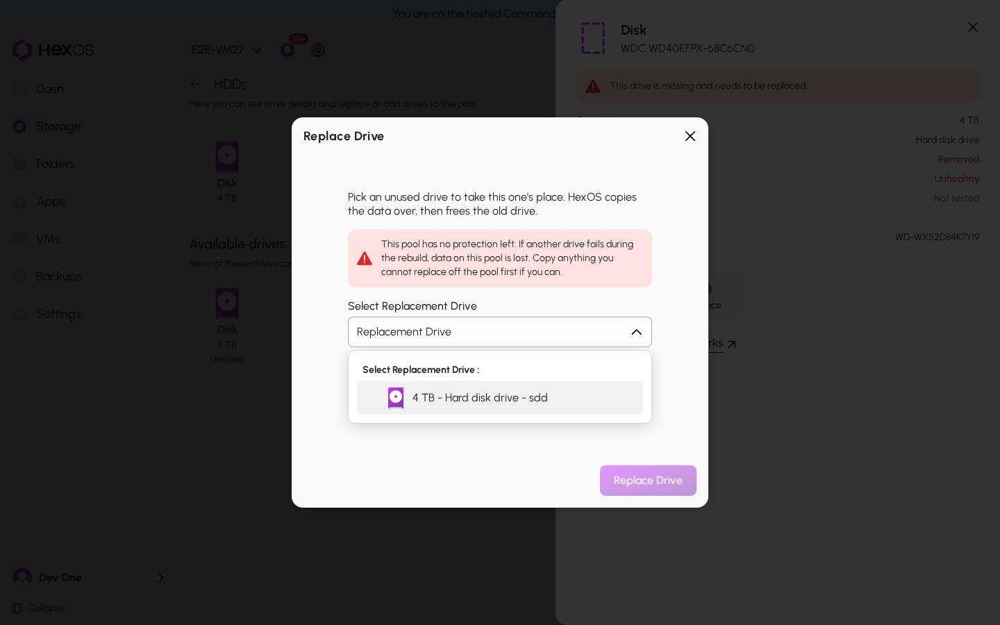

# Drive failure

This page shows how to find a drive that has failed and replace it with a new one. You do everything in HexOS. You do not need to follow any steps in TrueNAS.

When you replace a drive, HexOS copies your data onto the new drive from the other drives in the pool. This copy is called a rebuild (ZFS calls it a resilver). Your files stay available while it runs.

> **Warning:** Replace one drive at a time. Let the rebuild finish before you remove or replace another drive. Removing a second drive during a rebuild can lose the pool.
{.is-warning}

## Before you start

> **Requirement:** The new drive must be the same size as the failed drive or bigger. It must be empty or hold nothing you want to keep. For help choosing one, read [Selecting drives](/articles/selectingDrives).
{.is-success}

Check how much protection your pool has left:

1. Click **Storage** in the menu.
2. Click the pool that shows **Unhealthy** or **Drive errors**. Its info panel opens.
3. Read the protection card. It says how many more drives can fail without data loss.

 Pool info panel with the protection card 

{.medium .framed}

> **Danger:** If the card says **No more drives can fail right now without data loss** or **This pool is not protected from drive failure**, one more failure during the rebuild would lose the data on this pool. Copy anything you cannot replace to another device first, if you can.
{.is-danger}

## Step 1: Find the failed drive

On the **Storage** screen, the pool with the failed drive shows **Unhealthy** or **Drive errors**.

 Unhealthy pool on the Storage screen 

{.medium .framed}

Click the pool, then click **View drives** in its info panel.

Click the drive that shows a problem. A drive that does not work at all shows as **Missing**, with a **Faulty** badge. Its info panel says **This drive is missing and needs to be replaced.**

 Missing drive and its info panel 

{.medium .framed}

Write down the **Serial number** from the failed drive's info panel. The same number is printed on the drive's label, so you can find the right drive inside the server. If no serial number shows, write down the serial numbers of the drives that still work instead. The drive that is not on your list is the failed one.

 Drive info panel with the serial number 

{.medium .framed}

## Step 2: Choose how to connect the new drive

There are two ways to do this. Pick the one that fits your server.

**If your server has a free drive connection** (a free SATA port and power cable, or an empty drive bay): connect the new drive. If the failed drive's **Status** in its info panel is **Online** or **Degraded**, leave it connected for now: ZFS can still read from it during the rebuild, which is safer. If its **Status** is **Faulted** or **Removed**, ZFS no longer reads from it, so keeping it connected does not help. You can remove it when you connect the new drive. If your server cannot swap drives while it is running, shut it down first (see below), connect the new drive, then turn it back on. Go to Step 3.

**If every drive connection is in use:** you must remove the failed drive first.

1. Click the **Power** button at the top of the screen, then click **Shut down server**. Click **Yes, shutdown now**.
2. When the server is off, unplug it from power.
3. Remove the drive with the serial number of the failed drive.
4. Put the new drive in its place.
5. Check that the power and SATA cables on every drive are firmly connected.
6. Plug the server back in and turn it on.

After the server starts, the old drive shows as **Missing** in the pool. This is expected.

## Step 3: Replace the drive in HexOS

Click the pool, then click **View drives**. Click the failed or missing drive, then click **Replace** in its info panel.

The **Replace Drive** dialog opens. Read any message it shows:

- A red or amber message means the pool has little or no protection left, or another drive is also failing. The rebuild reads every drive for hours, so copy anything you cannot replace off the pool first, if you can.
- If the pool has no protection left, the dialog also shows a box that says **I understand that this pool has no protection during the rebuild**. Click it to continue.
- If the failed drive is still connected, the dialog says to leave it connected until the rebuild finishes.

 Replace Drive dialog 

{.medium .framed}

Click the **Replacement Drive** list and pick your new drive.

 Replacement Drive list 

{.medium .framed}

Click **Replace Drive**.

> **Tip:** If the dialog says **You need to have a suitable unused drive candidate available to replace a drive**, HexOS did not find a drive it can use. Check that the new drive is connected, is the same size as the failed drive or bigger, and is not part of another pool. On the **Storage** screen, the new drive should show under **Available drives**.
{.is-tip}

## Step 4: Wait for the rebuild to finish

The rebuild starts right away. Depending on the size of your drives and your hardware, it can take minutes, hours or even days. The pool shows a problem until the rebuild is done.

> **Warning:** Avoid restarting the server or moving drives until the rebuild finishes. A restart can lose progress and start the rebuild over.
{.is-warning}

When the rebuild is done, the pool shows as healthy again. If you left the failed drive connected, you can now shut down the server and remove it.

> **Help:** If the rebuild does not start, or the pool still shows a problem after it finishes, ask for help on our [Discord](https://discord.gg/fCW2htvYdz) and include a screenshot of the pool's info panel.
{.is-troubleshooting}
