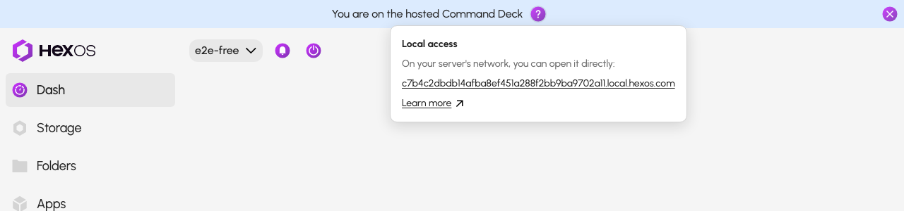
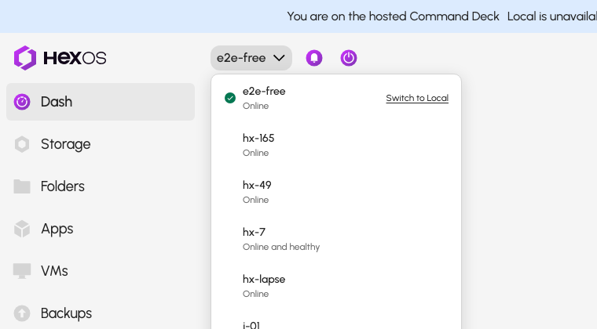
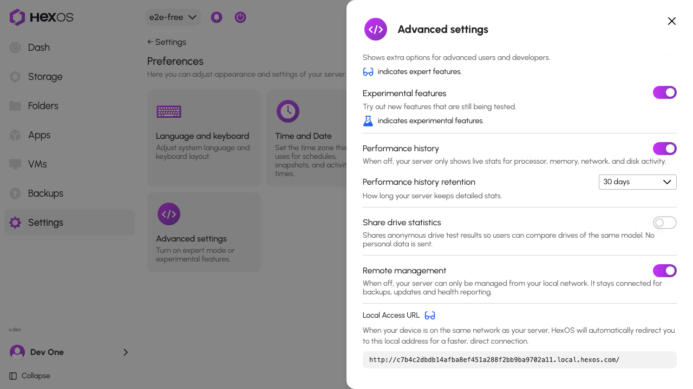

# Local access to your server

Your server has an address of its own on your home network. Opening the Command Deck at that address keeps your files and apps on your own network instead of sending them through the internet, which is faster and keeps working when your internet connection does not.

When you open the hosted Command Deck at [deck.hexos.com](https://deck.hexos.com), it checks whether your browser can reach that address and, when it can, hands you over on its own. When the check does not succeed, you stay on the hosted deck, which keeps working as it is, and a question mark appears beside **You are on the hosted Command Deck** at the top of the page. A check that does not succeed does not mean the address is unreachable: your browser may simply not allow the deck to look for your server. You can still open the address yourself.

## Find your server's local address

You can open your server's own address at any time, whether or not the deck found it for you. The address works whenever you are on the same network as your server.

- **From the hosted deck.** Click the question mark beside **You are on the hosted Command Deck**. It shows your server's address; click it to open your server directly, on the page you are looking at.

- **From the server dropdown.** Open the server dropdown at the top of the Command Deck and choose **Switch to Local**.

- **From Preferences.** With expert mode on, go to **Preferences** > **Advanced**. The **Local Access URL** is your server's own address; open it, or bookmark it for next time.

If the address does not open, see [If the address cannot be reached](#if-the-address-cannot-be-reached) below. The deck returns you to the hosted Command Deck when it cannot reach your server there.

## Let the Command Deck open local access for you

The hosted deck asks your server, at its local address, whether it is there. When it answers, the deck hands you over and shows **Return to Local** whenever you come back to the hosted deck.

Newer browsers ask before a website may look for devices on your home network, and remember the answer. If the question was dismissed or answered **Block**, the deck's check cannot succeed in that browser, so you stay on the hosted deck. Blocking the check does not block the address itself: the ways to open it above still work.

To let the deck hand you over on its own, allow local network access for `deck.hexos.com`, then reload the page.

### Google Chrome

Chrome asks the first time with a prompt that reads **deck.hexos.com wants to look for and connect to devices on your local network**. If you missed it:

1. Open the Chrome menu (⋮) and choose **Settings**.
2. Go to **Privacy and security** > **Site settings**.
3. Under **Permissions**, open **Local network access**.
4. Move `deck.hexos.com` from **Not allowed** to **Allowed**, or remove it so Chrome asks again.
5. Reload the Command Deck.

You can also paste `chrome://settings/content/localNetworkAccess` into the address bar to open the list directly.

### Microsoft Edge

1. Open the Edge menu (⋯) and choose **Settings**.
2. Go to **Cookies and site permissions**.
3. Open **Local network access**.
4. Move `deck.hexos.com` to **Allow**, or remove it so Edge asks again.
5. Reload the Command Deck.

### Brave

1. Open the Brave menu (☰) and choose **Settings**.
2. Go to **Privacy and security** > **Site and Shields Settings**.
3. Open **Local network access** and allow `deck.hexos.com`.
4. Reload the Command Deck.

### Other Chromium browsers

Arc, Vivaldi, Opera and other browsers built on Chromium keep the same setting under their site permissions. Look for **Local network access** in the browser's privacy or site settings, allow `deck.hexos.com`, and reload the Command Deck.

### Firefox

Firefox asks the first time with a prompt about allowing the site to access your local network. If you missed it:

1. Click the permissions icon on the left of the address bar while on the Command Deck.
2. Clear the blocked **Local network** permission, or set it to **Allow**.
3. Reload the Command Deck.

If the icon shows nothing, open **Settings** > **Privacy & Security** > **Permissions** and look for a local network entry there.

### Safari

Safari does not have a setting of its own for this. On a Mac, the permission belongs to the operating system; see the next section.

## On a Mac: the system-wide Local Network permission

macOS keeps its own list of apps allowed to reach devices on your network, and your browser needs to be on it. The system asks once, the first time the browser tries, with a prompt that names the browser.

1. Open **System Settings** (Apple menu > **System Settings**).
2. Go to **Privacy & Security** > **Local Network**.
3. Make sure your browser is switched on in the list. If it is missing, quit the browser, open it again, open the Command Deck, and answer **Allow** when the prompt appears.

## If the address cannot be reached

When your server's own address does not open, or the deck keeps returning you to the hosted Command Deck, the path from this device to the server is the problem rather than the browser:

- **A different network.** Local access only works from the same network as the server. On a guest network, a phone's mobile data or away from home, keep using the hosted Command Deck.
- **A VPN.** A VPN on this device can send your server's local address out through the tunnel. Pause the VPN, or allow local network access in its settings, and try again.
- **Your router's DNS rebind protection.** Many routers refuse the kind of address HexOS uses for local access. The deck shows a **Network** message when it finds this; the steps are in [DNS rebind protection](/troubleshooting/dns-rebind-protection).
- **A firewall or an isolated Wi-Fi network.** Client isolation on a Wi-Fi network, or a firewall on this device, can block the connection to the server's ports. See [Network ports](/troubleshooting/network-ports) for what must be open.

Everything in the Command Deck keeps working through the hosted deck in the meantime. Only the direct path to your server is affected.
