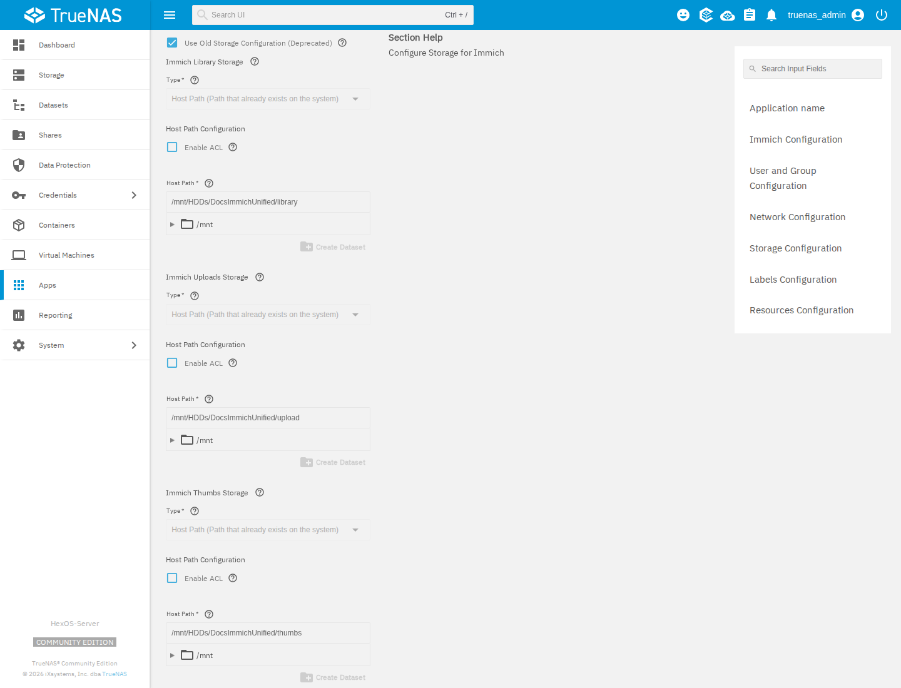
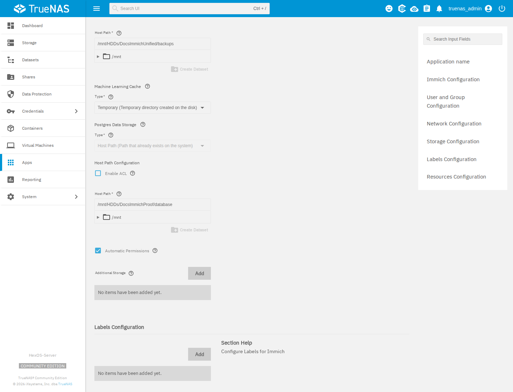
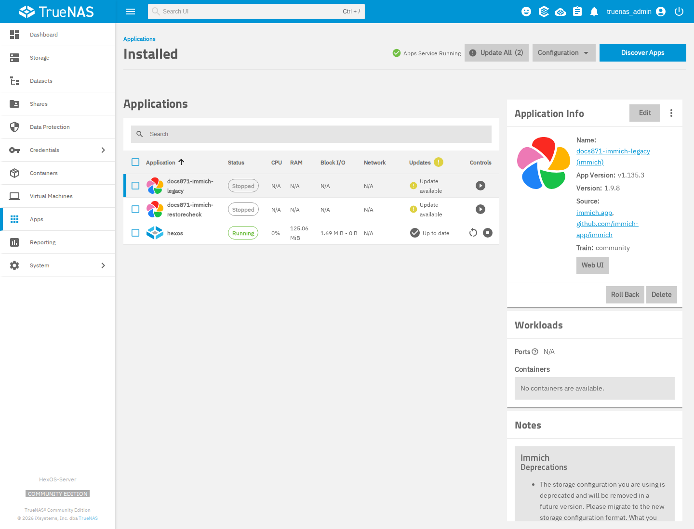
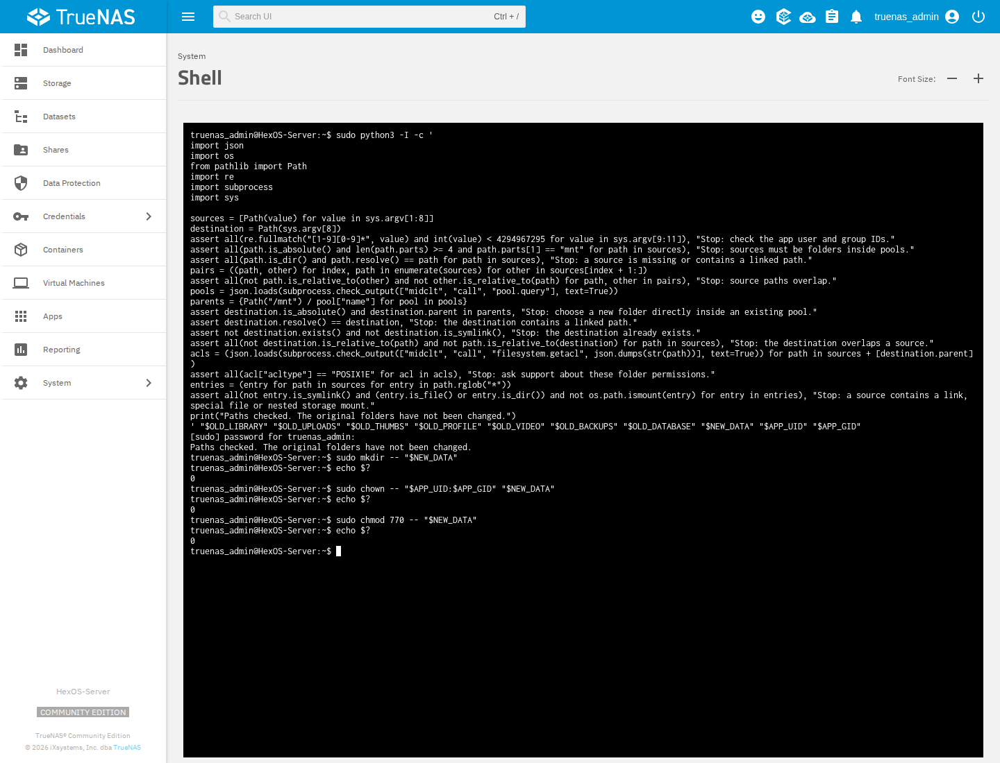
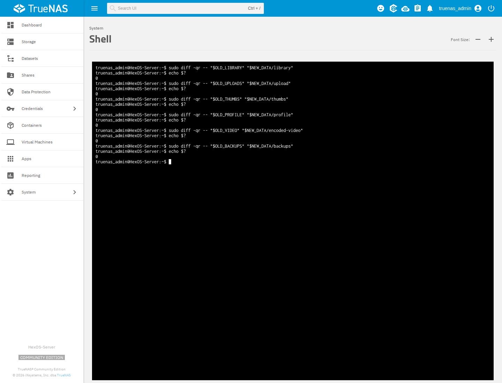
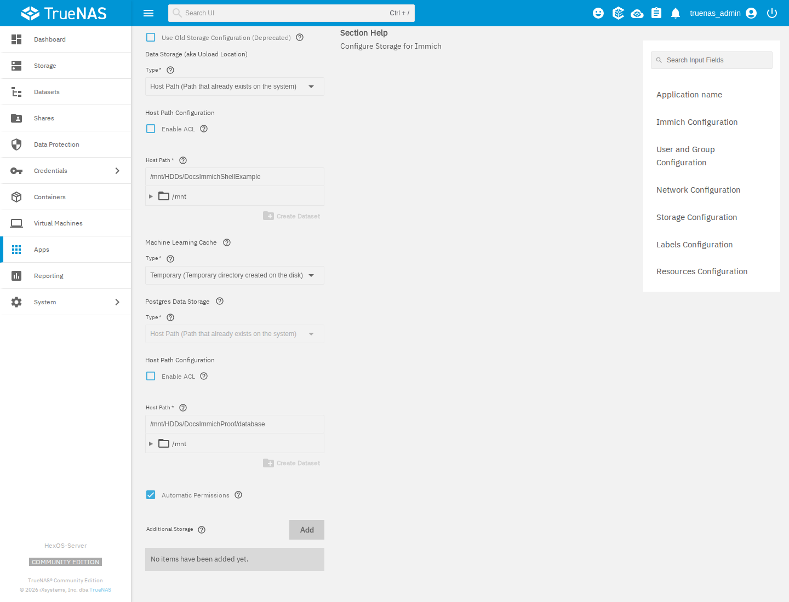
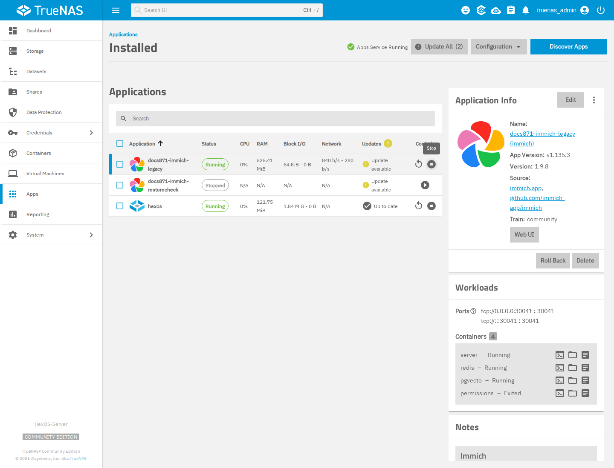
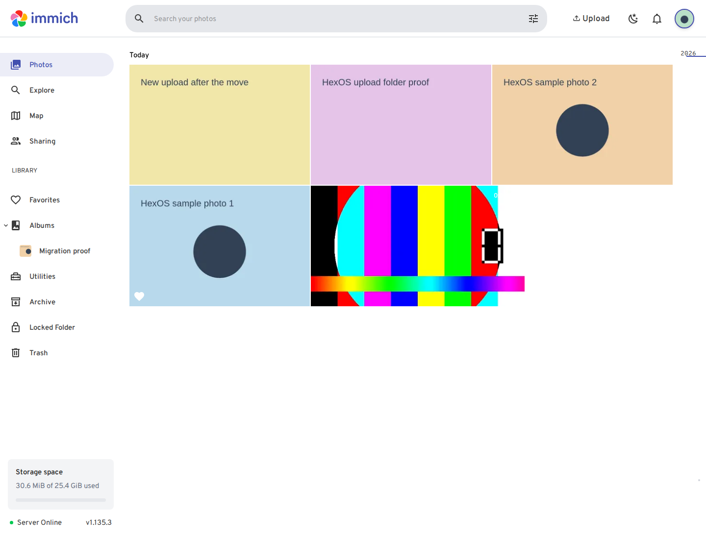

# Update an older Immich storage layout

> **Thank you:** @G-M0N3Y-2503 and @forsaken contributed the earlier community migration guides.
{.is-contribute}

Some older Immich apps have separate folders for uploads, thumbnails, the library, profile pictures, encoded videos and database backups. Their TrueNAS settings show **Use Old Storage Configuration (Deprecated)**. This guide copies those six folders into one new media folder. The PostgreSQL database stays separate.

This procedure was verified with TrueNAS 25.10.7 and an existing catalog version 1.9.8 app running Immich v1.135.3. It does not install an old version or upgrade Immich. Newer packages may refuse an upgrade until this conversion is finished.

> **Requirement:** Continue only if the old-storage checkbox is present and all seven storage paths use **Host Path**. The paths must be separate directories: none may contain another. If you use **ixVolume**, external libraries, additional storage or a different layout, contact [HexOS support](mailto:support@hexos.com) with your app and catalog versions before making changes.
{.is-success}

If your app already uses one **Data Storage (aka Upload Location)** folder without the old-storage checkbox, this conversion does not apply. HexOS **Settings** > **Locations** does not combine an existing library's folders.

## Record the existing settings

In HexOS, open **Settings** > **Tools** > **TrueNAS**. Sign in with your TrueNAS administrator account. Click **Apps**, click your Immich app, then **Edit**.

Record the app version, catalog version, **User ID** and **Group ID**. Keep the database and Redis passwords in your password manager. Do not include passwords in screenshots sent to support.

Under **Storage Configuration**, confirm that **Use Old Storage Configuration (Deprecated)** is checked. Record every **Host Path**:

| Setting | Variable used below | New media subfolder |
| --- | --- | --- |
| Immich Library Storage | `OLD_LIBRARY` | `library` |
| Immich Uploads Storage | `OLD_UPLOADS` | `upload` |
| Immich Thumbs Storage | `OLD_THUMBS` | `thumbs` |
| Immich Profile Storage | `OLD_PROFILE` | `profile` |
| Immich Video Storage | `OLD_VIDEO` | `encoded-video` |
| Immich Backups Storage | `OLD_BACKUPS` | `backups` |
| Postgres Data Storage | `OLD_DATABASE`, used only for safety checks. | Keep its existing path. |

<details>
<summary> Older storage settings use separate media paths </summary>

{.medium .framed}
</details>

<details>
<summary> PostgreSQL has its own database path </summary>

{.medium .framed}
</details>

Leave the settings without clicking **Update**. The screenshots show example paths; use the paths recorded from your app.

## Have a recoverable backup first

> **Danger:** Have a backup of the database, all six media folders and app settings from the same stopped state. Keep a copy on another device. Test recovery into separate empty locations using the same app version. Check sign-in, photos, videos and albums before continuing. A database dump alone does not contain your photographs.
{.is-danger}

Immich's [backup and restore documentation](https://docs.immich.app/administration/backup-and-restore/) explains the database and media relationship. Choose documentation for your installed Immich version; restore screens and commands changed in newer versions. Do not delete an existing database to prepare for this move.

The new location needs space for a second copy of all six media folders. The backup needs its own space. Keep the original folders throughout this procedure.

## Save a baseline

Before stopping the app, sign in to Immich and download several original photos and a video to your computer. Keep them for the comparison after the move. Record the albums, favorites, descriptions and profile picture you will check. Play the video once to confirm that the original works.

## Stop Immich

In TrueNAS **Apps**, use your Immich app's stop control. Wait for **Stopped** before copying. Keep the app stopped until the new settings are saved. Pause uploads from phones and other clients.

If you stop before changing the app settings, you can start the original app again through **Apps**. Its original paths and files have not changed. Keep any incomplete new copy separate.

<details>
<summary> Stop the app before copying files </summary>

{.medium .framed}
</details>

## Prepare an empty media folder

Open TrueNAS **System** > **Shell**. These commands run on the server. Keep this shell open so its variables remain available.

Replace every example path below with the path you recorded. Set `NEW_DATA` to a new folder directly inside an existing storage pool. It must not exist, and must be outside all old media folders and the database folder. Do not use a pool root or a folder belonging to another app. Set `APP_UID` and `APP_GID` to the app's recorded **User ID** and **Group ID**; 568 is the example.

```sh
OLD_LIBRARY='/mnt/your-pool/old-immich/library'
OLD_UPLOADS='/mnt/your-pool/old-immich/uploads'
OLD_THUMBS='/mnt/your-pool/old-immich/thumbs'
OLD_PROFILE='/mnt/your-pool/old-immich/profile'
OLD_VIDEO='/mnt/your-pool/old-immich/video'
OLD_BACKUPS='/mnt/your-pool/old-immich/backups'
OLD_DATABASE='/mnt/your-pool/old-immich/database'
NEW_DATA='/mnt/your-pool/immich-media-new'
APP_UID='568'
APP_GID='568'
```

Display the values with `printf '%s\n' "$OLD_LIBRARY" "$OLD_UPLOADS" "$OLD_THUMBS" "$OLD_PROFILE" "$OLD_VIDEO" "$OLD_BACKUPS" "$OLD_DATABASE" "$NEW_DATA" "$APP_UID:$APP_GID"`. Compare every path with the saved settings.

Before creating anything, run this read-only check. It refuses overlapping paths, links, special files, nested mounts and unsupported permissions. A large library can take time to check. Wait for **Paths checked**. If it reports an error, stop and contact support; do not skip the check.

```sh
sudo python3 -I -c '
import json
import os
from pathlib import Path
import re
import subprocess
import sys

sources = [Path(value) for value in sys.argv[1:8]]
destination = Path(sys.argv[8])
assert all(re.fullmatch("[1-9][0-9]*", value) and int(value) < 4294967295 for value in sys.argv[9:11]), "Stop: check the app user and group IDs."
assert all(path.is_absolute() and len(path.parts) >= 4 and path.parts[1] == "mnt" for path in sources), "Stop: sources must be folders inside pools."
assert all(path.is_dir() and path.resolve() == path for path in sources), "Stop: a source is missing or contains a linked path."
pairs = ((path, other) for index, path in enumerate(sources) for other in sources[index + 1:])
assert all(not path.is_relative_to(other) and not other.is_relative_to(path) for path, other in pairs), "Stop: source paths overlap."
pools = json.loads(subprocess.check_output(["midclt", "call", "pool.query"], text=True))
parents = {Path("/mnt") / pool["name"] for pool in pools}
assert destination.is_absolute() and destination.parent in parents, "Stop: choose a new folder directly inside an existing pool."
assert destination.resolve() == destination, "Stop: the destination contains a linked path."
assert not destination.exists() and not destination.is_symlink(), "Stop: the destination already exists."
assert all(not destination.is_relative_to(path) and not path.is_relative_to(destination) for path in sources), "Stop: the destination overlaps a source."
acls = (json.loads(subprocess.check_output(["midclt", "call", "filesystem.getacl", json.dumps(str(path))], text=True)) for path in sources + [destination.parent])
assert all(acl["acltype"] == "POSIX1E" for acl in acls), "Stop: ask support about these folder permissions."
entries = (entry for path in sources for entry in path.rglob("*"))
assert all(not entry.is_symlink() and (entry.is_file() or entry.is_dir()) and not os.path.ismount(entry) for entry in entries), "Stop: a source contains a link, special file or nested storage mount."
print("Paths checked. The original folders have not been changed.")
' "$OLD_LIBRARY" "$OLD_UPLOADS" "$OLD_THUMBS" "$OLD_PROFILE" "$OLD_VIDEO" "$OLD_BACKUPS" "$OLD_DATABASE" "$NEW_DATA" "$APP_UID" "$APP_GID"
```

Create the new folder with `sudo mkdir -- "$NEW_DATA"`. If it reports an error, stop. Do not reuse an existing destination.

Set access on this new empty folder with `sudo chown -- "$APP_UID:$APP_GID" "$NEW_DATA"`, then `sudo chmod 770 -- "$NEW_DATA"`. Stop if either command fails. These commands do not change the original folders.

<details>
<summary> Check the paths and prepare a new empty folder </summary>

{.medium .framed}
</details>

## Copy and check the media

Define this small shell function. It copies a folder only when its source is a directory and its destination is absent. It refuses a symbolic link at either selected path. The `-a` option includes hidden files and preserves ownership and permissions.

```sh
copy_media() {
sudo test -d "$1" &&
sudo test ! -L "$1" &&
sudo test ! -e "$2" &&
sudo test ! -L "$2" &&
sudo cp -a -- "$1" "$2"
}
```

Run each line separately:

```sh
copy_media "$OLD_LIBRARY" "$NEW_DATA/library"
copy_media "$OLD_UPLOADS" "$NEW_DATA/upload"
copy_media "$OLD_THUMBS" "$NEW_DATA/thumbs"
copy_media "$OLD_PROFILE" "$NEW_DATA/profile"
copy_media "$OLD_VIDEO" "$NEW_DATA/encoded-video"
copy_media "$OLD_BACKUPS" "$NEW_DATA/backups"
```

After each line, run `echo $?`. It must return `0`. If any line returns another number, stop and keep both locations. Do not rerun a copy into a partially filled destination.

Compare each original with its copy:

```sh
sudo diff -qr -- "$OLD_LIBRARY" "$NEW_DATA/library"
sudo diff -qr -- "$OLD_UPLOADS" "$NEW_DATA/upload"
sudo diff -qr -- "$OLD_THUMBS" "$NEW_DATA/thumbs"
sudo diff -qr -- "$OLD_PROFILE" "$NEW_DATA/profile"
sudo diff -qr -- "$OLD_VIDEO" "$NEW_DATA/encoded-video"
sudo diff -qr -- "$OLD_BACKUPS" "$NEW_DATA/backups"
```

Run `echo $?` after each comparison. Each must print no differences and return `0`. If one reports a difference or error, do not change the app settings. Start the original app again if you need service, then contact support. Do not switch to an incomplete copy.

<details>
<summary> Check all six copies before changing the app </summary>

{.medium .framed}
</details>

The new folder should contain exactly `library`, `upload`, `thumbs`, `profile`, `encoded-video` and `backups`. **Do not copy the PostgreSQL database into it.** Do not copy the old parent folder, which may contain the database or unrelated files.

## Select the new location

1. Return to **Apps**, click your Immich app, then **Edit**.
2. Clear **Use Old Storage Configuration (Deprecated)**.
3. For **Data Storage (aka Upload Location)**, choose **Host Path**. Enter the exact `NEW_DATA` path. Leave **Enable ACL** off for the folder prepared above.
4. Check that **Postgres Data Storage** still has its original database path. Keep the existing passwords, user IDs and other app settings.
5. Click **Update**. Wait for the update to finish, then start the app. Saving settings for a stopped app does not start it automatically.

<details>
<summary> Select the new media folder and keep the database separate </summary>

{.medium .framed}
</details>

<details>
<summary> Start Immich after saving its settings </summary>

{.medium .framed}
</details>

## Check the library

Sign in to Immich. Open representative photos and play a video. Check albums, favorites, descriptions and profile pictures. Download several originals and compare them with the same files downloaded before the move. On a Linux computer, `sha256sum filename` shows a file's checksum; matching copies have the same value.

Upload one small photo, then open and download it. Stop and start Immich once through TrueNAS **Apps**. Sign in and check both the old files and the new photo again. Resume other clients only after these checks pass.

<details>
<summary> Check original files, albums and a new upload </summary>

{.medium .framed}
</details>

Keep the original media folders and tested backup. This guide does not delete them. Plan later cleanup separately after confirming which paths the working app uses.

## If you need to go back

Stop Immich. Preserve the current database and media together before recovery, especially if new files were uploaded after the move.

Restore the matching earlier database and media backup into separate empty locations. Use the same app version as that backup. Point the app at all those restored paths together, save its settings, then start it through **Apps**. Repeat the sign-in, original-file and metadata checks before resuming clients. Do not overwrite or merge an existing database directory. If you do not already have a tested recovery procedure for your backup, contact support before changing database paths.

> **Warning:** Checking the old-storage box and selecting old media paths is not a complete rollback after new uploads. The current database can refer to files that exist only in the new location. Rollback requires a matching database and media set.
{.is-warning}

For recovery help, send [HexOS support](mailto:support@hexos.com) your app and catalog versions, old and new paths, and the last completed step. Do not send passwords or personal photographs. Keep all copies until recovery is checked.
