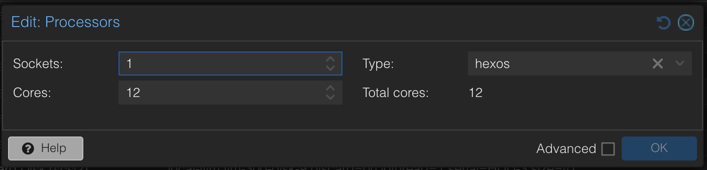
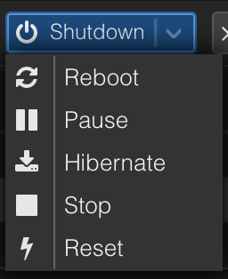

# Running HexOS on Proxmox

Many people run HexOS as a virtual machine on a Proxmox VE host. That works well for storage and apps. But if you also run **VMs on HexOS** (a Windows VM in particular), Proxmox's default settings hide a processor feature that those VMs depend on, and they can run **two to three times slower** than they need to.

The fix is a few settings on the Proxmox host. The most important one takes about five minutes and a restart of the HexOS virtual machine.

> **Info:** This page only matters if HexOS itself runs inside Proxmox **and** you run VMs on HexOS. If HexOS is installed directly on your server's hardware, none of this applies to you.
{.is-info}

## What is actually happening

When HexOS runs inside Proxmox, every VM on HexOS is a virtual machine inside a virtual machine (called *nested virtualization*). Each time the inner VM needs help from the system underneath it, the request has to pass through both HexOS and Proxmox. That round trip is much slower than on real hardware, so the fewer of them the better.

By default, Proxmox hides the processor's **invariant TSC** from the HexOS virtual machine. That is the processor's steady, always-running clock. Without it, HexOS can't give its VMs a fast way to read the time, so Windows asks the system for the time with one of those slow round trips, tens of thousands of times per second.

We measured this on a Ryzen 9 9950X with the same Windows 11 install in each case:

| Setup | Windows 11 install time |
|---|---|
| HexOS on real hardware | about 7.5 minutes |
| HexOS on Proxmox, default settings | about 25.5 minutes |
| HexOS on Proxmox, with Step 1 below | about 11 minutes |

The optional Steps 2 and 3 cut another 10% or so on top of that.

## Check whether you are affected

1. Open the TrueNAS web interface: in the [HexOS Deck](https://deck.hexos.com), open **Settings**, click the **TrueNAS** button, then click the **TrueNAS** launch button.
2. Click **System** in the left sidebar, then **Shell**.
3. Run this command:

```
cat /sys/devices/system/clocksource/clocksource0/current_clocksource
```

- If it prints `tsc`, you are already set up correctly. Skip to [Step 2](#step-2-let-the-processor-handle-interrupts-amd-only).
- If it prints `kvm-clock`, apply Step 1.

## Step 1: Expose the processor clock (recommended)

Proxmox has no checkbox for this setting, so you will create a small custom processor type once, then switch the HexOS virtual machine to it.

You will need the HexOS virtual machine's ID number (the **VM ID**). It is the number next to its name in the Proxmox sidebar, for example `100`.

### 1. Create the custom processor type

In the Proxmox web interface, select your Proxmox node (the server itself, not the virtual machine) and click **Shell**. Paste this and press `Enter`:

```
cat >> /etc/pve/virtual-guest/cpu-models.conf <<'EOF'
cpu-model: hexos
    flags +invtsc
    reported-model host

EOF
```

This creates a processor type called `hexos` that is identical to `host` (the type HexOS needs for VMs), plus the invariant clock.

### 2. Switch the HexOS virtual machine to it

In the same shell, replace `100` with your VM ID:

```
qm set 100 --cpu custom-hexos
```

You can also do this in the web interface: select the HexOS virtual machine, open **Hardware**, double-click **Processors**, and choose **hexos** as the **Type** (custom types are listed by name).

<details>
  <summary>The Processors dialog with the hexos type</summary>

{.medium .framed}

</details>

### 3. Shut down and start again

1. Shut down the HexOS virtual machine completely: click the **Shutdown** button itself, not **Reboot** or **Reset** in its menu.
2. Wait until Proxmox shows it as stopped, then click **Start**.

<details>
  <summary>The Shutdown button and its menu</summary>

{.small .framed}

</details>

> **Warning:** A restart from inside HexOS, or **Reboot** or **Reset** in Proxmox, keeps the old processor settings. The change only takes effect after a full shutdown and start.
{.is-warning}

### 4. Check it worked

Run the check command from [Check whether you are affected](#check-whether-you-are-affected) again. It should now print `tsc`.

Your VMs pick up the faster clock the next time each one is fully shut down and started.

## Step 2: Let the processor handle interrupts (AMD only)

Modern AMD processors can deliver interrupts to a virtual machine in hardware (a feature called *AVIC*), which saves more of those slow round trips. Recent Proxmox versions turn AVIC on, but it stays blocked for any virtual machine whose **OS Type** is Linux, because of how the emulated system timer is set up. The HexOS virtual machine is normally set to Linux.

This step removes the block. In the Proxmox shell, first check whether the virtual machine already has custom arguments:

```
qm config 100 | grep ^args
```

- If that prints **nothing**, run:

```
qm set 100 --args '-global kvm-pit.lost_tick_policy=discard'
```

- If it prints an `args:` line, keep what is there and add the new part to the end. For example, if it printed `args: -something`, run `qm set 100 --args '-something -global kvm-pit.lost_tick_policy=discard'`.

Then shut down and start the HexOS virtual machine again, as in Step 1.

This is the same timer setting Proxmox already uses for its own Windows virtual machines. It gave about a 3% speedup in our tests. On Intel processors the step is harmless, but we have not measured a benefit there.

## Step 3: Hide two unused processor features (optional)

HexOS switches on two processor security features that Windows VMs don't use: memory protection keys and user shadow stacks. Because the two sides differ, the processor state has to be switched on every one of those round trips. Hiding the features from HexOS removes that extra work and gave about a 7% speedup in our tests.

Edit the custom processor type from Step 1. In the Proxmox shell, run:

```
nano /etc/pve/virtual-guest/cpu-models.conf
```

Change the `flags` line of the `hexos` model to:

```
    flags +invtsc;-pku;-cet-ss;-cet-ibt
```

Save with `Ctrl+O`, `Enter`, then exit with `Ctrl+X`. Shut down and start the HexOS virtual machine again.

> **Info:** If the virtual machine refuses to start after this change, your Proxmox version is too old to know these features. Change the line back to `flags +invtsc` and start it again.
{.is-info}

## HexOS doesn't finish starting with an Intel Arc card passed through

When an Intel Arc graphics card is passed through to the HexOS virtual machine, HexOS can hang while it starts. The virtual machine shows as running in Proxmox, but the Deck never finds the server.

This happens when the virtual machine has both the Arc card and Proxmox's emulated display. HexOS tries to draw its console on a display that never answers, and startup waits there forever.

The fix has two parts. We have tested it on one server so far, with an Arc A380 on Proxmox VE 9.

### 1. Replace the emulated display with a serial terminal

In the Proxmox shell, replace `100` with your VM ID:

```
qm set 100 --serial0 socket --vga serial0
```

Shut down the HexOS virtual machine completely and start it again. The **Console** tab in Proxmox now shows a text terminal instead of a screen.

### 2. Tell HexOS not to use the Arc card as a screen

Open the TrueNAS shell as described in [Check whether you are affected](#check-whether-you-are-affected). First check whether any extra kernel options are already set:

```
midclt call system.advanced.config | jq -r .kernel_extra_options
```

- If that prints **nothing**, run:

```
midclt call system.advanced.update '{"kernel_extra_options": "i915.disable_display=1"}'
```

- If it prints options, keep them and add the new one to the end. For example, if it printed `something=1`, run `midclt call system.advanced.update '{"kernel_extra_options": "something=1 i915.disable_display=1"}'`.

Then restart HexOS.

The card still works for video transcoding in apps such as Jellyfin and Plex. Only its use as a screen is turned off.

> **Info:** If HexOS still hangs after part 1, remove the Arc card from the virtual machine's **Hardware** list, start HexOS, do part 2, shut down, then add the card back.
{.is-info}

## What doesn't make a difference

We also tested pinning a VM to specific processor cores, and reserving cores for it inside HexOS. Neither changed VM speed on an otherwise idle server.

What does matter is giving the HexOS virtual machine enough processor cores. HexOS keeps 2 cores for itself (see [What your server needs](/features/vms#what-your-server-needs)), so a HexOS virtual machine with only 4 cores leaves just 2 for your VMs.

## Common questions

**Is anything lost by exposing the invariant clock?**
Two things, neither of which most HexOS setups use. A virtual machine with this setting can't be live-migrated to another Proxmox host in a cluster, and Proxmox can't take snapshots that include its memory (the **Include RAM** option). Ordinary snapshots without memory, and backups, still work.

**Does this affect my storage or apps?**
No. These settings only change how the processor is presented to HexOS. Your pools, shares and apps are untouched.

**Does this help Linux VMs too?**
Much less. Linux reads the time in a way that doesn't need the slow round trip, so Windows benefits most. Steps 2 and 3 should still help any VM a little, though we only measured Windows.

**I use another hypervisor, not Proxmox.**
The same problem applies to any KVM-based host, such as virt-manager: the HexOS virtual machine needs the `invtsc` processor feature. We haven't written step-by-step instructions for those yet.

> **Help:** Not sure whether this applies to your setup? Ask in the [HexOS Discord Community](https://discord.gg/fCW2htvYdz) with your Proxmox version, your processor model, and the output of the check command.
{.is-troubleshooting}

> **Contribute:** to help to improve HexOS documentation [join the #Docs channel on Discord](https://discord.com/invite/DjEp3WRHKz) today! Send feedback, suggestions or contribute a guide.
{.is-contribute}
