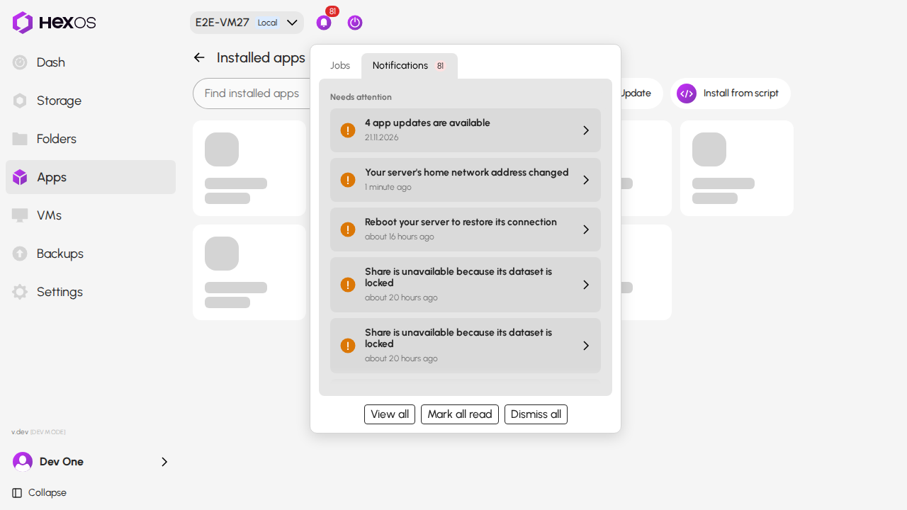
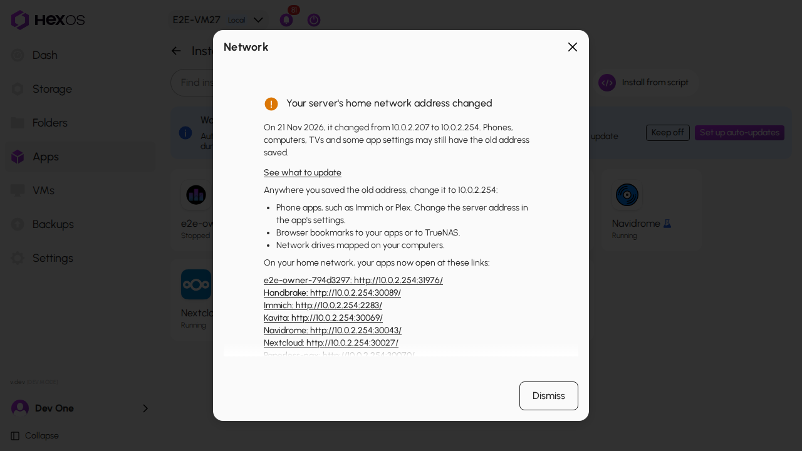

# Your server's address changed

Your server has an address on your home network, such as `192.168.1.50`. Your router gives it that address. If the address changes, your server and your apps keep working, but phones, computers and TVs that saved the old address can no longer find them.

This page shows what to update, one device at a time, and how to ask your router to keep the address the same from now on.

## When this happens

You may see one or more of these:

- The Command Deck shows the notice **Your server's home network address changed**.
- A phone app, such as Immich, stops syncing or can't connect to your server.
- A bookmark to one of your apps, or to TrueNAS, no longer opens.
- A network drive on your computer stops opening.

An address usually changes after you replace or reset your router, when your internet provider swaps your equipment, or after a change in your router's settings.

> **Info:** Your photos, files and apps are not affected. Only the address you reach them at has changed.
{.is-info}

## Find your server's new address

1. Open the Command Deck.
2. Click the bell, then click the notice **Your server's home network address changed**. It shows the old address and the new one.

The notice in the bell

{.medium .framed}

3. Click **See what to update**. Under it, each app with a web page is listed with the link it opens at now.

What to update, with each app's new link

{.medium .framed}

If you don't see the notice, see [Local access to your server](/troubleshooting/local-access) to find your server's address.

## Update what saved the old address

Change the old address to the new one wherever you saved it. In the examples below, `192.168.30.217` stands for your new address. Use the one your notice shows.

### Phone apps

Apps on your phone, such as Immich or Plex, keep the server address you typed when you set them up.

1. Open the app on your phone.
2. Sign out of the app. In Immich, click your profile picture, then click **Sign Out**.
3. On the sign-in screen, change the server address to your new address. Keep the port number at the end the same. For Immich, `http://192.168.1.2:2283` becomes `http://192.168.30.217:2283`.
4. Sign in again. The app should connect and start syncing.

### Bookmarks

1. Open each app from the notice's list, or from your installed apps in the Command Deck.
2. Save the page as a new bookmark.
3. Delete the old bookmark.

### Network drives

A folder you opened as a network drive on your computer keeps the old address.

**Windows:**

1. Open **File Explorer** and click **This PC**.
2. Right-click the old drive and click **Disconnect**.
3. Connect the folder again with the new address. See [File sharing](/troubleshooting/file-sharing) for the steps.

**macOS:**

1. In **Finder**, eject the old network folder.
2. Click **Go** > **Connect to Server**.
3. Type `smb://` and your new address, for example `smb://192.168.30.217`, and click **Connect**.

### App settings

Some apps saved your server's address inside their own settings when HexOS installed them. Plex is one. See [Apps still use your server's old address](/troubleshooting/apps-old-server-address) to update them.

## Keep the address from changing

You can ask your router to give your server the same address every time. Routers call this an **address reservation**, a **DHCP reservation** or a **static lease**.

1. Open your router's settings page in a browser. The address and password are usually on a sticker on the router.
2. Find the list of connected devices, often under **LAN**, **DHCP** or **Network**.
3. Find your server in the list. It shows your server's name and its current address.
4. Choose to reserve that address for it, and save.

Every router's screens are different. If you can't find these settings, search the web for your router's model and "DHCP reservation", or ask your internet provider.

> **Tip:** Reserve the address your server has now, so you don't need to update your devices again.
{.is-tip}

## Check that it works

Open one of your apps from the new link on your phone or computer, while connected to your home network. If it opens, everything is updated.

If an app still can't connect, make sure your phone or computer is on the same home network as your server, not a guest network.
