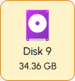
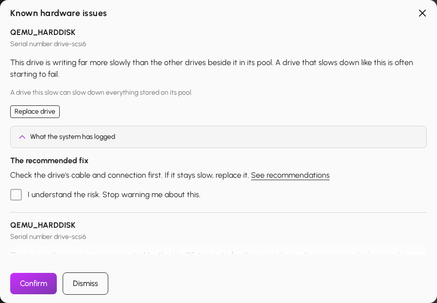
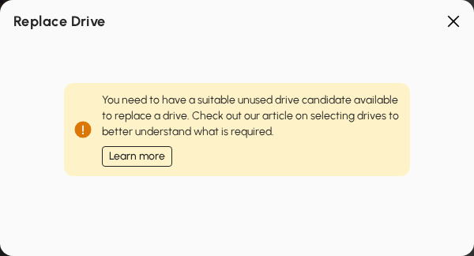

# Slow drive warning

When one drive in a pool takes much longer to write than the drives beside it, the Hardware Advisor warns you about that drive. A slow drive is often the first sign of a problem. The drive itself can be the cause. Its cable, its power connector or the port it is plugged into can be the cause too.

> **Info:** This warning is reaching testers first. If you don't see it on your server yet, nothing is wrong. It also needs **Share hardware data** turned on for your server, like every Hardware Advisor warning. See [Health & Capabilities](/features/health-and-capabilities).
{.is-info}

## Find the warning

On the **Storage** screen, open the pool and look at its drives. The slow drive's tile is marked with a warning.

 Drive tile with a warning 

{.small .framed}

Click the tile. The drive's info panel shows **This device has known issues**. Click **See details** to open the **Known hardware issues** dialog.

The dialog names the drive by its model and serial number. Where your server reports it, the dialog also names the bay the drive sits in. It says: **This drive is writing far more slowly than the other drives beside it in its pool. A drive that slows down like this is often starting to fail.** Below that it says: **A drive this slow can slow down everything stored on its pool.**

 Known hardware issues dialog for a slow drive 

{.medium .framed}

## How HexOS decides a drive is slow

Every 5 minutes, HexOS reads how many writes each pool drive finished and how long they took. From that it works out each drive's average time per write. Then it compares each drive with the other drives in the same group: the other side of a mirror, or the other drives of a RAIDZ.

A check counts as slow when both of these are true:

- The drive took at least 4 times as long per write as its partners.
- The drive took 100 ms or more per write for a hard drive, or 30 ms or more for an SSD. On a virtual machine these limits are doubled.

One slow check is not enough. HexOS shows the warning only when 6 of the drive's last 8 checks were slow, and those 8 checks fall within 6 hours.

Some checks are not counted at all, because they would not be a fair comparison:

- A check where any drive in the group wrote very little. A few writes are not enough to judge.
- A check where the drives in the group got very different amounts of work.
- A group that mixes hard drives and SSDs.
- The first check after a hard drive wakes from sleep. Spinning up makes that check slow.

Drives in the same group get the same work. If all of them are slow, that is the speed of the pool, not a fault in one drive. If one drive is much slower than the rest, that one drive needs a look.

The warning goes away by itself once a full day has passed since the last slow check, with at least 6 normal checks in that time.

## Drives HexOS does not compare

Some drives have no partner to compare with, so HexOS never gives them this warning:

- A drive in a pool with a single drive.
- A drive in a stripe, where each drive holds its own part of the data.
- Cache, log and spare drives.
- A drive in a mirror with only one drive online, or in a RAIDZ with fewer than three drives online.

HexOS also pauses the comparison for a pool while the pool is being checked (scrub), rebuilt (resilver) or expanded. It pauses too while a drive in the pool is being replaced or is offline. After any change to the drives of a pool on the server, every pool waits 15 minutes before it is compared again. Slow writes are normal then. The comparison starts again when the pool is done.

## When the whole server is busy

The technical details in the dialog can include the server's IO pressure. This is a Linux figure that shows how much of the time programs were waiting for the drives. HexOS adds it only for the pool your apps run on, or the pool that holds the system data, and only when the figure is 10% or more.

> **Info:** IO pressure is there for context only. It never decides whether a drive is slow. A busy server slows every drive in a group together, and that does not cause this warning.
{.is-info}

## What to do

1. If the dialog shows **Light up its bay**, click it and find the lit bay in your server's case.
2. Check the drive's data cable and power connector. Reseat them, or try another cable or port.
3. Look at the drive's health in its info panel. A drive that also reports errors is more likely the cause.
4. If the warning stays, replace the drive. Click **Replace drive** in the dialog.

## When the warning comes back

You can acknowledge a slow drive warning. In the dialog, click **I understand the risk. Stop warning me about this.**, then click **Confirm**. HexOS remembers what it had already seen on that drive at that moment.

The warning comes back when something new is seen on the same drive after you acknowledged it:

- The drive becomes slow again, in a new period of slow writes.
- The drive shows another problem the warning lists for the first time since you acknowledged it, such as read or write errors, timeouts, SMART errors, or the drive dropping out of the pool.

The dialog then says **This warning is back**, with what was seen and the date it was first seen. To quiet it again, click the checkbox and click **Confirm**. Acknowledging again resets what counts as new. From then on, only something seen after that moment brings the warning back.

## Find the drive and replace it

**Light up its bay** turns on the light on the drive's bay, so you can find the drive in the case. The dialog then shows **The bay light is on. It turns off by itself after 10 minutes.** To turn it off sooner, click **Turn off the bay light**.

The button shows only when your server has drive bays that TrueNAS can light. Servers without such bays do not show it, and neither do virtual machines. On TrueNAS 25.10 it never shows.

**Replace drive** opens the same **Replace Drive** dialog that the drive's tile on the **Storage** screen opens, with the same checks and warnings. It shows only when the drive can be replaced now:

- The drive is in a pool with more than one drive.
- The drive is not being rebuilt.
- A spare has not already taken the drive's place.
- The drive is not being tested.

Nothing is replaced until you confirm in that dialog. If you have no unused drive to put in its place, the dialog says so.

 Replace Drive dialog with no unused drive 

{.medium .framed}

## What HexOS never does

- HexOS never wakes a sleeping drive for this check. It only reads numbers the system already keeps.
- HexOS never runs a test on a drive for this check.
- HexOS never erases, replaces or removes a drive by itself. Only you can start a replacement.
