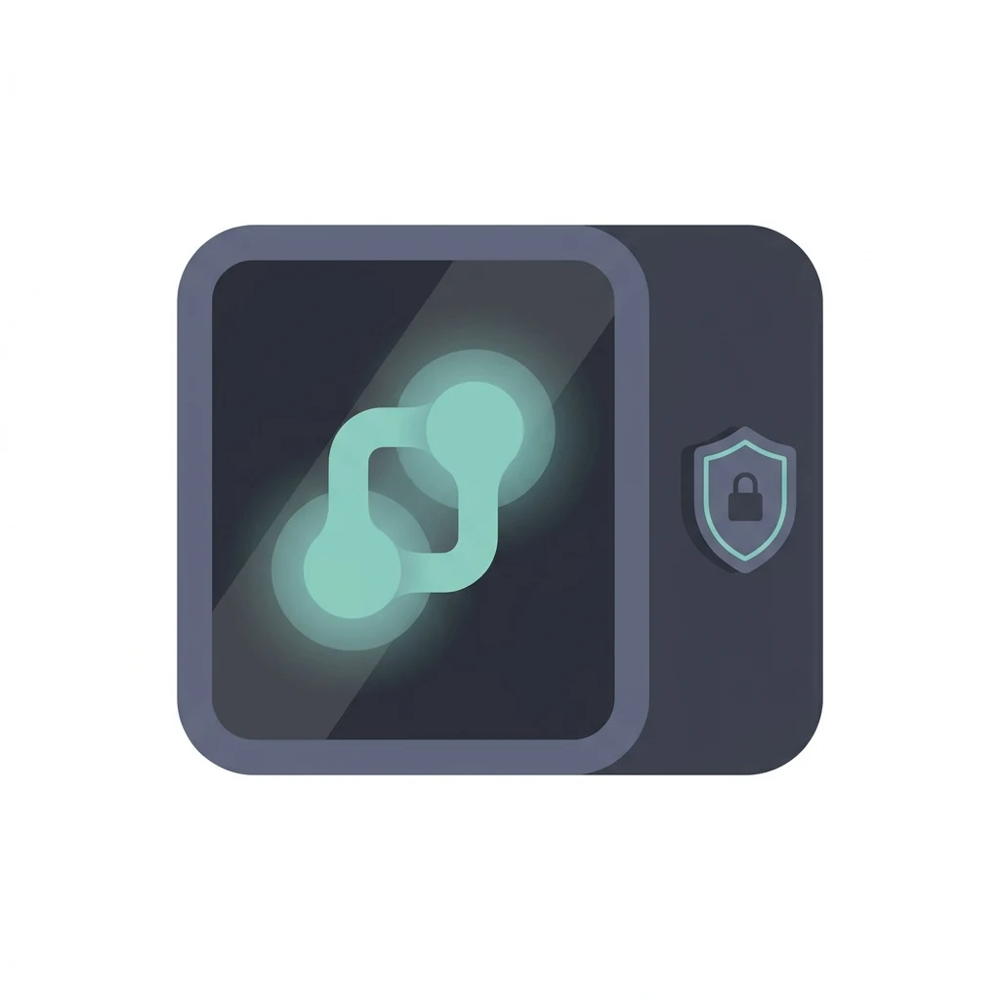
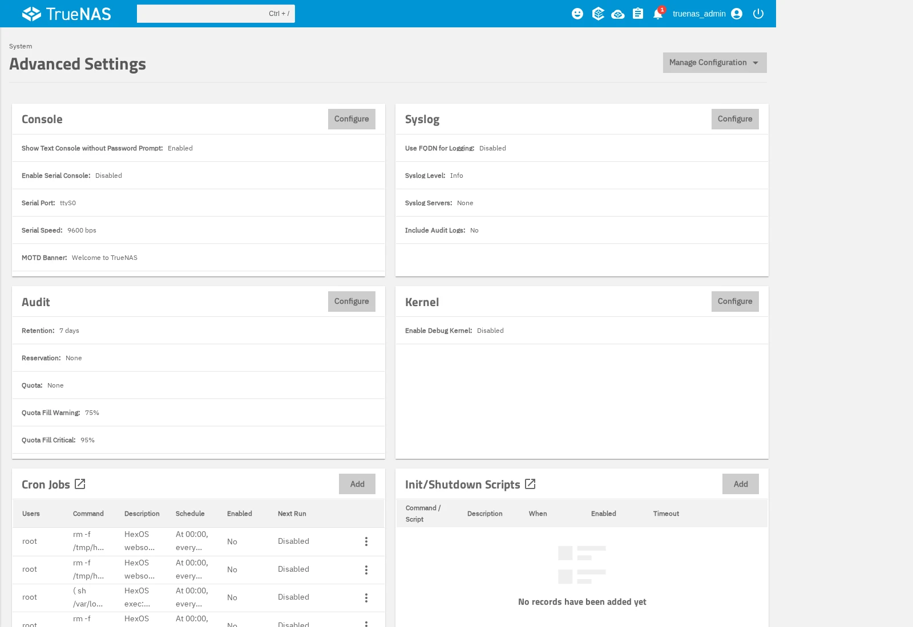
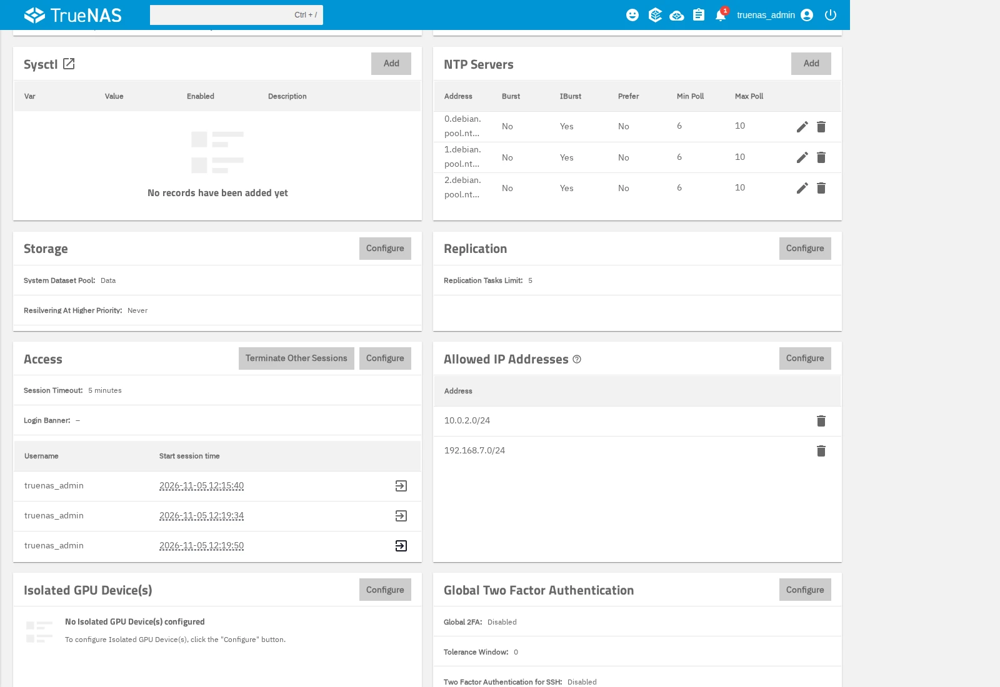
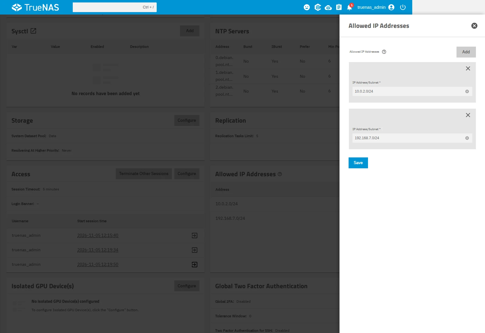
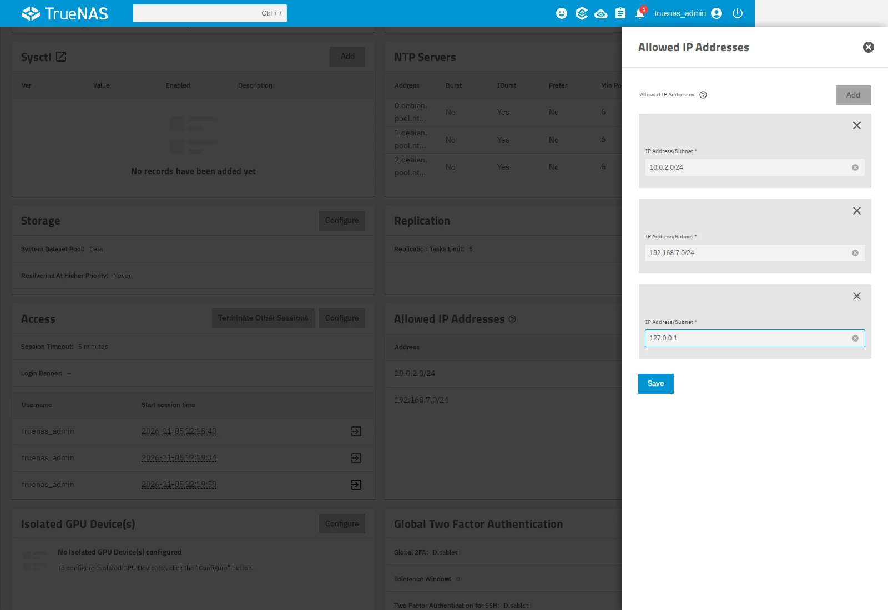
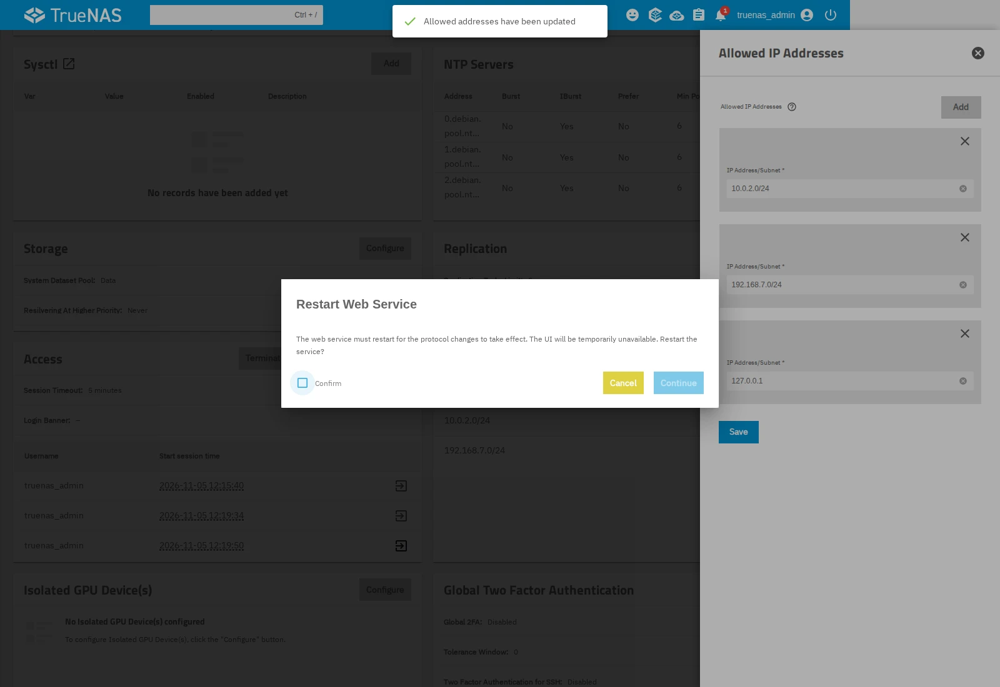
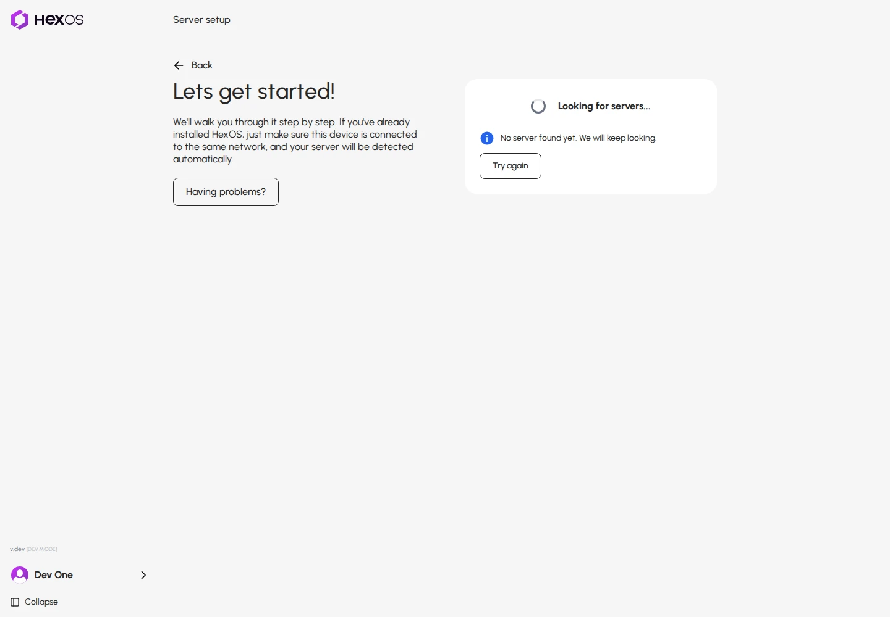

# TrueNAS access restrictions

If you restricted which addresses can access TrueNAS, that list may also block HexOS. This can prevent your server from appearing in setup, even while you can open TrueNAS in your browser.

HexOS needs a connection within your server. Its address is `127.0.0.1`, also called the local or loopback address. Allowing this address does not add another computer or network to your allowed list.

The connection stays inside your server

{.medium .framed}

These steps use TrueNAS 25.10.7. Menus may differ on other versions. You need an administrator account and access to the TrueNAS web interface. If you cannot open TrueNAS, contact HexOS support before changing access restrictions.

## Open the allowed list

Open TrueNAS at your server's local address in your browser and sign in. Click **System** > **Advanced Settings**.

Open Advanced Settings

{.medium .framed}

Find **Allowed IP Addresses** and click **Configure**. If TrueNAS displays its advanced-settings warning, read it and click **Close** to open the list.

Allowed IP Addresses

{.medium .framed}

## Check before changing anything

If the list is empty, leave it empty. An empty list does not restrict access by address, so this repair does not apply. Contact support if HexOS still cannot find your server.

If `127.0.0.1` is already allowed, do not add it again. A network entry can also include that address. If you are unsure, send support a screenshot of the list before editing it.

> **Warning:** Keep every existing entry. Do not replace the list with only `127.0.0.1`. That would block access from your computer.
{.is-warning}

An existing restricted list

{.medium .framed}

## Add the server's local address

If the list has entries but does not allow `127.0.0.1`, click **Add** and enter `127.0.0.1` in the new field. Leave all existing entries in place. The network addresses in these screenshots are examples. Keep your own addresses.

Add 127.0.0.1 alongside the existing entries

{.medium .framed}

Click **Save**. In **Restart Web Service**, click **Confirm**, then **Continue**. Your browser may briefly disconnect while TrueNAS applies the change. This restarts the web service, not the whole server.

Apply the saved list

{.medium .framed}

Saving alone does not apply the list to running connections. If you previously saved the correct list but skipped **Continue**, tell support that the saved change has not been applied. Do not add duplicate entries.

## Check HexOS again

When you can open TrueNAS again, return to the HexOS setup tab and refresh it. If your server was already added to HexOS, refresh its Command Deck page instead.

Return to server discovery

{.medium .framed}

If the server still does not appear or reconnect, send HexOS support screenshots of the saved **Allowed IP Addresses** list and the HexOS screen. Tell support whether you clicked **Continue** to restart the web service. Another connection issue may also need attention.

You do not need to reinstall HexOS, remove the server from your account, or reset TrueNAS for this change. These steps do not change your pools or app data.

## Why this helps

TrueNAS checks its allowed list when HexOS connects locally. A list that permits only your home networks can reject the server's own local connection. Adding `127.0.0.1` to that existing list allows the local connection while keeping your other address restrictions. The address rule also allows a proxy on this server that forwards connections to TrueNAS through `127.0.0.1`. Normal sign-in requirements still apply.

The setup guide is available even when HexOS cannot reach your server. Opening it does not diagnose the server or change any settings. You decide whether the steps apply and make the change in TrueNAS.
