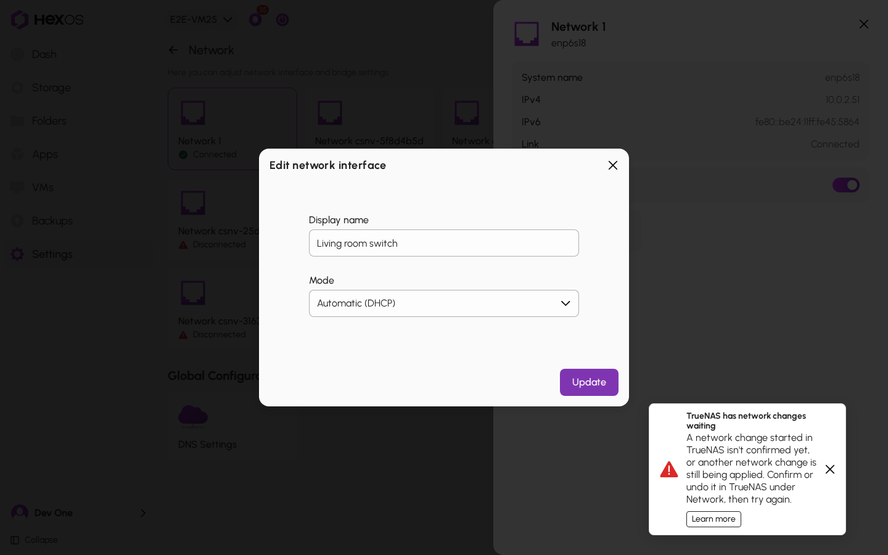
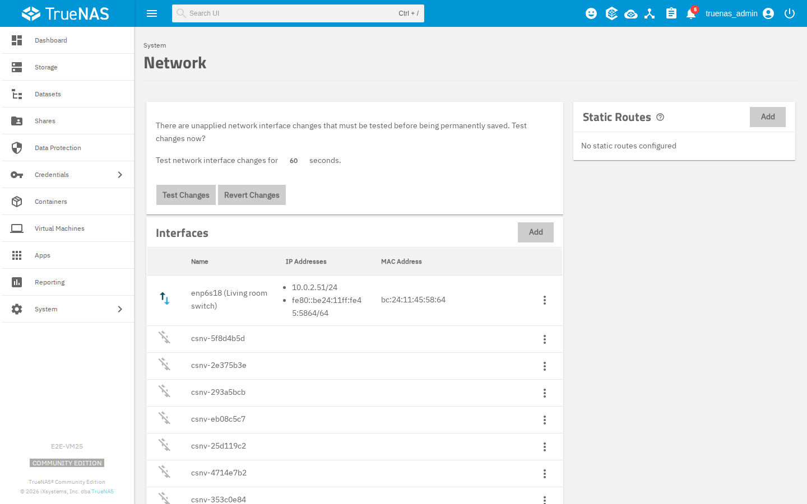
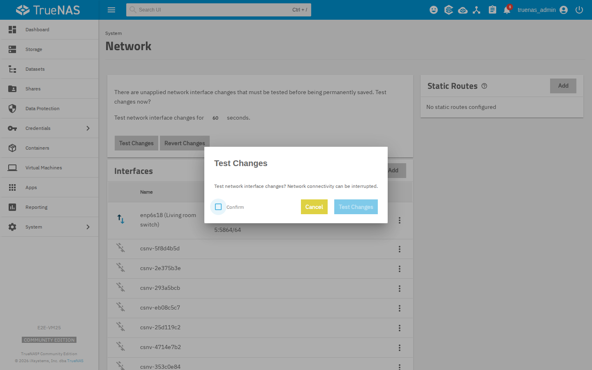
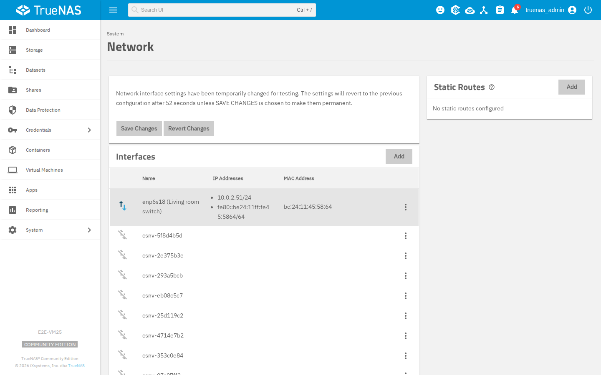

# TrueNAS has network changes waiting

When you change a network setting in the Command Deck, you might see the message **TrueNAS has network changes waiting**. This page explains what the message means and how to clear it in TrueNAS. It also covers two related messages, **Network change not confirmed** and **Network change interrupted**.

 The message in the Command Deck 

{.medium .framed}

## What the message means

HexOS runs on top of TrueNAS. When you change a network setting, TrueNAS holds the change as waiting until someone confirms it. While a change is being tested, TrueNAS undoes it by itself if nobody confirms it in time.

The message means TrueNAS already has a network change waiting. Usually it is a change someone made in TrueNAS itself and has not confirmed yet. Sometimes it is another network change from HexOS that is still being applied.

HexOS shows this message when you save the **Edit network interface** dialog or create a bridge with **Create Network Bridge** in the Command Deck. HexOS has not changed anything on your server.

## Why HexOS waits

TrueNAS keeps all waiting network changes together. When HexOS confirms its own change, TrueNAS confirms every waiting change with it.

This matters because TrueNAS undoes an unconfirmed change on purpose. If a change cuts your server off from your home network, the undo brings it back. If HexOS confirmed that change by accident, your server could stay cut off. So HexOS leaves the waiting change for you to confirm or undo in TrueNAS.

## Clear the waiting change in TrueNAS

1. Open TrueNAS at your server's local address in your browser and sign in. If you don't know the address, see [Local access to your server](/troubleshooting/local-access).
2. Click **System** > **Network**.

What you see at the top of the **Network** screen tells you which kind of change is waiting.

### The change has not been tested yet

You see the message "There are unapplied network interface changes that must be tested before being permanently saved." with the buttons **Test Changes** and **Revert Changes**.

 Unapplied changes in TrueNAS 

{.medium .framed}

A change that has not been tested stays waiting until someone tests it or reverts it. TrueNAS does not undo it by itself.

If you did not make this change, or you no longer want it, click **Revert Changes**. TrueNAS throws the change away and keeps your current settings.

> **Warning:** **Revert Changes** undoes every network change waiting in TrueNAS. If you made a change in TrueNAS on purpose, you will need to make it again.
{.is-warning}

If you want to keep the change, click **Test Changes**. TrueNAS asks you to confirm. Check the **Confirm** box, then click **Test Changes**.

 Test Changes dialog 

{.medium .framed}

TrueNAS then applies the change for a short test, as in the next section.

### The change is being tested

You see the message "Network interface settings have been temporarily changed for testing." It counts down the seconds until TrueNAS undoes the change. The buttons are **Save Changes** and **Revert Changes**.

 A change being tested in TrueNAS 

{.medium .framed}

Choose one:

- To keep the change, click **Save Changes** before the countdown ends.
- To undo the change, click **Revert Changes**.
- If you are not sure, do nothing. When the countdown ends, TrueNAS undoes the change by itself.

> **Tip:** If the TrueNAS page stops loading during the test, the change may have cut your browser off from the server. Wait for the countdown to end. TrueNAS then undoes the change, and the page loads again.
{.is-tip}

### No waiting change is shown

If the top of the **Network** screen shows no message, nothing is waiting in TrueNAS. Another network change from HexOS was probably still being applied. Wait a few minutes, then try again.

## Try your change again

When TrueNAS no longer shows a waiting change, go back to the Command Deck and make your network change again.

## Related messages

### Network change not confirmed

HexOS makes a network change, then waits until your server is back online before it confirms the change. If your server did not come back in time, HexOS does not confirm the change. TrueNAS then undoes it by itself, and your previous network settings come back.

This can happen when the new setting cut your server off from your home network or the internet. Check the setting you entered, such as the address, and try again.

### Network change interrupted

HexOS restarted while it was applying a network change, so it could not check the result. If the change was being tested, TrueNAS undoes it by itself when the countdown ends. If the restart came before the test started, the change may still be waiting in TrueNAS.

Open TrueNAS and click **System** > **Network**. Check that your network settings are the ones you expect. If a change is still waiting, follow [Clear the waiting change in TrueNAS](#clear-the-waiting-change-in-truenas). Then try your change again from the Command Deck.

> **Help:** If the message keeps coming back, ask in the [HexOS Discord Community](https://discord.gg/fCW2htvYdz).
{.is-troubleshooting}
